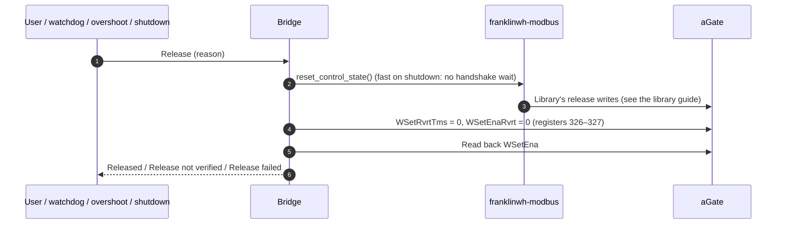

# Battery dispatch: what the bridge adds

This page covers what the bridge does around a battery command, on top of
franklinwh-modbus. The register writes themselves (SunSpec model 704: `WSetMod`,
`WSet`, `WSetPct`, `WSetEna`) and their order are the library's, and are documented
in the library's battery-dispatch sequence guide. This page links there instead of
repeating them.

Versions: bridge 0.2.41, franklinwh-modbus 0.10.1. Firmware named where it matters:
V10R01B04D00 (before 2026-10-20) and V12R02B60D00 (from 2026-10-20).

## Labels

Every step below carries one label:

| Label | Meaning |
|---|---|
| **SunSpec** | A standard SunSpec model 704 point, used as defined. |
| **FranklinWH limitation** | The aGate doesn't behave as SunSpec defines; the firmware and evidence are given. |
| **Workaround** | The bridge does something non-standard to get around a limitation, or for the user. |

Each workaround also states:

- **Approval:** *Approved* (date, where recorded), *Pending* (the #296 item), or
  *No approval found*.
- **Logged:** whether the app log records it each time it runs, and how.

## Start: Force Charge or Force Discharge

```mermaid
sequenceDiagram
    autonumber
    participant U as User (UI, HA, API, schedule)
    participant B as Bridge (command handler)
    participant L as franklinwh-modbus
    participant A as aGate
    U->>B: Force Discharge, power (W or %)
    B->>B: Battery rating trusted for this direction?
    alt not trusted
        B-->>U: Refused: reason (nothing sent)
    end
    B->>B: Work out watts (Power % → watts of the rating)
    B->>L: Set library rating = trusted rating (under the Modbus lock)
    B->>L: send_command(watts), no library timer
    L->>A: Library's start writes (see the library guide)
    A-->>L: OK or exception
    B->>A: WSetRvrtTms = duration, or 7200 s (register 327)
    B->>A: Read back WSetEna, WSetMod, WSet, WSetPct
    alt WSetEna not 1, or the write was refused
        B-->>U: Failed: reason in words
    else
        B-->>U: Sent; watchdog started
    end
```

| Step | What the bridge does | Label | Approval | Logged |
|---|---|---|---|---|
| Rating check | Refuses Force Charge/Discharge unless the battery rating for that direction is trusted. Nothing is sent. | Workaround: the aGate doesn't validate power (PICS Issue 5), and a wrong rating over- or under-dispatches (#133) | Pending: #296 items 29, 30 | Yes: WARNING "Refused Force …" and the Activity Log |
| Power % | **Turned into watts of the trusted rating** (50 % of 5000 W → 2500 W) and sent through `WSet`. `WSetPct` is not written. | Workaround: library 0.10.1 has no `WSetPct` command, and V12 refuses `WSetPct` above 10 % | **No approval found.** Added in 0.2.41 (#361); it reverses the owner's 2026-10-19 decision to send % unchanged as `WSetPct` | Partly: the result reads "50% (2500W)"; not logged as a translation |
| Watts | Clamped to the trusted rating, then sent as watts. | SunSpec (`WSet`, `WSetMod` = 1) | — | Yes: INFO "Battery command: …" |
| Library rating | Sets the library's `RATED_MAX_CHARGE_W` / `RATED_MAX_DISCHARGE_W` to the trusted rating just before the send, under the Modbus lock. | Workaround: library ≤ 0.9.5 clamped in the wrong direction after a reconnect (#230) | No approval found | No |
| No library timer | Calls `send_command` without `duration_s`; the bridge's own watchdog ends the command. | Workaround: the library's timer releases on its own thread, outside the bridge's lock and unaudited (#242) | No approval found | No |
| Revert timer | Writes `WSetRvrtTms` (register 327): the command's duration, or 7200 s if it has none. | Workaround. The code says it stops the FranklinWH app overriding a dispatch; there is no recorded evidence for that. On V12 it has no effect, because `WSetEnaRvrt` (326) is 0 | No approval found | Yes: INFO "Wrote WSetRvrtTms=…s" |
| Read-back | Reads the setpoint back; the command counts as sent only if `WSetEna` = 1. | SunSpec | — | Yes: the result and the Activity Log |

!!! warning "FranklinWH limitation: V12R02B60D00"
    `WSetPct` is accepted only from 0 to +10 % (discharge up to 500 W at a 5000 W
    rating). Every charge value, in `WSetPct` or `WSet`, is refused with Modbus
    exception 3. V10R01B04D00 accepted −100 to +100 %. Watts (`WSet`) has been tested
    on V12 only.

## While it runs

| Step | What the bridge does | Label | Approval | Logged |
|---|---|---|---|---|
| Watchdog | Every 5 s: releases at the duration, or when the target SoC is reached. | Workaround: the aGate doesn't revert when `WSetRvrtRem` reaches 0 (PICS Issue 4) | No approval found | Yes: WARNING "Watchdog expired…", INFO "Target SoC reached…" |
| Overshoot guard | After 20 s, if the battery runs above 1.25 × the request + 500 W, releases and marks the rating wrong. | Workaround (#133) | Pending: #296 item 30 | Yes: the release reason and the Activity Log |
| Outside changes | Each poll compares the setpoint with what was sent (watts within max(100 W, 2 % of the rating), or % within 2 points). Logs a dispatch the bridge didn't send, and a change under its own. | SunSpec reads | — | Yes: WARNING "battery dispatch detected that this bridge did not send…" |
| Power change | A new power while a command is active re-sends the command. | SunSpec | — | Yes |

## Release



| Step | What the bridge does | Label | Approval | Logged |
|---|---|---|---|---|
| Library release | Calls `reset_control_state()`. On shutdown it asks for no handshake wait, so a stop finishes inside the add-on's stop time. | See the library guide | — | Yes: INFO "Battery command released…" |
| Revert registers | Writes `WSetEnaRvrt` = 0 and `WSetRvrtTms` = 0 (326 [0, 0, 0]). | Workaround: only undoes the start's revert-timer write | No approval found | Yes: INFO "Cleared revert timer…" |
| Read-back | Released only if `WSetEna` reads 0. | SunSpec | — | Yes: WARNING "Battery release NOT verified…" |
| Startup | A command still marked active from before a restart or crash is released at startup, with the same revert-register write. | Workaround: crash safety | No approval found | Yes: WARNING "previous session had active command…" |

## Refused by the aGate

| Step | What the bridge does | Label | Approval | Logged |
|---|---|---|---|---|
| Wording | A Modbus exception becomes "Rejected by the aGate (Modbus exception 3: illegal data value…). The command did not run…". | SunSpec error handling (#12041: exception 3 for an unsupported value) | — | Yes: WARNING "Battery command FAILED…" |
| Schedules | A refusal is not retried for the rest of that window; one notification. A lost link is still retried. | Workaround (#323: a refused 18:00 discharge was resent 58 times) | No approval found | Yes: "dispatch refused: … not retrying this window" |
| Library text | The library's "Ensure 'SPAN Modbus' is unlocked" sentence is replaced with what is known. | Workaround | Approved: owner, 2026-10-21 (no unproven claims) | No: the message is rewritten |

## Operating mode and reserves

The mode (15507) and reserve (15508, 15509) controls stay in the UI, HA and the
scheduler.

!!! warning "FranklinWH limitation: writes don't stick"
    FranklinWH has never documented these extension registers as writable. Writes are
    acknowledged, but the value doesn't change. That has been seen on every aGate
    tested, and on V12R02B60D00 on 2026-10-21 and 2026-10-23. The controls are kept
    because a future firmware may accept them.

| Step | What the bridge does | Label | Approval | Logged |
|---|---|---|---|---|
| Mode or reserve write | Sent through the library (raw FC06, outside the write audit), then read back; a value that didn't change is reported as "Hardware ignored write". | FranklinWH limitation | Pending: #296 item 36 | Yes: the result and the Activity Log |
| Scheduler | After a mode write that didn't stick, a release-time mode write is skipped until a mode write sticks again. | Workaround | No approval found | To be checked |

## Write audit

Every SunSpec write, by the bridge or the library, is recorded as sent: register,
raw values, the aGate's reply and who asked. The bridge wraps the library's SunSpec
device `write()`. Writes the library makes on its own raw socket (15507–15509) are
not captured. See **Logs → Battery-control writes**, and the app log line
"Modbus write @<register> [<values>] -> <reply> (<who>)".

## Done in both layers

These steps are done by both the bridge and the library, and go to the owner to
decide which layer keeps them:

| Step | Bridge | Library |
|---|---|---|
| Power limit | Clamps to the trusted rating and refuses if untrusted | Clamps to `RATED_MAX_*`, with a 5000 W fallback |
| Time limit | Watchdog | `duration_s` timer (not used by the bridge) |
| Percent → watts | Power % → watts (0.2.41) | `dispatch("N%")` → watts (not used by the bridge) |
| Release | Revert registers 326–327 and read-back | Zeroes `WSet` and `WSetPct` twice, then `WSetEna` = 0 |
