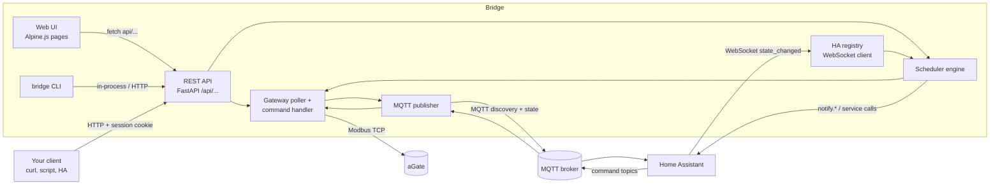

# Developer Guide

How to build on the bridge: call its REST API, read what it publishes to Home Assistant
over MQTT, feed Home Assistant entities into its scheduler, and see how its own Web UI
uses the same API.

!!! warning "Battery commands are real"
    The API writes to grid-connected battery hardware. Develop against a **demo gateway**
    (the setup wizard's demo, or Settings → Site & Gateways → **+ Add Gateway** with
    **Mock gateway** ticked), on a throwaway bridge. Never point test code at a live aGate.

## How the pieces fit



| Direction | Mechanism | Page |
|---|---|---|
| Anything → bridge | REST API, session cookie | [REST API](rest-api.md), [API reference](api-reference.md) |
| Web UI → bridge | The same REST API, from the browser | [How the Web UI uses the API](web-ui.md) |
| Bridge → Home Assistant | MQTT Discovery, retained state | [Data out: MQTT](mqtt.md) |
| Home Assistant → bridge (entities) | Home Assistant WebSocket API | [Data in: HA WebSocket](ha-websocket.md) |
| Home Assistant → bridge (commands) | MQTT command topics | [Data out: MQTT → Command topics](mqtt.md#command-topics) |
| Bridge → Home Assistant (actions, notifications) | Home Assistant REST service calls | [Data in: HA WebSocket → Outbound calls](ha-websocket.md#outbound-calls-actions-and-notifications) |
| Your automation → scheduler | Schedule entries over the REST API | [Use case: Scheduler integration](scheduler-integration.md) |

## Rules the code follows

- **The REST API is canonical.** Every feature exists as a route first. The Web UI and
  CLI are clients of it; there is no private UI-only back end.
- **The bridge wraps the `franklinwh-modbus` library** for all register I/O. It does not
  speak Modbus itself.
- **`config/environment.py` is the only place that branches** on add-on, Docker or dev.
- **Home Assistant identity is frozen** until the purge release: namespace defaults,
  device identifiers, device names, unique_ids, topics and slugs do not change. See the
  [Install lifecycle](../install-lifecycle.md) policy.

## Run a bridge to develop against

From a checkout (see [Install (Python)](../user/install-python.md)):

```bash
source venv/bin/activate
mkdir -p /tmp/bridge-dev && cd /tmp/bridge-dev     # ./data is created here
ALLOW_INSECURE_AUTH=1 ADMIN_USERNAME=admin ADMIN_PASSWORD=admin \
  uvicorn franklinwh_bridge.main:app --host 127.0.0.1 --port 8102
```

Then add a demo gateway (`POST /api/setup/demo`, below) and work against it. A dev bridge
keeps its database in `./data` under the directory you start it from, so a fresh
directory is a fresh bridge.
