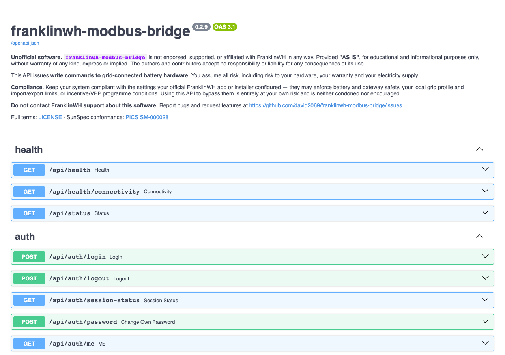
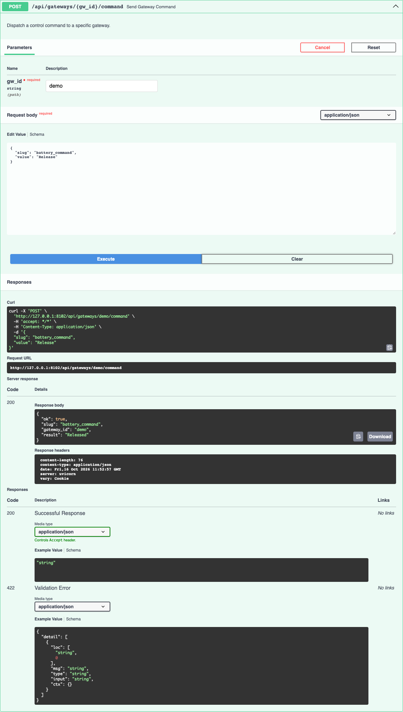

# REST API

The bridge's REST API is a FastAPI application. Everything the Web UI and the CLI do goes
through it, so anything you can do on a page you can do from a script.

## Where the API and its docs are

| URL | What | Login needed |
|---|---|---|
| `/api/...` | The API itself. | Yes, except `/api/health`, `/api/health/connectivity`, `/api/status` and `/api/auth/login` |
| `/docs` | Swagger UI: browse and try every route. | No to open it; the routes it calls still need a login |
| `/redoc` | ReDoc: the same schema as a long reference page. | No |
| `/openapi.json` | The OpenAPI 3.1 schema. | No |
| [API reference](api-reference.md) | This site's copy, grouped by tag, with the access each route enforces. | — |

Where to reach them:

| Install | Base URL |
|---|---|
| Docker | `http://<host>:8100` (the compose file maps 8100 → 8099) |
| Python / dev | `http://<host>:8099`, or the port you gave uvicorn |
| HA add-on | Through ingress the Web UI works, but **`/docs` does not**: see the note below. Publish the add-on's port **8099/tcp** (add-on → Configuration → Network) and use `http://<HA host>:8099`. |



!!! note "Swagger UI under ingress, and offline"
    FastAPI's Swagger and ReDoc pages fetch `/openapi.json` from the server root and load
    their JavaScript from `cdn.jsdelivr.net`. Under Home Assistant ingress the root is
    Home Assistant's, so the page loads with no operations. Without internet access the
    page stays blank. Use the published port, or this site's
    [API reference](api-reference.md) and [openapi.json](openapi.json).

The schema's `info.description` carries the project's legal notice, so a generated client
shows it too.

## Authentication

The API uses the **same session cookie as the Web UI**. There are no API keys or bearer
tokens. A client signs in once and sends the cookie on every request.

1. `POST /api/auth/login` with `{"username": "...", "password": "..."}` (JSON or a form).
2. The response sets a signed `session` cookie and returns the user and its capabilities.
3. Send that cookie with every call. `POST /api/auth/logout` ends the session.

| Situation | Response |
|---|---|
| No cookie, or the login was ended (logout, revoked, user disabled or expired) | **401** with `detail.reason` and `detail.reason_text` saying why |
| Signed in, but the role can't do this | **403** `admin role required`, `insufficient role` or `'control' capability required` |
| Route belongs to a feature module that is switched off | **403** `module '<id>' is disabled` |
| 5 failed sign-ins for one name and address within 15 minutes | **429** with `Retry-After` for 60 s, before the password is checked |
| Plain HTTP without `ALLOW_INSECURE_AUTH=1` | **400** `login requires HTTPS` |

`ALLOW_INSECURE_AUTH=1` is set by the shipped Docker compose file and by the add-on for its
port 8099, so sign-in works over plain HTTP on a LAN. Behind TLS, set
`SESSION_COOKIE_SECURE=1` so the cookie is only sent over HTTPS.

### Roles

Create users in [Settings → Admin → Users](../user/ui/settings-admin.md#users). Give a script its
own account.

| Role | Can read | Can write | Can command the battery | Web UI |
|---|---|---|---|---|
| `admin` | everything | everything | yes | full UI |
| `user` | everything a signed-in role can read | only routes that need `control` | yes | simple dashboard (`/user`) |
| `viewer` | everything a signed-in role can read | nothing | no | simple dashboard (`/user`) |
| `api` | everything a signed-in role can read | only routes that need `control` | yes | **none**: web pages answer *This account is for the REST API only* |

The rule in code (`api/auth.py`, `main.py`): **reads (GET) need any signed-in role**;
**writes need `admin`** unless the route declares its own gate. The battery command routes
declare the `control` capability, so `user` and `api` can use them. Creating, editing,
running or stopping **schedules is admin-only**, so a scheduler client needs an admin
account. The per-route access is listed in the [API reference](api-reference.md).

### Home Assistant ingress

On the add-on, a request that arrives through Home Assistant's ingress proxy is already
authenticated by Home Assistant. The bridge then treats it as an admin named after the
Home Assistant user, with no second login. It trusts this only when all three hold: it is
running as the add-on, the TCP peer is the Supervisor's proxy (`172.30.32.2`), and the
request carries `X-Ingress-Path`. Anything else, including the published port 8099, signs
in with a bridge account.

## Worked examples

These use `curl` with a cookie jar, against a bridge at `http://192.0.2.10:8100` with a
demo gateway called `demo`. Replace the host, the account and the gateway id with yours.

```bash
B=http://192.0.2.10:8100
```

### Sign in

```bash
curl -s -c jar.txt -H 'Content-Type: application/json' \
  -d '{"username":"hass-client","password":"<password>"}' \
  $B/api/auth/login
```

```json
{
  "user": {"id": "user_7804701d", "username": "hass-client", "role": "api", "enabled": true, "...": "..."},
  "capabilities": ["control", "view"],
  "session_id": "<session id>"
}
```

`-c jar.txt` saves the cookie; `-b jar.txt` sends it. Keep the jar private: it is a login.

### Status and live values

```bash
curl -s $B/api/status          # open: version, MQTT, gateways, poll stats
curl -s -b jar.txt $B/api/gateways                 # every gateway and its health
curl -s -b jar.txt $B/api/gateways/demo/points     # one gateway's latest sample
```

```json
{
  "gateway_id": "demo",
  "points": {"soc": 31.2, "battery_power_w": 513.6, "grid_power_w": 171.2,
             "battery_command_state": "Force Charge", "...": "..."},
  "ts": 1792150700.1,
  "quality": "ok"
}
```

In `/api/gateways/{gw_id}/…` the gateway is its **ID or its serial**: `demo` and the
demo's serial reach the same gateway. A reference no gateway has is refused with `404`
and `"No gateway has the ID or serial '…'"`. An empty one, one over 63 characters, or one
with a control character or `\` is refused with `422` and what is wrong with it. Each
refusal is logged in the bridge's log (Logs tab), with the user. A gateway that exists but
is stopped still answers `404 … not running` on routes that need it polling.

`GET /api/points?gateway=<ID or serial>` is the same for the gateway it names.

**Every route names its gateway.** No route falls back to the gateway with ID `default`
(#296 item 43). Routes outside `/api/gateways/{gw_id}/…` take the gateway as
`?gateway=` (points, battery limits, sensors, condition tests, point history, energy,
tariff and solar), `?gateway_id=` (gateway address and test, SunSpec models, catalog,
export, model read and refresh) or a `"gateway_id"` body field (`/api/command`,
`/api/sequence/execute`, which also takes `"all"`, and `/api/reader/run`). A request that
names none gets `400` and *"This request names no gateway: add …"*; a malformed one `422`
and an unknown one `404`, as above. Each refusal is logged with the user.

### Send a battery command

Commands are `{slug, value}` pairs posted to `POST /api/gateways/{gw_id}/command`. The
staging slugs only store a value for the next command; `battery_command` sends it.

```bash
cmd() { curl -s -b jar.txt -H 'Content-Type: application/json' \
          -d "{\"slug\":\"$1\",\"value\":\"$2\"}" $B/api/gateways/demo/command; echo; }

cmd battery_command_power 2000        # {"ok":true,...,"result":"Staged power 2000 W"}
cmd battery_command_duration 600      # {"ok":true,...,"result":"Staged duration 600 s"}
cmd battery_command "Force Charge"    # {"ok":true,...,"result":"Simulated charge 2000 W (mock gateway)"}
cmd battery_command Release           # {"ok":true,...,"result":"Released"}
```

Always check `ok`. A refused command answers HTTP 200 with `"ok": false` and the reason in
`result`, for example *Refused Force Charge: … Calibrate it* when the battery rating isn't
trusted. An unknown slug is refused, not ignored.

| Slug | Value | Effect |
|---|---|---|
| `battery_command` | `Force Charge`, `Force Discharge`, `Force Standby`, `Release` (also `Not Active`, `Stop`) | Sends the command now. Release ends it. |
| `battery_command_power` | watts, 0 = the full trusted rating | Staged. Re-sends a running command at the new power. |
| `battery_command_duration` | seconds, 0–7200, 0 = no limit | Staged. |
| `battery_command_target_soc` | 0–100 %, 0 = off | Staged. Ends the command at that SoC. |
| `operating_mode` | `Emergency Backup`, `Self-Consumption`, `TOU` (or `Time of Use`) | Writes the aGate's mode now. |
| `self_reserve_pct`, `tou_reserve_pct` | 0–100 | Writes that mode's reserve now. |
| `battery_command_power_pct` | — | Removed in 0.2.8: refused unless sent by a schedule saved before then. |

`POST /api/command` takes the same body plus `"gateway_id"` (ID or serial), which is
required. It is kept for older clients.

What the commands do to the aGate, and why to leave its mode alone, is in
[Battery dispatch: best practice](../user/battery-dispatch-best-practice.md).

### Try it in Swagger UI

Sign in to the Web UI in the same browser first: Swagger UI's **Try it out** sends the
browser's session cookie. It also prints the equivalent `curl` command.



## Regenerating the reference

The [API reference](api-reference.md) and [openapi.json](openapi.json) are generated from
the code, in-process, with no running bridge:

```bash
source venv/bin/activate
python docs/dev/_gen_api_reference.py
mkdocs build --strict
```

The script imports `franklinwh_bridge.main:app`, writes `app.openapi()` to
`docs/dev/openapi.json`, and renders `docs/dev/api-reference.md`: one section per OpenAPI
tag, a table per section, then each operation with its docstring, parameters and request
fields. The **Access** column is read from each route's dependencies, so it follows the
code. It needs no MkDocs plugin and no extra dependency. Run it after any route change and
commit both files.
