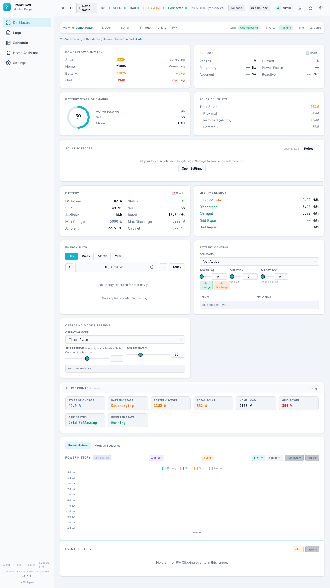

# FranklinWH Modbus Bridge

Run your FranklinWH aGate from Home Assistant over your local network.

The bridge talks to the aGate over **Modbus TCP**. It shows live power, battery and grid data on its own dashboards, runs **schedules** (force charge or discharge, reserves and modes, with conditions such as SoC, spot price or weather), and publishes everything to Home Assistant as **MQTT entities**.

!!! warning "Unofficial software"
    This project is **not affiliated with or endorsed by FranklinWH**. It issues
    **write commands to grid-connected battery hardware**: used wrongly, it can
    discharge your battery when you need it or import power you didn't intend
    to. Keep your system within the settings your installer configured and your
    grid and VPP obligations. **Don't contact FranklinWH support about it.**
    Report problems on [GitHub](https://github.com/david2069/franklinwh-modbus-bridge/issues).

## Start here

| I want to… | Go to |
|---|---|
| Install it in Home Assistant | [Install (HA add-on)](user/install-addon.md) |
| Run it without Home Assistant | [Install (Docker)](user/install-docker.md) |
| Run it from source, or develop it | [Install (Python)](user/install-python.md) |
| Connect my aGate, or try a demo | [First run & setup wizard](user/setup-wizard.md) |
| Learn every screen and setting | [Dashboards & Settings](user/ui/index.md) |
| Automate charge and discharge | [Scheduler](user/scheduler/index.md) |
| Set up my utility, meter and tariff | [Guide: utility, meter & tariff](user/ui/guide-utility-tariffs.md) |
| Add a solar forecast and weather | [Guide: location & weather](user/ui/guide-location-weather.md) |
| Fix or remove HA entities | [Fixing, moving and removing entities](user/home-assistant-entities.md) |

## What you need

- A FranklinWH **aGate** with **Modbus TCP enabled**. That's an installer setting; the bridge can't turn it on.
- The aGate's IP address, reachable from the machine that runs the bridge.
- For Home Assistant entities: an **MQTT broker**. The Mosquitto add-on is the usual choice.

!!! note "One Modbus client per aGate"
    The aGate's Modbus port serves one client at a time. Don't run two bridges, or
    the bridge and another Modbus tool, against the same aGate. The symptoms are
    dropped connections, "unreachable" flapping and corrupt readings.

## Battery power rating

Force charge and discharge are sized against the battery's **power rating**.
FranklinWH doesn't report the battery model or count over Modbus, so since
0.2.8 a force command is only sent once the rating is **trusted**. That means
either the bridge has seen your battery run at the aGate's rating, or you have
**calibrated** it. See
[Settings: Site & Gateways → Battery power rating](user/ui/settings-site-gateways.md).
