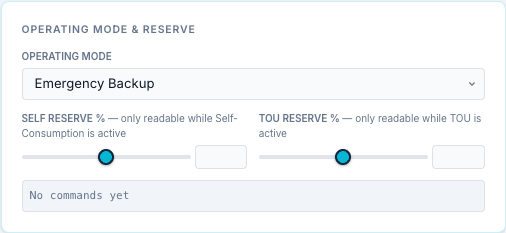
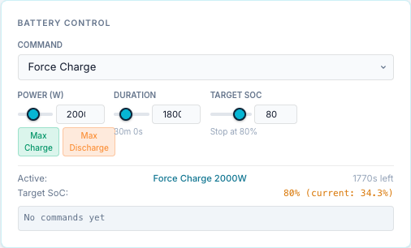
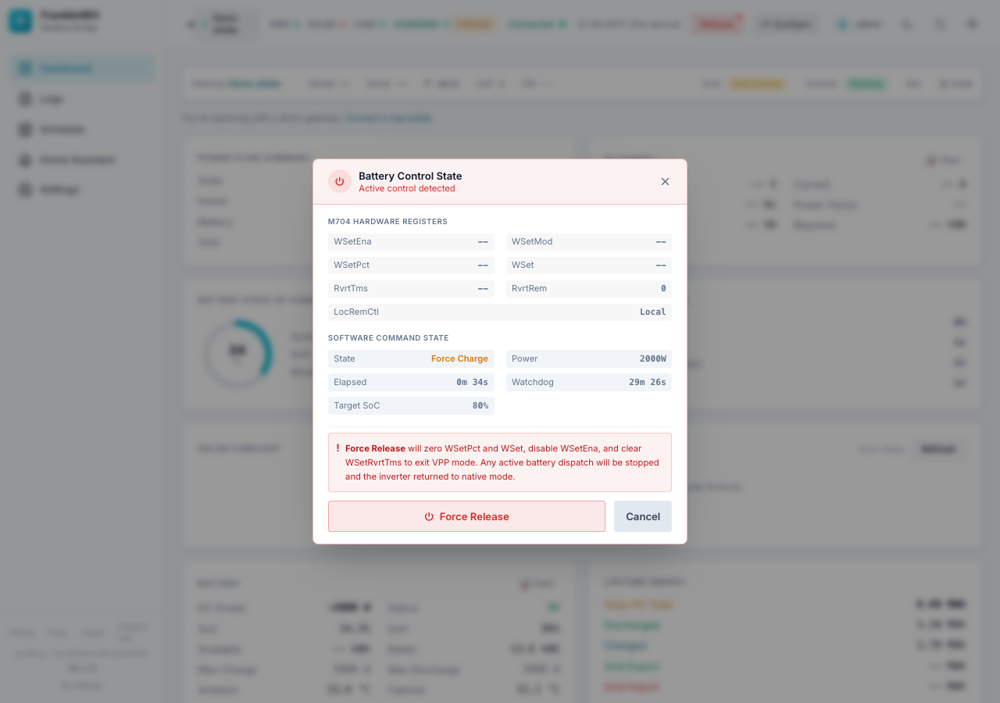

# Battery dispatch via the UI or Scheduler: best practice

How to run your battery with the bridge without fighting the aGate or the FranklinWH app.

| Do | Why |
|---|---|
| **Leave the aGate in its default mode: Self-Consumption or Emergency Backup.** | That is what the aGate does whenever the bridge isn't commanding it. |
| **Use the bridge's Scheduler instead of the app's Time-of-Use (TOU).** | One planner for the battery. TOU in the app and schedules in the bridge would both try to drive it. |
| **Expect "VPP Mode" in the FranklinWH app while the bridge is in control.** | It's normal: the bridge holds the battery through the aGate's remote-control (VPP) setpoint. |
| **Release from the bridge** when you want control back. | The app can't override the bridge while it holds the battery. |

## 1. Leave the aGate in its default mode

Pick **Self-Consumption** (use solar and battery for the house first) or **Emergency
Backup** (keep the battery full for outages), in the FranklinWH app or on the bridge's
**Operating Mode & Reserve** card, and leave it there.

A force command from the bridge (Force Charge, Force Discharge, Force Standby) overrides
whatever mode is set while it runs. When the command ends, the aGate goes back to that
mode by itself. With a stable default mode underneath, "between commands" is always
predictable.

## 2. Use the Scheduler instead of Time-of-Use

The FranklinWH app's **Time-of-Use** mode is the aGate's own timetable. Don't combine it
with bridge schedules: the aGate's TOU plan and the bridge's commands would both act on
the same battery, and what happens between the bridge's windows would depend on the TOU
plan rather than on your schedules.

Do your time-of-use planning in the bridge's [Scheduler](scheduler/index.md) instead. It
does what TOU does and more:

| TOU in the app | Bridge Scheduler |
|---|---|
| Fixed charge and discharge periods | Windows, daily / weekly / monthly / cron triggers |
| Clock only | Conditions on SoC, spot and tariff prices, solar forecast, weather, Home Assistant entities |
| — | Exit conditions, a time limit and a target SoC per run |
| — | Verification that the battery actually moved, retries, and [failure alerts to your phone](ha-setup.md#failure-alerts-scheduler-notifications-you-dont-write) |

Worked examples: [Scheduler → Examples](scheduler/examples.md).

## 3. "VPP Mode" in the FranklinWH app is normal

When the bridge sends a force command it writes the aGate's remote-control power
setpoint (SunSpec *WSet*). The aGate treats that as a virtual power plant (VPP) dispatch,
so the **FranklinWH app shows "VPP Mode"** for as long as the setpoint holds.

- This is expected. It doesn't mean the aGate has joined a VPP programme.
- **While it holds you can't override it from the app.** Changing the mode in the app
  doesn't end it.
- The bridge shows the same state: the **Release** button in the top bar has a red dot,
  and the Battery Control card shows the active command.

## 4. Release control from the bridge

Any of these hands the battery back to the aGate's own mode. The app leaves VPP Mode once
the aGate has dropped the setpoint.

| Where | How |
|---|---|
| **Top bar → Release** | Click **Release** (red dot = active control). The *Battery Control State* dialog shows the aGate's control registers and the bridge's command. Click **Force Release**. |
| **Dashboard → Battery Control** | Set **Command** to **Release** (or *Not Active*). It is sent at once. |
| **Schedule** | On an active entry, **■ Stop** ends that run. |
| **Simple dashboard** (`/user`) | **Stop**. |
| **Home Assistant** | Set the bridge's *Battery Command* select to *Release*. |

The dialog says what **Force Release** does: it zeroes *WSetPct* and *WSet*, disables
*WSetEna* and clears *WSetRvrtTms* to exit VPP mode. Any active battery dispatch stops and
the inverter returns to its own mode. When it worked, a toast says *Control released —
battery returned to native mode*, and the dialog shows *No Active Control*.

Releasing a **scheduled** run ends it for the rest of that window: the entry doesn't
re-fire until its next window. Disable the entry to stop it for good.

## Keep commands bounded

- Give manual commands a **Duration** or a **Target SoC** on the Battery Control card. With
  both at 0, a command runs until something releases it.
- Give scheduled force commands a window end or a duration. An exit condition can only end
  a run earlier, never later.
- A graceful bridge restart releases active commands, and a bridge that starts up releases
  a command it finds still active. After a crash or power cut the setpoint stays on the
  aGate until the bridge is back. See [Exit, release and conflicts](scheduler/exit-and-conflicts.md#bridge-restart).
- Let one thing own the battery: the bridge's schedules, **or** a Home Assistant
  automation, **or** the app. Not two at once.

Who can send commands: `admin`, `user` and `api` accounts; a `viewer` can't. See
[Battery controls](ui/controls.md).
