# Home Assistant setup: instance and notifications

This guide connects the bridge to a Home Assistant so that:

- your **schedules can use Home Assistant entities** as conditions (for example "only
  while away mode is on"), and
- the bridge can **send notifications** to your phone or to Home Assistant, from a
  schedule and when a scheduled battery command fails.

It is the *reading* direction. Publishing the bridge's own entities **to** Home Assistant
is MQTT, covered in [Settings → Home Assistant](ui/settings-home-assistant.md).

| Step | Where |
|---|---|
| 1. Create a long-lived access token | Home Assistant |
| 2. Add the instance and test it | Bridge: Settings → Home Assistant |
| 3. Expose the entities your schedules need | Bridge: Home Assistant page |
| 4. Add a notification device | Home Assistant (Companion app) |
| 5. Send notifications from a schedule | Bridge: Schedule |
| 6. Try it: an away-mode alert | Both |

!!! tip "On the Home Assistant add-on, skip steps 1 and 2"
    The add-on adds the Home Assistant it runs in by itself (shown as **auto**). Its
    entities, notify services and token come through the Supervisor. You need steps 1 and
    2 only for **another** Home Assistant, or when the bridge runs in Docker or Python.

## Step 1: Create a token in Home Assistant

1. In Home Assistant, click your name at the bottom of the sidebar, then the **Security**
   tab.
2. Scroll to **Long-lived access tokens** and click **Create token**.

    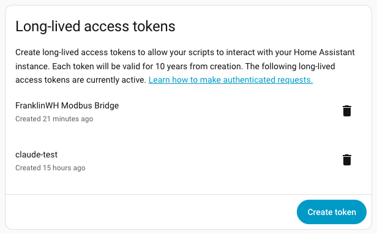

3. Name it after the bridge, for example *FranklinWH Modbus Bridge*, and click
   **Create token**.

    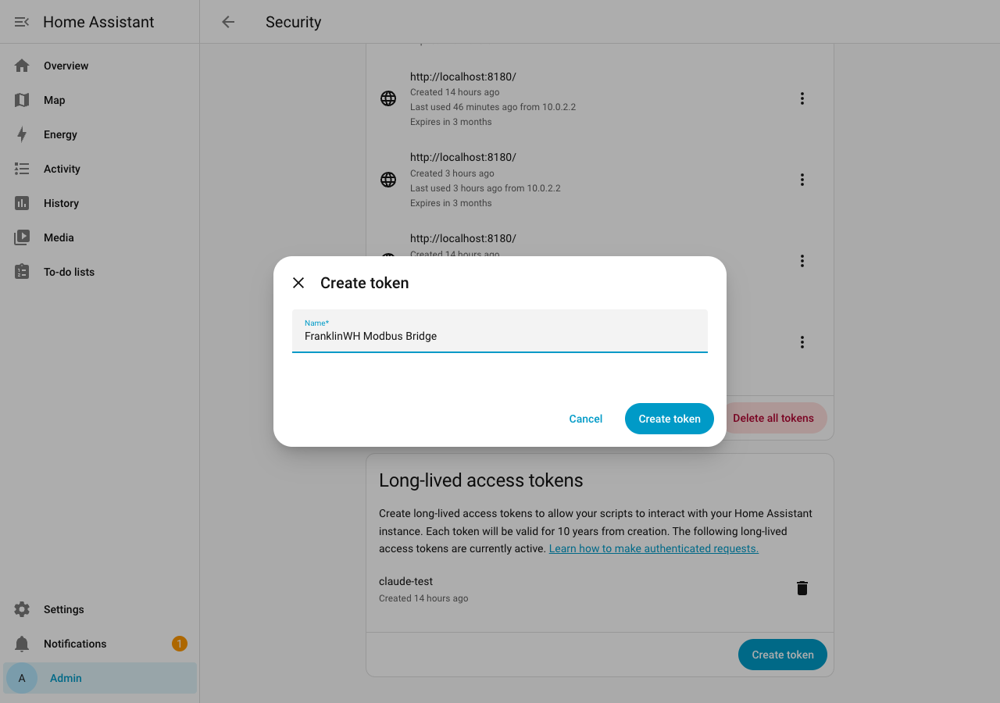

4. **Copy the token now.** Home Assistant shows it once. (It is blurred here.)

    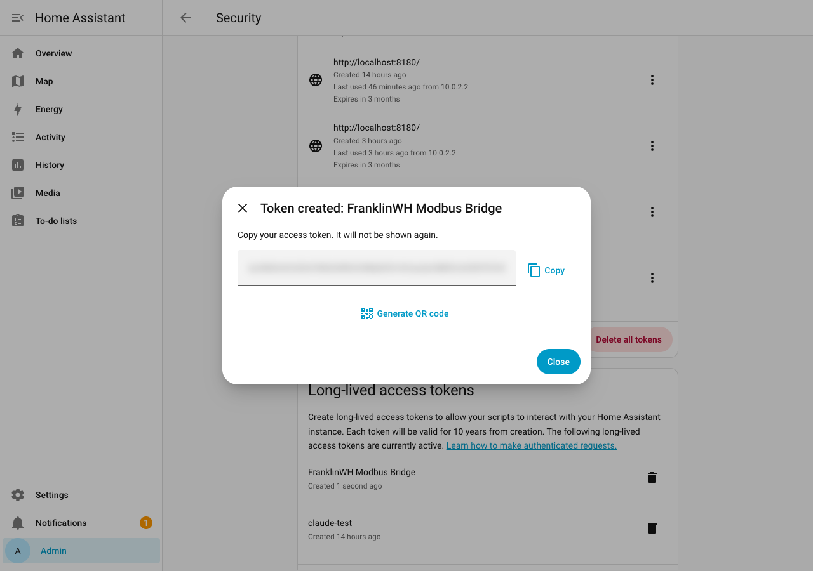

The token acts as you. To limit what the bridge can do, create a separate, non-admin Home
Assistant user for it and create the token while signed in as that user.

## Step 2: Add the instance in the bridge

Open **Settings → Home Assistant** (`?tab=settings&section=home-assistant`), find the
**Home Assistant** card (*entity access*) and click **+ Add Home Assistant**.

| Field | What to enter |
|---|---|
| Name | A short label, for example *Home*. It appears in sensor names: *Home: Away mode*. |
| Base URL | Home Assistant's address **as the bridge sees it**, for example `http://192.0.2.20:8123` or `http://homeassistant.local:8123`. In Docker, `localhost` is the bridge's own container, not Home Assistant. |
| Long-Lived Access Token | The token from step 1. |
| Default | Tick for your main Home Assistant. Used for *Use Home Assistant's location* and the dashboard card. |
| Enabled | Leave ticked. |

Click **Test Connection**. *Connected — N entities* means the URL and token work. Then
**Save**.

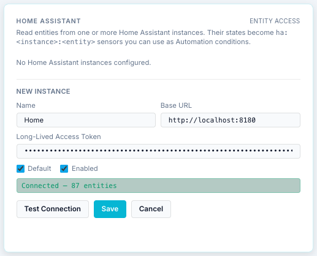

The card now lists the instance:

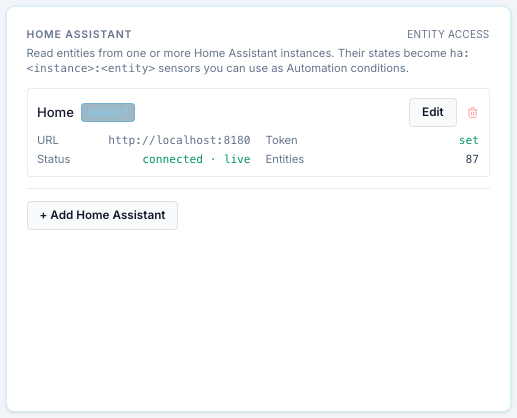

| Status | Meaning |
|---|---|
| **connected · live** | Subscribed to Home Assistant's WebSocket. Changes arrive within a second. |
| **connected · poll** | Reached over REST, the live connection isn't up yet. It retries by itself (1 s, rising to every 30 s). |
| **offline** + an error | Can't reach it, or the token was refused (*401*, *auth_invalid*). Check the URL from the bridge's machine and create a new token. |

The token is never shown again in the bridge. To replace it, **Edit**, paste the new one
and **Save**. Leaving the field empty keeps the stored token.

## Step 3: Expose the entities your schedules need

Open the **Home Assistant** page, search for the entity and turn on **Expose**.

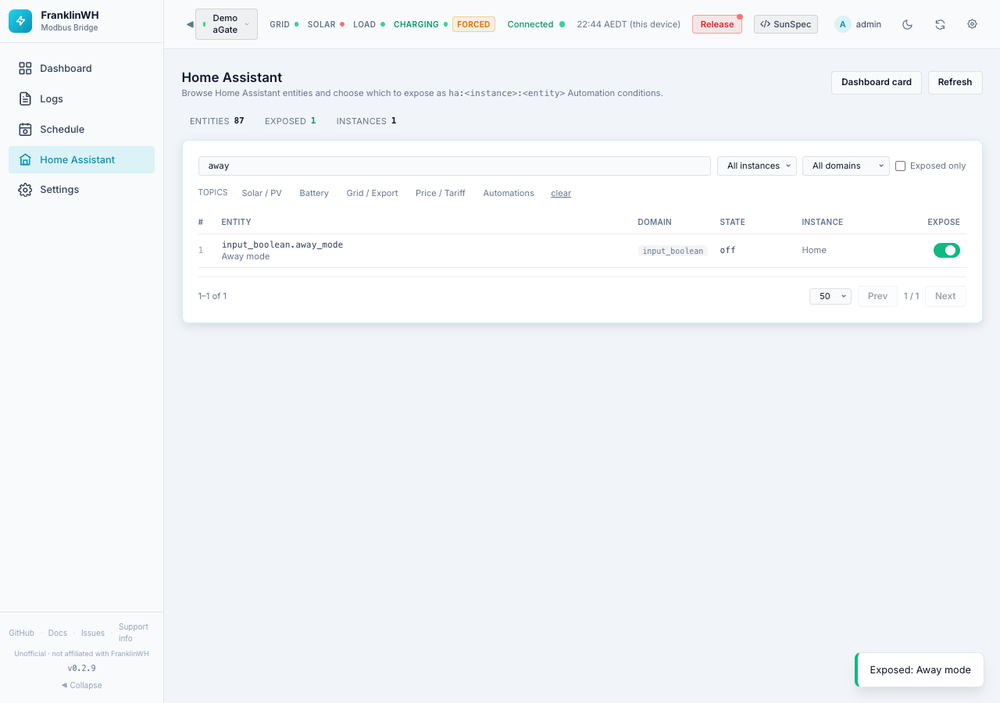

An exposed entity becomes a condition sensor named *&lt;instance&gt;: &lt;friendly
name&gt;*, for example **Home: Away mode**, in the Schedule's condition picker. Exposing
changes nothing in Home Assistant.

| Home Assistant state | Compare with |
|---|---|
| a number | a number |
| `on` / `off` (also `home`/`away`, `open`/`closed`) | `1` / `0` |
| other text, such as an option of a select | that text |
| `unavailable` or `unknown` | nothing: the condition is false, so the schedule doesn't act |

!!! note "Expose at least one controllable entity before adding notifications"
    In 0.2.9 the **+ add action** link in a schedule's *HA Actions* only appears when at
    least one **controllable** entity is exposed (a switch, light, select, number, button,
    scene, script, or an `input_boolean` / `input_select` / `input_number` helper), even
    if you only want a **Notify** action. If you have none to expose, create a helper in
    Home Assistant (Settings → Devices & services → Helpers → **Toggle**) and expose it.
    The away-mode toggle in step 6 does both jobs.

## Step 4: Add a notification device

The bridge sends notifications through Home Assistant's **notify** services. Each
notification device or method in Home Assistant is one service, and the bridge can use any
of them.

**A phone (recommended).** Install the **Home Assistant Companion app** on the phone
(iOS or Android) and sign in to your Home Assistant. Home Assistant adds the phone under
**Settings → Devices & services → Mobile App** and creates a service named
`notify.mobile_app_<phone name>`.

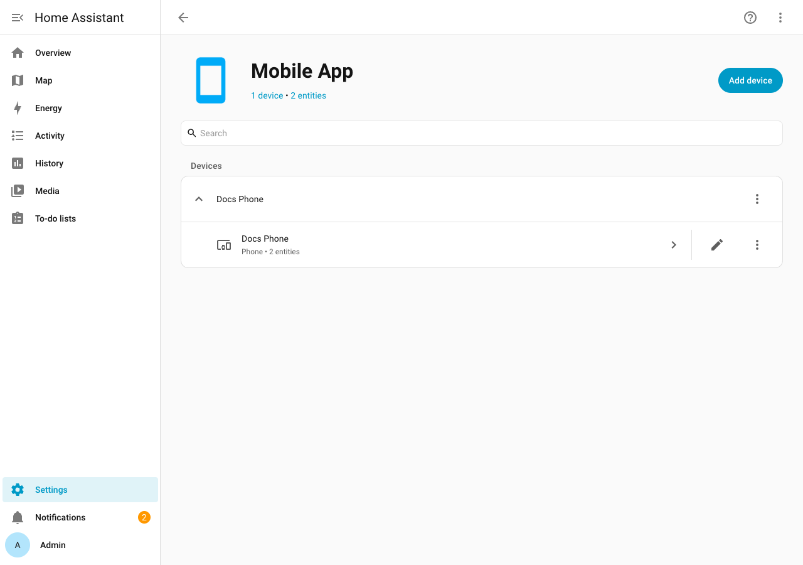

Allow notifications for the app on the phone, or nothing will appear on it.

Other targets that work:

| Target | Where it shows |
|---|---|
| `persistent_notification` | Home Assistant's own **Notifications** panel (bell, bottom of the sidebar). Built in; good for testing. |
| `notify` | Home Assistant's default notifier, if your configuration defines one. |
| a notify group, Telegram, e-mail … | Wherever that integration sends it. Any service in the `notify` domain is listed. |

!!! warning "Don't pick `send_message`"
    Home Assistant also lists `send_message`. It needs a notify **entity**, which the
    bridge doesn't send, so it always fails (*400 Bad Request* in the Activity Log). Pick
    a named service such as `mobile_app_<phone>`.

## Step 5: Send notifications from a schedule

Notifications are **actions on a schedule entry**. There is no separate "notifications"
setting: an entry notifies only if it has a Notify action.

Open **Schedule**, create or edit an entry, and under **HA Actions** click
**+ add action**:

| Field | What to choose |
|---|---|
| Kind | **Notify** |
| When | **on fire** (when the entry starts), **on exit** (when its run ends) or **entry & exit** |
| Notify target | `mobile_app_<phone> (Home)` and so on. The list is read from Home Assistant when the Schedule page opens: reload the page after adding a phone. |
| Title | Optional. |
| Message | Required. `%sensor.id%` inserts a live value, for example `%battery.soc_pct%`. |
| + guard | Optional: send only if a condition is true at that moment. |

Add one row per target to notify several devices. The details are in
[Scheduler → Actions → Home Assistant actions](scheduler/actions.md#home-assistant-actions).

### Failure alerts: scheduler notifications you don't write

Once an entry has **any** Notify action, the bridge also sends **its own alerts** about
that entry's battery command to **every** notify target on the entry. They come with the
title *FranklinWH bridge*:

| Message starts with | When |
|---|---|
| `FAILED: <entry> — <reason>. Retrying.` | The first failed attempt in a window, including a **refused** command (for example *Refused Force Charge: … Calibrate it*). The bridge retries after 15 s, 30 s, then every 60 s. |
| `FAILED: <entry> — window ended without a successful dispatch` | The window closed and no attempt succeeded. |
| `FAILED: <entry> — setpoint lost 3 times` | The aGate kept dropping the setpoint; the bridge stops re-sending for this window. |
| `NOT EFFECTIVE: <entry> — battery at … W` | The battery wasn't moving the commanded way even after a re-send. |
| `Recovered: <entry> dispatched after N failed attempt(s)` | A retry succeeded. |

So to be told when a schedule fails, give it a Notify action, even one that only runs
**on exit**. An entry without one logs *skipped — no notify target on this entry* in the
Activity Log instead.

Nothing else sends notifications in 0.2.9: not manual commands from the Dashboard, not a
gateway going offline, not a bridge restart.

## Step 6: Try it: an away-mode alert

A notification-only entry: while the **Away mode** toggle in Home Assistant is on, send a
reminder with the battery's state, once an hour.

1. In Home Assistant, create a **Toggle** helper named *Away mode*
   (`input_boolean.away_mode`). Expose it in the bridge (step 3).
2. In the bridge, **Schedule → + Add Entry**:

    | Field | Value |
    |---|---|
    | Name | Away mode alert |
    | Trigger Type | Every N minutes, every **60** |
    | Action | No battery action (HA only) |
    | Entry conditions | **Home: Away mode** `==` `1` |
    | HA Actions | Notify, on fire, `mobile_app_<phone>`, title *Away mode*, message `Away mode is on. Battery at %battery.soc_pct%%, mode %mode.name%.` |

    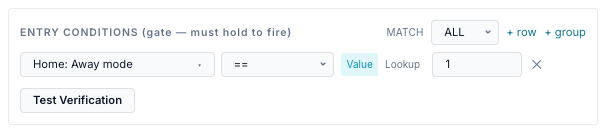

    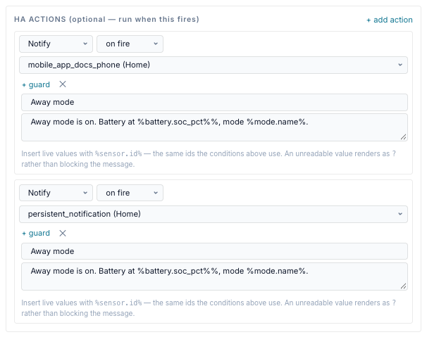

    (`%%` after a placeholder prints a literal `%`.) This example also notifies
    `persistent_notification`, so the message shows in Home Assistant too.

3. Turn **Away mode** on in Home Assistant. At the next fire time the entry passes its
   gate and sends. The Activity Log shows each send as **ha action**, and **gated** while
   the toggle was off:

    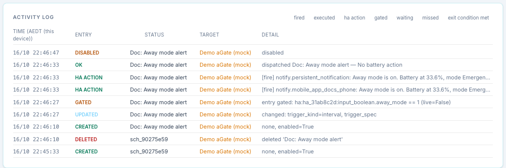

    And in Home Assistant's notification panel:

    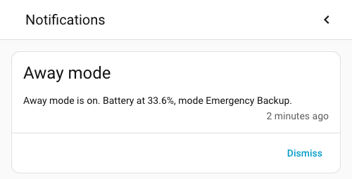

To test sooner, set the interval to 1 minute, then put it back.

## If it doesn't work

| Symptom | Likely cause |
|---|---|
| Test Connection: *401* or *auth_invalid* | Wrong or deleted token. Create a new one. |
| Test Connection: connection refused or timeout | The URL isn't reachable **from the bridge**. In Docker use the host's LAN address, not `localhost`. |
| No **+ add action** link | No controllable entity is exposed (see the note in step 3). |
| Notify target list empty | The instance is offline, or Home Assistant has no notify services. Reload the Schedule page. |
| Activity Log: *failed* with *400 Bad Request* | The target is `send_message`. Pick a named service. |
| Activity Log: *failed* with *404* | The phone was removed or renamed in Home Assistant. Pick the target again. |
| Activity Log: *ha action*, but nothing on the phone | Home Assistant accepted it; check the Companion app's notification permission on the phone. |
| Activity Log: *skipped — no notify target on this entry* | A failure alert for an entry without a Notify action. Add one. |
| The condition never passes | The entity is `unavailable`, or you compared `on` with `true`: compare with `1`. Use **Test Verification** in the entry form. |

Related: [Home Assistant page](ui/home-assistant-page.md),
[Scheduler → Conditions](scheduler/conditions.md),
[Developer Guide → Data in: HA WebSocket](../dev/ha-websocket.md).
