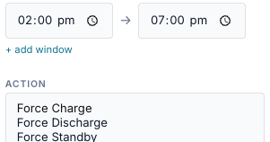
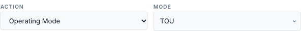
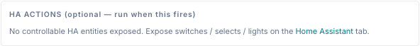

# Actions

The action is what an entry does when it fires. Each entry has exactly one **battery
action** (or *No battery action*) plus any number of **Home Assistant actions**.



## Summary

| Action (UI) | API `action` | Parameters | Kind | What the bridge writes |
|---|---|---|---|---|
| Force Charge | `force_charge` | Power (W) | sustained | a WSet charge setpoint (Model 704) and the revert timer |
| Force Discharge | `force_discharge` | Power (W) | sustained | a WSet discharge setpoint and the revert timer |
| Force Standby | `force_standby` | — | sustained | a 0 W setpoint: the battery neither charges nor discharges |
| Release | `release` | — | one-shot | clears the setpoint and the revert timer: the gateway returns to its own mode |
| Self Reserve % | `reserve_self` | Reserve % (`pct`) | one-shot | Self-Consumption reserve (register 15508) |
| TOU Reserve % | `reserve_tou` | Reserve % (`pct`) | one-shot | TOU reserve (register 15509) |
| Operating Mode | `mode` | Mode (`mode`) | one-shot | operating mode (register 15507) |
| No battery action (HA only) | `none` | — | none | nothing; only the entry's HA actions run |

- **Sustained** actions hold the battery for the length of the run. The bridge supervises
  them and releases them when the run ends. See [Exit and release](exit-and-conflicts.md).
- **One-shot** actions are sent once each time the entry becomes active, and not again until
  the next window. Nothing is undone when the window ends.
  <!-- @b ACT-01 ;; src: gateway/scheduler.py:57, gateway/scheduler.py:851, gateway/scheduler.py:882-883, gateway/scheduler.py:984-989 ;; untested ;; write: yes ;; b: Release, reserve and mode are one-shot: sent once per activation, not re-sent while the window stays open, nothing undone at window end ;; test: unit — mode entry over a 1 h window: one operating_mode call, none at window exit -->

The API checks the action when you save: an unknown action, a *mode* without `params.mode`
or a reserve without `params.pct` is refused.
<!-- @b ACT-02 ;; src: api/schedules_api.py:182-189 ;; untested ;; write: no ;; b: The API rejects an unknown action, mode without params.mode and a reserve without params.pct ;; test: unit (API) — POST each and assert 400 -->

## Battery actions: Force Charge and Force Discharge


### Power and sizing

| Power field | Result |
|---|---|
| a number, in **watts** | that power, capped at the gateway's trusted battery rating for that direction |
| empty | the gateway's full **trusted** rating for that direction |

<!-- @b ACT-03 ;; src: publish/command_handler.py:441-454 ;; tested: tests/unit/test_battery_rating.py::test_trusted_rating_is_what_the_library_sizes_against ;; write: yes ;; b: Force power is capped at the trusted rating for that direction; the library sizes WSetPct against the trusted rating ;; test: — -->
<!-- @b ACT-04 ;; src: gateway/scheduler.py:315-329 ;; tested: tests/unit/test_battery_rating.py::test_scheduled_empty_power_is_full_trusted_rating_not_a_manual_leftover ;; write: yes ;; b: A force entry always stages its own duration, target SoC and power (0 when empty), so empty Power means the full trusted rating and no manual value leaks in ;; test: — -->

- Power is in **watts or %** (the form's W / % choice). A **%** is a share of what the aGate
  itself can do and is sent to it as WSetPct unchanged: 50 % arrives as WSetPct 50, on a
  site with one aPower or four. It needs no battery rating, and the overshoot guard doesn't
  apply to it. Percentages were removed in 0.2.8 and restored in 0.2.31.
  <!-- @b ACT-05 ;; src: api/schedules_api.py:_validate_action, publish/command_handler.py (PCT_BASE_W) ;; tested: tests/unit/test_battery_rating.py::test_percent_reaches_the_agate_as_exactly_that_wsetpct ;; write: yes ;; b: params.power_pct 1-100 is accepted (not with power_w) and reaches the aGate as exactly that WSetPct ;; test: — -->
- `params.power_pct` must be 1–100, and an entry can't set both `power_w` and `power_pct`.
- **A PATCH that changes only `params` is not checked**, so a value outside those rules can
  still be set on an existing entry through the API.
  <!-- @b ACT-06 ;; src: api/schedules_api.py:619-621 ;; untested ;; write: yes ;; b: PATCH validates params only when action is in the update ;; test: unit (API) — PATCH {'params': {'power_pct': 500}} returns 200 (defect) -->
- An entry saved with a percentage opens in the form with **%** selected.
- A power above the gateway's **Model 702 nameplate** limit is first cut to that limit,
  even when the trusted (calibrated) rating is higher.
  <!-- @b ACT-10 ;; src: publish/command_handler.py:343-345, publish/command_handler.py:221-224 ;; unclear ;; write: yes ;; b: Staged power is clamped to the handler's max_power_w (702 nameplate or 5000 W default) before the trusted cap, so a calibrated rating above the nameplate cannot be reached with an explicit power ;; test: unit — handler with nameplate 5000, calibrated 8000; stage 7000; assert sent watts -->

!!! danger "Force commands are refused until the battery rating is trusted"
    The bridge sizes every force command against a **battery power rating**. A rating is
    *trusted* only when it is backed by evidence:

    - **calibrated**: you ran a full-rate dispatch from the FranklinWH app and the bridge
      recorded the peak, or
    - **m702_confirmed**: the aGate's Model 702 rating, and the battery has been seen
      running at 80–115 % of it.

    Mock gateways are always trusted. A rating stops being trusted when the battery is seen
    running well above it, until you calibrate again. Each direction is judged on its own.
    Force Standby is never refused: it asks for 0 W.

<!-- @b ACT-11 ;; src: gateway/battery_rating.py:102-128 ;; tested: tests/unit/test_battery_rating.py::test_m702_alone_is_not_trusted ;; write: yes ;; b: A direction is trusted when calibrated or when the 702 rating is confirmed by a peak of 80-115 %; mock is always trusted; a contradiction revokes trust ;; test: — -->
<!-- @b ACT-12 ;; src: publish/command_handler.py:431-440, publish/command_handler.py:1014-1022 ;; tested: tests/unit/test_battery_rating.py::test_refused_command_replaces_an_earlier_ok_result ;; write: yes ;; b: An untrusted direction refuses Force Charge/Discharge: nothing is written, command_refused is logged and last_dispatch is set not-ok ;; test: — -->

**What a refusal looks like (since 0.2.9).** The scheduler records the refused send as
*failed* — "dispatch failed: Refused Force Charge: … — attempt 1, retrying in 15s" — and
retries after 15 s, 30 s, then every 60 s while the window is open. The first failure, and a
final "window ended without a successful dispatch", go to the entry's notify targets. The
control log records *command_refused*. Before 0.2.9 a refusal could be logged *ok*.
<!-- @b ACT-13 ;; src: gateway/scheduler.py:1043-1046, gateway/scheduler.py:1234-1253 ;; tested: tests/unit/test_dispatch_verification.py::test_t1_failed_send_is_failed_not_ok_and_retried_with_backoff ;; write: yes ;; b: A not-ok last_dispatch after a sustained send is audited failed and retried 15 s, 30 s, then every 60 s; tested with a fake failing handler, not with a real refusal end to end ;; test: unit — real CommandHandler with an untrusted rating driven by the engine; assert a failed row containing 'Refused' and a retry -->

### What is written

1. Staging, always, in this order: the time limit (`duration_s`, 0 = none), the target SoC
   (0 = none), then the power (0 = full trusted rating).
2. The setpoint (WSetEna = 1, WSetPct) in Model 704. The aGate enters remote-control
   (VPP) mode.
3. The revert timer (WSetRvrtTms): the time limit in seconds, or 7200 s when there is none.
   It keeps the FranklinWH app from overriding the dispatch. The aGate does **not** release
   by itself when it counts down; the bridge does the releasing.
4. A read-back. If WSetEna is not 1 afterwards, the send counts as failed.

<!-- @b ACT-14 ;; src: publish/command_handler.py:491-524 ;; tested: tests/unit/test_dispatch_verification.py::test_handler_accepted_but_not_enabled_is_failed ;; write: yes ;; b: A force send writes the setpoint, then WSetRvrtTms (duration or 7200 s), then reads back WSetEna; not 1 means failed ;; test: — -->
<!-- @b ACT-15 ;; src: publish/command_handler.py:504-512 ;; untested ;; write: yes ;; b: The aGate does not release when WSetRvrtRem reaches 0 (PICS Issue 4); only the bridge releases ;; test: VM/mock is not enough — hardware observation only; record as a known device behaviour -->

!!! warning "Staging while a command runs re-sends that command"
    Staging a new power while a force command is active re-sends the **active** command at
    the new power before the entry's own command follows. When an entry overrides a manual
    Force Charge with a Force Discharge, the aGate briefly receives the Force Charge again.
    Re-sends by the scheduler (a lost setpoint, *not effective*) also write twice.

<!-- @b ACT-16 ;; src: publish/command_handler.py:343-351, gateway/scheduler.py:319-329 ;; unclear ;; write: yes ;; b: Staging battery_command_power while a command is active re-sends the active command at the new power, so an override or re-send writes the old command again before the new one ;; test: unit — real handler with an active manual Force Charge; engine override with force_discharge; assert the sequence of send_command calls -->

### Parameters you can set only through the API

The form sets Power only. Through the REST API, `params` may also carry:

| Param | Effect |
|---|---|
| `duration_s` | a time limit, 0–7200 s, after which the gateway's command handler releases the command. Larger values are cut to 7200 s. |
| `target_soc` | 0–100. Charge stops at or above it, discharge at or below it (checked every 5 s). A target already reached when the command starts is cleared. |

<!-- @b ACT-17 ;; src: publish/command_handler.py:367-372, publish/command_handler.py:966-976 ;; tested: tests/unit/test_background_loop_guards.py::test_watchdog_survives_a_failed_check ;; write: yes ;; b: params.duration_s is clamped to 0-7200 s and enforced by the handler's watchdog, which releases at expiry ;; test: unit — stage 9000; assert watchdog_s == 7200 -->
<!-- @b ACT-18 ;; src: publish/command_handler.py:373-388, publish/command_handler.py:474-489, publish/command_handler.py:980-1005 ;; untested ;; write: yes ;; b: params.target_soc releases a charge at SoC >= target and a discharge at SoC <= target, checked every 5 s; a target already reached at start is cleared ;; test: unit — handler with points soc 79 then 80, target 80 charge; assert release reason target_soc_reached -->

Fire-based entries already end at *fire time + duration*, so `duration_s` in params is
rarely needed. **Editing the entry in the form removes both**: the form replaces `params`
with Power only.
<!-- @b ACT-19 ;; src: static/js/schedule_tab.js:1295-1307, static/js/schedule_tab.js:1414 ;; untested ;; write: yes ;; b: Saving from the form replaces params, dropping API-only duration_s and target_soc ;; test: browser — create via API with params.target_soc, save in the form, GET params -->

## Battery actions: Force Standby

Holds the battery at 0 W. The house runs from solar and grid; the battery neither charges
nor discharges. Useful to keep charge for later without changing the gateway's mode.
<!-- @b ACT-20 ;; src: publish/command_handler.py:429-430, gateway/scheduler.py:330-331 ;; tested: tests/unit/test_force_commands.py::test_force_standby_is_zero_watts ;; write: yes ;; b: Force Standby sends 0 W and is never refused for an untrusted rating ;; test: — -->

## Battery actions: Release

Sends a release: the setpoint and the revert timer are cleared and the gateway returns to
its own mode. It is a one-shot. It ignores **If already controlled**: it releases a manual
command too.
<!-- @b ACT-21 ;; src: gateway/scheduler.py:332-333, gateway/scheduler.py:963-964 ;; untested ;; write: yes ;; b: A release entry is not subject to the conflict policy and releases a manual command ;; test: unit — FakeHandler with an active manual command; release entry with conflict defer; assert Release sent -->

## Non-battery actions: Reserve and Operating Mode

=== "Reserve %"

    

    | Param | Values |
    |---|---|
    | Reserve % (`pct`) | 0–100 (larger or smaller values are clamped) |

=== "Operating Mode"

    

    | Param | Values |
    |---|---|
    | Mode (`mode`) | Self-Consumption, TOU, Emergency Backup (`Time of Use` is accepted as an alias for TOU) |

<!-- @b ACT-22 ;; src: publish/command_handler.py:97-102, publish/command_handler.py:840-846, publish/command_handler.py:881-882 ;; tested: tests/unit/test_command_result.py::test_mode_write_success ;; write: yes ;; b: Mode accepts Emergency Backup, Self-Consumption, TOU and the alias Time of Use; reserve pct is clamped to 0-100 ;; test: unit — reserve 150 is written as 100 -->
<!-- @b ACT-23 ;; src: api/schedules_api.py:186-187, publish/command_handler.py:840-846 ;; untested ;; write: no ;; b: The API checks only that params.mode is present; an unknown mode name is saved and fails at run time with Unknown mode ;; test: unit (API) — POST mode 'Backup' returns 201 (documents the gap) -->

!!! warning "A failed mode or reserve write is logged *ok*"
    The scheduler checks the result of force commands only. A mode or reserve write that
    fails, or that the aGate acknowledges but ignores, still shows *ok — dispatched* in the
    Activity Log. Check **Logs** for the real result (*"The aGate acknowledged the write but
    the register did not change"*). On every real aGate tested, reserve writes are
    acknowledged but do not change, and some gateways also ignore mode writes. TOU reserve
    (15509) mirrors Self-Consumption reserve (15508). Prefer force commands where you can.

<!-- @b ACT-24 ;; src: gateway/scheduler.py:1043-1046, gateway/scheduler.py:1085-1088 ;; untested ;; write: yes ;; b: One-shot results are not checked: a failed mode or reserve write is audited ok — dispatched and is not retried ;; test: unit — handler whose mode write fails; assert the audit row is ok (documents the gap) -->
<!-- @b ACT-25 ;; src: publish/command_handler.py:862-868 ;; tested: tests/unit/test_command_result.py::test_mode_write_ignored_marks_gateway_write_locked ;; write: yes ;; b: A mode write the aGate ignores marks the gateway mode-write-locked; the next successful write clears it ;; test: — -->

One-shot actions also ignore **If already controlled**: a mode or reserve is written even
while a manual force command runs. <!-- @b ACT-26 ;; src: gateway/scheduler.py:963-964 ;; untested ;; write: yes ;; b: Mode and reserve entries are not subject to the conflict policy and write during manual control ;; test: unit — manual Force Charge active; mode entry with conflict defer; assert operating_mode sent -->

## No battery action (HA only)

The entry sends nothing to the battery and only runs its HA actions. Such entries never
compete with battery entries for a gateway, and the conflict policy, release policy and
exit conditions do not apply. <!-- @b ACT-27 ;; src: gateway/scheduler.py:1211-1212, gateway/scheduler.py:722-733 ;; tested: tests/unit/test_scheduler.py::test_none_action_fires_ha_only ;; write: no ;; b: Action none sends no battery command and runs only the HA actions, on its own lane ;; test: — -->

The **Run now** button does nothing for these entries: the API answers `unknown_action`.
<!-- @b ACT-28 ;; src: gateway/scheduler.py:596-598 ;; untested ;; write: no ;; b: Run now on a none entry returns unknown_action and runs no HA action ;; test: unit — execute() on a none entry returns status unknown_action -->

## Home Assistant actions



HA actions are one-shot calls that run alongside the battery action. **+ add action**
appears once at least one controllable entity is exposed on the **Home Assistant** tab;
otherwise the block says *"No controllable HA entities exposed."*

1. Press **+ add action**.
2. Pick **Entity** or **Notify**.
3. Pick the entity and service, or the notify target, title and message.
4. Pick **When**: on fire, on exit, or entry & exit.
5. Optional: **+ guard** to run it only when a condition is true at that moment.

| Field | Values | Notes |
|---|---|---|
| Kind | **Entity** or **Notify** | |
| Entity | an exposed entity in a controllable domain | switch, input_boolean, light, select, input_select, number, input_number, button, scene, script |
| Service (Entity) | depends on the domain | switch / input_boolean / light: Turn On, Turn Off, Toggle. select / input_select: `select_option` + an option. number / input_number: `set_value` + a value. button: `press`. scene / script: `turn_on`. |
| Notify target | a `notify.*` service of an HA instance | listed separately: it is a service, not an entity |
| Title, Message (Notify) | text, up to 200 / 1000 characters | Message is required |
| When | **on fire**, **on exit**, **entry & exit** | |
| Guard (**+ guard**) | sensor, operator, value | the action runs only if this condition is true at that moment |

<!-- @b HAA-01 ;; src: api/schedules_api.py:72-105 ;; untested ;; write: no ;; b: The API rejects an entity action without entity_id and a notify action without message; title and message are limited to 200 and 1000 characters ;; test: unit (API) — POST each invalid shape and assert 422 -->
<!-- @b HAA-02 ;; src: static/js/schedule_tab.js:1423-1445 ;; untested ;; write: no ;; b: The form silently drops incomplete HA action rows on save ;; test: browser — add an entity row without an entity; save; GET ha_actions is empty -->

### When they run

| When | Runs |
|---|---|
| on fire | once when the entry fires, **after** the battery action is accepted. For an HA-only entry, when it becomes active and its gate passes (after any hold-for). |
| on exit | once when the activation ends: the window closes, an exit condition is met, the command ends in the window (time limit, target SoC, release elsewhere) or you press Stop. |
| entry & exit | both. |

<!-- @b HAA-03 ;; src: gateway/scheduler.py:1047-1056 ;; tested: tests/unit/test_scheduler.py::test_ha_actions_fire_once_per_activation ;; write: no ;; b: Fire-time HA actions run once per activation, after the battery action ;; test: — -->
<!-- @b HAA-04 ;; src: gateway/scheduler.py:1003-1018 ;; tested: tests/unit/test_scheduler.py::test_ha_actions_skipped_when_gated ;; write: no ;; b: Fire-time HA actions do not run while the entry is gated ;; test: — -->
<!-- @b HAA-05 ;; src: gateway/scheduler.py:1136-1142 ;; tested: tests/unit/test_scheduler.py::test_ha_actions_fire_and_exit_phases ;; write: no ;; b: when=both runs in the fire phase and in the exit phase; a missing when defaults to fire ;; test: — -->
<!-- @b HAA-06 ;; src: gateway/scheduler.py:850, gateway/scheduler.py:917, gateway/scheduler.py:952, gateway/scheduler.py:644, gateway/scheduler.py:1202-1206 ;; tested: tests/unit/test_scheduler.py::test_exit_ha_action_on_exit_condition_met ;; write: no ;; b: Exit-time HA actions run once when the activation ends: window close, exit condition, in-window end, or Stop ;; test: unit — exit actions on window close and on Stop -->
<!-- @b HAA-07 ;; src: gateway/scheduler.py:1044-1046 ;; untested ;; write: no ;; b: When the battery send fails, fire-time HA actions wait for the successful retry ;; test: unit — VHandler failing once; assert the HA action runs only after the retry succeeds -->

- Each action runs once per activation, not every tick.
- If the battery action fails, fire-time HA actions wait for the successful retry.
- **Run now** and a **late fire** run no HA actions.

### Guards

A guard is one condition, checked against the target gateway's snapshot at the moment the
action is due. False: the action is skipped and logged *gated*.
<!-- @b HAA-08 ;; src: gateway/scheduler.py:1122-1126, gateway/scheduler.py:1168-1175 ;; tested: tests/unit/test_scheduler.py::test_ha_action_guard_gates_the_action ;; write: no ;; b: An HA action guard is one condition evaluated at run time; false skips the action with a gated audit row ;; test: — -->

### Placeholders in notifications

Title and message can quote live values with `%sensor.id%`, using the same ids as
conditions:

```text
SoC is %battery.soc_pct%%, mode %mode.name%, reserve %battery.reserve_pct%%
```

- Numbers print without a trailing `.0` (63.0 → 63).
- An unknown sensor or a sensor without a value prints `?`; the notification is still sent.
- Only two-part ids work (`group.name`). Ids with two dots, such as
  `energy.grid_import.today_kwh`, and `ha:` ids are left as typed.
- Placeholders work in notifications only, not in an entity action's data.

<!-- @b HAA-09 ;; src: gateway/scheduler.py:1095-1120 ;; tested: tests/unit/test_scheduler_engine.py::test_notification_substitutes_live_sensor_values ;; write: no ;; b: %group.name% placeholders in notify title/message are filled from the snapshot; floats print with %g; unknown or empty prints ? ;; test: — -->
<!-- @b HAA-10 ;; src: gateway/scheduler.py:1120 ;; untested ;; write: no ;; b: Three-part ids and ha: ids are not substituted by the placeholder regex ;; test: unit — _render('%energy.grid_import.today_kwh%') is unchanged -->

### Failure alerts

If a force command fails, is not effective, or recovers after failing, the bridge sends a
message titled *FranklinWH bridge* to **every notify target on that entry**. An entry with
no notify action gets no alert; the Activity Log records *skipped — no notify target on
this entry*. The messages are listed in [Outcomes and audit](outcomes.md#notifications).
<!-- @b HAA-11 ;; src: gateway/scheduler.py:1390-1412 ;; tested: tests/unit/test_dispatch_verification.py::test_no_notify_target_is_audited_not_silent ;; write: no ;; b: Failure, not-effective and recovery alerts go to every notify target on the entry with title FranklinWH bridge; none configured is audited skipped ;; test: — -->

### What is logged

Every HA action writes an Activity Log row: *ha_action* (`[fire] switch.pool_pump →
turn_off`, `[exit] notify.mobile_app: …`) on success, *failed* with the error, or *gated*
when its guard was false. With no Home Assistant configured at all, a single *failed* row
says the actions were skipped.
<!-- @b HAA-12 ;; src: gateway/scheduler.py:1148-1153, gateway/scheduler.py:1191-1200 ;; tested: tests/unit/test_scheduler.py::test_ha_actions_no_dispatcher_is_safe ;; write: no ;; b: Each HA action is audited ha_action or failed with the rendered detail; with no HA hooks one failed row reports the skip ;; test: — -->

## Dependencies by action

| Action | Needs |
|---|---|
| Force Charge / Discharge | a running aGate with a **trusted** rating in that direction. A MAC-1 collar has no battery; `gateway.battery_capable` reads false for one, so you can gate on it. |
| Force Standby, Release | a running gateway |
| Reserve %, Operating Mode | a running gateway; the aGate must accept extension-register writes (many do not) |
| HA actions | a Home Assistant instance and the entity exposed on the Home Assistant tab; for notifications a `notify.*` service |
| None | nothing |
