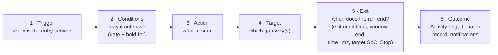

# Concepts

How a schedule entry works, end to end. Read this first; the other pages go into each part.

!!! note "How to read the scheduler pages"
    These pages describe what the code does in this release. Each behaviour has a hidden
    marker in the page source with the code location and whether a unit test covers it.
    Untested behaviour is described from the code, not from a test run. The
    [Scheduler test plan](../../dev/scheduler-test-plan.md) lists every behaviour with its
    test status.

## The model

An entry is one row on the **Schedule** tab. It has six parts, always in this order:

| Part | Question it answers | Fields in the form | Page |
|---|---|---|---|
| **Trigger** | When is the entry active? | Trigger Type, its time fields, Duration (min) | [Triggers](triggers.md) |
| **Conditions** | May it act now? | Entry conditions, Duration (HH:MM:SS) hold-for | [Conditions](conditions.md) |
| **Action** | What does it send? | Action, Power / Reserve % / Mode, HA Actions | [Actions](actions.md) |
| **Target** | Which gateway or gateways? | Target, Gateway / Service | [Targets](targets.md) |
| **Exit** | When does a run end, and what then? | Exit conditions, On exit / release | [Exit and release](exit-and-conflicts.md) |
| **Outcome** | What happened? | — (Activity Log, Logs, notifications) | [Outcomes and audit](outcomes.md) |

Two more settings decide what happens when entries meet: **Priority** and **If already
controlled**. See [Priorities and conflicts](priorities.md).

## Three ways to start

The owner's words "by time, by event, by sensor" map onto the trigger types like this:

| You want | Use | Example |
|---|---|---|
| **By time** | A window (Recurring or One-off) or a fire-based trigger (Daily, Weekly, Every N minutes, Monthly, Cron) | Charge 16:00–17:00 on weekdays |
| **By event** | A time trigger plus an entry condition on the thing that changes: a Home Assistant entity, the grid connection, the operating mode, a tariff window | Hold the battery while `switch.ev_charger` is on, 17:00–23:00 |
| **By sensor** | *Always evaluate*, or a short repeating trigger, with entry conditions on a sensor | Charge when the spot price is below 5 c/kWh |

There is no separate event trigger. An "event" is a condition that becomes true while the
entry's trigger is active. The engine notices it on the next 15-second tick.

## The tick

The engine runs on the bridge, not in the browser. Every 15 seconds it evaluates every
enabled entry. <!-- @b CON-01 ;; src: gateway/scheduler.py:47, gateway/scheduler.py:673-682 ;; untested ;; write: yes ;; b: The engine evaluates every enabled entry once per 15-second tick; a failing tick is logged and the loop continues ;; test: unit — run _loop with a fake sleep, make tick raise once, assert the loop continues and ticks again -->

| Step | What happens |
|---|---|
| 1 | Load the enabled entries, highest **priority** first, then **oldest** first. |
| 2 | Build one sensor snapshot per gateway from its last poll (no Modbus read). |
| 3 | For each target, work out the gateways it covers. |
| 4 | Per gateway: pick the one battery entry that may act, and reconcile the gateway to it. Entries with *No battery action* run on their own lane. |
| 5 | Write every decision to the Activity Log. |

<!-- @b CON-02 ;; src: gateway/scheduler.py:456-461, store/db.py:1772-1788 ;; tested: tests/unit/test_scheduler.py::test_store_sorted_by_priority ;; write: no ;; b: Only enabled entries are loaded, ordered priority descending, then created_at ascending (oldest first), then id ;; test: unit — add an equal-priority pair and assert the older one sorts first -->
<!-- @b CON-03 ;; src: gateway/scheduler.py:1464-1480, gateway/scheduler.py:702 ;; tested: tests/unit/test_scheduler_engine.py::test_entry_conditions_fail_closed_without_points_source ;; write: no ;; b: Conditions read a per-tick snapshot of the gateway's cached points; with no points source every sensor is None and conditions fail closed ;; test: — -->
<!-- @b CON-04 ;; src: gateway/scheduler.py:722-733 ;; tested: tests/unit/test_scheduler_engine.py::test_ha_only_entry_does_not_starve_a_battery_entry ;; write: yes ;; b: Entries with action none run on their own lane per entry and never compete with battery entries for a gateway ;; test: — -->

Saving, deleting, enabling or disabling an entry reloads the engine and runs a tick at once,
so a change can act within a second rather than at the next tick. <!-- @b CON-05 ;; src: api/schedules_api.py:194-200, gateway/scheduler.py:463-466 ;; untested ;; write: yes ;; b: Every create, update, delete and import reloads the engine and runs an immediate tick, which can dispatch at once ;; test: unit (API) — create an entry whose window is open against a fake engine and assert reload() was awaited -->

!!! warning "Turning the Schedule module off does not stop schedules"
    **Settings → Admin → Feature Modules → Schedule** hides the tab and blocks the schedule API, but
    the engine starts with the bridge either way and keeps running the enabled entries it
    loaded. To stop schedules, disable the entries. <!-- @b CON-06 ;; src: main.py:963, main.py:1211-1218, api/modules_api.py:50-58 ;; unclear ;; write: yes ;; b: Disabling the automations module only 403s the schedule routes; the engine still starts and runs enabled entries ;; test: VM/mock — disable the module with an enabled entry whose window is open on a mock; check the Activity Log and the mock's command state -->

## Window, activation and run

Three words recur:

| Word | Meaning |
|---|---|
| **Window** | The time the trigger makes the entry active. For a window trigger it is the start → end you type. For a fire-based trigger it is *fire time → fire time + Duration (min)*. *Always* has one endless window. |
| **Activation** | One pass through a window. Fire-time HA actions run once per activation. |
| **Run** | A battery command the entry sent and still owns on one gateway. A run ends at the first exit (see [Exit and release](exit-and-conflicts.md)). After a run ends inside its window, the entry does not fire again until the window closes and opens again. |

## What the engine remembers

The engine keeps its state in memory: which entry owns each gateway, which windows are
done, hold-for timers, retry timers. A bridge restart forgets all of it. See
[Restarts and the clock](restarts-and-clock.md).

## Legacy and v2 entries

Entries saved before the trigger and condition fields existed are *legacy* entries. The
code treats an entry as *v2* when it has a trigger type **or** any entry or exit
condition. The difference matters in one place: only v2 entries honour **On exit /
release**; a plain window entry with no conditions always does a plain release.
<!-- @b CON-07 ;; src: gateway/scheduler.py:172-177, gateway/scheduler.py:867-881 ;; untested ;; write: yes ;; b: A window entry with no conditions is legacy and always does a plain release at window end, even when its release_policy is restore_prior_mode ;; test: unit — window entry with release_policy=restore_prior_mode and no conditions; assert no mode note and only Release at window exit (the existing test leaves the policy at its default) -->

## Glossary

| Term | Meaning |
|---|---|
| **Entry** | One schedule row. Also called a schedule or an automation. |
| **Gate** | The entry conditions. |
| **Hold-for (dwell)** | **Duration (HH:MM:SS)** under the entry conditions: how long the gate must stay true before the entry fires. |
| **Exit conditions** | Checked while a force command from this entry runs; the first time they are true the run ends. |
| **Owner** | The entry that sent the command a gateway is running. |
| **Manual control** | A force command the scheduler did not send on this target (Controls tab, Home Assistant, MQTT, API, Run now, or another target's entry). |
| **Release** | Clearing the setpoint so the gateway returns to its own mode. |
| **Fan-out** | One entry acting on several gateways (Site or Service target). Each gateway is handled on its own. |
