# Conditions

Conditions let an entry react to the battery, the grid, prices, the weather, Home Assistant
and more. This is how you schedule **by sensor** or **by event**: a trigger opens the
window, the conditions decide whether to act inside it.

Each entry has two condition blocks:

| Block | Checked | Effect |
|---|---|---|
| **Entry conditions** (the gate) | each tick while the entry is active and **not yet running** | The action is sent only when they hold. |
| **Exit conditions** | each tick while a **force command** from this entry is running | The first time they hold, the run ends. See [Exit and release](exit-and-conflicts.md). |

A condition row (an *item*) has a **sensor**, an **operator** and a right-hand side: a
**Value** you type or a **Lookup** of another sensor.

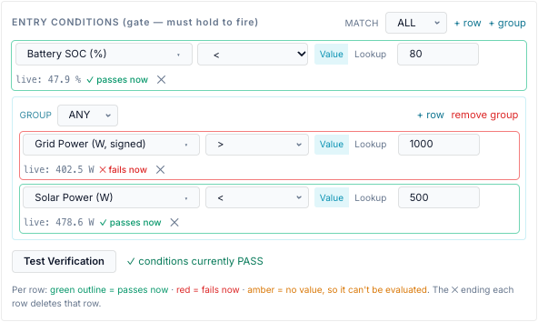

## Rules for every condition

- **No value means false.** If a sensor has no value (gateway offline, feature not set up,
  Home Assistant entity `unavailable`), every operator returns false, including `!=` and
  `not in`. A rule never acts on missing data.
  <!-- @b CND-01 ;; src: gateway/scheduler_conditions.py:227-230 ;; tested: tests/unit/test_scheduler_conditions.py::test_none_live_value_fails_closed_all_ops ;; write: yes ;; b: A sensor with no value makes every operator false, including != and not_in ;; test: — -->
- **An unknown sensor or operator is false too.** The bridge does not check sensor ids or
  operators when you save through the API; such a row just never passes. Import warns
  about unknown sensors.
  <!-- @b CND-02 ;; src: gateway/scheduler_conditions.py:275, gateway/scheduler_conditions.py:289, api/schedules_api.py:123-124 ;; tested: tests/unit/test_scheduler_conditions.py::test_unknown_operator_fails_closed ;; write: no ;; b: An unknown sensor id or operator evaluates false; neither is validated at save ;; test: unit (API) — POST an entry with op 'approx' and assert 201 (documents the gap) -->
- **Values come from one snapshot per gateway per tick**, built from the gateway's last
  poll and the other sources below. Conditions never cause a Modbus read.
  <!-- @b CND-03 ;; src: gateway/scheduler.py:1464-1480, gateway/scheduler_sensors.py:975-988 ;; tested: tests/unit/test_scheduler_sensors.py::test_snapshot_always_contains_every_sensor_id ;; write: no ;; b: Every condition in a tick reads one snapshot per gateway built from cached points; every static sensor id is present, HA ids pass through ;; test: — -->
- **On/off sensors: compare with 1 or 0.** For *Grid Connected*, *PV Generating* or a Home
  Assistant switch, use `==` `1` (on) or `0` (off). Typing `true` is sent as text and never
  equals the sensor.
  <!-- @b CND-04 ;; src: gateway/scheduler_conditions.py:105-113, static/js/schedule_tab.js:1309-1316 ;; untested ;; write: yes ;; b: A bool sensor equals the number 1 or 0 (Python True == 1); the text 'true' never matches ;; test: unit — grid.connected True == 1 passes, == 0 fails, == 'true' fails -->

## Operators

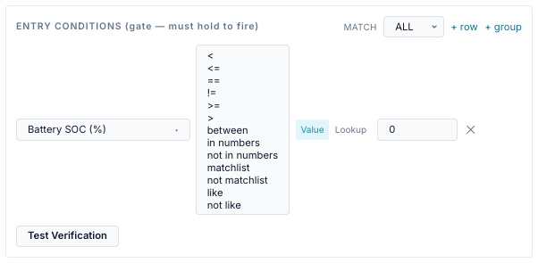

| Operator (UI) | Stored as | Right-hand side | True when | Example |
|---|---|---|---|---|
| `<` `<=` `>=` `>` | same | a number (or a Lookup) | the numeric comparison holds | `battery.soc_pct < 80` |
| `==` | `==` | a number, text, or a Lookup | equal. Numbers compare as numbers; text compares exactly | `mode.name == TOU` |
| `!=` | `!=` | as `==` | not equal (still false with no value) | `inverter.status != Running` |
| between | `between` | two numbers | inclusive; the order of the two numbers does not matter | `time.hour between 16 and 20` |
| in numbers | `in` | list of numbers and ranges | the value is one of them or inside a range | `battery.soc_pct in 10,20,42-49` |
| not in numbers | `not_in` | as above | not in the list (an empty list → true) | `time.dow not in 5-6` |
| matchlist | `matchlist` | list of text values | equals one of them, ignoring case | `mode.name matchlist TOU, Self-Consumption` |
| not matchlist | `not_matchlist` | as above | equals none of them | |
| like | `like` | a pattern | matches, ignoring case | `weather.condition like *rain*` |
| not like | `not_like` | a pattern | does not match | |

<!-- @b CND-05 ;; src: gateway/scheduler_conditions.py:256-274 ;; tested: tests/unit/test_scheduler_conditions.py::test_numeric_operators ;; write: yes ;; b: <, <=, >=, > compare numbers; text, bool or missing values make them false ;; test: — -->
<!-- @b CND-06 ;; src: gateway/scheduler_conditions.py:105-113, gateway/scheduler_conditions.py:231-234 ;; tested: tests/unit/test_scheduler_conditions.py::test_enum_string_equality ;; write: yes ;; b: == and != compare numerically when both sides are numbers (strings included) and exactly otherwise; == on text is case-sensitive ;; test: — -->
<!-- @b CND-07 ;; src: gateway/scheduler_conditions.py:269-274 ;; tested: tests/unit/test_scheduler_conditions.py::test_between_inclusive_and_orderless ;; write: yes ;; b: between is inclusive and order-independent; a missing second bound is false ;; test: — -->
<!-- @b CND-08 ;; src: gateway/scheduler_conditions.py:116-202, gateway/scheduler_conditions.py:235-246 ;; tested: tests/unit/test_condition_in_like.py::test_ranges_and_exact_levels_mix_in_one_list ;; write: yes ;; b: in / not_in take numbers and inclusive ranges (a-b, a..b, en dash), comma, semicolon or newline separated, brackets ignored; a text live value is false for both ;; test: — -->
<!-- @b CND-09 ;; src: gateway/scheduler_conditions.py:239-246 ;; tested: tests/unit/test_condition_in_like.py::test_an_empty_list_matches_nothing ;; write: yes ;; b: An empty list matches nothing: in is false and not_in is true ;; test: — -->
<!-- @b CND-10 ;; src: gateway/scheduler_conditions.py:247-252 ;; tested: tests/unit/test_condition_in_like.py::test_matchlist_ignores_case ;; write: yes ;; b: matchlist compares whole text values case-insensitively, with no range parsing ;; test: — -->
<!-- @b CND-11 ;; src: gateway/scheduler_conditions.py:205-224 ;; tested: tests/unit/test_condition_in_like.py::test_both_wildcard_dialects_work ;; write: yes ;; b: like uses * or % for many and ? or _ for one character, case-insensitive; no wildcard means contains ;; test: — -->

Details:

- **Ordering operators** (`<`, `<=`, `>=`, `>`, between) need numbers on both sides. Text
  that looks like a number counts as a number.
- **in / not in numbers** take a comma-separated list. Semicolons and new lines also work,
  and surrounding brackets are ignored: `(10, 20, 30)`. `42-49` or `49-42` is an inclusive
  range. Write negative ranges with `..`: `-5000..-1000`. An ambiguous member such as
  `1-2-3` and any text member are ignored.
- **matchlist** compares whole text values, so `Self-Consumption` is a name, not a range.
- **like** wildcards: `*` or `%` for any run of characters, `?` or `_` for one. A pattern
  with no wildcard means *contains*: `like rain` matches "Light rain".
- **matchlist and like on a number or a yes/no sensor** compare its text: `True`, `False`,
  `63.0`. So `grid.connected matchlist true` passes when connected.
  <!-- @b CND-12 ;; src: gateway/scheduler_conditions.py:247-255 ;; tested: tests/unit/test_condition_in_like.py::test_matchlist_on_a_number_compares_its_text ;; write: yes ;; b: matchlist and like on a number compare its text form; on a bool they compare 'True'/'False' case-insensitively ;; test: unit — grid.connected True matchlist 'true' passes -->
- `in` tests membership, not crossing. A fast-moving value can step over a listed number
  between polls; use a range member for robustness.

=== "Value"

    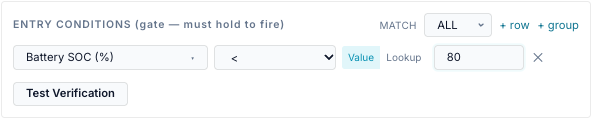

=== "Lookup"

    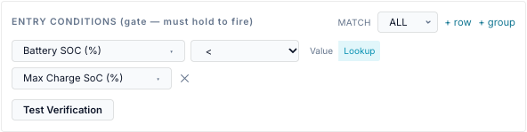

=== "between"

    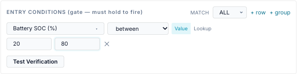

=== "matchlist"

    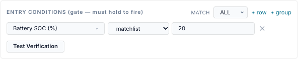

### Value and Lookup

The **Value / Lookup** switch sits after the operator.

- **Value** compares with what you type. The form sends anything that looks like a number
  as a number. <!-- @b CND-13 ;; src: static/js/schedule_tab.js:1309-1316, static/js/schedule_tab.js:1333-1341 ;; untested ;; write: no ;; b: The form sends number-looking values as numbers and the RHS of list and pattern operators as raw text ;; test: browser — save '50' and 'in 10,20'; GET the entry and check types -->
- **Lookup** compares with **another sensor's live value**, for example
  `battery.soc_pct <= const.min_discharge_soc` or `demand.interval_kw >= demand.peak_kw`.
  If the Lookup sensor has no value the row is false.
  <!-- @b CND-14 ;; src: gateway/scheduler_conditions.py:291-302 ;; tested: tests/unit/test_scheduler_conditions.py::test_lookup_rhs_unavailable_fails_closed ;; write: yes ;; b: A Lookup row compares with another sensor's live value; a missing Lookup value is false ;; test: — -->

The switch is hidden for the list and pattern operators: their right-hand side is always
text. `between` needs Value (two numbers).

The **Details** panel of an entry prints a Lookup row as `… < undefined`: it shows the
typed value, not the Lookup sensor. The rule itself is stored and evaluated correctly.
<!-- @b CND-15 ;; src: static/js/schedule_tab.js:753-762 ;; untested ;; write: no ;; b: The Details panel (treeText) renders a Lookup row as 'sensor op undefined' because it ignores value_kind/value_sensor ;; test: browser — open Details of an entry with a Lookup row -->

## Groups and items: ALL / ANY

A block is a **group**: a match mode (ALL or ANY) and a list of **items**. An item is either
a condition row or another group.

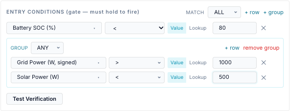

| Group setting | True when | Empty group |
|---|---|---|
| **match ALL** | every item is true | true |
| **match ANY** | at least one item is true | false |

<!-- @b CND-16 ;; src: gateway/scheduler_conditions.py:325-332 ;; tested: tests/unit/test_scheduler_conditions.py::test_empty_all_is_true_empty_any_is_false ;; write: yes ;; b: ALL needs every item true (empty ALL is true); ANY needs one (empty ANY is false); ALL is the default and the match word is case-insensitive ;; test: — -->
<!-- @b CND-17 ;; src: gateway/scheduler_conditions.py:278-285, gateway/scheduler_conditions.py:325-332 ;; tested: tests/unit/test_scheduler_conditions.py::test_nested_tree ;; write: yes ;; b: A group counts as one item of its parent; groups nest to any depth in the engine ;; test: — -->

How the items relate:

- **Order does not matter.** Every item is evaluated every time (no short-circuit), so Test
  Verification and the Activity Log can show each row's live value.
  <!-- @b CND-18 ;; src: gateway/scheduler_conditions.py:325-332 ;; tested: tests/unit/test_scheduler_conditions.py::test_trace_shape_and_no_short_circuit ;; write: no ;; b: The evaluator visits every item without short-circuit and returns a trace row per condition ;; test: — -->
- **A group is one item of the block it sits in.** *SoC above 40 % AND (grid import above
  1 kW OR solar below 500 W)* is a `match ALL` block with one row and one `ANY` group of
  two rows.
- **The editor nests one level**: a block holds rows and groups, a group holds rows. A
  deeper tree sent through the API is evaluated, but the editor cannot show it.
- **Empty groups are dropped when you save.** A block with no rows at all is saved as
  *none*: no gate, or no exit criteria.
  <!-- @b CND-19 ;; src: static/js/schedule_tab.js:1318-1347 ;; untested ;; write: yes ;; b: The form prunes empty groups and saves an empty block as null (no gate / no exit) ;; test: browser — add an empty group and save; GET shows it gone; clear all rows and save; GET shows null -->
- **An empty tree sent through the API is not the same as none.** An empty `ALL` exit
  block is *true*, so it ends a run on the first tick after the command is sent; an empty
  `ANY` exit block never ends one.
  <!-- @b CND-20 ;; src: gateway/scheduler.py:902-905, gateway/scheduler_conditions.py:330-332 ;; untested ;; write: yes ;; b: An API exit tree {match: ALL, conditions: []} is true and releases the run on the next tick; an empty ANY tree never exits ;; test: unit — entry with exit_conditions {'match':'ALL','conditions':[]}; tick twice; assert Release on the second tick -->

## Scope: which gateway's values

Conditions are evaluated **per gateway**. For a Site or Service target, each member
gateway is checked against its own snapshot, and may pass while another fails.

| Sensors | Scope |
|---|---|
| `battery.*`, `solar.*`, `pv.*`, `grid.*`, `load.*`, `mode.*`, `inverter.*`, `gateway.*`, `energy.*.total_kwh`, `energy.*.today/this_week/this_month/ytd_kwh`, `dispatch.*` | the gateway being evaluated |
| `demand.*`, `bonus.*`, `tariff.export_charge_*` (not the window flag), `energy.period_import_kwh`, `energy.import_cost`, `energy.export_credit`, `energy.unpriced_*` | **the gateway with id `default`**, whichever gateway is evaluated |
| `tariff.*` windows and rates, `service.*`, `fixed.*` | the first utility service that defines each feature, the same for every gateway |
| `const.*`, `weather.*`, `solar_forecast.*`, `tariff.spot_price`, `tariff.feed_in_price`, `time.*`, `ha:*` | the same for every gateway |

<!-- @b CND-21 ;; src: gateway/scheduler.py:724-727, gateway/scheduler.py:1464-1480, main.py:651-681 ;; untested ;; write: yes ;; b: For a site or service target each member gateway's conditions are evaluated on that gateway's own snapshot ;; test: unit — site target, two FakeHandlers, points_fn per gateway with soc 80 and 10; gate soc > 50; assert only the first dispatches -->
<!-- @b CND-22 ;; src: main.py:643-646, main.py:672-680 ;; untested ;; write: yes ;; b: demand.*, bonus.*, export-charge and billing-period energy sensors measure the default gateway and are merged into every gateway's snapshot ;; test: unit — _schedule_points for a second gateway returns the default gateway's demand values -->

## Hold for (dwell)

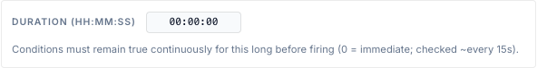

**Duration (HH:MM:SS)** below the entry conditions is a hold-for time:

- The entry fires only after it has been *eligible* (window active and entry conditions
  true) **continuously** for this long. <!-- @b CND-23 ;; src: gateway/scheduler.py:1021-1037 ;; tested: tests/unit/test_scheduler.py::test_dwell_holds_then_fires ;; write: yes ;; b: With entry_hold_s > 0 the entry fires only after being eligible continuously for that long; waiting is audited once ;; test: — -->
- If the gate fails even once the timer starts again.
  <!-- @b CND-24 ;; src: gateway/scheduler.py:1006-1008 ;; tested: tests/unit/test_scheduler.py::test_dwell_resets_when_conditions_flap ;; write: yes ;; b: A failing gate resets the hold-for timer ;; test: — -->
- When the window ends the timer starts again.
  <!-- @b CND-25 ;; src: gateway/scheduler.py:847-848 ;; untested ;; write: yes ;; b: The hold-for timer resets at window exit ;; test: unit — hold 300 s, window ends after 200 s eligible, re-opens; assert no fire until 300 s more -->
- It is checked on each 15-second tick, so the real wait is the set time rounded up to the
  next tick. 0 = fire immediately. Maximum 24 h.
  <!-- @b CND-26 ;; src: api/schedules_api.py:128, gateway/scheduler.py:1022 ;; tested: tests/unit/test_scheduler.py::test_zero_dwell_fires_immediately ;; write: yes ;; b: entry_hold_s 0 fires immediately; the API accepts 0 to 86400 s ;; test: — -->
- While waiting, the Activity Log shows *waiting* once ("conditions met — holding 300s
  before firing").
- The timer lives in memory. After a bridge restart it starts again, so it never fires early.
- A retry after a failed send does not wait for the hold-for time again.
  <!-- @b CND-27 ;; src: gateway/scheduler.py:1023 ;; untested ;; write: yes ;; b: A retry after a failed send skips the hold-for wait ;; test: unit — hold 120 s, first send fails; assert the retry at +15 s sends without a new waiting row -->

Use it to ride through a brief price spike or a cloud passing over. It applies to every
action, including HA-only entries.

## When conditions are evaluated

| What | When |
|---|---|
| Entry conditions | each tick while the entry is active and not running; on Run now (unless forced); before a late fire |
| Hold-for timer | each tick |
| Exit conditions | each tick while this entry owns a running force command (not for Release, mode, reserve or HA-only entries) |
| HA action guard | when that HA action is about to run |
| After you save | at once: saving reloads the engine and runs a tick |

- **The gate is a gate, not a leash.** Once a force command runs, the entry conditions are
  not checked again: a gate that turns false does not stop the run. Use exit conditions.
  <!-- @b CND-28 ;; src: gateway/scheduler.py:779-784, gateway/scheduler.py:984-989 ;; tested: tests/unit/test_scheduler_engine.py::test_incumbent_keeps_the_gateway_when_its_gate_blips ;; write: yes ;; b: Entry conditions are only checked before a new dispatch; a running entry keeps the gateway when its gate turns false ;; test: — -->
- **A failing gate is logged once per window** as *gated*, with up to four failing rows
  and their live values, for example `entry gated: battery.soc_pct < 80 (live=86.0)`.
  <!-- @b CND-29 ;; src: gateway/scheduler.py:1003-1019, gateway/scheduler.py:265-276 ;; tested: tests/unit/test_scheduler_engine.py::test_gate_audits_once_while_gated_then_dispatches_when_it_passes ;; write: no ;; b: A failing gate is audited once per window as gated, listing up to four failing leaves with live values ;; test: — -->

The values themselves refresh at the rate in the **Refreshes** column below. A condition on
a 15-minute forecast cannot change faster than the forecast does.

## Test Verification

**Test Verification** under each block evaluates the block now, against one gateway: the
selected gateway for a Gateway target, the gateway `default` for a Site or Service target.
<!-- @b CND-30 ;; src: api/scheduler_api.py:121-129, static/js/schedule_tab.js:1369-1388 ;; tested: tests/unit/test_api.py::test_scheduler_evaluate_endpoint ;; write: no ;; b: Test Verification posts the block to /api/scheduler/evaluate for the target gateway (default for site/service) and maps each trace row back to its condition ;; test: — -->

| Row outline | Meaning |
|---|---|
| green, *✓ passes now* | true now |
| red, *✕ fails now* | false now |
| amber, *✕ no value* | the sensor has no value, so the row is false |

Each row also shows `live:` with the current value and unit. For the entry block the
summary reads *conditions currently PASS/FAIL*; for the exit block *exit WOULD fire now* /
*exit would NOT fire*.

!!! note "Test Verification is close to, not the same as, the engine's view"
    - It does not include the `dispatch.*` values: they read *not overriding* even while a
      schedule runs.
    - It does not include the gateway type, so `gateway.battery_capable` reads 1 and
      `gateway.device_type` reads `agate`, even for a MAC-1 collar.
    - It needs an **admin** account, like every other change on the Schedule page.

<!-- @b CND-31 ;; src: api/scheduler_api.py:29-62, main.py:651-681 ;; untested ;; write: no ;; b: The evaluate endpoint builds points without dispatch_* and device_type, so dispatch.* and gateway.device_type/battery_capable differ from the engine's snapshot ;; test: unit (API) — evaluate gateway.battery_capable == 0 for a mac1 gateway returns false while the engine snapshot returns true -->
<!-- @b CND-32 ;; src: main.py:1215-1218, api/auth.py:199-216 ;; untested ;; write: no ;; b: POST /api/scheduler/evaluate is a write route and needs the admin role ;; test: unit (API) — a user-role session gets 403 on evaluate -->

## Home Assistant entities

Entities from a connected Home Assistant instance appear in the picker under **HA ·
*instance name***, after the bridge's own groups.

- **Needs:** a Home Assistant instance on the **Home Assistant** tab, and the entity
  **exposed** there. Only exposed entities are offered and evaluated.
- **Id:** `ha:<instance id>:<entity_id>`, for example `ha:home:input_boolean.away_mode`.
- **Value:** the entity state. Numbers become numbers. `on`, `true`, `home`, `open` and
  `locked` become true (compare with `1`); `off`, `false`, `away`, `closed` and `unlocked`
  become false (compare with `0`). Anything else stays text, so compare it with `==` or
  matchlist. `unavailable`, `unknown`, `none` and empty states become **no value**.
  <!-- @b CND-33 ;; src: gateway/ha.py:55-80, gateway/ha.py:329-335 ;; tested: tests/unit/test_ha.py::test_coerce_state ;; write: yes ;; b: HA states coerce to number, true (on/true/home/open/locked), false (off/false/away/closed/unlocked) or text; unavailable/unknown/none/empty become no value; only exposed entities are included ;; test: — -->
- **Refresh:** live over the Home Assistant WebSocket; REST polling every 30 s while the
  WebSocket is down. <!-- @b CND-34 ;; src: gateway/ha.py:48, gateway/ha.py:135-140, gateway/ha.py:268-326 ;; tested: tests/unit/test_ha.py::test_seed_and_apply_state_changed ;; write: no ;; b: HA entity values update from WebSocket state_changed events, with a 30 s REST poll fallback ;; test: — -->
- If the instance is removed, the condition has no value. Import warns about `ha:` sensors
  whose instance is missing.
  <!-- @b CND-35 ;; src: api/schedules_api.py:406-418 ;; tested: tests/unit/test_schedules_v2_api.py::test_import_dry_run_reports_warnings_and_errors ;; write: no ;; b: Import warns about unknown sensors and ha: sensors whose instance is missing ;; test: — -->

## Every sensor in the picker

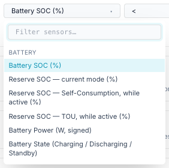

The picker groups sensors as below and has a filter box that matches the label, the id or the group.

??? example "Picker screenshots, one per group"

    === "Battery"
        
    === "Solar / PV"
        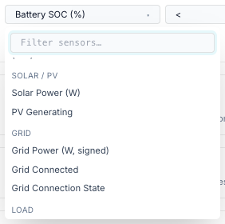
    === "Grid"
        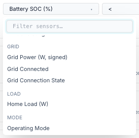
    === "Load"
        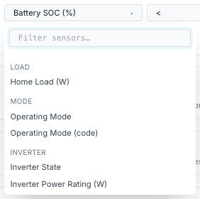
    === "Mode"
        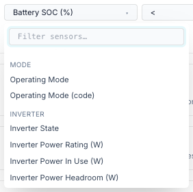
    === "Inverter"
        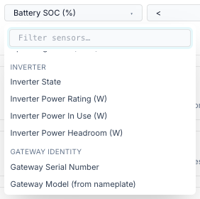
    === "Gateway identity"
        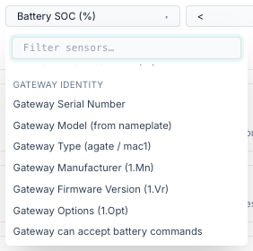
    === "Constants"
        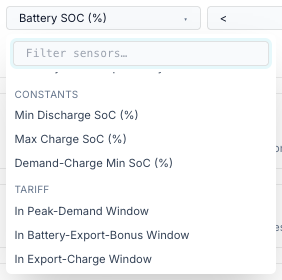
    === "Tariff"
        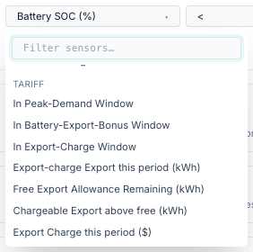
    === "Demand / Tariff"
        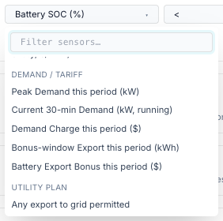
    === "Utility Plan"
        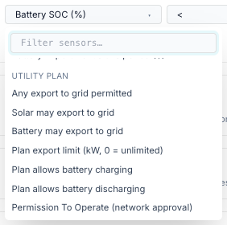
    === "Other"
        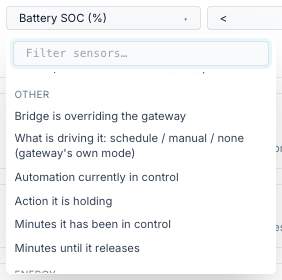
    === "Energy"
        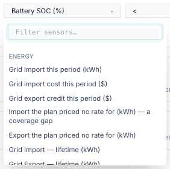
    === "Fixed Charges"
        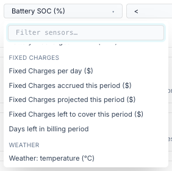
    === "Weather"
        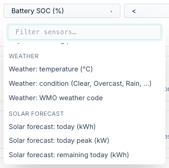
    === "Solar Forecast"
        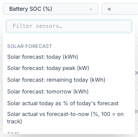
    === "Time"
        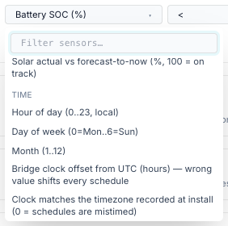
    === "Filter"
        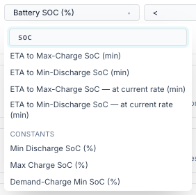

How to read the tables:

- **Type:** *number*, *bool* (yes/no — compare with 1 or 0) or *enum* (text — use `==`, `!=`, matchlist or like).
- **Needs:** what must be set up for the sensor to have a meaningful value. Where a settings page is named, that is where you configure it.
- **Without it:** what the sensor reads when that is missing. *None* means no value, so every condition on it is false. A sensor that reads `0` or `False` instead **does** take part in conditions: `tariff.demand_window_active == 0` is true on an install with no tariff configured.
- **Refreshes:** how often the underlying value changes. The scheduler re-reads it every tick.
- *Gateway polling* depends on the gateway's poll interval (**Settings → Site & Gateways → Modbus Poller**, default 10 s). An offline gateway's values go stale, and a dispatch is not judged on values older than 45 s.
- **Default gateway:** the demand, bonus, export-charge and billing-period energy figures measure the gateway with id `default` only.
- The **Other** group holds the `dispatch.*` sensors, which say why the battery is doing what it is doing.

!!! info "Generated table"
    The tables below were generated from the code by [`_gen_sensors.py`](https://github.com/david2069/franklinwh-modbus-bridge/blob/main/docs/user/scheduler/_gen_sensors.py). Run `python docs/user/scheduler/_gen_sensors.py` from the repository root to refresh them.

<!-- sensors:begin -->

### Battery

| Picker label | Sensor id | Unit | Type | Needs | Without it | Refreshes |
|---|---|---|---|---|---|---|
| Battery SOC (%) | `battery.soc_pct` | % | number | Gateway polling | None | every poll (default 10 s) |
| Reserve SOC — current mode (%) | `battery.reserve_pct` | % | number | Gateway polling (15508 / 15509) | None | every poll (default 10 s) |
| Reserve SOC — Self-Consumption, while active (%) | `battery.reserve_self_pct` | % | number | Self-Consumption must be the active mode | None in any other mode | every poll (default 10 s) |
| Reserve SOC — TOU, while active (%) | `battery.reserve_tou_pct` | % | number | TOU must be the active mode | None in any other mode | every poll (default 10 s) |
| Battery Power (W, signed) | `battery.power_w` | W | number | Gateway polling. + = discharging, − = charging | None | every poll (default 10 s) |
| Battery State (Charging / Discharging / Standby) | `battery.status` | — | enum | Gateway polling | None | every poll (default 10 s) |
| Battery Capacity (kWh) | `battery.capacity_kwh` | kWh | number | Battery nameplate 713.WHRtg | None | every poll (default 10 s) |
| Battery Stored Energy (kWh) | `battery.stored_kwh` | kWh | number | Capacity + SoC | None | every poll (default 10 s) |
| Battery Headroom to Full (kWh) | `battery.remaining_kwh` | kWh | number | Capacity + SoC | None | every poll (default 10 s) |
| ETA to Max-Charge SoC (min) | `battery.time_to_charge_min` | min | number | Capacity, SoC, const Max Charge SoC, 702 max charge rate | None | every poll (default 10 s) |
| ETA to Min-Discharge SoC (min) | `battery.time_to_discharge_min` | min | number | Capacity, SoC, const Min Discharge SoC, 702 max discharge rate | None | every poll (default 10 s) |
| ETA to Max-Charge SoC — at current rate (min) | `battery.time_to_charge_now_min` | min | number | As above, plus the battery must be charging now | None when idle or discharging | every poll (default 10 s) |
| ETA to Min-Discharge SoC — at current rate (min) | `battery.time_to_discharge_now_min` | min | number | As above, plus the battery must be discharging now | None when idle or charging | every poll (default 10 s) |

### Solar / PV

| Picker label | Sensor id | Unit | Type | Needs | Without it | Refreshes |
|---|---|---|---|---|---|---|
| Solar Power (W) | `solar.power_w` | W | number | Gateway polling | None | every poll (default 10 s) |
| PV Generating | `pv.is_generating` | — | bool | Gateway polling. True above 50 W of solar | None | every poll (default 10 s) |

### Grid

| Picker label | Sensor id | Unit | Type | Needs | Without it | Refreshes |
|---|---|---|---|---|---|---|
| Grid Power (W, signed) | `grid.power_w` | W | number | Gateway polling. + = importing, − = exporting | None | every poll (default 10 s) |
| Grid Connected | `grid.connected` | — | bool | Gateway polling (connection state, else grid mode) | None | every poll (default 10 s) |
| Grid Connection State | `grid.status` | — | enum | Gateway polling | None | every poll (default 10 s) |

### Load

| Picker label | Sensor id | Unit | Type | Needs | Without it | Refreshes |
|---|---|---|---|---|---|---|
| Home Load (W) | `load.power_w` | W | number | Gateway polling | None | every poll (default 10 s) |

### Mode

| Picker label | Sensor id | Unit | Type | Needs | Without it | Refreshes |
|---|---|---|---|---|---|---|
| Operating Mode | `mode.name` | — | enum | Gateway polling | None | every poll (default 10 s) |
| Operating Mode (code) | `mode.raw` | — | number | Gateway polling | None | every poll (default 10 s) |

### Inverter

| Picker label | Sensor id | Unit | Type | Needs | Without it | Refreshes |
|---|---|---|---|---|---|---|
| Inverter State | `inverter.status` | — | enum | Gateway polling | None | every poll (default 10 s) |
| Inverter Power Rating (W) | `inverter.power_rating_w` | W | number | Model 702 nameplate rating (not the trusted battery rating) | None | every poll (default 10 s) |
| Inverter Power In Use (W) | `inverter.utilised_w` | W | number | Battery power | None | every poll (default 10 s) |
| Inverter Power Headroom (W) | `inverter.unutilised_w` | W | number | 702 nameplate rating + battery power | None | every poll (default 10 s) |

### Gateway identity

| Picker label | Sensor id | Unit | Type | Needs | Without it | Refreshes |
|---|---|---|---|---|---|---|
| Gateway Serial Number | `gateway.serial` | — | enum | Nameplate (SunSpec Model 1) read by the poller | None | every poll (default 10 s) |
| Gateway Model (from nameplate) | `gateway.model` | — | enum | Nameplate (SunSpec Model 1) read by the poller | None | every poll (default 10 s) |
| Gateway Type (agate / mac1) | `gateway.device_type` | — | enum | Gateway config (not polled) | "agate" | on config change |
| Gateway Manufacturer (1.Mn) | `gateway.manufacturer` | — | enum | Nameplate (SunSpec Model 1) read by the poller | None | every poll (default 10 s) |
| Gateway Firmware Version (1.Vr) | `gateway.version` | — | enum | Nameplate (SunSpec Model 1) read by the poller | None | every poll (default 10 s) |
| Gateway Options (1.Opt) | `gateway.options` | — | enum | Nameplate (SunSpec Model 1) read by the poller | None | every poll (default 10 s) |
| Gateway can accept battery commands | `gateway.battery_capable` | — | bool | Gateway config: False for a MAC-1 collar | True | on config change |

### Constants

| Picker label | Sensor id | Unit | Type | Needs | Without it | Refreshes |
|---|---|---|---|---|---|---|
| Min Discharge SoC (%) | `const.min_discharge_soc` | % | number | Settings → Energy & Automation → Automation Constants | Never missing: defaults 20 / 100 / 30 % | on save |
| Max Charge SoC (%) | `const.max_charge_soc` | % | number | Settings → Energy & Automation → Automation Constants | Never missing: defaults 20 / 100 / 30 % | on save |
| Demand-Charge Min SoC (%) | `const.demand_charge_min_soc` | % | number | Settings → Energy & Automation → Automation Constants | Never missing: defaults 20 / 100 / 30 % | on save |

### Tariff

| Picker label | Sensor id | Unit | Type | Needs | Without it | Refreshes |
|---|---|---|---|---|---|---|
| In Peak-Demand Window | `tariff.demand_window_active` | — | bool | A peak-demand window on a service (Settings → Energy & Automation → Electricity Utility Service(s)) | False | every tick (15 s) |
| In Battery-Export-Bonus Window | `tariff.bonus_window_active` | — | bool | An export-bonus window on a service (Settings → Energy & Automation → Electricity Utility Service(s)) | False | every tick (15 s) |
| In Export-Charge Window | `tariff.export_charge_window_active` | — | bool | An export-charge window on a service (Settings → Energy & Automation → Electricity Utility Service(s)) | False | every tick (15 s) |
| Export-charge Export this period (kWh) | `tariff.export_charge_kwh` | kWh | number | Export charge on a service (Settings → Energy & Automation → Electricity Utility Service(s)); counts the default gateway | 0 | every poll (default 10 s) |
| Free Export Allowance Remaining (kWh) | `tariff.export_charge_free_remaining` | kWh | number | Export charge on a service (Settings → Energy & Automation → Electricity Utility Service(s)); counts the default gateway | 0 | every poll (default 10 s) |
| Chargeable Export above free (kWh) | `tariff.export_charge_net_kwh` | kWh | number | Export charge on a service (Settings → Energy & Automation → Electricity Utility Service(s)); counts the default gateway | 0 | every poll (default 10 s) |
| Export Charge this period ($) | `tariff.export_charge_cost` | $ | number | Export charge on a service (Settings → Energy & Automation → Electricity Utility Service(s)); counts the default gateway | 0 | every poll (default 10 s) |
| In a declared grid-import window | `tariff.import_window_active` | — | bool | Import windows on a service (Settings → Energy & Automation → Electricity Utility Service(s)) | False | every tick (15 s) |
| Grid import is billable right now (0 = free window) | `tariff.import_billable` | — | bool | Energy rates or import windows (Settings → Energy & Automation → Electricity Utility Service(s)) | None | every tick (15 s) |
| Rate tier in force (1 = first block) | `tariff.tier` | — | number | Energy rates with tiers (Settings → Energy & Automation → Electricity Utility Service(s)) | None | every tick (15 s) |
| Tariff season in force | `tariff.season` | — | enum | Energy rates with seasons (Settings → Energy & Automation → Electricity Utility Service(s)) | None | every tick (15 s) |
| Time period in force (Off-Peak, Mid-Peak, …) | `tariff.time_period` | — | enum | Energy rates (Settings → Energy & Automation → Electricity Utility Service(s)) | None | every tick (15 s) |
| Grid import price now ($/kWh) | `tariff.buy_rate` | $/kWh | number | Energy rates, or a dynamic plan (Settings → Energy & Automation → Electricity Utility Service(s)) | None | every tick (15 s) |
| Grid export price now ($/kWh) | `tariff.sell_rate` | $/kWh | number | Energy rates, or a dynamic plan (Settings → Energy & Automation → Electricity Utility Service(s)) | None | every tick (15 s) |
| Wholesale spot price (AEMO NEM or HA entity, c/kWh) | `tariff.spot_price` | c/kWh | number | A NEM region or an HA price entity (Settings → Site & Gateways → Wholesale spot price), or a dynamic plan | None (also None when the last price is over 30 min old) | every 240 s |
| Dynamic feed-in price (AEMO NEM or HA entity, c/kWh) | `tariff.feed_in_price` | c/kWh | number | A NEM region or an HA feed-in entity (Settings → Site & Gateways → Wholesale spot price), or a dynamic plan | None (also None when the last price is over 30 min old) | every 240 s |

### Demand / Tariff

| Picker label | Sensor id | Unit | Type | Needs | Without it | Refreshes |
|---|---|---|---|---|---|---|
| Peak Demand this period (kW) | `demand.peak_kw` | kW | number | Peak demand on a service (Settings → Energy & Automation → Electricity Utility Service(s)); measures the default gateway | 0 | every poll (default 10 s) |
| Current 30-min Demand (kW, running) | `demand.interval_kw` | kW | number | Peak demand on a service (Settings → Energy & Automation → Electricity Utility Service(s)); measures the default gateway | 0 | every poll (default 10 s) |
| Demand Charge this period ($) | `demand.period_charge` | $ | number | Peak demand on a service (Settings → Energy & Automation → Electricity Utility Service(s)); measures the default gateway | 0 | every poll (default 10 s) |
| Bonus-window Export this period (kWh) | `bonus.export_kwh` | kWh | number | Export bonus on a service (Settings → Energy & Automation → Electricity Utility Service(s)); measures the default gateway | 0 | every poll (default 10 s) |
| Battery Export Bonus this period ($) | `bonus.period_credit` | $ | number | Export bonus on a service (Settings → Energy & Automation → Electricity Utility Service(s)); measures the default gateway | 0 | every poll (default 10 s) |

### Utility Plan

| Picker label | Sensor id | Unit | Type | Needs | Without it | Refreshes |
|---|---|---|---|---|---|---|
| Any export to grid permitted | `service.export_allowed` | — | bool | Plan terms on the service (Settings → Energy & Automation → Electricity Utility Service(s)) | True (permissive) | on save |
| Solar may export to grid | `service.solar_export_allowed` | — | bool | Plan terms on the service (Settings → Energy & Automation → Electricity Utility Service(s)) | True (permissive) | on save |
| Battery may export to grid | `service.battery_export_allowed` | — | bool | Plan terms on the service (Settings → Energy & Automation → Electricity Utility Service(s)) | True (permissive) | on save |
| Plan export limit (kW, 0 = unlimited) | `service.export_limit_kw` | kW | number | Plan terms on the service (Settings → Energy & Automation → Electricity Utility Service(s)) | 0 (unlimited) | on save |
| Plan allows battery charging | `service.charging_allowed` | — | bool | Plan terms on the service (Settings → Energy & Automation → Electricity Utility Service(s)) | True (permissive) | on save |
| Plan allows battery discharging | `service.discharging_allowed` | — | bool | Plan terms on the service (Settings → Energy & Automation → Electricity Utility Service(s)) | True (permissive) | on save |
| Permission To Operate (network approval) | `service.pto_status` | — | enum | PTO status on the service (Settings → Energy & Automation → Electricity Utility Service(s)) | "unknown" | on save |
| Network has approved export for this connection | `service.pto_approved` | — | bool | PTO status on the service (Settings → Energy & Automation → Electricity Utility Service(s)) | None | on save |
| Service country (ISO code) | `service.country` | — | enum | Country on the service (Settings → Energy & Automation → Electricity Utility Service(s)) | None | on save |
| Timezone the plan's TOU windows are written in | `service.timezone` | — | enum | Timezone on the service (Settings → Energy & Automation → Electricity Utility Service(s)) | None | on save |
| Plan timezone matches the clock schedules run on (0 = TOU windows mistimed) | `service.tz_matches_clock` | — | bool | Timezone on the service (Settings → Energy & Automation → Electricity Utility Service(s)) | None | every tick (15 s) |

### Other

| Picker label | Sensor id | Unit | Type | Needs | Without it | Refreshes |
|---|---|---|---|---|---|---|
| Bridge is overriding the gateway | `dispatch.active` | — | bool | Schedule engine (or a live WSet from manual control) | False | every tick (15 s) |
| What is driving it: schedule / manual / none (gateway's own mode) | `dispatch.source` | — | enum | Schedule engine | "none" | every tick (15 s) |
| Automation currently in control | `dispatch.entry` | — | enum | A schedule entry owning the gateway | None | every tick (15 s) |
| Action it is holding | `dispatch.action` | — | enum | A schedule entry owning the gateway | None | every tick (15 s) |
| Minutes it has been in control | `dispatch.since_min` | min | number | A schedule entry owning the gateway | None | every tick (15 s) |
| Minutes until it releases | `dispatch.expires_min` | min | number | A schedule entry owning the gateway | None | every tick (15 s) |

### Energy

| Picker label | Sensor id | Unit | Type | Needs | Without it | Refreshes |
|---|---|---|---|---|---|---|
| Grid import this period (kWh) | `energy.period_import_kwh` | kWh | number | Billing period of the service; measures the default gateway | 0 | every poll (default 10 s) |
| Grid import cost this period ($) | `energy.import_cost` | $ | number | Energy rates (Settings → Energy & Automation → Electricity Utility Service(s)); default gateway | 0 | every poll (default 10 s) |
| Grid export credit this period ($) | `energy.export_credit` | $ | number | Energy rates (Settings → Energy & Automation → Electricity Utility Service(s)); default gateway | 0 | every poll (default 10 s) |
| Import the plan priced no rate for (kWh) — a coverage gap | `energy.unpriced_import_kwh` | kWh | number | Energy rates (Settings → Energy & Automation → Electricity Utility Service(s)); default gateway | 0 | every poll (default 10 s) |
| Export the plan priced no rate for (kWh) | `energy.unpriced_export_kwh` | kWh | number | Energy rates (Settings → Energy & Automation → Electricity Utility Service(s)); default gateway | 0 | every poll (default 10 s) |
| Grid Import — lifetime (kWh) | `energy.grid_import.total_kwh` | kWh | number | Gateway's lifetime energy counters (Modbus) | None until counters are read | every poll (default 10 s) |
| Grid Export — lifetime (kWh) | `energy.grid_export.total_kwh` | kWh | number | Gateway's lifetime energy counters (Modbus) | None until counters are read | every poll (default 10 s) |
| Solar — lifetime (kWh) | `energy.solar.total_kwh` | kWh | number | Gateway's lifetime energy counters (Modbus) | None until counters are read | every poll (default 10 s) |
| Battery Charged — lifetime (kWh) | `energy.battery_charge.total_kwh` | kWh | number | Gateway's lifetime energy counters (Modbus) | None until counters are read | every poll (default 10 s) |
| Battery Discharged — lifetime (kWh) | `energy.battery_discharge.total_kwh` | kWh | number | Gateway's lifetime energy counters (Modbus) | None until counters are read | every poll (default 10 s) |
| Grid Import — today (kWh) | `energy.grid_import.today_kwh` | kWh | number | Energy totals from the gateway's counters (per gateway) | None until the first counter delta | every poll (default 10 s) |
| Grid Import — this week (kWh) | `energy.grid_import.this_week_kwh` | kWh | number | Energy totals from the gateway's counters (per gateway) | None until the first counter delta | every poll (default 10 s) |
| Grid Import — this month (kWh) | `energy.grid_import.this_month_kwh` | kWh | number | Energy totals from the gateway's counters (per gateway) | None until the first counter delta | every poll (default 10 s) |
| Grid Import — YTD (kWh) | `energy.grid_import.ytd_kwh` | kWh | number | Energy totals from the gateway's counters (per gateway) | None until the first counter delta | every poll (default 10 s) |
| Grid Export — today (kWh) | `energy.grid_export.today_kwh` | kWh | number | Energy totals from the gateway's counters (per gateway) | None until the first counter delta | every poll (default 10 s) |
| Grid Export — this week (kWh) | `energy.grid_export.this_week_kwh` | kWh | number | Energy totals from the gateway's counters (per gateway) | None until the first counter delta | every poll (default 10 s) |
| Grid Export — this month (kWh) | `energy.grid_export.this_month_kwh` | kWh | number | Energy totals from the gateway's counters (per gateway) | None until the first counter delta | every poll (default 10 s) |
| Grid Export — YTD (kWh) | `energy.grid_export.ytd_kwh` | kWh | number | Energy totals from the gateway's counters (per gateway) | None until the first counter delta | every poll (default 10 s) |
| Solar — today (kWh) | `energy.solar.today_kwh` | kWh | number | Energy totals from the gateway's counters (per gateway) | None until the first counter delta | every poll (default 10 s) |
| Solar — this week (kWh) | `energy.solar.this_week_kwh` | kWh | number | Energy totals from the gateway's counters (per gateway) | None until the first counter delta | every poll (default 10 s) |
| Solar — this month (kWh) | `energy.solar.this_month_kwh` | kWh | number | Energy totals from the gateway's counters (per gateway) | None until the first counter delta | every poll (default 10 s) |
| Solar — YTD (kWh) | `energy.solar.ytd_kwh` | kWh | number | Energy totals from the gateway's counters (per gateway) | None until the first counter delta | every poll (default 10 s) |
| Battery Charged — today (kWh) | `energy.battery_charge.today_kwh` | kWh | number | Energy totals from the gateway's counters (per gateway) | None until the first counter delta | every poll (default 10 s) |
| Battery Charged — this week (kWh) | `energy.battery_charge.this_week_kwh` | kWh | number | Energy totals from the gateway's counters (per gateway) | None until the first counter delta | every poll (default 10 s) |
| Battery Charged — this month (kWh) | `energy.battery_charge.this_month_kwh` | kWh | number | Energy totals from the gateway's counters (per gateway) | None until the first counter delta | every poll (default 10 s) |
| Battery Charged — YTD (kWh) | `energy.battery_charge.ytd_kwh` | kWh | number | Energy totals from the gateway's counters (per gateway) | None until the first counter delta | every poll (default 10 s) |
| Battery Discharged — today (kWh) | `energy.battery_discharge.today_kwh` | kWh | number | Energy totals from the gateway's counters (per gateway) | None until the first counter delta | every poll (default 10 s) |
| Battery Discharged — this week (kWh) | `energy.battery_discharge.this_week_kwh` | kWh | number | Energy totals from the gateway's counters (per gateway) | None until the first counter delta | every poll (default 10 s) |
| Battery Discharged — this month (kWh) | `energy.battery_discharge.this_month_kwh` | kWh | number | Energy totals from the gateway's counters (per gateway) | None until the first counter delta | every poll (default 10 s) |
| Battery Discharged — YTD (kWh) | `energy.battery_discharge.ytd_kwh` | kWh | number | Energy totals from the gateway's counters (per gateway) | None until the first counter delta | every poll (default 10 s) |

### Fixed Charges

| Picker label | Sensor id | Unit | Type | Needs | Without it | Refreshes |
|---|---|---|---|---|---|---|
| Fixed Charges per day ($) | `fixed.daily_charge` | $ | number | Standing charges on a service (Settings → Energy & Automation → Electricity Utility Service(s)) | 0 | every tick (15 s) |
| Fixed Charges accrued this period ($) | `fixed.accrued_period` | $ | number | Standing charges on a service (Settings → Energy & Automation → Electricity Utility Service(s)) | 0 | every tick (15 s) |
| Fixed Charges projected this period ($) | `fixed.period_total` | $ | number | Standing charges on a service (Settings → Energy & Automation → Electricity Utility Service(s)) | 0 | every tick (15 s) |
| Fixed Charges left to cover this period ($) | `fixed.remaining` | $ | number | Standing charges on a service (Settings → Energy & Automation → Electricity Utility Service(s)) | 0 | every tick (15 s) |
| Days left in billing period | `fixed.days_remaining` | days | number | Standing charges on a service (Settings → Energy & Automation → Electricity Utility Service(s)) | 0 | every tick (15 s) |

### Weather

| Picker label | Sensor id | Unit | Type | Needs | Without it | Refreshes |
|---|---|---|---|---|---|---|
| Weather: temperature (°C) | `weather.temp_c` | °C | number | Latitude and longitude (Settings → Site & Gateways → Location & Solar) | None | every 15 min |
| Weather: condition (Clear, Overcast, Rain, …) | `weather.condition` | — | enum | Latitude and longitude (Settings → Site & Gateways → Location & Solar) | None | every 15 min |
| Weather: WMO weather code | `weather.code` | — | number | Latitude and longitude (Settings → Site & Gateways → Location & Solar) | None | every 15 min |

### Solar Forecast

| Picker label | Sensor id | Unit | Type | Needs | Without it | Refreshes |
|---|---|---|---|---|---|---|
| Solar forecast: today (kWh) | `solar_forecast.today_kwh` | kWh | number | Location; array kWp, tilt, azimuth (Settings → Site & Gateways → Location & Solar) | None | every 15 min |
| Solar forecast: today peak (kW) | `solar_forecast.today_peak_kw` | kW | number | Location; array kWp, tilt, azimuth (Settings → Site & Gateways → Location & Solar) | None | every 15 min |
| Solar forecast: remaining today (kWh) | `solar_forecast.remaining_kwh` | kWh | number | Location; array kWp, tilt, azimuth (Settings → Site & Gateways → Location & Solar) | None | every 15 min |
| Solar forecast: tomorrow (kWh) | `solar_forecast.tomorrow_kwh` | kWh | number | Location; array kWp, tilt, azimuth (Settings → Site & Gateways → Location & Solar) | None | every 15 min |
| Solar actual today as % of today's forecast | `solar_forecast.day_pct` | % | number | Location (Settings → Site & Gateways → Location & Solar) + today's solar energy total | None | every 15 min |
| Solar actual vs forecast-to-now (%, 100 = on track) | `solar_forecast.vs_expected_pct` | % | number | Location (Settings → Site & Gateways → Location & Solar) + today's solar energy total | None | every 15 min |

### Time

| Picker label | Sensor id | Unit | Type | Needs | Without it | Refreshes |
|---|---|---|---|---|---|---|
| Hour of day (0..23, local) | `time.hour` | — | number | Bridge clock | Never missing | every tick (15 s) |
| Day of week (0=Mon..6=Sun) | `time.dow` | — | number | Bridge clock | Never missing | every tick (15 s) |
| Month (1..12) | `time.month` | — | number | Bridge clock | Never missing | every tick (15 s) |
| Bridge clock offset from UTC (hours) — wrong value shifts every schedule | `time.utc_offset_h` | h | number | Bridge clock | Never missing | every tick (15 s) |
| Clock matches the timezone recorded at install (0 = schedules are mistimed) | `time.tz_ok` | — | bool | Startup timezone check | None until the first check | at startup |

<!-- sensors:end -->

### Notes on some sensors

**`time.*`** use the bridge's clock. `time.dow` is 0 = Monday … 6 = Sunday (cron counts
from Sunday). `time.utc_offset_h` is the clock's current offset; `time.tz_ok` is 0 when
the clock no longer matches the timezone recorded at install, and has no value until the
first start-up check has run. See [Restarts and the clock](restarts-and-clock.md#the-clock).
<!-- @b SEN-01 ;; src: gateway/scheduler_sensors.py:909-911 ;; tested: tests/unit/test_scheduler_sensors.py::test_time_sensors ;; write: yes ;; b: time.hour, time.dow (0 = Monday) and time.month come from the bridge's local clock ;; test: — -->
<!-- @b SEN-02 ;; src: gateway/scheduler_sensors.py:913-933, config/clock.py:79-94 ;; tested: tests/unit/test_clock_guard.py::test_tz_ok_is_none_before_any_check ;; write: no ;; b: time.utc_offset_h is the clock's UTC offset; time.tz_ok is None before the first startup check, then 1 or 0 ;; test: — -->

**Battery, grid, solar, load, mode.** Read from the gateway's last poll. `battery.power_w`
is + discharging, − charging; `grid.power_w` is + importing. `grid.connected` comes from
the connection state, else the grid mode. `pv.is_generating` is true above 50 W of solar.
<!-- @b SEN-03 ;; src: gateway/scheduler_sensors.py:442-508 ;; tested: tests/unit/test_scheduler_sensors.py::test_snapshot_maps_canonical_keys ;; write: yes ;; b: battery, solar, grid, load and mode sensors map the gateway's cached poll points; non-numeric values read as no value ;; test: — -->
<!-- @b SEN-04 ;; src: gateway/scheduler_sensors.py:82-92, gateway/scheduler_sensors.py:205-214 ;; tested: tests/unit/test_scheduler_sensors.py::test_grid_connected_prefers_connection_state_over_grid_mode ;; write: yes ;; b: grid.connected uses connection_state, else grid mode; pv.is_generating is true above 50 W ;; test: — -->

**Reserves.** `battery.reserve_pct` is the reserve in force now, whatever the mode. The
aGate exposes only the active mode's reserve, so `battery.reserve_self_pct` has a value
only while Self-Consumption is active and `battery.reserve_tou_pct` only while TOU is
active. <!-- @b SEN-05 ;; src: gateway/scheduler_sensors.py:188-204, gateway/scheduler_sensors.py:450-470 ;; tested: tests/unit/test_scheduler_audit_reserve.py::test_reserve_current_follows_mode ;; write: yes ;; b: battery.reserve_pct is the active reserve; the per-mode reserves have a value only while that mode is active ;; test: — -->

**ETA and headroom.** `battery.time_to_charge_min` is the best-case minutes to reach the Max
Charge SoC constant at the gateway's **Model 702 nameplate** charge rate;
`battery.time_to_discharge_min` the same down to Min Discharge SoC. The `_now` variants use
the current battery power and have no value when the battery is idle or moving the other
way. They read 0 when already at or past the target. They do not use the trusted battery
rating that force commands use, and they ignore any Power you set on the entry.
`battery.remaining_kwh` is the headroom to full; `inverter.unutilised_w` the inverter
headroom against the 702 nameplate.
<!-- @b SEN-06 ;; src: gateway/scheduler_sensors.py:216-322 ;; tested: tests/unit/test_constants.py::test_realtime_eta_variants ;; write: yes ;; b: ETA sensors use capacity, SoC, the constants and the 702 nameplate rate (or current power for _now, None when idle or the wrong way); 0 when already there ;; test: — -->

**Constants** are three numbers you set once and reuse: **Min Discharge SoC** (default
20 %), **Max Charge SoC** (default 100 %) and **Demand-Charge Min SoC** (default 30 %). Set
them at **Settings → Energy & Automation → Automation Constants**. They always have a value.
<!-- @b SEN-07 ;; src: gateway/constants.py:25-27, gateway/scheduler_sensors.py:578-589 ;; tested: tests/unit/test_constants.py::test_defaults_and_persist ;; write: yes ;; b: const.* default to 20, 100 and 30 % and always have a value ;; test: — -->

**Tariff windows and calculators** come from the **first** utility service that has each
feature (peak demand, export bonus, export charge, energy rates). They are not per gateway.
Without a configured service, window sensors read `False` and calculators read `0`, so a
condition such as `tariff.demand_window_active == 0` is **true** on an install with no
tariff. <!-- @b SEN-08 ;; src: gateway/scheduler_sensors.py:336-363, gateway/billing.py:85-95 ;; tested: tests/unit/test_billing.py::test_billing_store_and_sensor ;; write: yes ;; b: Tariff window sensors come from the first service with that feature and read False (not None) when none is configured ;; test: unit — no service: tariff.demand_window_active == 0 evaluates true -->

**`tariff.import_billable`** is true unless a declared free (non-billable) import window is
active now, or the rate model prices the current time at zero. With nothing configured it
has no value. <!-- @b SEN-09 ;; src: gateway/scheduler_sensors.py:160-181 ;; tested: tests/unit/test_dispatch_sensors.py::test_unconfigured_is_unknown_not_free ;; write: yes ;; b: tariff.import_billable is false only in a free window or at a zero rate, and None when unconfigured ;; test: — -->

**`tariff.buy_rate` / `tariff.sell_rate`** are $/kWh from your rate model (or the live price
on a dynamic plan). **`tariff.spot_price` / `tariff.feed_in_price`** are c/kWh: the AEMO NEM
5-minute price for the chosen region (feed-in = spot), with a configured Home Assistant
price entity overriding its side. A price older than **30 minutes** is dropped, so the
sensor has no value. <!-- @b SEN-10 ;; src: gateway/aemo_nem.py:58, gateway/aemo_nem.py:360-385 ;; tested: tests/unit/test_aemo_nem.py::test_cached_flags_stale_and_ages_out ;; write: yes ;; b: tariff.spot_price and feed_in_price are c/kWh from the NEM cache or an HA entity and read None when older than 30 min ;; test: — -->

**`service.*`** permissions default to *allowed* when the plan terms are not set.
`service.tz_matches_clock` is 0 when the service's timezone differs from the bridge clock.
<!-- @b SEN-11 ;; src: gateway/scheduler_sensors.py:640-668 ;; tested: tests/unit/test_billing.py::test_plan_permissions_default_permissive ;; write: yes ;; b: service.* plan permissions default to permitted (True) when unset ;; test: — -->
<!-- @b SEN-12 ;; src: gateway/scheduler_sensors.py:109-130, gateway/scheduler_sensors.py:805-810 ;; tested: tests/unit/test_service_location.py::test_clock_on_utc_while_plan_is_sydney_fails ;; write: no ;; b: service.tz_matches_clock is 0 when the plan's timezone differs from the bridge clock ;; test: — -->

**Weather and solar forecast** come from Open-Meteo (free, no key). They need a latitude and
longitude at **Settings → Site & Gateways → Location & Solar**; the PV size, tilt and
azimuth shape the solar forecast. Weather codes follow the WMO table (for example 61–65
rain, 95–99 thunderstorm). "Today" is the site's local date. On a failed fetch the last
good forecast is kept. <!-- @b SEN-13 ;; src: gateway/scheduler_sensors.py:873-907, gateway/solar_forecast.py:369-373 ;; tested: tests/unit/test_solar_forecast.py::test_registry_sensors_none_when_off_and_listed_with_units ;; write: yes ;; b: weather.* and solar_forecast.* read the cached Open-Meteo forecast and are None when no location is set ;; test: — -->

**`gateway.*`.** `gateway.device_type` and `gateway.battery_capable` come from the
gateway's configuration, not from a poll: `battery_capable` is false for a MAC-1 collar.
The other `gateway.*` come from the nameplate. <!-- @b SEN-14 ;; src: gateway/scheduler_sensors.py:510-540, main.py:656-661 ;; untested ;; write: yes ;; b: gateway.device_type and gateway.battery_capable come from config (battery_capable false for mac1) merged into the engine's points ;; test: unit — snapshot({'device_type':'mac1'})['gateway.battery_capable'] is False -->

**`dispatch.*`** tell you what is driving the gateway: `dispatch.source` is `schedule`,
`manual` (a live setpoint the scheduler did not send, such as the Controls tab, MQTT or the
app) or `none` (the gateway runs its own mode). `dispatch.entry`, `dispatch.action`,
`dispatch.since_min` and `dispatch.expires_min` describe the scheduler's current run;
`expires_min` has a value only for entries with a duration.
<!-- @b SEN-15 ;; src: gateway/scheduler.py:1491-1535, gateway/scheduler_sensors.py:672-697 ;; tested: tests/unit/test_dispatch_sensors.py::test_schedule_in_control_is_named ;; write: no ;; b: dispatch.* report schedule (an owned run), manual (WSetEna 1 without an owner) or none; the snapshot mapping is tested, the engine side is not ;; test: unit — engine with an owned run: dispatch_points() returns source schedule and the entry name -->

!!! warning "An HA-only entry shows up as `dispatch.source = schedule`"
    While an entry with **No battery action** is active and has fired, the engine reports
    it in the `dispatch.*` sensors as if it were driving the battery (`dispatch.active` 1,
    `dispatch.source` `schedule`, `dispatch.action` `none`). Gate on `dispatch.action` as
    well as `dispatch.source` if you rely on these.

<!-- @b SEN-16 ;; src: gateway/scheduler.py:1503-1522, gateway/scheduler.py:731-733, gateway/scheduler.py:1057-1084 ;; unclear ;; write: no ;; b: _dispatch_points takes the first owned record for the gateway, including an HA-only lane record, so an active HA-only entry reads as dispatch.active True / source schedule ;; test: unit — HA-only always entry fires; assert dispatch_points(gw)['dispatch_source'] (expected none) -->

**Energy totals.** `energy.*.total_kwh` are the gateway's lifetime counters;
`energy.*.today/this_week/this_month/ytd_kwh` are per gateway, from the counters, and have
no value until the first counter change.
<!-- @b SEN-17 ;; src: gateway/scheduler_sensors.py:943-973 ;; tested: tests/unit/test_energy_totals.py::test_period_sensors_registered ;; write: yes ;; b: energy period sensors map energy_<source>_<period>_kwh points per gateway ;; test: — -->
