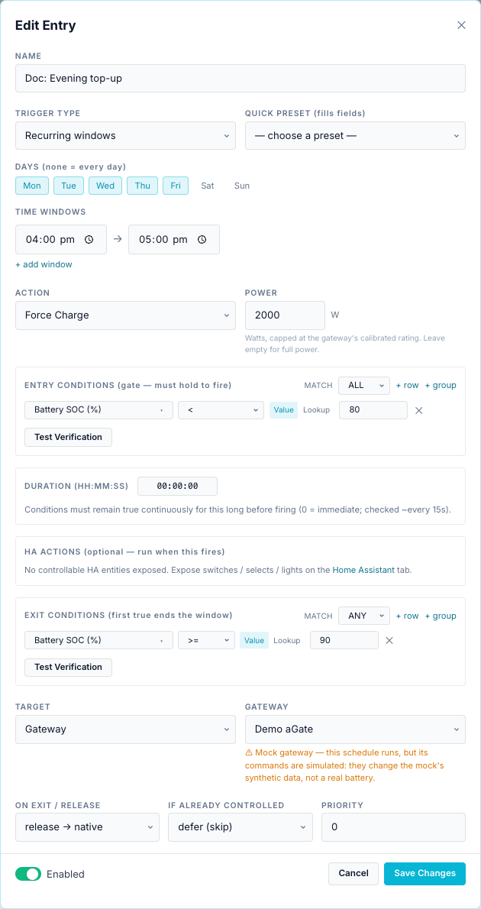
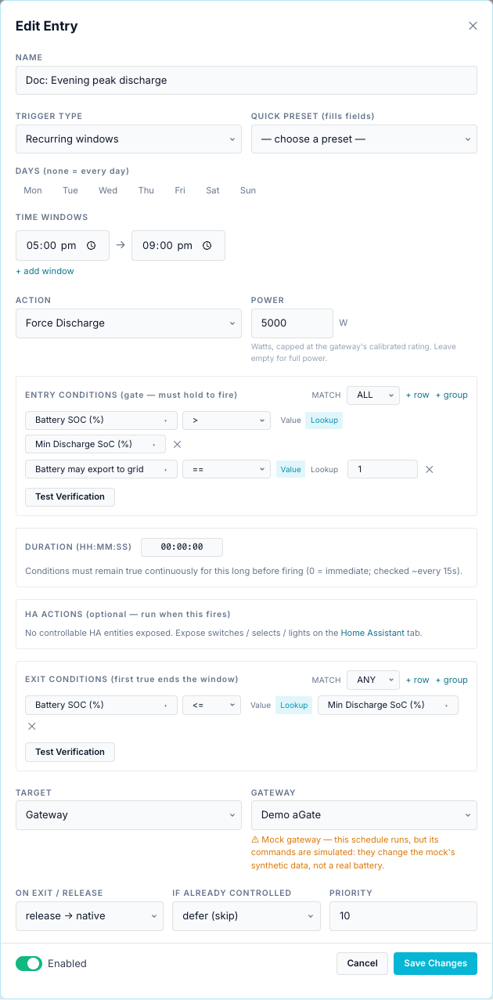
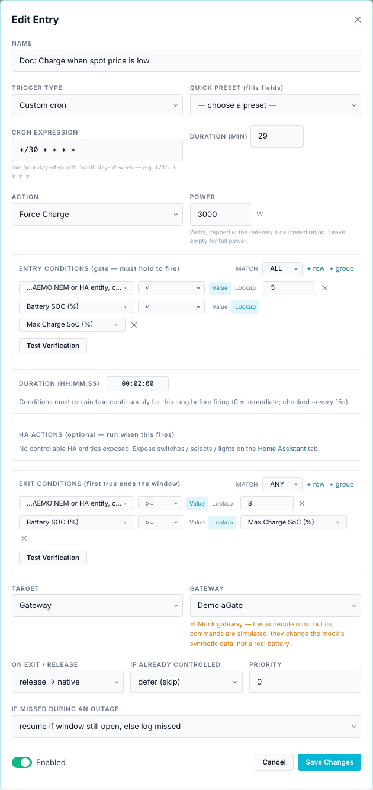
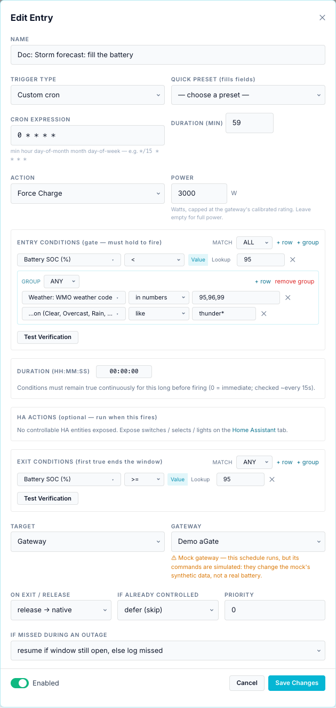
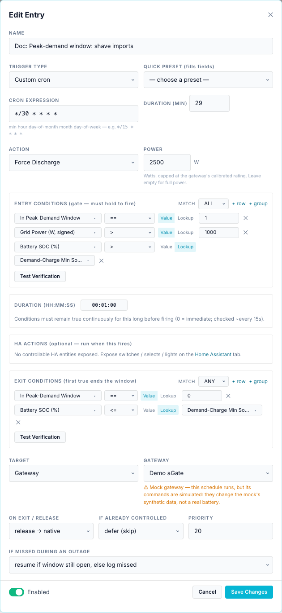
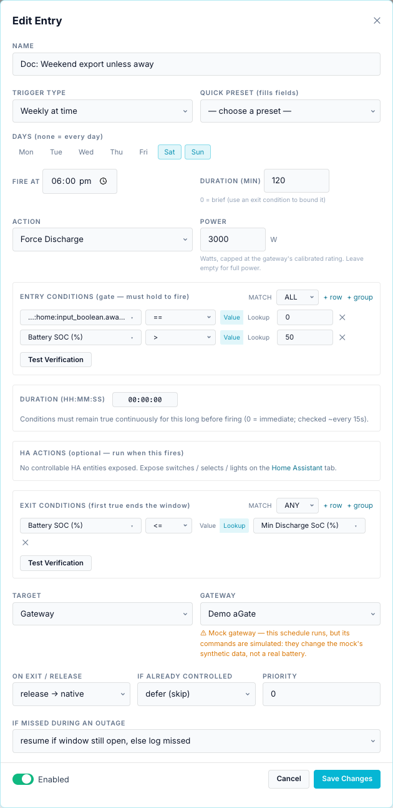
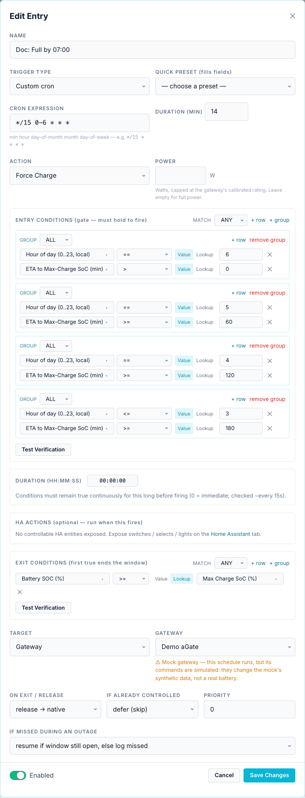

# Examples

Each recipe lists the fields to set, shows the finished form and explains how it behaves. The screenshots come from a demo (mock) gateway; on your bridge pick your own gateway as the target.

!!! tip "Before you start"
    - Force commands need a **trusted battery rating** on the gateway. See [Actions](actions.md#power).
    - Set the three [constants](conditions.md#notes-on-some-sensors) first: the recipes compare against them with **Lookup**.
    - New entries run as soon as you save them. Untick **Enabled** while you try things out, and use **Test Verification**.

## 1. Evening top-up

The walkthrough on the [Scheduler overview](index.md#your-first-schedule): Force Charge at 2000 W on weekdays 16:00–17:00 if SoC is below 80 %, until 90 %.

## 2. Evening peak discharge until the minimum SoC

Discharge through the evening peak, stop at your floor, and never export the battery if your plan forbids it.

| Field | Value |
|---|---|
| Trigger Type | Recurring windows, no days ticked (every day), `17:00 → 21:00` |
| Action | Force Discharge, Power `5000` |
| Entry conditions (ALL) | Battery SOC (%) `>` **Lookup** Min Discharge SoC (%) |
| | Battery may export to grid `==` `1` |
| Exit conditions (ANY) | Battery SOC (%) `<=` **Lookup** Min Discharge SoC (%) |
| Priority | `10` |

How it behaves:

- At 17:00 the bridge discharges at 5 kW (capped at the trusted rating) if SoC is above the constant.
- When SoC reaches the constant, the exit releases the battery and the entry rests until tomorrow's window.
- At 21:00 the window closes and the battery is released if still running.
- If SoC is below the floor at 17:00, the entry is *gated* and keeps checking until 21:00.
- The aGate's own reserve still applies: it will not discharge below its reserve, whatever the entry says.

## 3. Charge from the grid when the NEM spot price is low

Charge when the AEMO wholesale price drops below 5 c/kWh; stop when it rises to 8 c/kWh or the battery is full.

Needs: a NEM region (or HA price entity) at **Settings → Site & Gateways → Wholesale spot price**.

| Field | Value |
|---|---|
| Trigger Type | Custom cron `*/30 * * * *`, Duration (min) `29` |
| Action | Force Charge, Power `3000` |
| Entry conditions (ALL) | Wholesale spot price `<` `5` |
| | Battery SOC (%) `<` **Lookup** Max Charge SoC (%) |
| Duration (HH:MM:SS) | `00:02:00` |
| Exit conditions (ANY) | Wholesale spot price `>=` `8` |
| | Battery SOC (%) `>=` **Lookup** Max Charge SoC (%) |

How it behaves:

- Every half hour the entry opens for 29 minutes. Within that, it charges once the price has been below 5 c/kWh for 2 minutes in a row.
- The 1-minute gap each half hour re-arms the entry after an exit, so it can charge again the next time the price is low.
- 5 and 8 c/kWh are two thresholds on purpose: one threshold would start and stop on every small price move.
- Without a price (region not set, or the last price is over 30 minutes old) the gate fails and nothing happens.

!!! note "Why not *Always evaluate*?"
    An Always entry would stop for good after its first exit until the bridge restarts. See [Triggers](triggers.md#always-evaluate).

## 4. Storm forecast: fill the battery

Top the battery up when Open-Meteo reports a thunderstorm, so you have backup if the grid goes down.

Needs: a location at **Settings → Site & Gateways → Location & Solar**.

| Field | Value |
|---|---|
| Trigger Type | Custom cron `0 * * * *`, Duration (min) `59` |
| Action | Force Charge, Power `3000` |
| Entry conditions (ALL) | Battery SOC (%) `<` `95` |
| | **group (ANY)**: Weather: WMO weather code `in numbers` `95,96,99` |
| | **group (ANY)**: Weather: condition `like` `thunder*` |
| Exit conditions (ANY) | Battery SOC (%) `>=` `95` |

How it behaves:

- Each hour the entry is active for 59 minutes. If a thunderstorm is current and SoC is below 95 %, it charges until 95 %.
- `weather.code` and `weather.condition` describe the **current** weather, refreshed every 15 minutes.
- To hold the charge afterwards, add a second entry with **Force Standby** and the same weather gate. Raising the reserve with *Self Reserve %* is often ignored by the aGate (see [Actions](actions.md#reserve-and-operating-mode)).

## 5. Peak-demand window: shave imports using the Demand-Charge Min SoC

During your network's peak-demand window, discharge when the house is importing more than 1 kW, but keep the battery above the Demand-Charge Min SoC.

Needs: a utility service with **peak demand** and its window at **Settings → Energy & Automation → Electricity Utility Service(s)**; the Demand-Charge Min SoC constant.

| Field | Value |
|---|---|
| Trigger Type | Custom cron `*/30 * * * *`, Duration (min) `29` |
| Action | Force Discharge, Power `2500` |
| Entry conditions (ALL) | In Peak-Demand Window `==` `1` |
| | Grid Power (W, signed) `>` `1000` |
| | Battery SOC (%) `>` **Lookup** Demand-Charge Min SoC (%) |
| Duration (HH:MM:SS) | `00:01:00` |
| Exit conditions (ANY) | In Peak-Demand Window `==` `0` |
| | Battery SOC (%) `<=` **Lookup** Demand-Charge Min SoC (%) |
| Priority | `20` |

How it behaves:

- The hold-for of one minute ignores short load spikes.
- Priority 20 beats the evening discharge (10), so during the demand window this entry wins the gateway.
- `grid.power_w` is positive when importing. Once the battery discharges, grid import drops, but the run continues: the gate is not re-checked while running. It ends at the exit, at the end of the half-hour window, or when the next half hour re-checks the gate.
- Without a configured service, *In Peak-Demand Window* reads 0, so the gate fails and the entry does nothing.

The **Templates ▾ → Peak-demand shaving** template is a variant that compares the running 30-minute demand with the period peak (`demand.interval_kw >= demand.peak_kw`, a Lookup). It uses *Always evaluate*, so it fires once per bridge run; switch it to a cron trigger as here.

## 6. Weekend export, unless Home Assistant says you are away

Export the battery on Saturday and Sunday evenings, except when your HA *away mode* helper is on.

Needs: a Home Assistant instance on the **Home Assistant** tab, with `input_boolean.away_mode` exposed.

| Field | Value |
|---|---|
| Trigger Type | Weekly at time, **Sat**, **Sun**, Fire at `18:00`, Duration (min) `120` |
| Action | Force Discharge, Power `3000` |
| Entry conditions (ALL) | *HA instance*: away mode `==` `0` |
| | Battery SOC (%) `>` `50` |
| Exit conditions (ANY) | Battery SOC (%) `<=` **Lookup** Min Discharge SoC (%) |

How it behaves:

- `away_mode` is an on/off helper: `on` reads as 1, `off` as 0. Compare with `0`, not `false`.
- If Home Assistant is unreachable, the entity has no value and the gate fails: no export. That is the safe direction.
- The screenshot was taken on a bridge with no Home Assistant connected, so the picker shows the raw id `ha:home:input_boolean.away_mode`. On your bridge it reads *HA name: Away mode*.
- To skip a whole entry while away, this gate is enough. To also notify yourself, add a **Notify** HA action with message `Weekend export started at %battery.soc_pct%%`.

## 7. Full by 07:00, starting as late as possible

Charge overnight so the battery is full at 07:00, but start only when the remaining time is about the time needed. This uses the ETA sensor and the Max Charge SoC constant.

| Field | Value |
|---|---|
| Trigger Type | Custom cron `*/15 0-6 * * *`, Duration (min) `14` |
| Action | Force Charge, Power empty (full trusted rating) |
| Entry conditions (**ANY**) | group (ALL): Hour of day `==` `6`, ETA to Max-Charge SoC `>` `0` |
| | group (ALL): Hour of day `==` `5`, ETA to Max-Charge SoC `>=` `60` |
| | group (ALL): Hour of day `==` `4`, ETA to Max-Charge SoC `>=` `120` |
| | group (ALL): Hour of day `<=` `3`, ETA to Max-Charge SoC `>=` `180` |
| Exit conditions (ANY) | Battery SOC (%) `>=` **Lookup** Max Charge SoC (%) |

How it behaves:

- Every 15 minutes from 00:00 to 06:45 the entry opens for 14 minutes and checks the ladder: at 04:xx it starts if charging needs two hours or more, at 05:xx if it needs one hour, and so on.
- Each 14-minute window ends with a release, and the next one re-checks the ladder a minute later. Because the ETA only shrinks as the battery charges, a rung that passed usually still passes, so charging resumes. The run ends at the exit (full) or at 06:59.
- `battery.time_to_charge_min` assumes the gateway's **nameplate** charge rate (Model 702). If you set a lower Power, or your battery charges slower near full, add margin to each rung.
- The rungs are coarse (one hour). Add more groups for a finer ladder.

## More ideas

| Goal | Sketch |
|---|---|
| Solar sponge | Template **Ausgrid — Solar sponge (10am–3pm)**: window 10:00–15:00, Force Charge, gate SoC < Max Charge SoC, exit SoC ≥ Max Charge SoC. |
| Export bonus | Template **Battery export bonus**: gate `tariff.bonus_window_active == 1` and SoC > Min Discharge SoC. Change *Always* to a cron trigger. |
| Free-import window | Force Charge with gate `tariff.import_billable == 0`. |
| Alert on a timezone change | HA-only entry, cron `0 * * * *`, gate `time.tz_ok == 0`, Notify action "Bridge clock changed: %time.utc_offset_h% h". |
| Do nothing on a collar | Add `gateway.battery_capable == 1` to a Site entry's gate. |
| Respect the plan | Add `service.battery_export_allowed == 1` to every discharge entry. |
