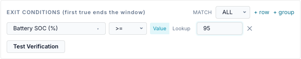
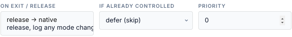

# Exit and release

How a run ends, and what the gateway does afterwards. Everything here is **per gateway**:
for a Site or Service target each member gateway ends its own run.

What happens when two entries, or you and an entry, want the same gateway is on
[Priorities and conflicts](priorities.md). Run now, Stop and the Activity Log are on
[Outcomes and audit](outcomes.md).

## How a run ends

A force command started by an entry ends at the **first** of these:

| End | Logged as | Fires again… |
|---|---|---|
| **Window ends** (window end, or fire time + Duration (min)) | *ok* — "window exit — released to native" | at the next window |
| **Exit conditions** become true | *exit_condition_met* | at the next window |
| **Time limit** reached (API `params.duration_s`) | *expired* — "dispatch ended in-window" | at the next window |
| **Target SoC** reached (API `params.target_soc`) | *expired* | at the next window |
| **Released elsewhere**: the Release button, the Controls tab, MQTT, another tool, the overshoot guard | *expired* | at the next window |
| **Stop** (■) on the entry | *stopped* | at the next window |
| Entry **disabled** or **deleted** | *ok* — released | when enabled again |
| **Bridge shuts down** | control log only: release, reason *shutdown* | after restart, if the window is still open |

<!-- @b EXT-01 ;; src: gateway/scheduler.py:835-884 ;; tested: tests/unit/test_scheduler.py::test_release_on_window_exit ;; write: yes ;; b: When the entry's window ends the owned run is released and audited ok 'window exit — released to native' ;; test: — -->
<!-- @b EXT-02 ;; src: gateway/scheduler.py:937-953 ;; tested: tests/unit/test_scheduler.py::test_watchdog_release_does_not_refire_within_window ;; write: yes ;; b: A run that ends inside its window (time limit, target SoC, external release, overshoot) is audited expired and the entry does not re-fire until the window is re-entered ;; test: — -->
<!-- @b EXT-03 ;; src: gateway/scheduler.py:845, gateway/scheduler.py:956-957 ;; tested: tests/unit/test_scheduler.py::test_refires_after_window_re_enter ;; write: yes ;; b: The done-for-this-window mark is cleared when the window closes, so the entry fires again in its next window ;; test: — -->
<!-- @b EXT-04 ;; src: gateway/scheduler.py:735-753, gateway/scheduler.py:456-461 ;; tested: tests/unit/test_scheduler.py::test_deleted_entry_releases_owned_target ;; write: yes ;; b: Disabling or deleting an entry removes it from the engine; a run it owned is released on the reload tick when no other entry is active on that target ;; test: — -->

"At the next window" means the entry is marked *done* for the current window and does not
fire again until its window closes and opens again. For an **Always** entry the window never
closes; see [Triggers → Always](triggers.md#always-evaluate).

!!! danger "A window end may not release when another entry is active on the gateway"
    A run is released at its window end only when **no other battery entry on the same
    target is active** at that moment. If another one is (an *Always* entry, or an
    overlapping window), the code hands the gateway to it instead:

    - If that entry's entry conditions pass, its own action replaces the run.
    - If they fail, **the old command keeps running** with no time limit, after its own
      window has ended. It stops only when the other entry's gate passes, its exit
      conditions are met, or something else releases it.
    - The other entry's **exit conditions** are evaluated against the old run and can end it.
    - The first entry's exit-time HA actions do not run at its window end.

    Until this is changed, avoid an *Always* battery entry on a gateway that has other
    battery entries, and give force entries a time limit through the API.

<!-- @b EXT-05 ;; src: gateway/scheduler.py:774-802, gateway/scheduler.py:835-836, gateway/scheduler.py:896-1018 ;; unclear ;; write: yes ;; b: At an entry's window end, if another battery entry on the same target is active, _battery_winner returns that entry instead of None, so the run is not released; a gated successor leaves the old command running with no limit ;; test: unit — entries A (window 10-11) and B (always, gate fails) on one gateway; tick 10:30 (A dispatches), tick 11:01; assert whether Release is sent (expected yes, code says no) -->
<!-- @b EXT-06 ;; src: gateway/scheduler.py:896-918 ;; unclear ;; write: yes ;; b: The exit check uses the winner's exit tree against the owner's run, so when the winner differs from the owner another entry's exit conditions end the run ;; test: unit — as EXT-05 with B having an exit condition that is true; assert the audit row's entry id -->

## Exit conditions

Exit conditions:

- are checked on every tick while this entry owns a running **force** command on that
  gateway, starting with the tick after the command was sent;
  <!-- @b EXT-07 ;; src: gateway/scheduler.py:896-905 ;; tested: tests/unit/test_scheduler_engine.py::test_first_tick_dispatches_even_if_exit_already_true ;; write: yes ;; b: Exit conditions are evaluated only while a sustained run is owned and the handler is active, so an exit already true at fire time still dispatches and ends the run on the next tick ;; test: — -->
- use the same sensors, operators, ALL/ANY and groups as [entry conditions](conditions.md);
- end the run as soon as they are true, release it with the **On exit / release** policy,
  log *exit_condition_met*, run the exit-time HA actions and mark the window done;
  <!-- @b EXT-08 ;; src: gateway/scheduler.py:902-918 ;; tested: tests/unit/test_scheduler_engine.py::test_exit_condition_releases_and_audits ;; write: yes ;; b: Met exit conditions release with the entry's release policy, audit exit_condition_met, run exit HA actions and block re-fire in the window ;; test: — -->
- are **not** checked for Release, Reserve, Mode or HA-only entries, nor for **Run now** or a
  **late fire** (the scheduler does not own those).
  <!-- @b EXT-09 ;; src: gateway/scheduler.py:896-900, gateway/scheduler.py:549-608 ;; untested ;; write: yes ;; b: Exit conditions are ignored for one-shot and none entries and for commands sent by Run now or a late fire ;; test: unit — Run now a force entry with a true exit condition; tick; assert no release -->

The Activity Log detail for *exit_condition_met* lists the exit rows that were **false** at
that moment, not the ones that ended the run. With an ANY block that is the rows that did not
match; with an ALL block it just says "exit conditions met".
<!-- @b EXT-10 ;; src: gateway/scheduler.py:909, gateway/scheduler.py:273-276 ;; untested ;; write: no ;; b: The exit_condition_met detail is built from failing leaves, so it names the rows that did not match ;; test: unit — ANY exit with one true and one false row; assert the detail names the false one (documents the confusing text) -->

Typical exits: `battery.soc_pct >= const.max_charge_soc` for a charge,
`battery.soc_pct <= const.min_discharge_soc` for a discharge, `tariff.spot_price >= 8` for a
price rule.

## Release policy

| Option (UI) | API `release_policy` | When the run ends |
|---|---|---|
| release → native | `release` (default) | The setpoint is cleared; the gateway goes back to whatever mode it is in. |
| release, log any mode change | `restore_prior_mode` | The same release. The bridge also compares the mode now with the mode when the run started and logs the result ("mode unchanged (TOU)" or "mode not restored: changed during dispatch (TOU → Self-Consumption), left as-is"). It never writes the old mode back. |
| *(API only)* | `set_operating_mode:<Mode>` | Release, then set that mode, for example `set_operating_mode:TOU`. Skipped when the mode is already in place or the gateway is known to ignore mode writes; the reason is logged. |

<!-- @b EXT-11 ;; src: gateway/scheduler.py:867-881, gateway/scheduler.py:1414-1428 ;; tested: tests/unit/test_scheduler_engine.py::test_exit_release_policy_plain_release_no_mode_command ;; write: yes ;; b: release_policy release sends a plain Release with no mode command ;; test: — -->
<!-- @b EXT-12 ;; src: gateway/scheduler.py:343-360, gateway/scheduler.py:1429-1433 ;; tested: tests/unit/test_scheduler_engine.py::test_exit_restore_prior_mode_leaves_mode_changed_mid_window ;; write: yes ;; b: restore_prior_mode releases and only audits the mode change between dispatch and release; it never writes a mode ;; test: — -->
<!-- @b EXT-13 ;; src: gateway/scheduler.py:1434-1446 ;; tested: tests/unit/test_scheduler_engine.py::test_exit_set_operating_mode_skips_write_locked_gateway ;; write: yes ;; b: set_operating_mode:<Mode> releases then writes the mode unless it is already in place or the gateway is mode-write-locked; a failed write is reported in the note ;; test: — -->

- The policy applies to every way a v2 run ends: window end, exit conditions and Stop. A
  plain window entry with **no conditions** always does a plain release (see
  [Concepts](concepts.md#legacy-and-v2-entries)).
  <!-- @b EXT-14 ;; src: gateway/scheduler.py:631-640, gateway/scheduler.py:871-879, gateway/scheduler.py:906 ;; tested: tests/unit/test_scheduler_engine.py::test_duration_elapsed_restore_prior_mode_does_not_rewrite_mode ;; write: yes ;; b: v2 entries apply release_policy on window/duration exit, exit conditions and Stop ;; test: unit — Stop on a restore_prior_mode entry; assert the stopped detail carries the mode note -->
- A run that ends **inside** its window by itself (time limit, target SoC, released
  elsewhere) has already been released; no policy is applied.
- The API accepts any text for `release_policy`. An unknown value releases plainly.
  <!-- @b EXT-15 ;; src: api/schedules_api.py:126, gateway/scheduler.py:1428-1447 ;; untested ;; write: no ;; b: release_policy is not validated; an unknown value behaves as a plain release ;; test: unit (API) — POST release_policy 'bogus' returns 201; engine releases plainly -->
- Entries created before the trigger fields existed were given `restore_prior_mode` by the
  database upgrade, so their Details panel shows it, but as plain window entries they release
  plainly. <!-- @b EXT-16 ;; src: store/db.py:552, gateway/scheduler.py:172-177 ;; untested ;; write: no ;; b: Migration 25 defaults release_policy to restore_prior_mode for existing rows, which legacy entries then ignore ;; test: unit — migrate a v24 database; a legacy row reads restore_prior_mode and releases plainly -->

### What a release does on the gateway

The command handler clears the setpoint and the revert timer, reads WSetEna back, and
records the dispatch as *released*, or *release_unverified* when WSetEna still reads 1. It
also clears any staged target SoC.
<!-- @b EXT-17 ;; src: publish/command_handler.py:687-739 ;; tested: tests/unit/test_dispatch_verification.py::test_handler_release_that_leaves_wset_enabled_is_not_verified ;; write: yes ;; b: A release reads WSetEna back; still 1 records release_unverified; the staged target SoC is cleared ;; test: — -->

## Hold instead of release (API only)

The API field `release` takes `release` (default) or `hold`. With `hold`, when the window of
a force command ends the bridge does **not** hand back: it switches to Force Standby (0 W)
and keeps the gateway in remote-control mode, so its own TOU or Self-Consumption logic stays
suppressed. The Activity Log says *"window exit — holding native suppressed"*. The form has
no control for this; it keeps whatever value the entry has.
<!-- @b EXT-18 ;; src: gateway/scheduler.py:852-866 ;; tested: tests/unit/test_scheduler.py::test_hold_keeps_standby_across_gap ;; write: yes ;; b: With release=hold the window end sends Force Standby and keeps ownership instead of releasing ;; test: — -->

!!! warning "A hold has no end of its own"
    The standby lasts until another entry takes the gateway, you press **Stop** on the
    entry, or you release the battery. **Disabling or deleting the entry does not end it**:
    the engine keeps the hold, with no time limit.

<!-- @b EXT-19 ;; src: gateway/scheduler.py:851-867, gateway/scheduler.py:737-743 ;; unclear ;; write: yes ;; b: Once in hold mode, a window-exit or entry-removed reconcile matches neither branch, so disabling or deleting the entry never releases the 0 W hold ;; test: unit — release=hold entry; window exit (standby); remove the entry; tick; assert no Release (documents the defect) -->

## Bridge shutdown

On a graceful shutdown the engine stops first, then each gateway releases its active
command (a fast release, no ramp-down). No *released* row is written to the Activity Log and
exit-time HA actions do not run. See [Restarts and the clock](restarts-and-clock.md).
<!-- @b EXT-20 ;; src: main.py:1083-1085, gateway/instance.py:450-455, publish/command_handler.py:1057-1067 ;; untested ;; write: yes ;; b: Shutdown stops the engine before the gateways, so active commands are released by the handlers with reason shutdown, with no Activity Log row and no exit HA actions ;; test: VM/mock — stop the bridge while a mock run is active; check control log (shutdown release) and Activity Log (no row) -->
