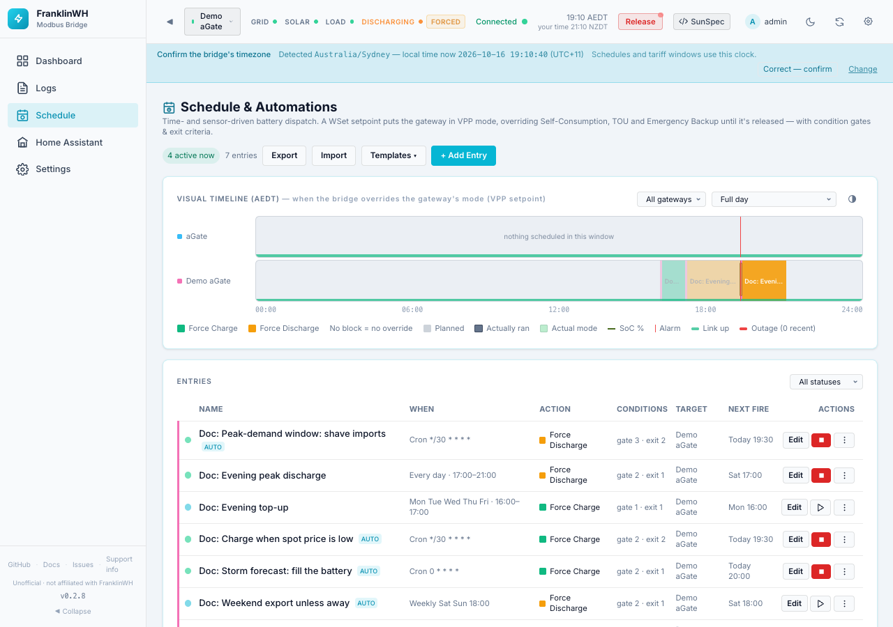
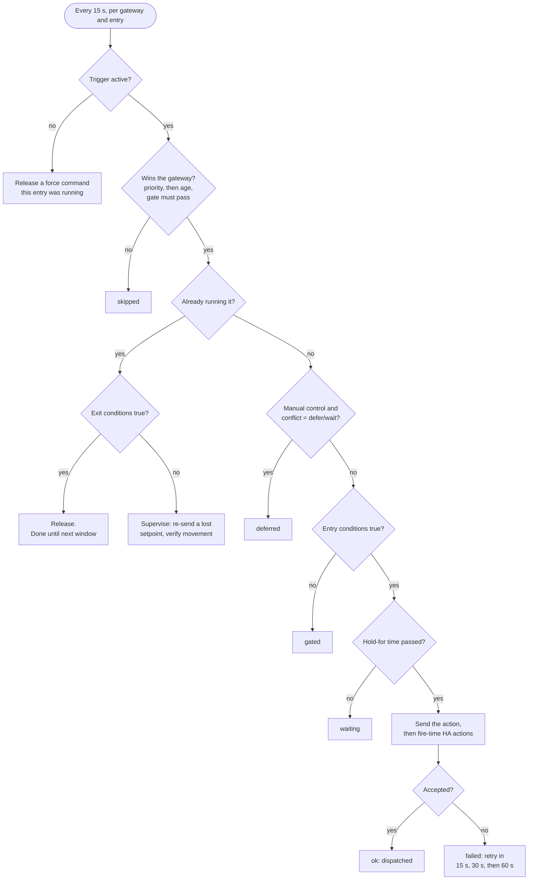
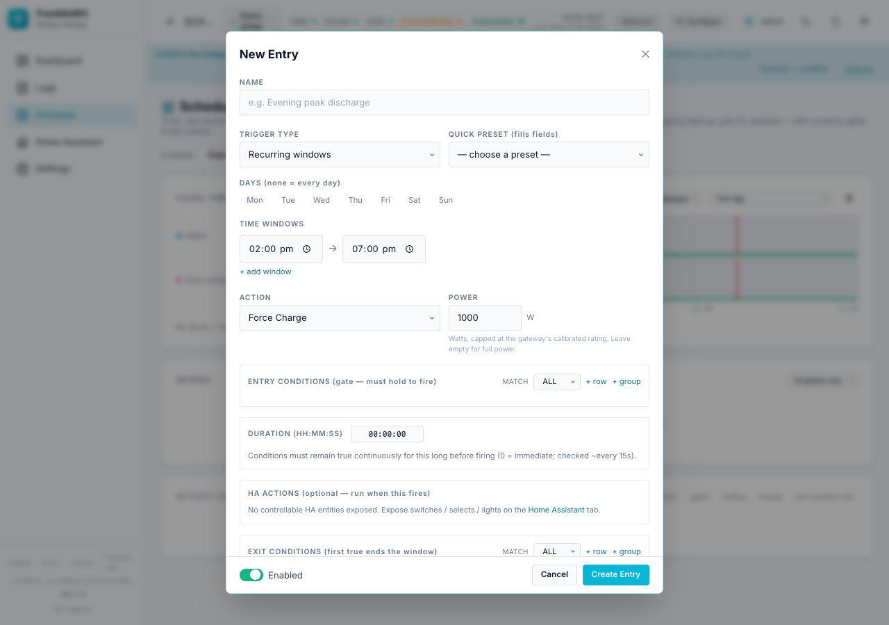
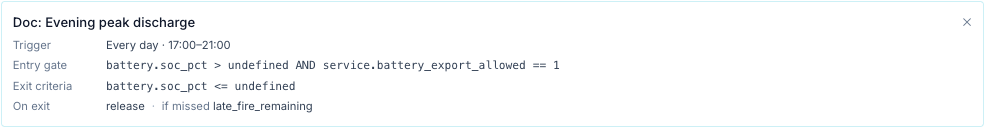
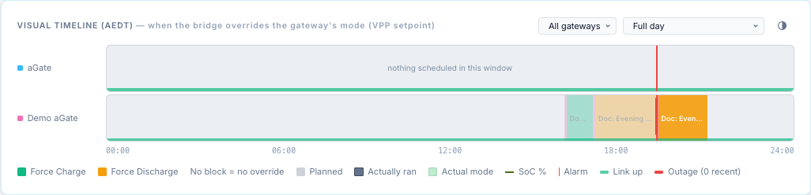

# Scheduler

The scheduler runs your battery on a plan. Each **entry** says *when* to act, *whether* conditions allow it, *what* to send to the aGate, and *when to stop*. The bridge checks every entry every 15 seconds and drives the gateway to match.

You find it on the **Schedule** tab (`/?tab=schedule`).

!!! warning "A force command takes the battery out of its own mode"
    Force Charge, Force Discharge and Force Standby write a *WSet* setpoint. That puts the aGate in remote-control (VPP) mode, which overrides Self-Consumption, TOU and Emergency Backup until the bridge releases it. While it holds, the FranklinWH app cannot change the mode.

## Pages in this section

| Page | What it covers |
|---|---|
| [Triggers](triggers.md) | Every trigger type: recurring windows, one-off date, daily, weekly, every N minutes, monthly, cron, always. Clock and timezone. Catch-up after an outage or restart. |
| [Conditions](conditions.md) | Every sensor in the condition picker, its unit, what it needs and how often it refreshes. Operators, Value vs Lookup, ALL/ANY, groups, hold-for dwell. |
| [Actions](actions.md) | Force charge / discharge / standby, release, operating mode, reserves, HA-only entries, Home Assistant actions and notifications. |
| [Exit, release and conflicts](exit-and-conflicts.md) | How a run ends, release policy, priority, conflict policy, multi-gateway targets, restart, dispatch verification and the overshoot guard. |
| [Dependencies and troubleshooting](dependencies.md) | What each condition and action needs, and fixes for "never fires", "always false" and "refused". |
| [Examples](examples.md) | Worked recipes with screenshots. |

## Concepts

| Term | Meaning |
|---|---|
| **Entry** | One row on the Schedule tab. Also called a schedule or an automation. It has a name, a trigger, an action and optional conditions. |
| **Trigger** | What makes the entry *active*: a time window, a fire time plus a duration, a cron expression, or "always". See [Triggers](triggers.md). |
| **Window** | The time an entry is active. For a recurring or one-off window entry it is the start and end you type. For the other triggers it is *fire time → fire time + Duration (min)*. |
| **Entry conditions** | The gate. All (or any) must be true for the action to be sent. Checked when the entry is about to dispatch, not while it is already running. |
| **Hold for (dwell)** | Labelled **Duration (HH:MM:SS)** in the form. The gate must stay true this long before the action is sent. |
| **Action** | What is sent to the gateway: a force command, a release, a mode, a reserve, or nothing (Home Assistant actions only). See [Actions](actions.md). |
| **HA actions** | Optional Home Assistant service calls or notifications that run when the entry fires, when it ends, or both. |
| **Exit conditions** | Checked while a force command is running. The first time they are true the run ends early. |
| **Target** | Which gateway(s) the action goes to: one gateway, every gateway on a utility service, or the whole site. |
| **Release policy** | What happens when the run ends. See [Exit, release and conflicts](exit-and-conflicts.md). |
| **Priority** | 0–1000. When two entries want the same gateway, the higher priority wins; on a tie the older entry wins. |

## How an entry is evaluated

Every 15 seconds (one *tick*) the bridge does this for each gateway and each entry that targets it:

A few rules fall out of this:

- **Conditions are a gate, not a leash.** Entry conditions are checked before the action is sent. Once a force command is running, only the **exit conditions**, the end of the window, a time limit or a target SoC stop it. A gate that turns false mid-run does *not* stop it.
- **One battery command per gateway.** If two entries are active for the same gateway, only one runs. The other is logged once as *skipped*.
- **Entries with the action "No battery action (HA only)" never compete.** They run on their own lane and never block a battery entry.
- **Nothing repeats needlessly.** Sending the same command again is skipped, so the battery is not re-commanded every tick.
- **Values come from the last poll.** Conditions read the gateway's latest cached sample. The scheduler never makes its own Modbus reads.

## Your first schedule

This walkthrough charges the battery to 90 % on weekday afternoons, but only if it is below 80 % when the window opens.

1. Open the **Schedule** tab and press **+ Add Entry**.

    

2. **Name:** `Evening top-up`.
3. **Trigger Type:** leave **Recurring windows**. Tick **Mon–Fri** under **Days** (none ticked means every day). Set the time window to `16:00 → 17:00`.
4. **Action:** **Force Charge**. **Power:** `2000` W. Leave Power empty to use the gateway's full *trusted* battery rating (see [Actions](actions.md#power)).
5. **Entry conditions:** press **+ row**. Pick **Battery SOC (%)**, operator `<`, value `80`.
6. **Exit conditions:** press **+ row**. Pick **Battery SOC (%)**, operator `>=`, value `90`.
7. Press **Test Verification** under each block to see whether the conditions hold right now. Each row turns green (passes), red (fails) or amber (no value).
8. **Target:** **Gateway**, and pick your gateway.
9. Leave **On exit / release** at *release → native*, **If already controlled** at *defer (skip)* and **Priority** at 0.
10. Press **Create Entry**.

The finished form:

What happens next:

- At 16:00 on a weekday the bridge checks SoC. Below 80 %, it sends Force Charge at 2000 W. At 80 % or more it logs *gated* and checks again every 15 s until the window closes, so it can still start at 16:20 if SoC drops.
- When SoC reaches 90 % the exit condition releases the battery and the entry is done until tomorrow.
- At 17:00 the window closes and the bridge releases the battery if it is still charging.

!!! tip "Try before you trust it"
    Use a mock gateway first. Its commands change simulated data only, and the form warns you when the target is a mock.

## The entry list

| Control | What it does |
|---|---|
| Dot at the left | Pulsing green = active now. Cyan = enabled. Grey = disabled. Click to enable or disable. |
| **auto** badge | The entry uses a trigger (daily, weekly, interval, monthly, cron, always) rather than a time window. |
| **When** | The window or trigger in words. |
| **Conditions** | How many entry (*gate*) and exit rows it has. |
| **Next fire** | The next window start or fire time, on the bridge's clock. "—" for Always entries. |
| **Edit** | Opens the form. Saving an entry that is running asks first, then applies the new settings to the live run. |
| ▶ (Run now) | Shown when the entry is not active. Sends the action immediately. See [Run now](exit-and-conflicts.md#run-now-and-stop). |
| ■ (Stop) | Shown while the entry is active. Releases this run; the entry fires again at its next window. |
| ⋯ → **Disable / Enable** | Turns the entry off or on. Disabling releases a run it owns. |
| ⋯ → **Details** | Shows the trigger, gate, exit criteria, release policy and missed policy. |
| ⋯ → **Duplicate** | Copies the entry. The copy starts **disabled**. |
| ⋯ → **Export** | Downloads this entry as JSON. |
| ⋯ → **Delete** | Removes the entry. |

The list shows **Enabled only** by default. Use the selector above the table for disabled or all entries.

### Templates, export and import

- **Templates ▾** opens a pre-filled entry for review: Peak-demand shaving, Battery export bonus, Ausgrid evening discharge (16:00–21:00) and Ausgrid solar sponge (10:00–15:00). Templates open **disabled**; after saving, the bridge asks whether to enable it.
- **Export** downloads every entry as a `franklinwh-automations` JSON bundle.
- **Import** takes a bundle (paste or file). **Validate** shows errors and warnings per entry, such as an unknown sensor or a missing Home Assistant instance. Imported entries are created **disabled**. An entry whose gateway does not exist here is pointed at the primary gateway.

## Visual timeline

The timeline shows today on the bridge's clock, one track per gateway.

- Coloured blocks are planned windows, coloured by action. Left of the red *now* line they fade to "planned".
- A solid inner bar marked *ran* is what actually dispatched, taken from the Activity Log.
- The background tint is the operating mode the gateway actually ran, the line is SoC, thin red marks are alarms, and the strip along the bottom is link state (red = outage).
- Trigger entries are drawn as fire time plus duration, with a top edge. Monthly and cron entries are not drawn.
- Use the selectors for one gateway, a zoom range, and the appearance (◐) panel.

## Activity Log

Every decision the scheduler makes is written here, newest first: config changes (created, updated, enabled, disabled, deleted) and engine results. The buttons at the top filter by result. The full list of results is in [Exit, release and conflicts](exit-and-conflicts.md#activity-log-results).
