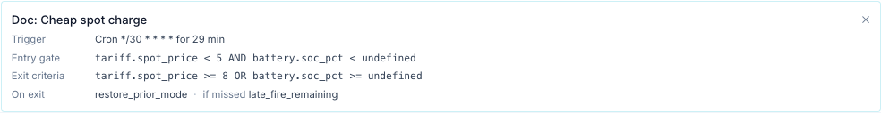

# Scheduler

The scheduler runs your battery on a plan. Each **entry** says *when* to act, *whether*
conditions allow it, *what* to send, *where* to send it and *when to stop*. The bridge checks
every enabled entry every 15 seconds and drives each gateway to match.

You find it on the **Schedule** tab (`/?tab=schedule`).

!!! warning "A force command takes the battery out of its own mode"
    Force Charge, Force Discharge and Force Standby write a *WSet* setpoint. That puts the
    aGate in remote-control (VPP) mode, which overrides Self-Consumption, TOU and Emergency
    Backup until the bridge releases it. While it holds, the FranklinWH app cannot change the
    mode.

Leave the aGate in Self-Consumption or Emergency Backup and use the Scheduler instead of the
FranklinWH app's Time-of-Use: see [Battery dispatch: best practice](../battery-dispatch-best-practice.md).

## Pages in this section

| Page | What it covers |
|---|---|
| [Concepts](concepts.md) | The model (trigger → conditions → action → target → exit → outcome), the tick, by time / by event / by sensor. **Start here.** |
| [Triggers](triggers.md) | Every trigger type, Next fire, catch-up after an outage or restart. |
| [Conditions](conditions.md) | Operators, Value vs Lookup, groups and items (ALL/ANY), scope, hold-for, Test Verification, every sensor. |
| [Actions](actions.md) | Battery actions and sizing, reserve and mode, HA-only entries, Home Assistant actions and notifications. |
| [Targets](targets.md) | Gateway, Service and Site; fan-out; entries with no target id. |
| [Exit and release](exit-and-conflicts.md) | How a run ends, exit conditions, release policy, hold. |
| [Priorities and conflicts](priorities.md) | Which entry gets a gateway, manual control, who sent what. |
| [Outcomes and audit](outcomes.md) | Activity Log, retries, supervision, dispatch record, notifications, Run now and Stop. |
| [Restarts and the clock](restarts-and-clock.md) | What a restart does, the bridge clock, daylight saving. |
| [Dependencies and troubleshooting](dependencies.md) | What each condition and action needs; fixes for "never fires", "always false", "refused". |
| [Examples](examples.md) | Worked recipes with screenshots. |

!!! note "What these pages are based on"
    The scheduler pages describe the code of this release. Many behaviours have no automated
    test yet; the [Scheduler test plan](../../dev/scheduler-test-plan.md) lists each one with
    its test status, and the pages flag the known problems in warning boxes.

## Your first schedule

This walkthrough charges the battery to 90 % on weekday afternoons, but only if it is below
80 % when the window opens.

1. Open the **Schedule** tab and press **+ Add Entry**.

    

2. **Name:** `Evening top-up`.
3. **Trigger Type:** leave **Recurring windows**. Tick **Mon–Fri** under **Days** (none ticked
   means every day). Set the time window to `16:00 → 17:00`.
4. **Action:** **Force Charge**. **Power:** `2000` W. Leave Power empty to use the gateway's
   full *trusted* battery rating (see [Actions](actions.md#power-and-sizing)).
5. **Entry conditions:** press **+ row**. Pick **Battery SOC (%)**, operator `<`, value `80`.
6. **Exit conditions:** press **+ row**. Pick **Battery SOC (%)**, operator `>=`, value `90`.
7. Press **Test Verification** under each block to see whether the conditions hold right now.
   Each row turns green (passes), red (fails) or amber (no value).
8. **Target:** **Gateway**, and pick your gateway.
9. Leave **On exit / release** at *release → native*, **If already controlled** at
   *defer (skip)* and **Priority** at 0.
10. Turn **Enabled** off while you try it, then press **Create Entry**.

The finished form:

What happens once it is enabled:

- At 16:00 on a weekday the bridge checks SoC. Below 80 %, it sends Force Charge at 2000 W.
  At 80 % or more it logs *gated* and checks again every 15 s until the window closes, so it
  can still start at 16:20 if SoC drops.
- When SoC reaches 90 % the exit condition releases the battery and the entry is done until
  tomorrow.
- At 17:00 the window closes and the bridge releases the battery if it is still charging.

!!! tip "Try before you trust it"
    Use a mock gateway first. Its commands change simulated data only, and the form warns you
    when the target is a mock.

## The entry list

| Control | What it does |
|---|---|
| Dot at the left | Pulsing green = active now (its window is open). Cyan = enabled. Grey = disabled. Click to enable or disable. |
| **auto** badge | An enabled entry with a fire-based trigger (daily, weekly, interval, monthly, cron, always). |
| **When** | The window or trigger in words. |
| **Conditions** | How many top-level entry (*gate*) and exit items it has. |
| **Target** | The gateway name, *Site (all gateways)* or the service. |
| **Next fire** | The next window start or fire time, on the bridge's clock. "—" for Always entries and triggers that never fire. |
| **Edit** | Opens the form. Saving an entry that is active asks first, then applies the new settings to the live run. |
| ▶ (Run now) | Shown when the entry is not active. Sends the action immediately. See [Run now](outcomes.md#run-now-and-stop). |
| ■ (Stop) | Shown while the entry is active. Ends this run; the entry fires again at its next window. |
| ⋯ → **Disable / Enable** | Turns the entry off or on. Disabling releases a run it owns (see the [warnings](exit-and-conflicts.md#how-a-run-ends)). |
| ⋯ → **Details** | Shows the trigger, gate, exit criteria, release policy and missed policy. |
| ⋯ → **Duplicate** | Copies the entry. The copy starts **disabled**. |
| ⋯ → **Export** | Downloads this entry as JSON. |
| ⋯ → **Delete** | Removes the entry. |

<!-- @b IDX-01 ;; src: static/js/schedule_tab.js:236-241, templates/tabs/schedule.html:338 ;; untested ;; write: no ;; b: The entry list shows enabled entries only by default ;; test: browser — a disabled entry is hidden until the selector is All -->
<!-- @b IDX-02 ;; src: static/js/schedule_tab.js:1552-1584 ;; untested ;; write: no ;; b: Duplicate POSTs a copy named '(copy)' with enabled false ;; test: browser — duplicate; the copy is disabled -->
<!-- @b IDX-03 ;; src: static/js/schedule_tab.js:1395-1407, gateway/scheduler.py:984-989 ;; tested: tests/unit/test_scheduler.py::test_power_change_redispatches ;; write: yes ;; b: Saving a running entry asks to confirm; a changed action or parameter re-dispatches on the reload tick, new gates and exits apply from the next tick ;; test: — -->

The list shows **Enabled only** by default. Use the selector above the table for disabled or
all entries.

### Templates, export and import

- **Templates ▾** opens a pre-filled entry for review: Peak-demand shaving, Battery export
  bonus, Ausgrid evening discharge (16:00–21:00) and Ausgrid solar sponge (10:00–15:00).
  Templates open **disabled**; after saving, the bridge asks whether to enable it.
  <!-- @b IDX-04 ;; src: static/js/schedule_tab.js:1039-1126, static/js/schedule_tab.js:1478-1493 ;; untested ;; write: yes ;; b: Templates open disabled and the enable prompt after save appears only when the form opened disabled ;; test: browser — open a template, save, answer the prompt; check enabled -->
- **Export** downloads every entry as a `franklinwh-automations` JSON bundle.
- **Import** takes a bundle (paste or file). **Validate** shows errors and warnings per entry,
  such as an unknown sensor or a missing Home Assistant instance. Imported entries are created
  **disabled**. An entry whose gateway does not exist here is pointed at the gateway `default`.
  <!-- @b IDX-05 ;; src: api/schedules_api.py:424-493 ;; tested: tests/unit/test_schedules_v2_api.py::test_export_bundle_shape ;; write: no ;; b: Export returns a franklinwh-automations v1 bundle of portable fields; import is a dry run unless dry_run=false and creates entries disabled ;; test: — -->

## Visual timeline

The timeline shows today on the bridge's clock, one track per gateway.

- Coloured blocks are planned windows of **enabled** entries, coloured by action. Left of the
  red *now* line they fade to "planned".
- A solid inner bar marked *ran* is what actually dispatched, taken from the Activity Log.
- The background tint is the operating mode the gateway actually ran, the line is SoC, thin
  red marks are alarms, and the strip along the bottom is link state (red = outage).
- Fire-based entries are drawn as fire time plus duration (at least 8 minutes wide), with a
  top edge. *Every N minutes* shows at most 96 blocks a day. Monthly, cron and Always entries
  are not drawn.
- A **one-off** entry is drawn on every day with the same weekday as its date, including
  after the date has passed. The timeline is a preview; the date is what the engine uses.
- Use the selectors for one gateway, a zoom range, and the appearance (◐) panel.

<!-- @b IDX-06 ;; src: gateway/scheduler_triggers.py:324-384, api/schedules_api.py:543-595 ;; tested: tests/unit/test_scheduler_triggers.py::test_day_segments_min_width_for_zero_duration ;; write: no ;; b: Timeline segments: enabled entries only, fire+duration at least 8 min, interval capped at 96, monthly/cron/always not drawn ;; test: — -->
<!-- @b IDX-07 ;; src: api/schedules_api.py:585-590, gateway/scheduler_triggers.py:374-382 ;; tested: tests/unit/test_scheduler_triggers.py::test_day_segments_oneoff_on_matching_weekday_only ;; write: no ;; b: One-off date windows and API oneoff triggers are drawn on the matching weekday in any week, also after the date has passed ;; test: unit (API) — timeline for a past one-off date's weekday still returns its segment (documents the preview gap) -->

## Activity Log

Every decision the scheduler makes is written to the **Activity Log**, newest first. The
result list and the filter buttons are on [Outcomes and audit](outcomes.md#activity-log-results).
