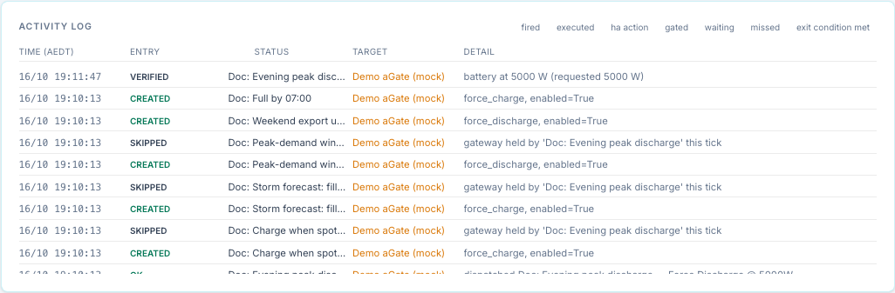
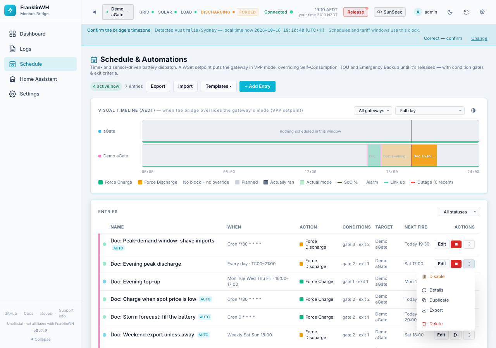

# Outcomes and audit

How you find out what an entry did: the Activity Log, the control log, the dispatch record and
notifications. Also the two buttons that act outside the schedule: **Run now** and **Stop**.

## Where to look

| Where | What |
|---|---|
| **Schedule → Activity Log** | every decision the scheduler makes, newest first, and every config change |
| **Logs → control log** | every command the gateway's command handler sent, refused or released, with who asked (`— by schedule:<entry id>`), the hardware state before and after, and the release reason |
| **Dispatch record** (`GET /api/gateways/{gw}/dispatch-outcomes`) | one row per force command sent to the gateway and how it ended |
| **Notifications** | failure, *not effective* and recovery alerts to the entry's notify targets |

## Activity Log results

| Result | Meaning |
|---|---|
| created, updated, enabled, disabled, deleted | a config change; the detail lists the changed fields |
| ok | a dispatch ("dispatched <name> — Force Discharge @ 3000W"), a release or hold at window exit, or a release when the entry was disabled or deleted |
| gated | entry conditions failed (the detail lists up to four failing rows with live values); also an HA action whose guard failed, and Run now blocked by conditions |
| waiting | conditions met, hold-for timer running |
| skipped | another entry holds the gateway; or a failure alert with no notify target |
| deferred | the gateway is under manual control and the conflict policy is defer or wait |
| exit_condition_met | exit conditions ended the run |
| expired | the command ended inside the window (time limit, target SoC, external release, overshoot) |
| stopped | you pressed Stop |
| released | someone released the entry's command outside the scheduler: the top bar's **Release** button, or the API ("released by <user> — Released"). A scheduled run released this way can also show *expired* when the scheduler next checks it |
| executed | Run now |
| missed, late_fired | catch-up after an outage or restart |
| verified, unverifiable, not_effective, reasserted | dispatch supervision |
| failed | a send failed or was refused, an HA action failed, or supervision gave up |
| ha_action | an HA action or notification succeeded |

<!-- @b OUT-01 ;; src: api/schedules_api.py:203-260 ;; tested: tests/unit/test_schedules_v2_api.py::test_crud_changes_are_audited ;; write: no ;; b: Create, update, enable, disable, delete and import are audited to the Activity Log with the changed fields ;; test: — -->
<!-- @b OUT-02 ;; src: api/schedules_api.py:496-513, store/db.py:1924-1950 ;; tested: tests/unit/test_schedules_v2_api.py::test_log_filter_by_status ;; write: no ;; b: GET /api/schedules/log filters by schedule_id and status (the audit result), newest first, limit 1-500 ;; test: — -->

The filter buttons above the log are *fired*, *executed*, *ha action*, *gated*, *waiting*,
*missed* and *exit condition met*. The engine records dispatches as *ok*, so **the *fired*
filter never shows anything**; clear the filter to see dispatches. The page shows the latest
40 rows. <!-- @b OUT-03 ;; src: static/js/schedule_tab.js:290, static/js/schedule_tab.js:322-324, gateway/scheduler.py:1088 ;; untested ;; write: no ;; b: The fired filter matches no row because dispatches are audited ok; the log shows 40 rows ;; test: browser — click fired with dispatches present; the list is empty -->

## Retries

A force command that fails, or is refused, is not owned. The entry tries again after
**15 s, 30 s, then every 60 s** while its window is open and it still wins the gateway. Each
attempt logs *failed* — "dispatch failed: <reason> — attempt N, retrying in 15s".

| Event | Activity Log | Notification |
|---|---|---|
| First failure in the window | *failed* | `FAILED: <entry> — <reason>. Retrying.` |
| Later failures | *failed* | none |
| A retry succeeds | *ok* — "… recovered after N failed attempt(s)" | `Recovered: <entry> dispatched after N failed attempt(s)` |
| The window closes with no success | *failed* — "window ended without a successful dispatch (N attempt(s); last: …)" | `FAILED: <entry> — window ended without a successful dispatch …` |

<!-- @b OUT-04 ;; src: gateway/scheduler.py:61, gateway/scheduler.py:991-997, gateway/scheduler.py:1234-1253 ;; tested: tests/unit/test_dispatch_verification.py::test_t6_every_attempt_fails_bounded_and_one_final_failure_at_window_end ;; write: yes ;; b: Failed sends retry at 15 s, 30 s, then every 60 s; the first failure and the window-end failure are notified ;; test: — -->
<!-- @b OUT-05 ;; src: gateway/scheduler.py:1047, gateway/scheduler.py:1086-1093 ;; tested: tests/unit/test_dispatch_verification.py::test_t1_failed_send_is_failed_not_ok_and_retried_with_backoff ;; write: yes ;; b: A successful retry is audited ok with 'recovered after N failed attempt(s)' and notified as Recovered ;; test: — -->
<!-- @b OUT-06 ;; src: gateway/scheduler.py:991-995 ;; untested ;; write: yes ;; b: A pending retry is dropped when a different entry wins the gateway ;; test: unit — entry A fails, entry B (higher priority) becomes active; assert A's retry is not attempted -->

## Supervision of a running command

While an entry owns a running force command, every tick checks it against the gateway's
latest poll. It uses only good polls no older than 45 seconds; with no fresh poll it skips the
check. <!-- @b OUT-07 ;; src: gateway/scheduler.py:1255-1268, gateway/scheduler.py:1280-1282 ;; tested: tests/unit/test_dispatch_verification.py::test_t3_stale_points_do_not_trigger_verification_or_reassert ;; write: yes ;; b: Supervision uses only ok-quality points no older than 45 s; otherwise it does nothing that tick ;; test: — -->

| Check | When | If it fails |
|---|---|---|
| **Setpoint still enabled** (WSetEna = 1) | every tick | The command is sent again and logged *reasserted* (up to 3 times per run). After that: *failed* — "setpoint lost 3 times — not re-sending again this window", plus a notification. |
| **Battery is moving** | 90 s after the send | It must run in the commanded direction at at least max(100 W, 20 % of the request); Standby must be within 200 W of zero. Pass: *verified* — "battery at 2950 W (requested 3000 W)". Fail: *not_effective* and one re-send; if it still fails 90 s later, *not_effective* "even after a re-send" plus a notification. |
| **At a SoC limit** | at the 90 s check | Charging at 98 % SoC or more, or discharging within 3 % of the active reserve, is not judged: *unverifiable*. |

<!-- @b OUT-08 ;; src: gateway/scheduler.py:1285-1314 ;; tested: tests/unit/test_dispatch_verification.py::test_t4_lost_setpoint_is_reasserted_then_capped ;; write: yes ;; b: A lost setpoint (WSetEna 0) is re-sent up to 3 times per run, then audited failed and notified once ;; test: — -->
<!-- @b OUT-09 ;; src: gateway/scheduler.py:1316-1345 ;; tested: tests/unit/test_dispatch_verification.py::test_t2_moving_battery_is_verified_once_with_no_extra_writes ;; write: no ;; b: 90 s after the send the battery must move the commanded way at >= max(100 W, 20 % of request) (standby within 200 W) to be verified ;; test: — -->
<!-- @b OUT-10 ;; src: gateway/scheduler.py:1330-1336, gateway/scheduler.py:1380-1388 ;; tested: tests/unit/test_dispatch_verification.py::test_t7_soc_limit_is_not_judged_as_not_effective ;; write: no ;; b: A charge at >= 98 % SoC or a discharge within 3 % of the reserve is audited unverifiable, not not_effective ;; test: — -->
<!-- @b OUT-11 ;; src: gateway/scheduler.py:1346-1373 ;; tested: tests/unit/test_dispatch_verification.py::test_t2_not_effective_resends_once_then_notifies ;; write: yes ;; b: A not-moving battery gets one re-send; still not moving 90 s later is final not_effective with a NOT EFFECTIVE notification ;; test: — -->
<!-- @b OUT-12 ;; src: gateway/scheduler.py:920-929 ;; untested ;; write: no ;; b: Supervision runs only for runs the engine owns: not for Run now, late fires, manual commands or a hold ;; test: unit — execute() a force entry; advance 90 s with a stationary battery; assert no not_effective row -->

## The dispatch record

Each force command sent to a gateway gets one row, with the requester, the requested power and
a state:

| State | Meaning |
|---|---|
| `sent` | accepted, and WSetEna read back as 1 |
| `failed` | the write failed, or WSetEna did not read back as 1 |
| `verified` | the battery was seen moving the commanded way |
| `not_effective` | accepted, but the battery did not move |
| `reasserted` | the aGate dropped the setpoint and it was sent again |
| `released` / `release_unverified` | released; *unverified* when WSetEna still read 1 afterwards |
| `superseded` | replaced by a newer command, or stopped by a failed send |

<!-- @b OUT-13 ;; src: store/dispatch_outcomes.py:1-31, publish/command_handler.py:526-535, publish/command_handler.py:648-676, publish/command_handler.py:725-730 ;; tested: tests/unit/test_dispatch_verification.py::test_handler_new_command_supersedes_the_active_row ;; write: no ;; b: The command handler writes one dispatch_outcomes row per battery command (sent or failed) and moves it to released, release_unverified or superseded ;; test: — -->
<!-- @b OUT-14 ;; src: gateway/scheduler.py:1306-1308, gateway/scheduler.py:1339-1340, gateway/scheduler.py:1348-1350, gateway/scheduler.py:1375-1377 ;; untested ;; write: no ;; b: The engine moves the row to verified, not_effective or reasserted; the engine tests run with db None, so these updates are not exercised ;; test: unit — engine with a real db and VHandler; assert the row states after verify and not_effective -->

A **refused** command (untrusted rating) or an unknown command is **not sent**, so it gets no
row here. The scheduler still sees it as a failed send (since 0.2.9) and logs it *failed*; the
control log has *command_refused*.
<!-- @b OUT-15 ;; src: publish/command_handler.py:1014-1022, publish/command_handler.py:431-440 ;; untested ;; write: no ;; b: A refused or unknown battery command creates no dispatch_outcomes row; only last_dispatch is set not-ok ;; test: unit — refused Force Discharge; assert dispatch_outcomes.recent() is empty and last_dispatch.ok is False -->

Read it with `GET /api/gateways/{gw}/dispatch-outcomes?limit=100`.
<!-- @b OUT-16 ;; src: api/gateways_api.py:1298-1308 ;; tested: tests/unit/test_dispatch_verification.py::test_dispatch_outcomes_endpoint ;; write: no ;; b: GET /api/gateways/{gw}/dispatch-outcomes lists that gateway's rows newest first ;; test: — -->

## Overshoot guard

The command handler watches each force command. If, 20 s or more after the start, the battery
runs at more than **1.25 × the request + 500 W**, the rating it was sized against must be
wrong. The bridge then releases the command (reason *overshoot*), marks that direction's
rating as contradicted, and refuses further force commands in that direction until you
calibrate again. For the scheduler this shows as *expired*.
<!-- @b OUT-17 ;; src: publish/command_handler.py:90-92, publish/command_handler.py:1024-1056 ;; tested: tests/unit/test_battery_rating.py::test_overshoot_guard_releases_and_revokes_trust ;; write: yes ;; b: After 20 s a battery above 1.25 x request + 500 W is released (reason overshoot) and the rating for that direction is contradicted ;; test: — -->

## Notifications

Sent only for **force** entries, and only to the notify targets on that entry, with the title
*FranklinWH bridge*:

| Message starts with | When |
|---|---|
| `FAILED: <entry> — <reason>. Retrying.` | the first failed attempt in a window, including a refused command |
| `FAILED: <entry> — window ended without a successful dispatch` | the window closed and no attempt succeeded |
| `FAILED: <entry> — setpoint lost 3 times` | the aGate kept dropping the setpoint |
| `NOT EFFECTIVE: <entry> — battery at … W` | the battery was not moving the commanded way, even after a re-send |
| `Recovered: <entry> dispatched after N failed attempt(s)` | a retry succeeded |

An entry with no Notify action gets none; the Activity Log records *skipped — no notify target
on this entry*. Set one up in [Home Assistant setup](../ha-setup.md#failure-alerts-scheduler-notifications-you-dont-write).
<!-- @b OUT-18 ;; src: gateway/scheduler.py:1250-1253, gateway/scheduler.py:843-844, gateway/scheduler.py:1294, gateway/scheduler.py:1372, gateway/scheduler.py:1090-1093 ;; tested: tests/unit/test_dispatch_verification.py::test_t2_not_effective_resends_once_then_notifies ;; write: no ;; b: The five alert messages are sent from the failure, window-end, setpoint-lost, not-effective and recovery paths ;; test: — -->

## Run now and Stop

| Button | Shown | What it does |
|---|---|---|
| ▶ **Run now** | while the entry is **not** active | Sends the action now, whatever the time. |
| ■ **Stop** | while the entry is active (its window is open, even if it is gated) | Ends this run and blocks the entry for the rest of the window. |

<!-- @b OUT-19 ;; src: templates/tabs/schedule.html:407-414, api/schedules_api.py:278 ;; untested ;; write: no ;; b: Stop is shown when active_now (window open, enabled) and Run now otherwise, regardless of whether a command is running ;; test: browser — a gated entry in an open window shows Stop -->

### Run now

1. Press ▶ and confirm **Fire**.
2. The bridge checks the entry conditions on each target gateway (the REST API can skip this
   with `?force=true`).
3. It sends the action to each gateway that passes, logs *executed* (or *gated*), and shows
   *Fired* or *Skipped — entry conditions not met*.

<!-- @b OUT-20 ;; src: gateway/scheduler.py:549-608, api/schedules_api.py:516-526 ;; tested: tests/unit/test_scheduler_engine.py::test_execute_respects_entry_conditions_unless_forced ;; write: yes ;; b: Run now checks entry conditions per gateway unless force=true, sends the action, audits executed or gated and returns fired, gated or noop ;; test: — -->

A Run now command is **not owned by the scheduler**:

- it uses the entry's **Duration (min)** as its time limit; a window entry usually has none,
  so a force command then **runs until you release it**;
  <!-- @b OUT-21 ;; src: gateway/scheduler.py:569-571, gateway/scheduler.py:319-321 ;; untested ;; write: yes ;; b: Run now stages the entry's duration_s as the time limit; with none it stages 0 and the command is open-ended ;; test: unit — execute() a window entry with no duration; assert battery_command_duration '0' -->
- no exit conditions, verification, release policy or HA actions;
- it ignores **If already controlled** and replaces a manual command;
  <!-- @b OUT-22 ;; src: gateway/scheduler.py:585-600 ;; untested ;; write: yes ;; b: Run now does not check the conflict policy and supersedes a manual command ;; test: unit — manual Force Charge active; execute() a force_discharge entry with conflict defer; assert it is sent -->
- **Stop** does not see it (*Nothing active to stop*); release it from the top bar or the
  Controls tab;
- on the next ticks, entries for that gateway (including this one, if its window opens)
  treat it as manual control.

Through the API, Run now works while the entry is active too, and on an entry that already
finished its window. <!-- @b OUT-23 ;; src: gateway/scheduler.py:549-608 ;; untested ;; write: yes ;; b: execute() ignores the trigger window and the done-for-window mark ;; test: unit — execute() an entry whose window is closed and one that is expired; both dispatch -->

### Stop

1. Press ■ and confirm **Stop now**.
2. The bridge releases every gateway this entry owns (with its release policy), runs the
   exit-time HA actions and logs *stopped* — "stopped by user — released; won't re-fire until
   the next window".
3. The entry stays enabled and fires again at its next window. Disable it to stop it for good.

<!-- @b OUT-24 ;; src: gateway/scheduler.py:610-659 ;; tested: tests/unit/test_scheduler_engine.py::test_stop_entry_releases_and_blocks_refire ;; write: yes ;; b: Stop releases every owned gateway with the release policy, runs exit HA actions, audits stopped and blocks re-fire until the window re-opens ;; test: — -->
<!-- @b OUT-25 ;; src: gateway/scheduler.py:650-659 ;; untested ;; write: yes ;; b: Stop with nothing owned returns not_active but still blocks the rest of the current window on every target gateway ;; test: unit — stop_entry() on a gated entry, then make the gate pass; assert no dispatch in that window -->

Stop on an entry with nothing running answers *Nothing active to stop*, but still blocks the
rest of the current window: a gated entry will not start later in that window.
