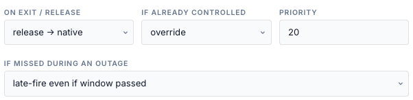
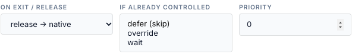

# Priorities and conflicts

A gateway runs one battery command at a time. This page says which entry gets it, and what
happens when you, Home Assistant or another tool are already driving the battery.

| Setting | Values | Default |
|---|---|---|
| **Priority** | 0–1000; higher wins | 0 |
| **If already controlled** | defer (skip), override, wait | defer |

<!-- @b PRI-01 ;; src: api/schedules_api.py:118-119 ;; untested ;; write: no ;; b: priority is 0-1000 (default 0) and conflict is defer, override or wait (default defer); other values are rejected ;; test: unit (API) — priority 1001 and conflict 'x' return 422 -->

## Entries on the same target

Entries compete only with entries that have **the same target** (same type and id) and a
**battery action**. Release, Reserve % and Operating Mode entries are battery actions too;
*No battery action* entries never compete.

On each tick, for each gateway of the target, the engine picks one entry:

1. **The entry already running there keeps it**, for as long as its window is open, even if
   its gate turns false and **even if a higher-priority entry becomes active**. Priority
   decides who gets a free gateway; it does not interrupt a run.
2. Otherwise, the **highest-priority** active entry **whose entry conditions pass** wins.
   Ties go to the **oldest** entry (created first).
3. If no active entry's gate passes, the top-ranked one is picked so that it logs its own
   *gated* row.

<!-- @b PRI-02 ;; src: gateway/scheduler.py:755-802 ;; tested: tests/unit/test_scheduler_engine.py::test_gated_battery_entry_steps_aside_for_the_next_one ;; write: yes ;; b: The winner is the incumbent, else the first entry in priority/age order whose gate passes, else the top-ranked active entry (which audits its gate) ;; test: — -->
<!-- @b PRI-03 ;; src: gateway/scheduler.py:779-784 ;; untested ;; write: yes ;; b: A running entry keeps the gateway while active even when a higher-priority entry becomes active; there is no preemption by priority ;; test: unit — low-priority entry running; a priority-100 entry's window opens; assert the low one keeps the gateway and the high one logs skipped -->
<!-- @b PRI-04 ;; src: store/db.py:1772-1788 ;; untested ;; write: yes ;; b: At equal priority the older entry (created_at ascending) ranks first ;; test: unit — two equal-priority entries created in order; assert get_schedules order and the engine winner -->
<!-- @b PRI-05 ;; src: gateway/scheduler.py:722-723 ;; untested ;; write: yes ;; b: Release, reserve and mode entries share the battery lane with force entries, so a one-shot entry can win the gateway and keep it for its whole window while a force entry is skipped ;; test: unit — mode entry (priority 10, 1 h window) and force entry (priority 0) overlapping; assert the force entry is skipped for the hour -->

Each entry that loses is logged once per contest as *skipped* — "gateway held by '<name>'
this tick". <!-- @b PRI-06 ;; src: gateway/scheduler.py:804-829 ;; tested: tests/unit/test_scheduler_engine.py::test_gated_battery_entry_steps_aside_for_the_next_one ;; write: no ;; b: Entries that lose the gateway are audited skipped once per contest (a new winner starts a new contest) ;; test: — -->

!!! tip "Give one-shot entries a short window"
    A Mode or Reserve entry holds the gateway for its whole window, although it only writes
    once. Use a fire-based trigger with no duration (one minute) for them, so they do not
    block a force entry on the same gateway.

### Example

| Entry | Priority | Window | Gate |
|---|---|---|---|
| Evening discharge | 10 | 17:00–21:00 | SoC > 20 % |
| Peak-demand shave | 20 | cron `*/30`, 29 min | in demand window |

At 17:00 both are active. If the demand gate passes, *Peak-demand shave* wins (20 > 10) and
the evening entry logs *skipped*. If the demand gate fails, the evening entry runs. Once the
evening entry runs, it keeps the gateway until its window ends, even when the demand gate
starts to pass at 17:30. Read the [window-end warning](exit-and-conflicts.md#how-a-run-ends)
before you combine entries like this.

## Manual control

*Already controlled* means the gateway's command handler is running a force command that
this target's entries did not send, or a different command from the one the owner sent.
That covers the Controls tab, the top-bar buttons, the Home Assistant / MQTT command
entities, the REST API, **Run now**, a **late fire**, and entries on **other targets**.
<!-- @b PRI-07 ;; src: gateway/scheduler.py:959-963 ;; tested: tests/unit/test_scheduler.py::test_conflict_defer_leaves_manual_alone ;; write: yes ;; b: Foreign control is a handler-active command that this target key does not own (or whose action differs from the owner's) ;; test: — -->

| Option (UI) | API `conflict` | Behaviour |
|---|---|---|
| defer (skip) | `defer` (default) | Leave the manual command alone. Logged once as *deferred* — "target under manual control (Force Charge)". The entry takes over when the manual command ends, if its window is still open. |
| override | `override` | Replace the manual command with this entry's action. The control log records the manual command as *superseded*. |
| wait | `wait` | Behaves exactly like defer. |

<!-- @b PRI-08 ;; src: gateway/scheduler.py:964-980 ;; tested: tests/unit/test_scheduler.py::test_conflict_defer_leaves_manual_alone ;; write: yes ;; b: defer and wait leave a manual command alone, drop stale ownership and audit deferred once ;; test: unit — conflict wait behaves like defer -->
<!-- @b PRI-09 ;; src: gateway/scheduler.py:980-981, publish/command_handler.py:553-561 ;; tested: tests/unit/test_scheduler.py::test_conflict_override_preempts_manual ;; write: yes ;; b: override replaces the manual command; the handler logs command_superseded ;; test: — -->
<!-- @b PRI-10 ;; src: gateway/scheduler.py:937-953, gateway/scheduler.py:970-980 ;; untested ;; write: yes ;; b: After a deferred manual command ends, the entry dispatches if its window is still open and it has not completed the window ;; test: unit — defer, then manual released mid-window; assert the entry dispatches on the next tick -->

Only **force** entries honour this setting. Release, Mode and Reserve entries act regardless
(see [Actions](actions.md)).

### What the bridge cannot see

- **Another tool writing the setpoint straight to the aGate** is not manual control here: the
  command handler did not send it. An entry dispatches over it. The control log records it as
  *external_dispatch_started*, and `dispatch.source` reads `manual`.
  <!-- @b PRI-11 ;; src: publish/command_handler.py:596-646, gateway/scheduler.py:960-963, gateway/scheduler.py:1524-1535 ;; untested ;; write: yes ;; b: A setpoint written by another tool leaves handler.state.active false, so entries dispatch over it; the handler logs external_dispatch_started and dispatch.source reads manual ;; test: unit — handler inactive, points wset_enabled 1; entry with defer dispatches; dispatch_points source manual before the dispatch -->
- **A manual command with the same action as the running entry** looks like the entry's own
  command. The engine adopts it and releases it at the window end.
  <!-- @b PRI-12 ;; src: gateway/scheduler.py:960-962, gateway/scheduler.py:984-989 ;; unclear ;; write: yes ;; b: Ownership is matched by action label only, so a manual Force Charge sent while an entry owns a Force Charge is treated as the entry's and released at window end ;; test: unit — entry owns Force Charge; a manual Force Charge at another power is sent; window ends; assert Release -->

- **A manual command sent over a running entry** is checked by the entry's supervision before
  the conflict policy. Within the first 90 seconds, or before the run is verified, the entry
  can judge the battery *not effective* and re-send its own command over yours. Once the run
  is verified, a different manual command makes the entry give up ownership (*deferred* with
  defer).
  <!-- @b PRI-15 ;; src: gateway/scheduler.py:920-929, gateway/scheduler.py:1316-1364, gateway/scheduler.py:959-980 ;; unclear ;; write: yes ;; b: Supervision runs before the foreign-control check, so a manual command replacing an unverified scheduled run can be overwritten by the not-effective re-send ;; test: unit — VHandler: entry dispatches Force Charge; before verification switch the handler to a manual Force Discharge with battery_power_w discharging; tick past 90 s; assert whether the entry re-sends -->

## Entries on different targets

Priority only compares entries with **the same target**. An entry for *Site*, one for a
*Service* and one for the gateway itself (or one with no target id and one with `default`)
are arbitrated separately, even when they end up on the same physical gateway:

- each treats the other's running command as **manual control**, so its **If already
  controlled** setting decides;
- with *defer* the second entry waits; with *override* it takes the gateway, and the first
  entry may then try to take it back. Priority plays no part.

Keep all battery entries for one gateway on the same target type.
<!-- @b PRI-13 ;; src: gateway/scheduler.py:686-692, gateway/scheduler.py:713-727, gateway/scheduler.py:960-980 ;; unclear ;; write: yes ;; b: Arbitration is per (target_type, target_id); entries reaching one gateway through different targets are not ranked by priority and see each other as manual control ;; test: unit — gateway entry (priority 0, override) and site entry (priority 100, defer) both active on one gateway; tick several times; record who runs and whether the command alternates -->

## Who sent what (requester)

Every battery command records who asked for it. Scheduled commands carry
`schedule:<entry id>`, and so do the scheduler's own releases and mode changes (window exit,
exit conditions, Stop); Run now and late fires carry the same; the Controls tab, the top
bar's Release and the REST API carry `user:<account>`; Home Assistant / MQTT commands carry
`mqtt`. You see it in **Logs → control log** ("— by schedule:sch_1a2b3c4d"), in **Logs →
Battery-control writes** and in the dispatch record. Arbitration does not use it:
ownership lives in the engine's memory and is lost on restart. A Run now uses it to tell
when another command has replaced it.
<!-- @b PRI-14 ;; src: gateway/scheduler.py:1208-1230, publish/command_handler.py:314-330, publish/command_handler.py:530-532, api/gateways_api.py:1206, publish/mqtt_publisher.py:881 ;; tested: tests/unit/test_dispatch_verification.py::test_command_records_who_sent_it ;; write: no ;; b: Scheduled, Run now and late-fire sends carry requester schedule:<id>, recorded on the control log and dispatch_outcomes; arbitration does not read it ;; test: — -->
