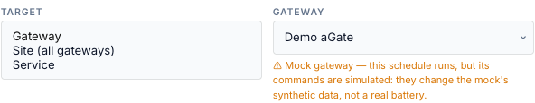
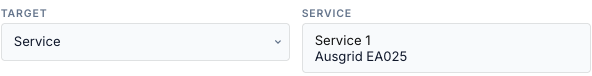
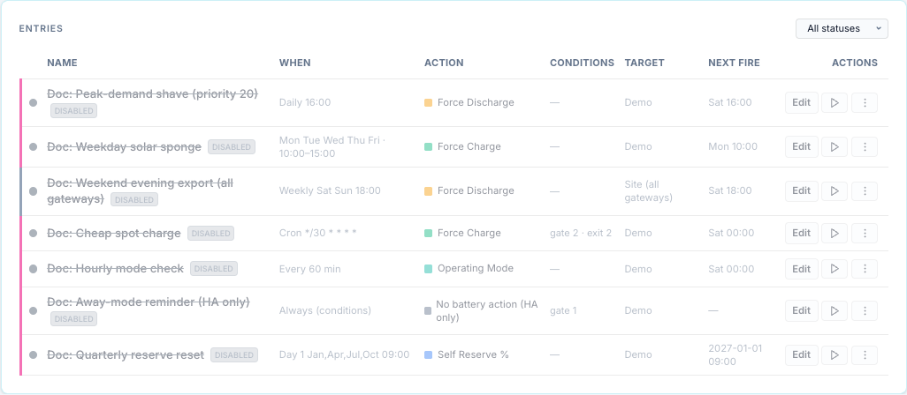

# Targets

The target says which gateway or gateways an entry acts on. One entry can drive one
gateway, every gateway on a utility service, or every gateway on the site.

## Pick a target

1. In the entry form, open **Target**.
2. Pick **Gateway**, **Site (all gateways)** or **Service**.
3. For Gateway or Service, pick it in the list next to it.

=== "Gateway"

    

=== "Site (all gateways)"

    

=== "Service"

    

| Target (UI) | API `target_type` / `target_id` | Acts on |
|---|---|---|
| Gateway | `gateway` / the gateway id | that gateway, once it has been started, **even while it is not polling** (for example during an outage) |
| Site (all gateways) | `site` / none | every **running** (polling) gateway, mock gateways included |
| Service | `service` / the service id | every running gateway linked to that utility service |

<!-- @b TGT-01 ;; src: main.py:569-573, gateway/registry.py:48-58 ;; untested ;; write: yes ;; b: A gateway target resolves to that gateway's handler whenever the gateway is registered (started), without checking is_running; site and service require is_running ;; test: unit — build the resolver over a fake registry; assert pairs for gateway, site and service targets -->
<!-- @b TGT-02 ;; src: main.py:574-578 ;; untested ;; write: yes ;; b: A site target resolves to every running gateway (registry.list_active), mock gateways included; target_id is ignored ;; test: unit — fake registry with a running real and a running mock and a stopped gateway; assert two pairs -->
<!-- @b TGT-03 ;; src: main.py:579-586 ;; untested ;; write: yes ;; b: A service target resolves to running gateways whose config.service_id equals target_id; a service target without an id resolves to nothing ;; test: unit — as TGT-02 with service ids -->

The list shows the target of each entry:

## How a fan-out works

For Site and Service, each member gateway is handled on its own:

| Per gateway | Detail |
|---|---|
| Conditions | evaluated on that gateway's own values (see [Conditions → Scope](conditions.md#scope-which-gateways-values)) |
| Ownership | one run per gateway; one gateway can be running while another is gated |
| Release | each gateway is released at its own exit |
| Activity Log | one row per gateway; the Target column names the gateway, with *(mock)* for a mock |

<!-- @b TGT-04 ;; src: gateway/scheduler.py:412-416, gateway/scheduler.py:724-727 ;; tested: tests/unit/test_scheduler.py::test_fanout_ownership_is_per_gateway ;; write: yes ;; b: A fan-out target is reconciled per member gateway with ownership keyed (type, id, gateway) ;; test: — -->
<!-- @b TGT-05 ;; src: gateway/scheduler.py:835-884 ;; tested: tests/unit/test_scheduler.py::test_fanout_releases_all_on_window_exit ;; write: yes ;; b: At window exit every member gateway the entry owns is released ;; test: — -->
<!-- @b TGT-06 ;; src: gateway/scheduler.py:1552-1564, main.py:683-689 ;; tested: tests/unit/test_scheduler_audit_reserve.py::test_target_label_uses_gateway_name_and_mock_flag ;; write: no ;; b: Activity Log target is the gateway's name with (mock) for a mock gateway ;; test: — -->

The member list is worked out again on every tick:

- A gateway that **joins** (starts, or is linked to the service) is picked up on the next tick.
- A gateway that **leaves** while the entry runs on it (unlinked from the service, or no
  longer polling for a Site target) is **not released**. The engine can no longer reach it
  through the target, drops its records, and the command keeps running on that gateway until
  something else releases it. Release it from the Controls tab or the top bar.
  When the gateway comes back (polling again), the entry no longer owns that command and
  treats it as manual control: with *defer* it logs *deferred* and never releases it.
  <!-- @b TGT-16 ;; src: main.py:574-578, gateway/scheduler.py:745-753, gateway/scheduler.py:960-980 ;; unclear ;; write: yes ;; b: After a site/service member stops polling and comes back, the entry's earlier command is no longer owned and is treated as foreign (deferred), so it is not released at window end ;; test: VM/mock — site entry running on a mock; stop the mock's polling for > 1 tick and restore; check the Activity Log for deferred and whether the window end releases -->
  <!-- @b TGT-07 ;; src: gateway/scheduler.py:735-753 ;; untested ;; write: yes ;; b: A member gateway that leaves a fan-out while owned is not released: the handler is re-resolved through the target, is not found, and the records are dropped (the command keeps running) ;; test: unit — site target over gwA and gwB, both owned; remove gwA from the resolver; tick; assert gwA got no Release (documents the defect). Deleted-entry release is covered by test_deleted_entry_releases_owned_target -->
- For Site and Service, a gateway that is **not polling** is skipped without an Activity
  Log row. A Gateway target is sent to even while its gateway is not polling: the send fails
  and is retried and reported like any [failed dispatch](outcomes.md#retries). A gateway that
  is stopped, disabled or unknown is skipped silently.
  <!-- @b TGT-08 ;; src: main.py:569-586, gateway/scheduler.py:724 ;; untested ;; write: yes ;; b: A target that resolves to no gateway is skipped silently (no dispatch, no audit row); a registered but stopped gateway on a gateway target is still sent to ;; test: unit — resolver returns []; tick; assert no audit rows. VM/mock — stop the mock gateway; a gateway-target entry logs failed and retries -->

**Run now** on a Site or Service entry sends the action to every member at once, each
after its own condition check. <!-- @b TGT-09 ;; src: gateway/scheduler.py:578-605 ;; untested ;; write: yes ;; b: Run now on a fan-out target dispatches to every member gateway that passes its own gate ;; test: unit — execute() with a two-gateway resolver; assert both handlers receive the command -->

## Entries with no target id

The form always saves a gateway id for a Gateway target. Through the API, a Gateway target
with **no `target_id`** (null or missing) acts on the gateway whose id is `default`. If no
gateway has that id, the entry does nothing.
<!-- @b TGT-10 ;; src: main.py:570, api/schedules_api.py:228, api/schedules_api.py:115 ;; untested ;; write: yes ;; b: A gateway target with target_id null resolves to the literal gateway id default ;; test: unit — resolver('gateway', None) returns the default gateway's handler; returns [] when there is no default -->

!!! warning "`default` and no id are two different targets"
    An entry with no `target_id` and an entry with `target_id: "default"` act on the same
    gateway, but the engine groups entries by the target as stored. They are not compared by
    priority: each sees the other's command as manual control (see
    [Priorities and conflicts](priorities.md#entries-on-different-targets)).

<!-- @b TGT-11 ;; src: gateway/scheduler.py:686-692, main.py:570 ;; unclear ;; write: yes ;; b: target_id null and 'default' form two arbitration groups for the same physical gateway ;; test: unit — two entries, target_id None and 'default', priorities 10 and 0, both active; assert which one runs and whether the other logs deferred -->

## In the form

- Switching **Target** to **Service** keeps the gateway id that was selected until you pick a
  service from the list. If you save without picking one, the entry is saved with that
  gateway id (or `default`) as its service id and matches no gateway. Pick the service
  explicitly. <!-- @b TGT-12 ;; src: static/js/schedule_tab.js:1416, templates/tabs/schedule.html:1247-1254 ;; unclear ;; write: yes ;; b: The service select sets target_id only on change, and save sends target_id || 'default', so an untouched Service target is saved with a gateway id or 'default' ;; test: browser — new entry, switch Target to Service, save without touching the list; GET target_id -->
- A Site target is saved with no target id.
- Picking a **mock** gateway shows a warning: its commands change simulated data only.
  <!-- @b TGT-13 ;; src: templates/tabs/schedule.html:1244-1245 ;; untested ;; write: no ;; b: The form warns when the selected gateway is a mock ;; test: browser — pick a mock gateway; the amber warning shows -->
- **Test Verification** for a Site or Service target checks the gateway `default` only.
- **Import** points an entry whose gateway does not exist on this bridge at `default`.
  <!-- @b TGT-14 ;; src: api/schedules_api.py:467-470 ;; tested: tests/unit/test_schedules_v2_api.py::test_import_creates_disabled_with_gateway_fallback ;; write: no ;; b: Import re-targets an unknown gateway id to default and creates the entry disabled ;; test: — -->

## On the timeline

Gateway entries are drawn on their gateway's track; Site entries on every track; Service
entries only when the timeline shows all gateways.
<!-- @b TGT-15 ;; src: static/js/schedule_tab.js:886-896 ;; untested ;; write: no ;; b: Timeline: site segments paint on every gateway, gateway segments on their own, service segments only in the All view ;; test: browser — one entry of each target type; switch the timeline gateway selector -->
