# Triggers

The trigger decides when an entry is **active**. Conditions and actions only matter while
it is active. This page covers starting **by time**; starting **by event** or **by sensor**
is a trigger plus entry conditions (see [Concepts](concepts.md#three-ways-to-start) and
[Conditions](conditions.md)).

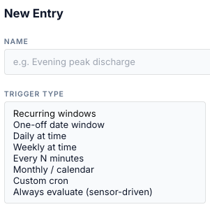

## Summary

| Trigger Type (UI) | API | Fields | Active |
|---|---|---|---|
| Recurring windows | `when_spec` (no `trigger_kind`) | Days, one or more time windows | inside any window, on the ticked days |
| One-off date window | `when_spec.date` | Date, one or more time windows | inside any window, on that date only |
| Daily at time | `trigger_kind: daily` | Fire at, Duration (min) | fire time → + duration, every day |
| Weekly at time | `weekly` | Days, Fire at, Duration (min) | fire time → + duration, on the ticked days |
| Every N minutes | `interval` | Every (min), Anchor, Duration (min) | each fire → + duration |
| Monthly / calendar | `monthly` | Day of month, Fire at, Duration (min), Months | fire time → + duration |
| Custom cron | `cron` | Cron expression, Duration (min) | each cron match → + duration |
| Always evaluate (sensor-driven) | `always` | — | always |
| *(API only)* | `oneoff` | `fire_at` (ISO date-time), `duration_s` | fire time → + duration, once |

Window triggers are *legacy* entries unless they also have conditions; the others are
*v2*. See [Concepts](concepts.md#legacy-and-v2-entries).

## Fire-based triggers: the active window

For Daily, Weekly, Every N minutes, Monthly, Cron and the API one-off, the bridge finds the
most recent fire time at or before now. The entry is active from that fire time until fire
time + **Duration (min)**. <!-- @b TRG-01 ;; src: gateway/scheduler.py:180-199, gateway/scheduler_triggers.py:387-411 ;; tested: tests/unit/test_scheduler_engine.py::test_trigger_inactive_after_duration_window ;; write: yes ;; b: A fire-based entry is active during [previous fire, previous fire + duration_s) ;; test: — -->

!!! warning "Duration (min) empty or 0 means one minute"
    With no duration the active window is **60 seconds**. That is enough for a one-shot
    action (a mode, a reserve, a notification). A force command sent in that minute is
    **released about a minute later** at the window end. Set a duration for force commands:
    an exit condition can end a run earlier, never later.
    <!-- @b TRG-02 ;; src: gateway/scheduler.py:197-199 ;; untested ;; write: yes ;; b: A fire-based entry with duration_s empty or 0 is active for 60 s, so a force command is released about a minute after it starts ;; test: unit — daily trigger, duration_s None; tick at fire+30 s (active, dispatch) and fire+61 s (Release sent) -->

!!! note "Duration (min) is not the same as Duration (HH:MM:SS)"
    *Duration (min)* sits with the trigger and sets how long the entry stays active.
    *Duration (HH:MM:SS)* sits under the entry conditions and is the
    [hold-for time](conditions.md#hold-for-dwell).

All triggers work to the minute: seconds are dropped before fire times are compared, so a
fire time equal to the current minute counts as now.
<!-- @b TRG-03 ;; src: gateway/scheduler_triggers.py:241-243, gateway/scheduler_triggers.py:395-397 ;; tested: tests/unit/test_scheduler_triggers.py::test_daily_exactly_now ;; write: no ;; b: Fire times are computed at minute resolution; a fire at the current minute counts as now ;; test: — -->

## Recurring windows

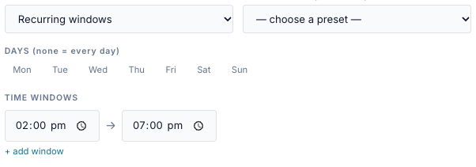

1. Tick the **Days**. None ticked means every day.
2. Type a **start → end** time. **+ add window** adds another; ✕ removes one (one must stay).

| Field | Values | Notes |
|---|---|---|
| Days | Mon … Sun, any combination | None ticked = every day. |
| Time windows | start → end, `HH:MM` | Any window matching makes the entry active. |

- The entry is active from *start* up to, but not including, *end*.
  <!-- @b TRG-04 ;; src: gateway/scheduler.py:120-138 ;; tested: tests/unit/test_scheduler.py::test_inactive_outside_window ;; write: yes ;; b: A recurring window is active from start up to but not including end ;; test: — -->
- **None ticked = every day.** A day not ticked is skipped.
  <!-- @b TRG-05 ;; src: gateway/scheduler.py:97, gateway/scheduler.py:135-136 ;; tested: tests/unit/test_scheduler.py::test_empty_days_means_every_day ;; write: yes ;; b: An empty days list means every day; a weekday not in the list is inactive ;; test: — -->
- **Several windows** on one entry: the entry is active inside any of them.
  <!-- @b TRG-06 ;; src: gateway/scheduler.py:138 ;; untested ;; write: yes ;; b: An entry with several windows is active inside any one of them ;; test: unit — two windows 06:00-07:00 and 16:00-17:00; assert active at 06:30 and 16:30, inactive at 12:00 -->
- **End earlier than start wraps past midnight.** `22:00 → 06:00` runs overnight; the form
  says *wraps past midnight*. <!-- @b TRG-07 ;; src: gateway/scheduler.py:120-126 ;; tested: tests/unit/test_scheduler.py::test_window_wraps_past_midnight ;; write: yes ;; b: A window whose end is earlier than its start wraps past midnight ;; test: — -->
- **The day check uses today's date, not the day the window opened.** With only **Mon**
  ticked, `22:00 → 06:00` is active Monday 00:00–06:00 and Monday 22:00–24:00, not
  Monday night into Tuesday. Tick both days if you want both halves.
  <!-- @b TRG-08 ;; src: gateway/scheduler.py:135-138 ;; untested ;; write: yes ;; b: For an overnight window the weekday test uses the current day, so the after-midnight part belongs to the next day's tick ;; test: unit — days=[0], 22:00-06:00; assert active Mon 02:00 and Mon 23:00, inactive Tue 02:00 -->
- **Start equal to end matches nothing.** <!-- @b TRG-09 ;; src: gateway/scheduler.py:122-123 ;; tested: tests/unit/test_scheduler.py::test_end_equals_start_matches_nothing ;; write: no ;; b: A window with start equal to end is never active ;; test: — -->
- **`24:00` is midnight.** An end of `24:00` is read as `00:00`, so `18:00 → 24:00` runs
  to midnight. The API accepts `H:MM` or `HH:MM`; hours above 23 wrap.
  <!-- @b TRG-10 ;; src: gateway/scheduler.py:80-86, api/schedules_api.py:55-57 ;; untested ;; write: yes ;; b: Times are parsed modulo 24 h, so 24:00 means 00:00 and 18:00-24:00 runs to midnight; unparsable times become 00:00 ;; test: unit — 18:00-24:00 active at 23:59, inactive at 00:01; _to_minutes('25:10') == 70 -->

## One-off date window

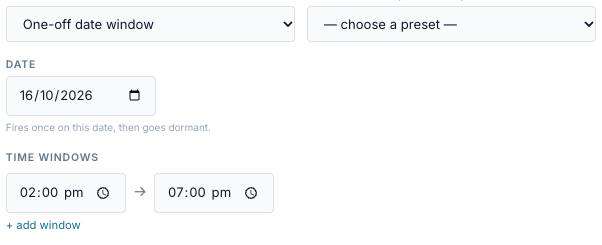

| Field | Values | Notes |
|---|---|---|
| Date | a calendar date | Defaults to the bridge's today. |
| Time windows | start → end | Same rules as recurring windows. |

- The entry is active only on that date. The **Days** are ignored.
  <!-- @b TRG-11 ;; src: gateway/scheduler.py:104-117, gateway/scheduler.py:129-136 ;; tested: tests/unit/test_scheduler.py::test_dated_entry_ignores_days_field ;; write: yes ;; b: A one-off date entry is active only on its date and ignores the days list ;; test: — -->
- It never fires again. The list shows *Once (passed)* after the date.
  <!-- @b TRG-12 ;; src: gateway/scheduler.py:153-160, static/js/schedule_tab.js:853-856 ;; tested: tests/unit/test_scheduler.py::test_dated_entry_does_not_refire_next_week_same_weekday ;; write: yes ;; b: A one-off date entry never fires after its date; Next fire is empty and the list says Once (passed) ;; test: — -->
- An overnight window on a date covers only that date: `22:00 → 02:00` on 20 October runs
  00:00–02:00 and 22:00–24:00 **on the 20th**. Use two entries to cross midnight.
  <!-- @b TRG-13 ;; src: gateway/scheduler.py:131-133 ;; untested ;; write: yes ;; b: An overnight window on a one-off date is active only on that date: the after-midnight part on the next date never runs ;; test: unit — date=D, 22:00-02:00; assert inactive at D+1 01:00 and active at D 01:00 -->

## Daily at time

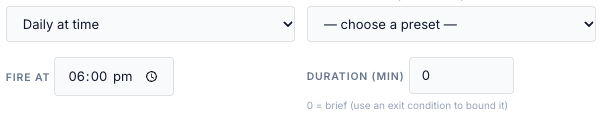

| Field | Values |
|---|---|
| Fire at | `HH:MM` |
| Duration (min) | 0 or more (0 = one minute) |

<!-- @b TRG-14 ;; src: gateway/scheduler_triggers.py:88-97, gateway/scheduler_triggers.py:276-284 ;; tested: tests/unit/test_scheduler_triggers.py::test_prev_daily_today_vs_yesterday ;; write: yes ;; b: Daily fires every day at time_of_day; an invalid time never fires ;; test: — -->

A duration longer than 24 hours makes the windows overlap, so the entry never becomes
inactive (see [Always](#always-evaluate) for what that means after a run ends).
<!-- @b TRG-15 ;; src: gateway/scheduler.py:194-199, api/schedules_api.py:125 ;; untested ;; write: yes ;; b: duration_s has no upper bound; a duration at or above the trigger period keeps the entry active continuously, so it never re-arms after a run ends ;; test: unit — interval 30 min with duration 30 min; end a run by exit condition; assert no re-fire at the next fire time -->

## Weekly at time

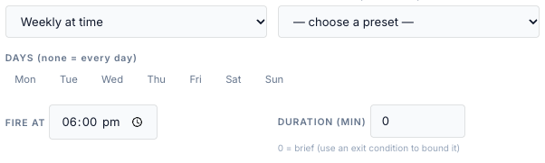

| Field | Values | Notes |
|---|---|---|
| Days | Mon … Sun | **Tick at least one day.** |
| Fire at | `HH:MM` | |
| Duration (min) | 0 or more | |

A weekly trigger with no days never fires. The bridge accepts it when you save; *Next fire*
shows —. <!-- @b TRG-16 ;; src: gateway/scheduler_triggers.py:100-115, api/schedules_api.py:154-179 ;; tested: tests/unit/test_scheduler_triggers.py::test_weekly_empty_days_returns_none ;; write: no ;; b: A weekly trigger with no days never fires and is not rejected at save ;; test: unit (API) — POST weekly with days_of_week [] and assert 201 with next_fire null (documents the gap) -->

## Every N minutes

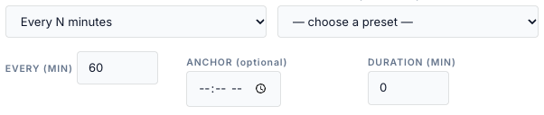

| Field | Values | Notes |
|---|---|---|
| Every (min) | 1 or more | Stored as seconds (`every_seconds`). The API takes any positive number of seconds. |
| Anchor | `HH:MM`, optional | Fires are counted from this time. Empty = midnight. |
| Duration (min) | 0 or more | |

- Fires land on *anchor + k × N*, counted from today's anchor (or yesterday's, before the
  anchor time). With N = 30 and no anchor: 00:00, 00:30, 01:00 …
  <!-- @b TRG-17 ;; src: gateway/scheduler_triggers.py:118-137, gateway/scheduler_triggers.py:305-321 ;; tested: tests/unit/test_scheduler_triggers.py::test_interval_explicit_anchor_time ;; write: yes ;; b: Interval fires at anchor + k*every, counted from the most recent anchor time ;; test: — -->
- **The count restarts at the anchor every day.** If N does not divide 24 hours, the last
  gap of the day is shorter: every 7 hours from midnight fires 00:00, 07:00, 14:00, 21:00,
  then 00:00 again.
  <!-- @b TRG-18 ;; src: gateway/scheduler_triggers.py:129-136, gateway/scheduler_triggers.py:316-321 ;; untested ;; write: yes ;; b: The interval series restarts at the anchor each day, so a period that does not divide 24 h has a short final gap ;; test: unit — every 7 h; assert prev_fire_at at 23:00 is 21:00 and at 00:30 next day is 00:00 -->
- **24 hours or more behaves like Daily** at the anchor time.
  <!-- @b TRG-19 ;; src: gateway/scheduler_triggers.py:316-321 ;; untested ;; write: yes ;; b: An interval of 24 h or more fires once a day at the anchor ;; test: unit — every 2 days; assert fires on consecutive days at the anchor -->
- An interval of 0 or less, or one that isn't a number, never fires. The form never sends one.
  <!-- @b TRG-20 ;; src: gateway/scheduler_triggers.py:118-124, static/js/schedule_tab.js:1353-1356 ;; tested: tests/unit/test_scheduler_triggers.py::test_interval_invalid_every_returns_none ;; write: no ;; b: An interval of 0, negative or non-numeric seconds never fires; it is not rejected by the API ;; test: — -->

## Monthly / calendar

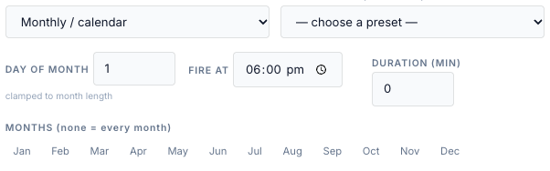

| Field | Values | Notes |
|---|---|---|
| Day of month | 1–31 | Clamped to the month's length: 31 fires on 30 April and 28/29 February. |
| Fire at | `HH:MM` | Empty (API) = 00:00. |
| Duration (min) | 0 or more | |
| Months | Jan … Dec | None ticked = every month. |

<!-- @b TRG-21 ;; src: gateway/scheduler_triggers.py:140-192 ;; tested: tests/unit/test_scheduler_triggers_cron.py::test_monthly_day_clamps_to_month_length ;; write: yes ;; b: Monthly fires on day (clamped to the month length) at time_of_day in the listed months; empty months = all 12 ;; test: — -->
<!-- @b TRG-22 ;; src: api/schedules_api.py:169-179 ;; tested: tests/unit/test_schedules_v2_api.py::test_reject_monthly_bad_day ;; write: no ;; b: The API rejects a monthly day outside 1-31 and months that are not integers 1-12 ;; test: unit (API) — months ["1"] (a string) is rejected with 400 -->
<!-- @b TRG-23 ;; src: gateway/scheduler_triggers.py:154 ;; untested ;; write: yes ;; b: A monthly trigger with no time_of_day fires at 00:00 ;; test: unit — monthly spec without time_of_day; assert next fire at 00:00 -->

The quick presets use this trigger: *Every month (1st day)*, *Quarterly* (Jan, Apr, Jul,
Oct), *Six monthly* (Jan, Jul) and *Annually* (Jan 1st).

## Custom cron

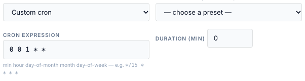

| Field | Values |
|---|---|
| Cron expression | five fields: minute, hour, day of month, month, day of week |
| Duration (min) | 0 or more |

| Expression | Fires |
|---|---|
| `*/15 * * * *` | every 15 minutes |
| `0 17 * * 1-5` | 17:00 Monday–Friday |
| `*/30 6-20 * * *` | every half hour from 06:00 to 20:30 |
| `0 0 1 * *` | midnight on the 1st of each month |

- The bridge checks the expression when you save and refuses an invalid one.
  <!-- @b TRG-24 ;; src: api/schedules_api.py:159-168, gateway/scheduler_triggers.py:195-229 ;; tested: tests/unit/test_schedules_v2_api.py::test_create_cron_trigger_and_reject_invalid ;; write: no ;; b: An invalid or empty cron expression is rejected at save; at run time an invalid one never fires ;; test: — -->
- **Day of week counts from Sunday = 0** (Monday = 1) in cron, unlike the Weekly trigger and
  `time.dow`, where Monday = 0.
  <!-- @b TRG-25 ;; src: gateway/scheduler_triggers.py:195-229 ;; untested ;; write: yes ;; b: Cron day-of-week follows croniter (0 or 7 = Sunday), unlike the weekly trigger and time.dow (0 = Monday) ;; test: unit — '0 17 * * 1' fires on a Monday and not on a Sunday -->
- A cron match at the current minute counts as now.
  <!-- @b TRG-26 ;; src: gateway/scheduler_triggers.py:216-217, gateway/scheduler_triggers.py:227-228 ;; tested: tests/unit/test_scheduler_triggers_cron.py::test_cron_next_and_prev ;; write: yes ;; b: Cron previous/next fire includes the current minute when it matches ;; test: — -->
- Cron and monthly entries are not drawn on the visual timeline.

## Always evaluate

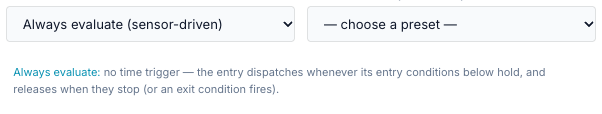

The entry is active all the time; only its entry conditions decide whether it dispatches.
<!-- @b TRG-27 ;; src: gateway/scheduler.py:189-191 ;; tested: tests/unit/test_scheduler_engine.py::test_always_trigger_gated_by_entry_conditions ;; write: yes ;; b: An always entry is continuously active and dispatches when its entry conditions pass ;; test: — -->

!!! warning "Always runs once, then waits for a restart"
    The form says an Always entry "releases when [its conditions] stop". The code does not
    do that:

    - Once a force command runs, the entry conditions are not checked again. Only an exit
      condition, a time limit, a target SoC, Stop or a release elsewhere ends it.
    - When a run ends, the entry is marked *done for this window*. An Always window never
      closes, so the entry **does not fire again until the bridge restarts**.
    - An Always **HA-only** entry also fires its HA actions only once per bridge run.
    - The *done* mark is held per gateway, not per entry. If another entry on the same
      target dispatches, the mark is cleared and the Always entry can fire again. Disabling
      and re-enabling the entry does not clear it when it is the only entry on its target.

    For "whenever the price is low" rules use a repeating trigger with a gap, for example
    **Custom cron** `*/30 * * * *` with a 29-minute duration. The [examples](examples.md) do this.

<!-- @b TRG-28 ;; src: gateway/scheduler.py:845, gateway/scheduler.py:943, gateway/scheduler.py:956-957, gateway/scheduler.py:984-989 ;; untested ;; write: yes ;; b: After a run of an always entry ends (exit, Stop, time limit), the entry never re-fires until restart because its window never closes; an always HA-only entry fires once per bridge run ;; test: unit — always entry with exit condition; tick to dispatch, meet exit, clear exit; assert no second dispatch over many ticks -->
<!-- @b TRG-29 ;; src: gateway/scheduler.py:428, gateway/scheduler.py:956-957, gateway/scheduler.py:1039 ;; unclear ;; write: yes ;; b: The done-for-this-window mark is one entry id per target and gateway; a dispatch by another entry on the same target clears it, letting an entry that already finished its window fire again in the same window ;; test: unit — entries A (window) and B (higher priority, short trigger) on one gateway; A exits by condition, B fires and ends; assert whether A re-fires in its still-open window -->
<!-- @b TRG-30 ;; src: templates/tabs/schedule.html:689-692 ;; untested ;; write: no ;; b: The form says an always entry releases when its conditions stop; the engine does not re-check the gate while running ;; test: none — doc/UI mismatch, fix the form text -->

## Quick presets

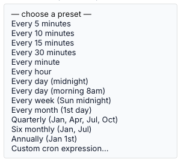

A preset fills the trigger fields; you can edit them afterwards.
<!-- @b TRG-31 ;; src: static/js/schedule_tab.js:51-66, static/js/schedule_tab.js:1203-1212 ;; untested ;; write: no ;; b: Quick presets only fill the trigger fields of the form ;; test: browser — pick each preset and compare the fields -->

| Preset | Sets |
|---|---|
| Every 5 / 10 / 15 / 30 minutes, Every minute, Every hour | Every N minutes, N = 5, 10, 15, 30, 1, 60 |
| Every day (midnight), Every day (morning 8am) | Daily at 00:00 / 08:00 |
| Every week (Sun midnight) | Weekly, Sunday, 00:00 |
| Every month (1st day), Quarterly, Six monthly, Annually | Monthly, day 1, months as named |
| Custom cron expression… | Custom cron |

## Next fire

The **Next fire** column is worked out on the bridge, on the bridge's clock:

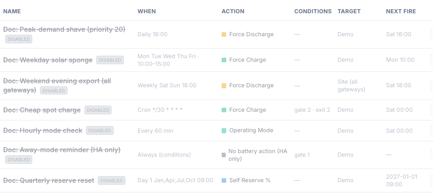

| Trigger | Next fire |
|---|---|
| Recurring windows | the next window **start** at or after now, looking up to 8 days ahead. While a window is open, that is the next one, not the current one. |
| One-off date window | the next window start on that date; — once it has passed |
| Fire-based | the next fire time at or after now |
| Always, or a trigger that can never fire | — |

<!-- @b TRG-32 ;; src: gateway/scheduler.py:141-169, api/schedules_api.py:262-280 ;; tested: tests/unit/test_scheduler.py::test_next_fire_rolls_to_matching_weekday ;; write: no ;; b: Next fire for windows is the next window start at or after now within 8 days (a dated entry uses its date); for triggers next_fire_at; always gives none ;; test: — -->
<!-- @b TRG-33 ;; src: api/schedules_api.py:262-280 ;; untested ;; write: no ;; b: active_now in the list means enabled and inside the trigger window, not that a command is running ;; test: unit (API) — gated entry in an open window lists active_now true -->

## Editing a trigger in the form

- Switching a fire-based entry to a window type keeps the old **Duration (min)** in the
  database. A window ignores it for activity, but **Run now** still uses it as the time
  limit (see [Run now](outcomes.md#run-now-and-stop)).
  <!-- @b TRG-34 ;; src: static/js/schedule_tab.js:1453-1467, gateway/scheduler.py:570-571 ;; untested ;; write: yes ;; b: Saving a window entry from the form does not send duration_s, so an old duration stays and is used as Run now's time limit ;; test: browser + unit — change a daily entry with 30 min to a window, save, GET it: duration_s still 1800 -->
- An API **one-off** (`trigger_kind: oneoff`) has no form type. Opening it in the editor
  and saving it drops its `fire_at`, and the entry never fires again.
  <!-- @b TRG-35 ;; src: static/js/schedule_tab.js:1132, static/js/schedule_tab.js:1349-1366 ;; untested ;; write: yes ;; b: Saving an API oneoff entry from the form sends trigger_spec {} and loses fire_at ;; test: browser — create a oneoff via API, open and save in the form, GET it: trigger_spec is {} -->

## After an outage or a restart (catch-up)

The bridge treats a gateway as in an **outage** when no good poll has arrived for more than
60 seconds. <!-- @b TRG-36 ;; src: gateway/connectivity.py:41, gateway/connectivity.py:142-152 ;; tested: tests/unit/test_connectivity_monitor.py::test_outage_opens_after_threshold ;; write: no ;; b: An outage opens when a gateway has had no ok poll for more than 60 s ;; test: — -->
When the gateway is back, the bridge runs **catch-up** for every enabled entry that targets
it. It also runs at start-up when the bridge was down for more than 60 seconds, using the
last good poll it saved (every 60 s) before stopping.
<!-- @b TRG-37 ;; src: gateway/connectivity.py:79-93, main.py:701-707 ;; tested: tests/unit/test_connectivity_monitor.py::test_recovery_runs_catchup_and_links_outage ;; write: yes ;; b: On recovery the catch-up pass runs for that gateway and links missed and late-fired entries to the outage record ;; test: — -->
<!-- @b TRG-38 ;; src: gateway/connectivity.py:113-140, main.py:979-985 ;; tested: tests/unit/test_connectivity_monitor.py::test_startup_catchup_runs_for_downtime_gap ;; write: yes ;; b: At start-up, a persisted last-good-poll older than 60 s records a restart_downtime outage and runs catch-up from that time ;; test: — -->

For each entry:

| Situation | What happens |
|---|---|
| Its window is **open now** | Nothing special: the next tick handles it as usual (gate permitting). |
| A window start or fire time fell **inside the outage** and has ended | Handled by **If missed during an outage**, below. Only the latest missed fire counts (for windows, the first window start after the outage began). |
| No fire during the outage | Nothing. |
| Always entries | Never missed: they have no fire time. |

<!-- @b TRG-39 ;; src: gateway/scheduler.py:495-504 ;; tested: tests/unit/test_scheduler_engine.py::test_catchup_skips_still_open_window ;; write: yes ;; b: Catch-up skips entries whose window is open now and entries not targeting the recovered gateway ;; test: — -->
<!-- @b TRG-40 ;; src: gateway/scheduler.py:210-227 ;; tested: tests/unit/test_scheduler_engine.py::test_catchup_legacy_window_missed ;; write: no ;; b: A fire or window start in (outage start, now] that is no longer active is reported missed; always entries are never missed ;; test: — -->
<!-- @b TRG-41 ;; src: gateway/scheduler.py:220-227 ;; untested ;; write: no ;; b: Only one missed fire per entry per outage is recorded: the latest fire for triggers, the first window start after the outage began for windows ;; test: unit — interval 15 min, 1 h outage; assert exactly one missed row -->

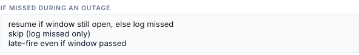

| Option (UI) | API `missed_policy` | Behaviour |
|---|---|---|
| resume if window still open, else log missed | `late_fire_remaining` (default) | Logs *missed*. |
| skip (log missed only) | `skip` | Logs *missed*. Behaves exactly like the default. |
| late-fire even if window passed | `late_fire_always` | Checks the entry conditions now. If they pass, sends the action now and logs *late_fired*; otherwise logs *missed* with the failing values. |

<!-- @b TRG-42 ;; src: gateway/scheduler.py:506-515 ;; untested ;; write: no ;; b: missed_policy skip behaves exactly like late_fire_remaining: both only log missed ;; test: unit — catch-up with policy skip; assert one missed row and no command -->
<!-- @b TRG-43 ;; src: gateway/scheduler.py:517-541 ;; tested: tests/unit/test_scheduler_engine.py::test_catchup_late_fire_always_gated_by_entry_conditions ;; write: yes ;; b: late_fire_always checks the entry conditions now and, if they pass, sends the action with catchup_duration_s or duration_s staged as its time limit ;; test: — -->

A late fire is different from a normal run:

- It is **not owned** by the scheduler: no exit conditions, no verification, no release at
  a window end. It ends at its time limit (the entry's duration) or when something releases it.
  An entry with **no duration late-fires with no time limit**.
  <!-- @b TRG-44 ;; src: gateway/scheduler.py:529-536, gateway/scheduler.py:319-321 ;; untested ;; write: yes ;; b: A late fire is not owned by the engine; with no duration it is staged with duration 0 and runs until released ;; test: unit — late_fire_always on an entry with duration_s None; assert battery_command_duration staged as 0 and no Release on later ticks -->
- It ignores **If already controlled**: it is sent even over a manual command.
  <!-- @b TRG-45 ;; src: gateway/scheduler.py:533-536 ;; untested ;; write: yes ;; b: A late fire does not check the conflict policy and supersedes a manual command ;; test: unit — FakeHandler with an active manual command; late_fire_always with conflict defer still sends -->
- It runs **no HA actions**. An HA-only (*none*) entry with this policy sends nothing and
  writes **no** Activity Log row; it is only listed as missed on the outage record.
  <!-- @b TRG-46 ;; src: gateway/scheduler.py:510-541 ;; untested ;; write: no ;; b: A late fire runs no HA actions; a none entry with late_fire_always sends nothing and writes no audit row, only the outage link ;; test: unit — late_fire_always HA-only entry with passing gate; assert no audit rows and result missed == [id] -->
- Its Activity Log rows name the target as `gateway:<id>:<gateway>` rather than the gateway's name.
  <!-- @b TRG-47 ;; src: gateway/scheduler.py:508, gateway/scheduler.py:1552-1564 ;; untested ;; write: no ;; b: Catch-up audit rows pass a string target, so the Activity Log shows type:id:gateway instead of the gateway name ;; test: unit — catch-up with gw_label_fn set; assert the target label -->

The form shows the missed-policy selector only for fire-based triggers. Window entries are
caught up with whatever policy is stored on them; the form saves its current value
(normally the default).
<!-- @b TRG-48 ;; src: gateway/scheduler.py:506, templates/tabs/schedule.html:1281-1288, static/js/schedule_tab.js:1420 ;; untested ;; write: yes ;; b: Window entries are caught up with their stored missed_policy although the form hides the selector for them ;; test: unit — window entry with missed_policy late_fire_always; catch-up sends the action -->

The clock that all of this runs on is described in [Restarts and the clock](restarts-and-clock.md).
