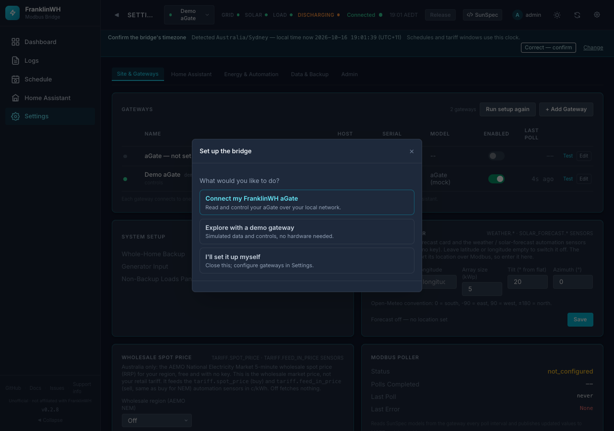
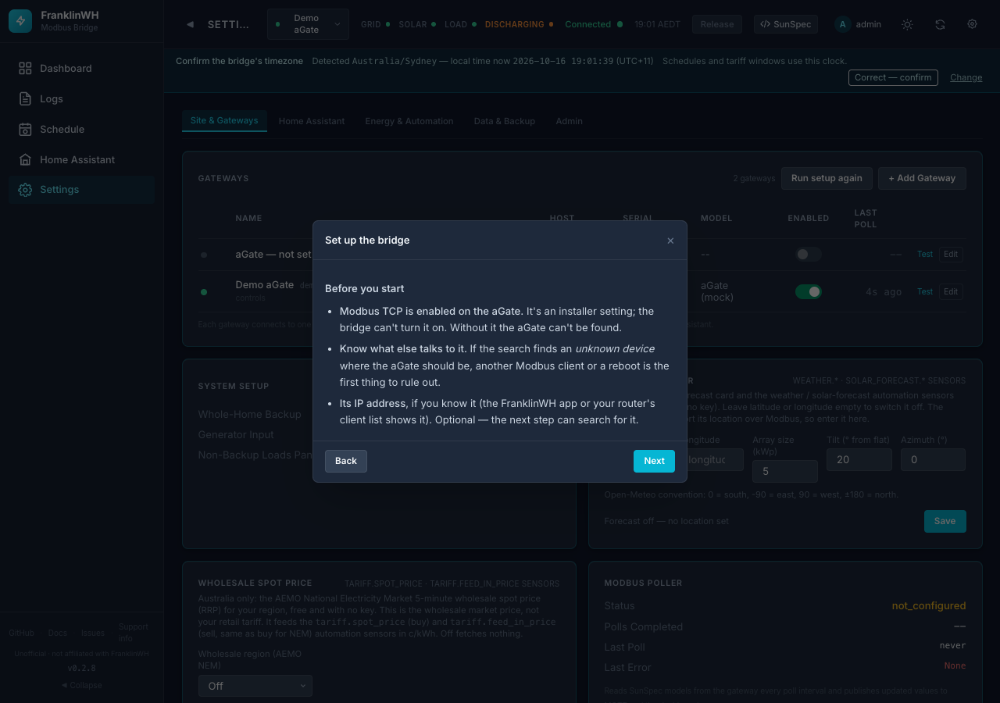
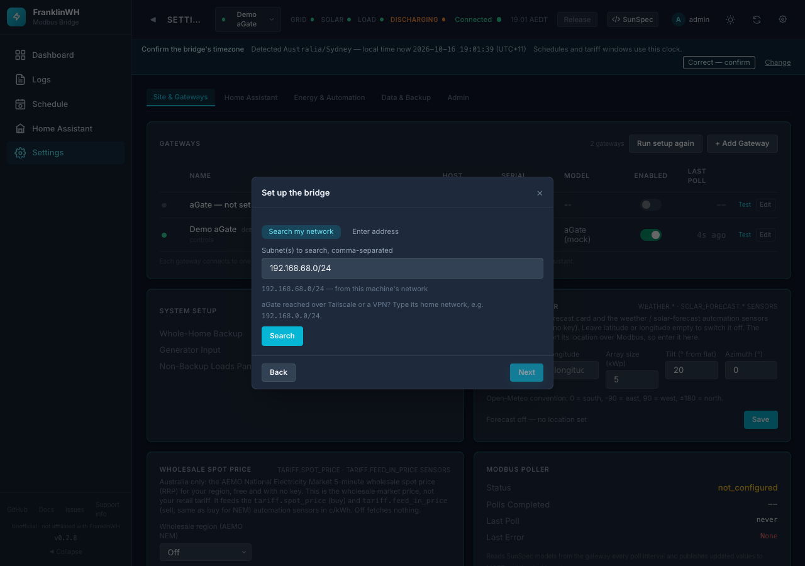
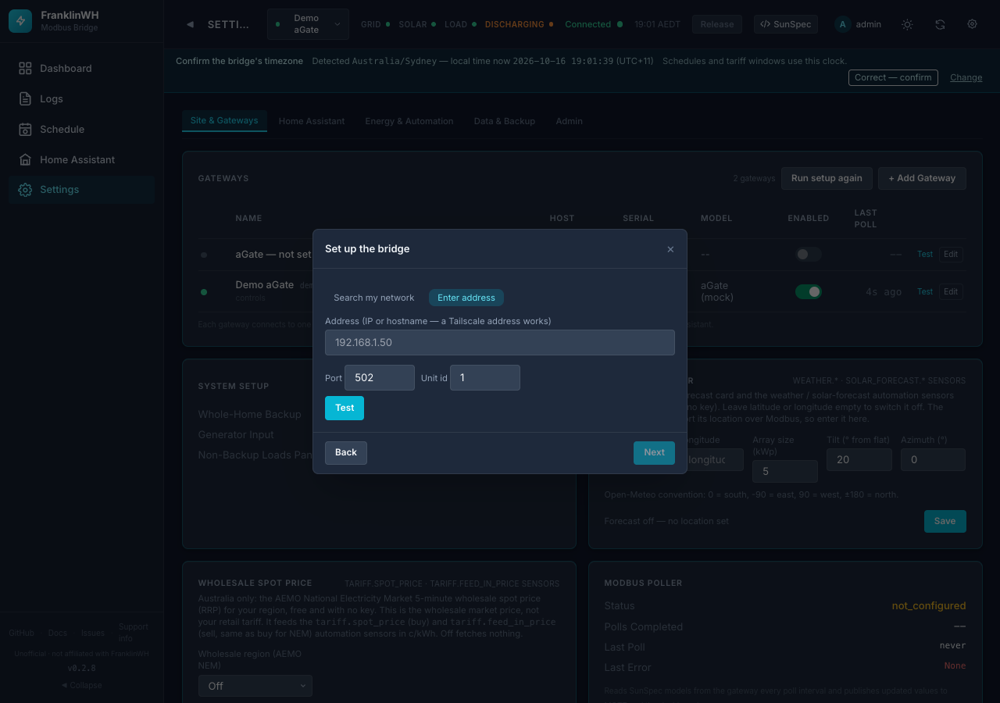
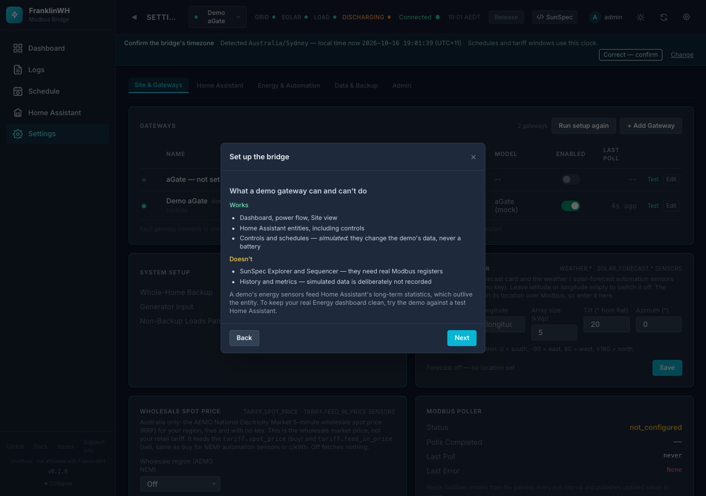
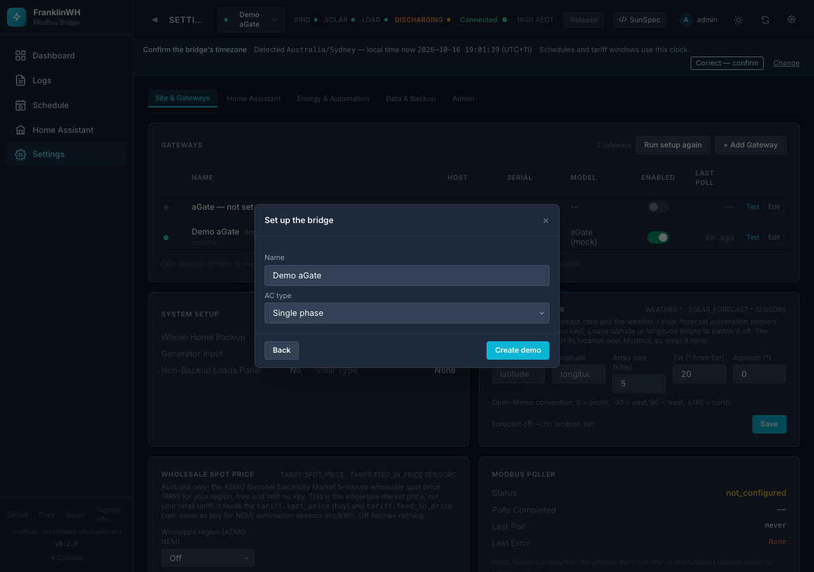

# First run & setup wizard

On a fresh install the bridge opens **Set up the bridge**. You can also open it later from **Settings → Site & Gateways → Run setup again**.

| Choice | What it does |
|---|---|
| **Connect my FranklinWH aGate** | Finds your aGate on the network (or by address) and starts reading it. |
| **Explore with a demo gateway** | Adds a simulated aGate, so you can try everything with no hardware. Nothing is sent to a real battery. |
| **I'll set it up myself** | Closes the wizard. Add gateways later in Settings. |

## Connect my aGate

**Before you start**: the wizard lists what must be true. Modbus TCP is enabled on the aGate (an installer setting), nothing else is using its Modbus port, and you know its IP address if you can.

**Find it** in one of two ways:

=== "Search my network"

    The wizard proposes the subnet Home Assistant (or the host) is on. Add another,
    e.g. `192.168.0.0/24`, if the aGate is on a different network or reached over a VPN.
    A found aGate shows its model, serial and firmware.

    

=== "Enter address"

    Type the aGate's IP address or hostname (a Tailscale address works) and press
    **Test**. This is the more reliable option over slow or VPN links (#137).

    

Then the wizard:

- connects the gateway;
- asks you to confirm the bridge's **timezone** (schedules and tariff windows run on this clock);
- shows a **Home Assistant** checklist: MQTT broker connected, HA connected, the MQTT integration set up, and entities published.

!!! tip "After connecting: battery power rating"
    Force charge and discharge stay unavailable until the gateway's battery power
    rating is trusted. If your battery has already run at full power, that happens
    by itself. Otherwise calibrate it: **Settings → Site & Gateways → your gateway
    → Edit → Battery power rating**.

## Explore with a demo gateway

The wizard explains what a demo can and can't do, then creates it.

!!! warning "Keep demos out of your real Home Assistant"
    A demo's energy sensors feed HA's long-term statistics, which outlive the
    entity. The wizard leaves a demo **unpublished** unless you say yes. A mock
    added through **+ Add Gateway** is currently published by default (#160);
    switch **Publish to Home Assistant** off for it.
