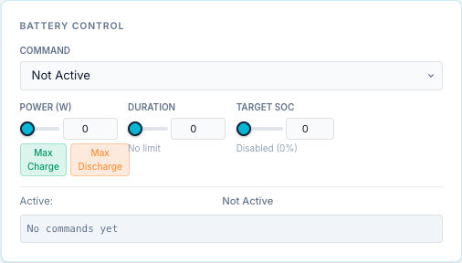
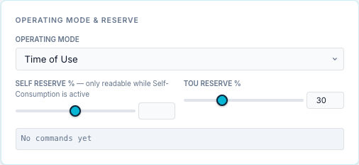

# Battery controls

The battery controls are two Dashboard cards: **Battery Control** and
**Operating Mode & Reserve**. There is no separate Controls page in 0.2.8.

Household members with the `user` role have simpler Charge / Discharge controls on the
[simple dashboard](user-dashboard.md). Schedules can send the same commands automatically:
see the [Scheduler](../scheduler/index.md).

Before you use them, read [Battery dispatch: best practice](../battery-dispatch-best-practice.md):
leave the aGate in its default mode, plan with the Scheduler rather than the app's
Time-of-Use, and release from the bridge when the app shows *VPP Mode*.

!!! danger "Controls act immediately"
    Changing a dropdown, moving a slider or typing in a number box **sends the command as
    soon as you let go**. There is no Apply button. Every command is logged in the card,
    in the bridge log, and as a toast at the bottom right.

## Battery Control

| Control | Range | What it does |
|---|---|---|
| **Command** | *Not Active*, *Force Charge*, *Force Discharge*, *Force Standby*, *Release* | Sends the command at once. |
| **Power (W)** | 0 up to the slider maximum, steps of 100 W | The power for force charge or discharge, in **watts**. 0 means "the battery's full trusted rating". |
| **Max Charge / Max Discharge** | — | Sets Power to the gateway's **trusted** charge or discharge rating. Greyed out until that rating is trusted. |
| **Duration** | 0–7200 s (2 h), steps of 60 s | How long the command runs before the bridge stops it. 0 = *No limit*: it runs until released or until the target SoC. |
| **Target SoC** | 0–100 %, steps of 5 | Stops the command when the battery reaches this SoC. 0 = *Disabled*. |

What the commands do:

| Command | Effect |
|---|---|
| Force Charge | Charges the battery at the set power (from solar and/or grid). |
| Force Discharge | Discharges at the set power. |
| Force Standby | Holds the battery at 0 W. |
| Release / Not Active | Ends the command. The aGate goes back to its own operating mode. |

Below the controls:

- **Active:** the command in force, its power and the watchdog seconds left.
- **Target SoC:** the target and the current SoC, when a target is set.
- **HW Revert Timer:** when the aGate's own revert timer is running (*VPP Mode*), the
  seconds left of the total.
- **Command log**: the last 50 commands sent from this card, with ✓ or ✗ and the bridge's
  reply. It is kept in the page only and clears when you reload.

Power, Duration and Target SoC are *staged*: changing one while no command is running only
stores it for the next command. Changing Power **while** a force command is running
re-sends that command at the new power.

### Power is in watts, sized against the battery rating

Force commands are sized against the **battery rating**. The aGate is commanded with a
percentage of a rating the bridge supplies: the aGate's **nameplate** rating from SunSpec
Model 702, as reported (since 0.2.20), or the rating you calibrated. The bridge never
assumes 5000 W: if the aGate reports no rating, force commands are refused.

There is a guard, from a site with several aPowers where "100 %" ran at 20 kW: if the
battery is seen well above the rating, the bridge stops using it until you calibrate.

So:

- **Power % has been removed.** Power is set in watts only. A command in percent is
  refused with *"Power % has been removed: set Command Power in watts"*. Schedules saved
  before 0.2.8 that still use a percentage keep working; they are sized against the trusted
  rating when they run.
- **Force Charge and Force Discharge are refused when the rating for that direction is
  unknown or contradicted.** The command log and toast show *"Refused Force Charge: … Calibrate it:
  Settings → Site & Gateways → this gateway → Battery power rating"*. Force Standby and
  Release always work.
- A requested power above the trusted rating is capped at the rating.

The rating is the aGate's nameplate as reported; seeing the battery run at 80–115 % of it
confirms it, and **calibrating** replaces it with a measured figure. It stops being used if
the battery is seen running well above it. How to calibrate:
[Battery power rating](settings-site-gateways.md#battery-power-rating).

!!! note "Demo gateway"
    A mock or demo gateway is always trusted (5000 W), because it drives a simulated
    battery.

!!! warning "The slider maximum is not the trusted rating"
    On the Dashboard card the Power slider's maximum is the aGate's reported maximum
    (Model 702), or 5000 W if it reports none. It is not limited by the trusted rating, and
    it is not disabled when the rating is untrusted. The bridge enforces the trusted rating
    when the command is sent: it refuses or caps the command. Only the **Max Charge /
    Max Discharge** buttons follow the trusted rating.

## Operating Mode & Reserve

| Control | Range | What it does |
|---|---|---|
| **Operating Mode** | *Emergency Backup*, *Self-Consumption*, *Time of Use* | Changes the aGate's operating mode at once. |
| **Self Reserve %** | 0–100 %, steps of 5 | The reserve SoC kept back in Self-Consumption mode. |
| **TOU Reserve %** | 0–100 %, steps of 5 | The reserve SoC kept back in Time of Use mode. |

Self Reserve shows register 15508 and TOU Reserve register 15509, as the aGate reports them.

The card has its own command log, like Battery Control.

A force command overrides the operating mode while it runs. When it ends, the aGate
returns to the mode set here.

## Release from the top bar

The **Release** button in the top bar shows the full control state and has a
**Force Release** button that clears the aGate's control registers. See
[Top bar → Release](top-bar.md#release).

## Who can use the controls

Only roles with the `control` capability: `admin`, `user` and `api`. A `viewer` cannot send
commands. A `user` sees the simple dashboard, not these cards.
