# Dashboard

The Dashboard (`?tab=dashboard`) is the live view of the gateway chosen in the
[gateway selector](top-bar.md#gateway-selector). Values refresh every 10 seconds.

From top to bottom it has:

1. a **device info bar**;
2. any **banners** that need your attention;
3. the **cards**, in two columns (one on a phone);
4. the **Live Points** panel;
5. **Power History** (with a **Modbus Sequencer** tab);
6. **Events History**.

## Device info bar

| Field | Meaning |
|---|---|
| Viewing | The gateway being shown (only with more than one gateway). |
| Model, Serial | Reported by the aGate. `--` on the demo gateway. |
| SoC | The battery's state of charge. The firmware version, which this bar used to show, is in **Info** and in Support info. |
| IP, Unit | The gateway's address and Modbus unit ID from its settings. |
| Grid | Grid mode: *Grid Following* (on-grid) or *Grid Forming* (islanded, the aGate is making its own grid). |
| Inverter | Inverter state, for example *Running*. |
| **Info** | Opens **Diagnostics**: about 20 control and health readings in one list (control mode, firmware, setpoints, revert timers, watchdog, last command result, temperatures, capacity). |
| **Cards** | Opens the card list: show, hide and reorder cards. |

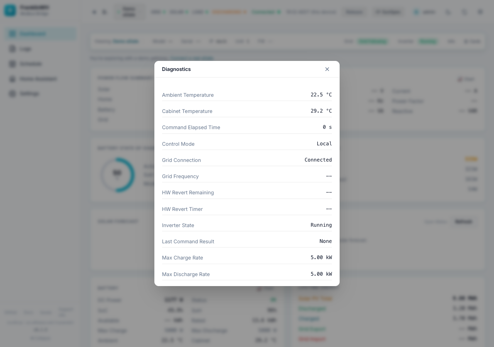

## Banners

These appear above the cards only when they apply.

| Banner | When | What to do |
|---|---|---|
| **Connect your aGate** | No gateway has an address and nothing is polling (a new install). | **Set up →** starts the setup wizard (admins only). |
| **You're exploring with a demo gateway** | You chose the demo in the setup wizard and have no real aGate. | **Connect a real aGate** reopens the wizard. |
| **Gateway not running: *name*** | An enabled gateway is not polling. Says *Device unreachable* or *Gateway stopped*. | **Fix →** opens Settings → Site & Gateways. |
| **Install an MQTT broker to see entities in Home Assistant** | Add-on install with no broker yet. | Install the Mosquitto broker app. The bridge connects by itself; no restart needed. |

## Choosing and ordering cards

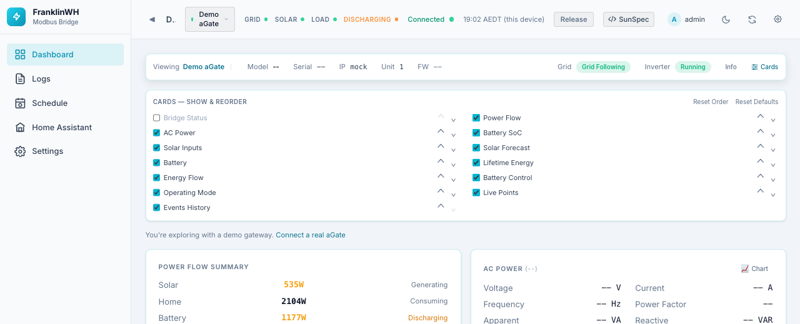

Click **Cards** in the info bar.

- Tick or untick a card to show or hide it.
- Use the **⌃ / ⌄** arrows to move a card up or down. On a desktop you can also drag a card
  by its body.
- **Reset Order** puts the cards back in their default order.
- **Reset Defaults** restores which cards are shown.

Card choices are stored **in this browser only**. Another browser or phone keeps its own.

| Card | Shown by default |
|---|---|
| Bridge Status | No |
| Power Flow, AC Power, Battery SoC, Solar Inputs, Solar Forecast, Battery, Lifetime Energy, Energy Flow, Battery Control, Operating Mode, Live Points, Events History | Yes |

## Cards

### Bridge Status

Hidden by default. Health counters for the bridge process since it started.

| Field | Meaning |
|---|---|
| Uptime | Time since the bridge started. |
| Quality | Share of polls that returned good data, in %. |
| Polls OK / Stale / Error | Poll outcomes. |
| Sanitized | Readings the bridge corrected or dropped as implausible. |
| DB Samples / Rejected | Samples stored in the metrics database, and samples refused. |
| Conn Drops / Recoveries | Modbus connections lost and re-established. |
| MQTT Sent | Messages sent to the MQTT broker. |
| Last Error | The most recent error, or *None*. |

### Power Flow Summary

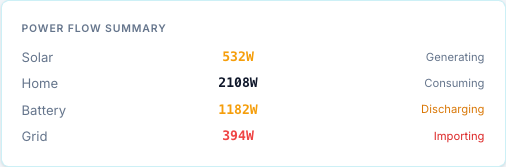

The four main power figures, in watts.

| Row | Sign | Status text |
|---|---|---|
| Solar | Always ≥ 0 | *Generating* or *Idle* |
| Home | Always ≥ 0 | *Consuming* |
| Battery | Positive = discharging, negative = charging | *Discharging*, *Charging* or *Standby* |
| Grid | Positive = importing, negative = exporting | *Importing*, *Exporting* or *Neutral* |

The Home figure comes from the home load register chosen for the gateway
([Home Load Register](settings-site-gateways.md#edit-gateway)).

### AC Power

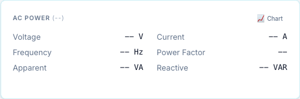

The grid-side AC measurements from SunSpec model 701. The title shows the AC type
(single, split or three phase).

| Field | Unit |
|---|---|
| Voltage | V |
| Current | A |
| Frequency | Hz |
| Power Factor | (0–1) |
| Apparent | VA |
| Reactive | VAR |

On a split-phase or three-phase aGate a **Per-Phase** button opens a table with each value
per line (L1, L2, L3), plus line-to-line voltages.

**Chart** opens the [AC metrics chart](#ac-and-dc-metrics-charts).

### Battery State of Charge

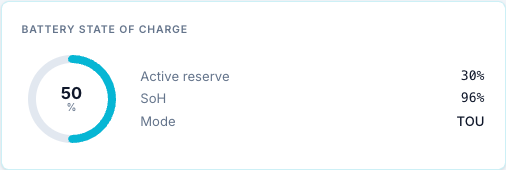

A ring with the battery's state of charge, plus:

| Field | Meaning |
|---|---|
| Active reserve | The reserve of the operating mode in force now, in %. |
| SoH | State of health, in %. |
| Mode | The aGate's operating mode: *Time of Use*, *Self-Consumption* or *Emergency Backup*. |

If you set a **Battery Label** in [System Setup](settings-site-gateways.md#system-setup),
the card title becomes *"&lt;label&gt; — State of Charge"*.

### Solar AC Inputs

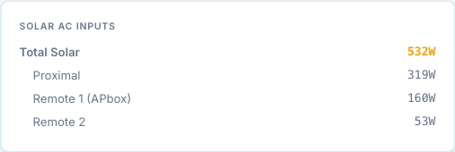

Solar power in watts, from FranklinWH extension registers.

| Row | Meaning |
|---|---|
| Total Solar | All solar inputs together. |
| Proximal | Solar connected at the aGate. |
| Remote 1 (APbox) | Solar on the first remote input (APbox). |
| Remote 2 | Solar on the second remote input. |

### Solar Forecast

The solar forecast for today and tomorrow, from Open-Meteo (free, no key).

!!! info "Needs a location"
    The card stays empty until you enter a latitude and longitude in
    [Settings → Site & Gateways → Location & Solar](settings-site-gateways.md#location-solar).
    Until then it shows *"Set your location … to enable the solar forecast"* and an
    **Open Settings** button (admins only). The bridge needs internet access to fetch the
    forecast.

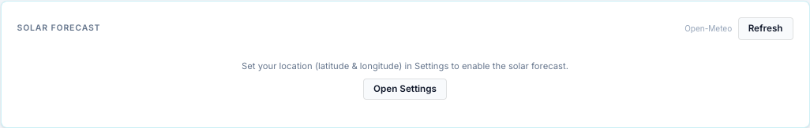

Once configured:

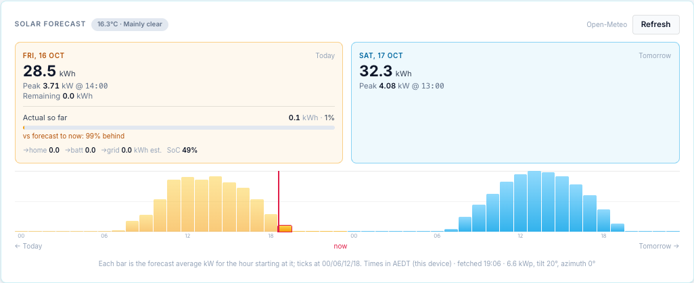

| Part | Meaning |
|---|---|
| Title chip | Current temperature and weather condition. A **stale** chip means the last fetch failed and the previous forecast is shown. |
| **Today** box | Forecast kWh for the day, the peak kW and when, and the kWh still to come. |
| Actual so far | Solar measured today in kWh, as a bar against the day's forecast. "vs forecast to now" compares it with what was forecast up to this hour. |
| →home / →batt / →grid | Where today's solar went, in kWh. Reconstructed from power samples (an estimate, not a meter). Then the current SoC. |
| **Tomorrow** box | Forecast kWh, peak kW and time. |
| Bars | Hourly forecast in kW from today to tomorrow. The current hour is outlined, with a red **now** line. Ticks at 00, 06, 12 and 18. |
| Battery band | Under today's bars: what the battery did each hour (charging, discharging, idle), estimated from the sampled battery power. |
| Footer | The bridge timezone, when the forecast was fetched, and the array size, tilt and azimuth used. |

**Refresh** fetches a new forecast now. The bridge otherwise caches it for 15 minutes.

The same data publishes the `weather.*` and `solar_forecast.*` sensors that schedules can
use as conditions.

### Battery

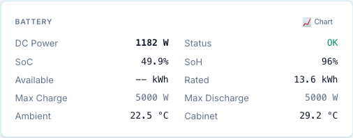

The battery's DC side and ratings. The title is the Battery Label, if you set one.

| Field | Source | Unit |
|---|---|---|
| DC Power | 714.DCW | W |
| Status | 713.Sta (battery health, for example *OK*) | — |
| SoC | 713.SoC | % |
| SoH | 713.SoH | % |
| Available | 713.WHAvail | kWh |
| Rated | 713.WHRtg | kWh |
| Max Charge | 702.WChaMax | W |
| Max Discharge | 702.WDisChaMax | W |
| Ambient | 701.TmpAmb | °C |
| Cabinet | 701.TmpCab | °C |

!!! note
    *Max Charge* and *Max Discharge* here are what the aGate reports in Model 702. They are
    **not** the trusted rating that force commands use. See
    [Battery power rating](settings-site-gateways.md#battery-power-rating).

**Chart** opens the [DC / Inverter metrics chart](#ac-and-dc-metrics-charts).

### Lifetime Energy

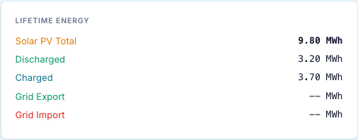

The aGate's own lifetime counters, in MWh: Solar PV Total, Discharged, Charged, Grid
Export, Grid Import. These are metered by the aGate, not calculated by the bridge.

### Energy Flow

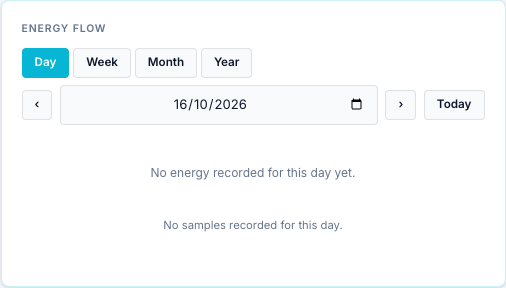

A Sankey diagram of where energy went (solar, grid, battery, home) over a period.

- **Day / Week / Month / Year** picks the period. Week, month and year are anchored on the
  chosen date, and the span is shown next to the buttons.
- **‹ ›** step one day. The date box picks any day up to today. **Today** jumps back.
- The line under the diagram says how reliable it is: *"Derived from power samples;
  lifetime totals are metered"*, or *"Partial data — the bridge recorded N% of this day"*
  when coverage is under 95%.

The flows are **reconstructed** from the power samples in the metrics database, so they
need the bridge to have been polling. The demo gateway does not store samples, so its card
says *No energy recorded for this day yet*. Today's diagram updates every two minutes.

### Battery Control and Operating Mode & Reserve

These two cards send commands to the aGate. They are described on their own page:
[Battery controls](controls.md).

## Live Points

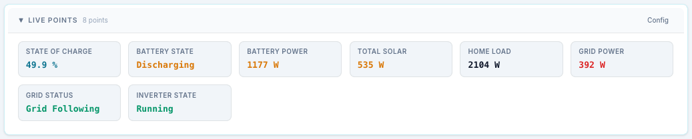

A grid of live values you choose. Click the **▶ Live Points** header to collapse or expand
it. By default it shows 8 points: State of Charge, Battery State, Battery Power,
Total Solar, Home Load, Grid Power, Grid Status and Inverter State.

**Config** opens the point list:

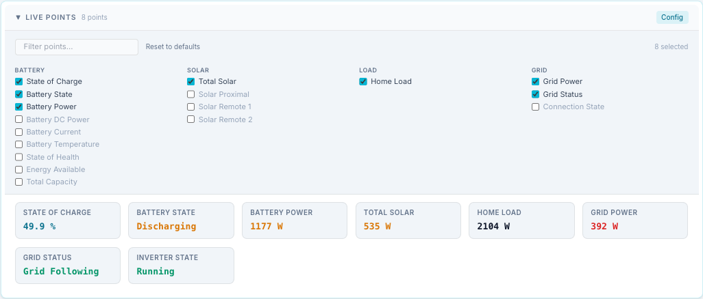

- Tick the points you want. They are grouped (Battery, Solar, Load, Grid, Inverter, AC,
  Control, Health, Energy).
- **Filter points…** narrows the list.
- **Reset to defaults** goes back to the 8 default points.

The choice is stored in this browser. With the **SunSpec** button on, each tile also shows
its source register.

## Power History

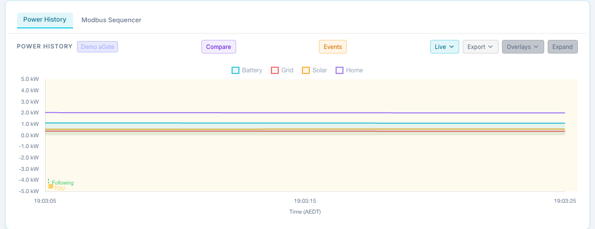

A chart of Battery, Grid, Solar and Home power. Click a legend entry to hide or show that
line. The background is shaded by operating mode (TOU, Self, Backup), and dashed vertical
lines mark grid-mode changes (Following, Forming, PV Clip) and alarms.

The badge next to the title is the gateway shown.

### Toolbar

| Control | What it does |
|---|---|
| **Compare** | Only with two or more enabled gateways. Opens one chart per gateway, stacked on a shared scale. |
| **Events** | Opens the full [alarm and event history](#events-history). |
| **Time span** (shows *Live*, *24h* …) | *Live* plots what the browser collects from now (updates every 2 s). Or a stored range: 30m, 1h, 2h, 4h, 6h, 8h, 12h, 18h, 24h, 3d, 5d, 7d, 30d. **Range…** opens From / To boxes for a custom range (in the bridge's timezone, up to 90 days); press **Load**. |
| **Scale** (*Auto*, 1m … 1d) | How samples are averaged into buckets. Hidden in Live. *Auto* picks one to suit the range. |
| **Export** | Downloads what the chart shows as **CSV** or **JSON**: time, battery, grid, solar, home, SoC, ambient, cabinet, mode and active reserve. |
| **Overlays** | Adds lines on a second axis: **SoC %**, **Ambient °C**, **Cabinet °C**. Any combination. The button then reads, for example, *SoC+Amb*. |
| **Expand** | Opens the chart full-size, with the same span, scale, export and overlay controls. |

On a phone these controls hide behind an **Options** button.

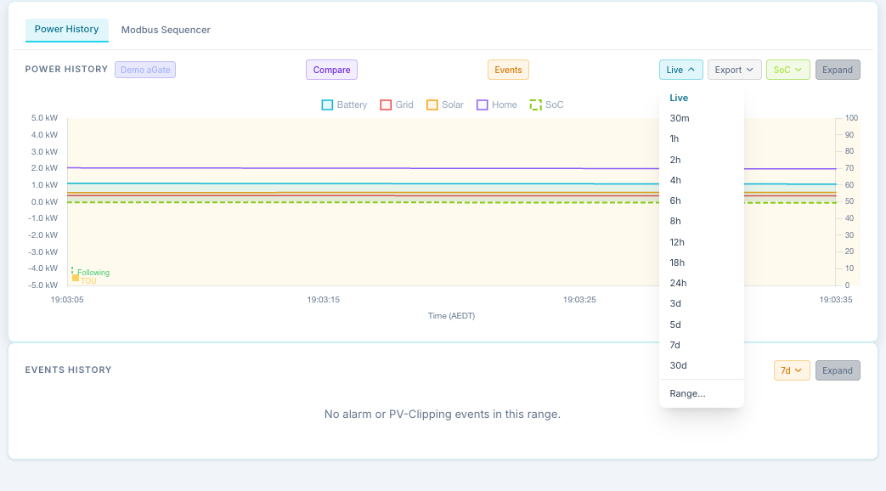

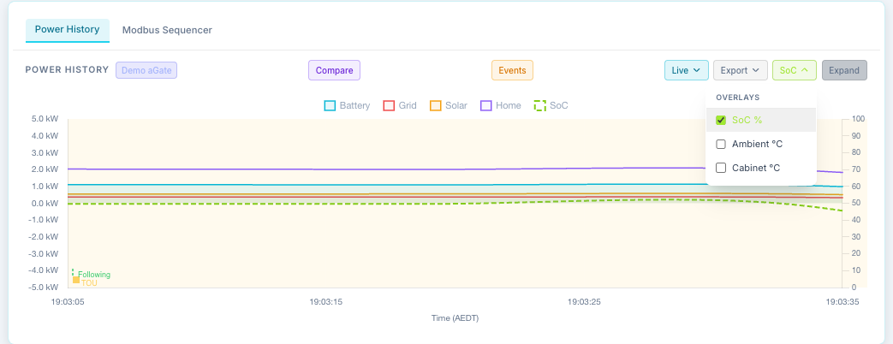

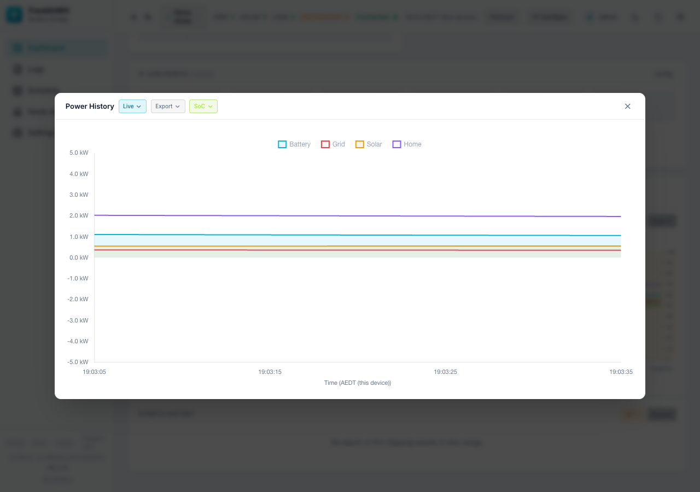

The default span is **24h**, and the last one you chose is remembered in this browser.
A custom range is not remembered.

!!! note "Empty chart?"
    Stored ranges come from the metrics database. A **mock or demo gateway's metrics are not
    recorded**, so the chart says so: use **Live** to see it move. A real gateway shows
    *"No history recorded for this gateway in this range"* until it has polled for a while.
    How long history is kept is set in
    [Data & Backup → Metrics Storage](settings-data-backup.md#metrics-storage).

### Compare

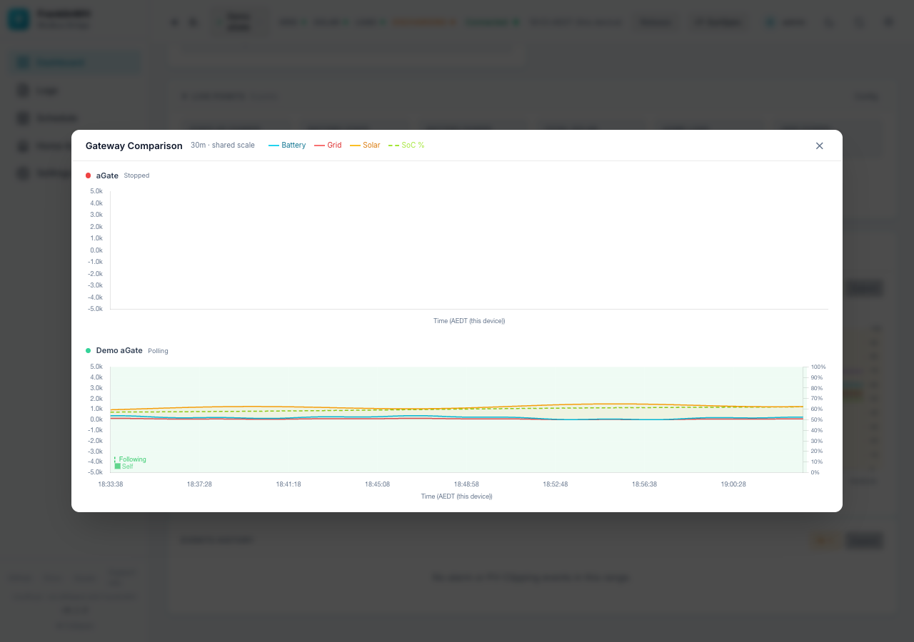

One row per enabled gateway, with its polling status, all on the same scale and span as the
main chart. Mock gateways are drawn from synthetic data, since their metrics are not stored.

### Modbus Sequencer tab

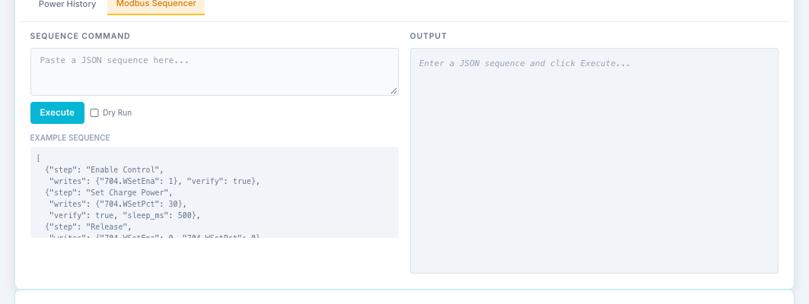

The second tab under the chart runs a JSON sequence of raw Modbus register writes and
reads. It is the quick version of the [Sequencer](sequencer.md) page.

- Paste a sequence, tick **Dry Run** to check it without writing, then **Execute**.
- The output shows each step.

!!! danger
    A sequence writes registers on a live battery, bypassing the bridge's own safety
    checks (including the trusted battery rating). The example writes `704.WSetPct`. Use
    it only if you know what each register does.

    This tab shows on the Dashboard even when the **Sequencer** feature module is off.

## AC and DC metrics charts

The **Chart** buttons on the AC Power and Battery cards open a chart you can configure.

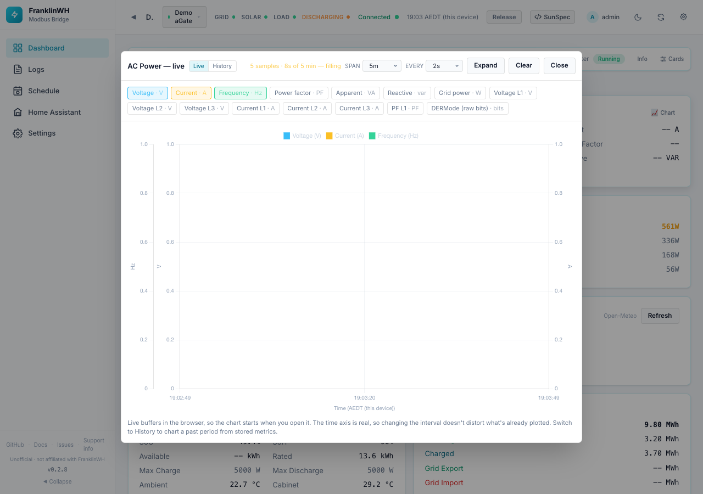

**Live** mode samples in the browser from the moment you open it.

| Control | Options | Default |
|---|---|---|
| span | 5m, 15m, 1h, 6h | 5m |
| every | 1s, 2s, 5s, 10s, 30s | 2s |
| Expand / Shrink | Larger chart | — |
| Clear | Empties the buffer | — |

**History** mode charts a past period from the bridge's stored point history.

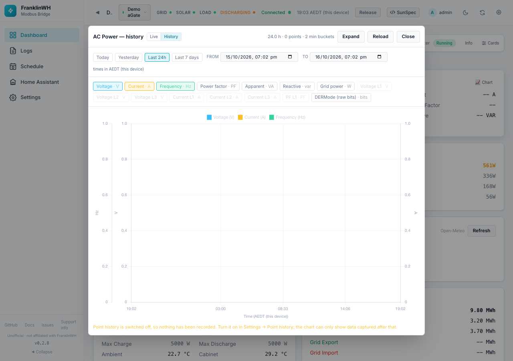

- Presets: **Today**, **Yesterday**, **Last 24h**, **Last 7 days**, or **From / To** in the
  bridge's timezone. **Reload** fetches again.
- Series buttons pick what to plot. Each unit gets its own axis, so volts, amps and hertz
  stay readable together.

| Chart | Series (default on in **bold**) |
|---|---|
| AC Power | **Voltage**, **Current**, **Frequency**, Power factor, Apparent, Reactive, Grid power, Voltage L1–L3, Current L1–L3, PF L1, DERMode (raw bits) |
| DC / Inverter | **DC power**, **Battery DC**, **SoC**, Battery volts, Battery amps, State of health, Cabinet temp, Ambient temp, three raw vendor registers (15013, 15035, 15016) |

!!! info "History needs Point History"
    History mode is empty until you switch on
    [Point History](settings-data-backup.md#point-history). The chart says so. Per-phase
    series (L1/L2/L3) are never recorded, so they are greyed out in History.

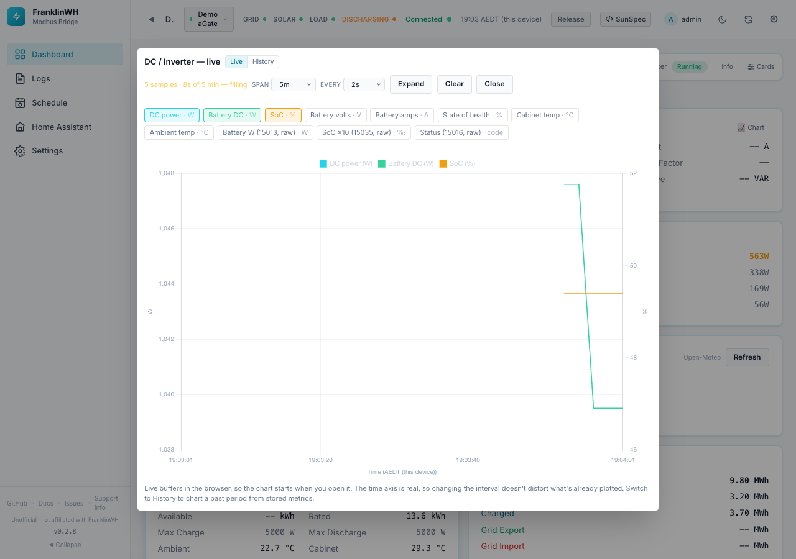

The span, interval and expand choices are remembered in this browser.

## Events History

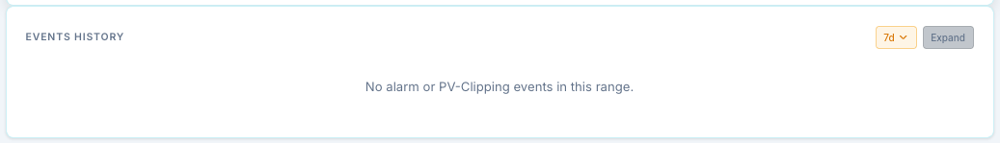

Alarms and PV-clipping events, with how long each lasted.

- **Time span**: 30m to 30d, or **Range…** for From / To. Default **7d**, remembered in
  this browser.
- **Fault / Warning / Info** chips show counts and filter by severity. Click again to clear.
- **All Sources** filters by origin: *M701 System Alarm*, *M714 DC Port Alarm*,
  *M713 Battery Health*, *M701 Grid Mode*.
- **Expand** opens the same list, larger.

| Column | Meaning |
|---|---|
| Time | Start, in the bridge's timezone. Hover for the full date. |
| Register | The Modbus register. |
| SunSpec group.point | For example `701.Alrm`. |
| Value | The alarm or event name. |
| Duration | How long it lasted, or *(ongoing)*. |

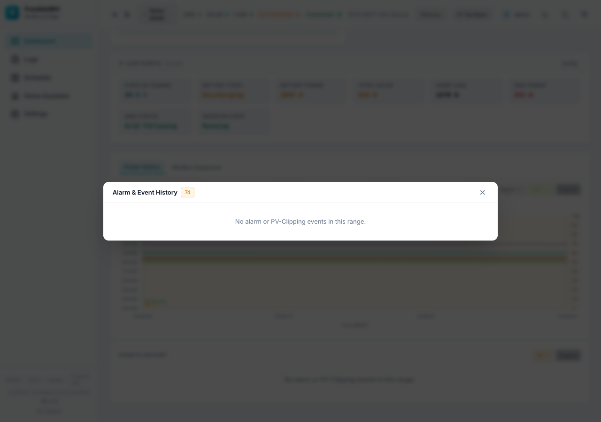
