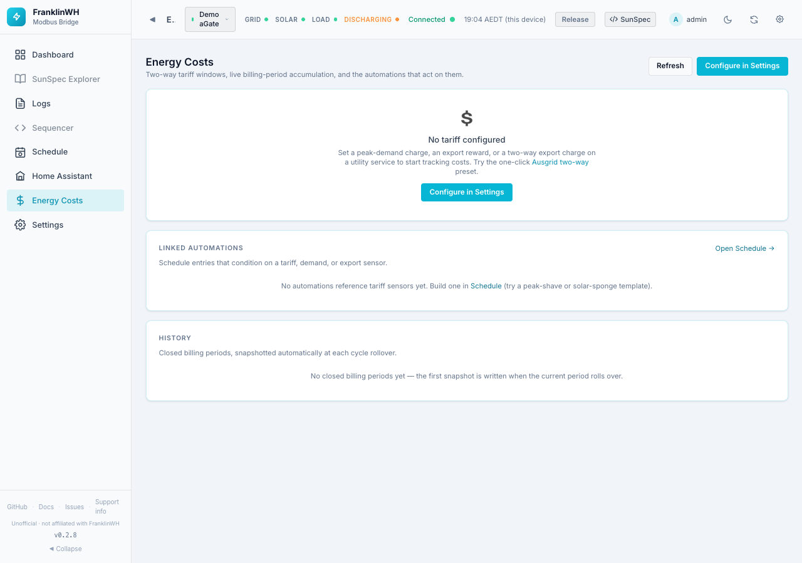
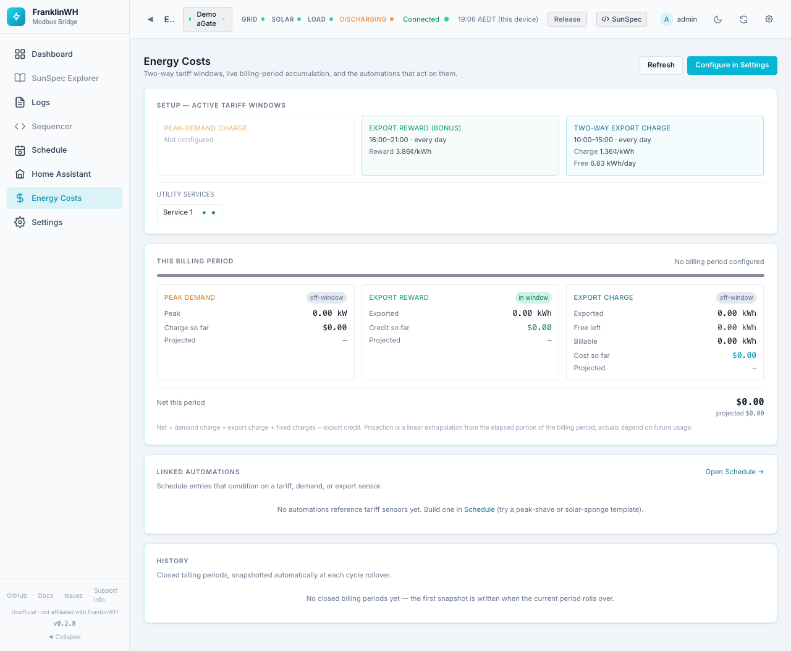

# Energy Costs

The Energy Costs page (`?tab=energy_costs`) tracks the cost parts of your electricity
tariff through the current billing period: peak-demand charges, export rewards, two-way
export charges and standing charges. It also lists the schedules that use tariff sensors,
and keeps a history of closed billing periods.

!!! info "Off by default, and needs a tariff"
    - On a new install the page is switched off. Turn it on in
      [Settings → Admin → Feature Modules](settings-admin.md#feature-modules).
    - It is configured on a **utility service** in
      [Settings → Energy & Automation](settings-energy-automation.md#utility-services-and-tariffs).
      Until a service has a peak-demand charge, export bonus, export charge, standing
      charges or dynamic pricing, the page says **No tariff configured**.

The buttons at the top: **Refresh** reloads, **Configure in Settings** opens
Energy & Automation.

## Setup — active tariff windows

One box per tariff part, showing what is in force. *Not configured* if that part is off.

| Box | Shows |
|---|---|
| Peak-demand charge | The window (times, months, days), the rate in $/kW per day or per month, and the interval (15, 30 or 60 min). |
| Export reward (bonus) | The window and the reward in ¢/kWh. |
| Two-way export charge | The window, the charge in ¢/kWh and the free export allowance in kWh/day. |

**Utility services** lists each service with a ◆ for each part it has (peak demand, export
reward, export charge, TOU plan), *live price* for dynamic pricing, or *no tariff*.

## This billing period

A bar shows how far through the billing period you are (the period follows the
**Billing cycle day** on the service).

If the plan uses a live (dynamic) price, a line shows the current buy and sell rate. If
some energy had no rate in force, it shows how many kWh were *unpriced*.

| Box | Fields |
|---|---|
| **Peak demand** | *in window* / *off-window*, the peak kW so far, the charge so far, and the projected charge. |
| **Export reward** | *in window* / *off-window*, kWh exported in the window, credit so far, projected. |
| **Export charge** | *in window* / *off-window*, kWh exported, free kWh left, billable kWh, cost so far, projected. |
| **Fixed charges** | Only when standing charges exist: $ per day, accrued so far, left to cover (and days left), the full-period total. |

**Net this period** = demand charge + export charge + fixed charges − export credit.
The projection extrapolates the elapsed part of the period in a straight line; actual
costs depend on future use.

!!! note "What the net does not include"
    The net is made of the parts above. It does not add the cost of the energy you import
    or the credit for ordinary feed-in priced by the plan's buy and sell rates.

The figures come from the tariff sensors (`demand.*`, `bonus.*`, `tariff.*`, `fixed.*`)
that schedules can also use as conditions.

## Linked automations

Schedule entries whose conditions use a tariff, demand or export sensor: name, action,
the sensors used, and whether each is *active now*, *enabled* or *disabled*.
**Open Schedule →** goes to the [Scheduler](../scheduler/index.md).

## History

Closed billing periods, saved automatically when a period rolls over. Until the first
rollover it says *No closed billing periods yet*.

- A bar per period: cost above the zero line, credit below.
- A table grouped by retailer and plan, so a change of retailer doesn't blend two plans:
  Period, Peak kW, Demand $, Reward kWh, Reward $, Export kWh, Billable kWh, Charge $,
  Fixed $, Net $.
- **Export CSV** downloads the history.
