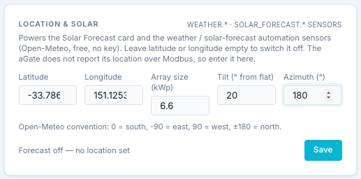
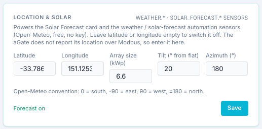
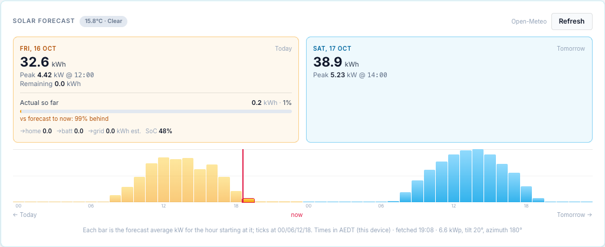
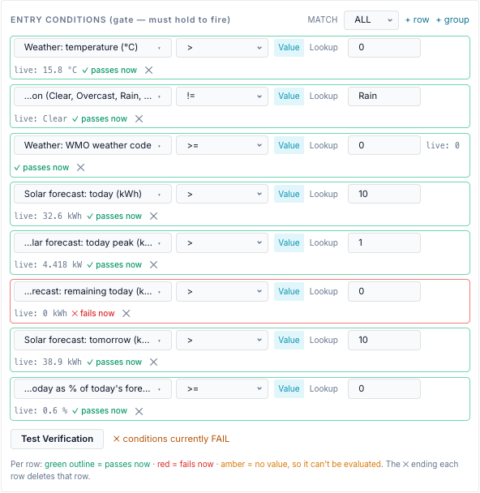

# Guide: site location, weather and solar forecast

This worked example sets the site location so the bridge can fetch weather and a solar
forecast from Open-Meteo. It uses **FranklinWH's Sydney office** as the address, because
it is a public business address. Use your own home's coordinates.

| Setting | Example value |
|---|---|
| Latitude | `-33.78667579056473` |
| Longitude | `151.12532799651834` |
| Timezone | Australia/Sydney (AEST, UTC+10 / AEDT, UTC+11) |
| Array size | 6.6 kWp (example) |
| Tilt | 20° (example) |
| Azimuth | 180° (north-facing, example) |

## What you get

- The [Solar Forecast card](dashboard.md#solar-forecast) on the Dashboard.
- Weather and forecast sensors that schedules can use as conditions:
  `weather.temp_c`, `weather.condition`, `weather.code`, `solar_forecast.today_kwh`,
  `solar_forecast.today_peak_kw`, `solar_forecast.remaining_kwh`,
  `solar_forecast.tomorrow_kwh`, `solar_forecast.day_pct` and
  `solar_forecast.vs_expected_pct`.
- The "actual so far" comparison, which uses the bridge's own solar samples.

**Needs:** internet access from the bridge to `api.open-meteo.com`. No account or key.

## Step 1 — Find your coordinates

The aGate does not report its location over Modbus, so you enter it.

- Right-click your house in Google Maps and click the coordinates to copy them, or
- in Home Assistant use **Settings → System → General → Location**. If the bridge is
  connected to Home Assistant, **Use Home Assistant's location** fills them in for you.

Latitude is **negative** in the southern hemisphere. Four decimal places (about 10 m) is
plenty; extra digits do no harm.

## Step 2 — Enter the location and array

Open **Settings → Site & Gateways → Location & Solar** (`?tab=settings&section=gateways`)
and fill in the fields.

| Field | What to enter |
|---|---|
| Latitude, Longitude | The coordinates from step 1. |
| Array size (kWp) | The DC size of your solar array, from your installer's paperwork. Default 5. |
| Tilt (° from flat) | The roof pitch. 0 = flat, 90 = vertical. Default 20. |
| Azimuth (°) | Which way the panels face, **Open-Meteo convention**: 0 = south, −90 = east, 90 = west, ±180 = north. |

!!! warning "Azimuth in Australia"
    The default is 0, which means **south**-facing. Most Australian arrays face north, which
    is **180** here. With the default left in place, a Sydney forecast comes out low and
    peaks late in the afternoon. For an east/west split array, pick the side with more
    panels or an average; the bridge models one array.

Press **Save**. The status changes to **Forecast on**:

The forecast is fetched in the background and cached for 15 minutes. It may take a few
seconds to appear.

## Step 3 — Check the Solar Forecast card

Go to the Dashboard. The **Solar Forecast** card now shows today and tomorrow:

- The chip next to the title is the current weather at the site (temperature and
  condition).
- **Today** and **Tomorrow** give the forecast kWh and peak kW. Day boundaries follow the
  **site's** local midnight (the bridge asks Open-Meteo for the site's own timezone).
- **Actual so far** compares the solar the bridge measured today with the forecast. On the
  demo gateway it is small, because the demo's solar is simulated.
- The bars are labelled in the bridge's timezone. On the test bridge used for these
  screenshots the bridge runs in New Zealand time, so the times read two hours later than
  Sydney time. On a real install in Sydney, the bridge's timezone is Australia/Sydney and
  the two agree. (See the [timezone banner](index.md#timezone-confirmation).)

The forecast model is simple: Open-Meteo's global tilted irradiance for your tilt and
azimuth, × kWp, × 0.85 for losses (`gateway/solar_forecast.py`). It does not know about
shading, clipping or an export limit. Treat it as a guide.

## Step 4 — Check the sensors

The same data becomes condition sensors in the [Scheduler](../scheduler/index.md). To see
their live values, open **Schedule → + Add Entry**, add rows under **Entry conditions**
with these sensors, and press **Test Verification**. Each row shows `live:` and its value.
(Cancel the entry afterwards if you were only looking.)

| Sensor | Example value | Meaning |
|---|---|---|
| `weather.temp_c` | 16.2 °C | Temperature now. |
| `weather.condition` | Mainly clear | Weather in words: *Clear*, *Mainly clear*, *Partly cloudy*, *Overcast*, *Fog*, *Drizzle*, *Rain*, *Thunderstorm* … |
| `weather.code` | 1 | The WMO weather code behind it. |
| `solar_forecast.today_kwh` | 34.9 kWh | Forecast for today. |
| `solar_forecast.today_peak_kw` | 5.167 kW | Today's forecast peak. |
| `solar_forecast.remaining_kwh` | 0.3 kWh | Forecast still to come today. |
| `solar_forecast.tomorrow_kwh` | 37.5 kWh | Forecast for tomorrow. |
| `solar_forecast.day_pct` | 3.1 % | Actual solar today as a share of today's forecast. |
| `solar_forecast.vs_expected_pct` | — | Actual vs forecast **up to now**; 100 = on track. |

For how to use them in rules, for example "fill the battery overnight if tomorrow is
forecast under 10 kWh", see [Conditions](../scheduler/conditions.md#weather),
[Solar Forecast sensors](../scheduler/conditions.md#solar-forecast) and the
[storm forecast example](../scheduler/examples.md#4-storm-forecast-fill-the-battery).

## If it doesn't work

| Symptom | Likely cause |
|---|---|
| Status stays *Forecast off — no location set* | Latitude or longitude is empty, or Save wasn't pressed. |
| Card says *Could not load the forecast* or *Forecast unavailable* | The bridge can't reach Open-Meteo. Check its internet access and DNS. |
| A **stale** chip | The last fetch failed; the previous forecast is shown. |
| Forecast far too low, peak in the late afternoon | Azimuth left at 0 (south) for a north-facing array. |
| Sensors show *no value* | The feature is off, or the first fetch hasn't finished. |

## Switching it off

Clear latitude **or** longitude and press **Save**. Nothing more is fetched, and the
`weather.*` and `solar_forecast.*` sensors have no value, so any schedule condition using
them can't pass.
