# Guide: utility, meter and tariff setup

Two worked examples of telling the bridge what your electricity costs:

1. [**A flat plan**](#example-1-a-flat-plan-agl-energy): AGL Energy, one import price and
   one feed-in price, plus a daily supply charge.
2. [**A dynamic plan**](#example-2-a-dynamic-plan-amber-electric-on-the-nem-spot-price):
   Amber Electric, priced from the AEMO wholesale (NEM) spot price for NSW1.

Then a [comparison](#flat-vs-dynamic-at-a-glance), [what the bridge does and doesn't
model](#what-the-bridge-models-and-what-it-doesnt), and
[how the prices feed the Scheduler](#where-the-prices-go-scheduler-conditions).

!!! info "All prices on this page are examples"
    The cents per kWh, supply charge and membership fee below are **plausible examples**,
    not AGL's or Amber's actual prices. Take your own from your bill or your plan's energy
    fact sheet. Meter and account numbers are made up.

The screenshots come from a test bridge running the demo gateway, so energy totals stay at
zero. See [Limits of the demo](#limits-of-these-screenshots).

## Before you start: one service prices everything

A **utility service** describes one electricity connection: the meter, the network's
permissions, the retailer's plan and its prices. The bridge creates one for you, called
**Service 1**.

!!! warning "Edit Service 1 rather than adding a second one"
    In 0.2.8 the bridge prices energy from the **first enabled service** in the list only
    (`gateway/billing.py`: "first service defines the plan (v1: single service)"). A second
    service that you add is stored, and can be linked to a gateway, but its tariff is **not
    used** for pricing, Energy Costs or the `tariff.*` sensors. For a single home, turn
    Service 1 into your plan, as below.

    Likewise, the running cost totals (`energy.import_cost`, `energy.export_credit`) are
    accumulated from the **primary gateway** (ID `default`) only, whichever gateway you link
    to the service.

Everything below is in **Settings → Energy & Automation**
(`?tab=settings&section=energy`), except the gateway link (Site & Gateways) and the spot
price region.

---

## Example 1: a flat plan (AGL Energy)

| Part | Example value |
|---|---|
| Retailer | AGL Energy |
| Network (DNSP) | Ausgrid |
| Import (buy) | 33 c/kWh, all day, every day (**example**) |
| Feed-in (sell) | 5 c/kWh (**example**) |
| Daily supply charge | $1.10/day (**example**) |
| Billing cycle | starts on the 1st |

### Step 1 — Site name (optional)

At the top of the card, **Site Name** → **Edit**. This is the name of the whole site, shown
on the [simple dashboard](user-dashboard.md).

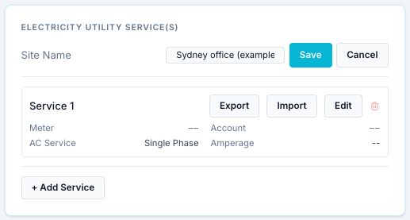

!!! bug "Known problem in 0.2.8"
    Pressing **Save** here fails with *"Save failed: … extra inputs are not permitted …
    updated_at"*: the form sends read-only fields back to the bridge. The site name stays
    *My Site*. It is cosmetic; nothing is priced from it.

### Step 2 — The service: meter and connection

For reference, this is what **+ Add Service** shows for a new service. For the reason
above, this example edits **Service 1** instead (click **Edit** on it).

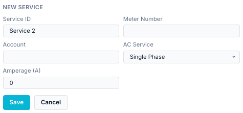

| Field | Example | What it is |
|---|---|---|
| **Service ID** | AGL Energy — main meter | The service's display name. Despite the label, you can rename it. |
| **Meter Number** | 4103000000 (example NMI) | Your meter identifier. In Australia, the 10–11 character **NMI** printed on your bill. For your records and the support summary (where it is removed); nothing is looked up from it. |
| **Account** | 1234 5678 (example) | Your retailer account number. For your records. |
| **AC Service** | Single Phase | Single, split or three phase: how the house is connected. Most Australian homes are single phase. |
| **Amperage (A)** | 63 | The rated current of the connection (the main switch or service fuse rating). For your records. |

Meter number, account and the network approval below are never included when you
**Export** a tariff to share it.

### Step 3 — Grid connection and retail plan

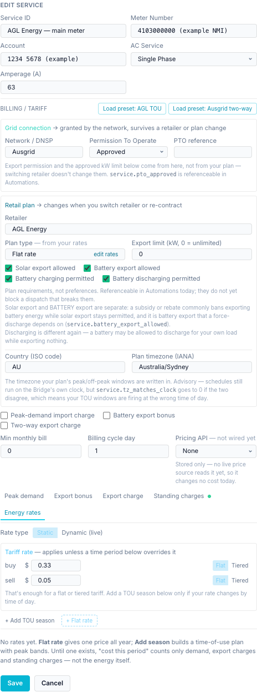

**Grid connection** (from the network, survives a change of retailer):

| Field | Example | Notes |
|---|---|---|
| Network / DNSP | Ausgrid | Your distributor, printed on the bill. |
| Permission To Operate | Approved | The network's approval for your solar/battery. Becomes `service.pto_approved` (1 when Approved). |
| PTO reference | (empty) | The approval number, if you have it. |

**Retail plan:**

| Field | Example | Notes |
|---|---|---|
| Retailer | AGL Energy | Groups the [Energy Costs](energy-costs.md) history by supplier. |
| Plan type | *Flat rate* | Not chosen: worked out from the rates you enter in step 4. |
| Export limit (kW) | 0 | 0 = unlimited. Your approved export limit, if any. |
| Export / charging boxes | all ticked | What the plan permits. Recorded and testable in schedules (`service.*`), **not enforced**. |
| Country | AU | |
| Plan timezone | Australia/Sydney | The timezone the plan's times are written in. If it differs from the bridge's clock, `service.tz_matches_clock` becomes 0. |

Leave **Peak-demand import charge**, **Battery export bonus** and **Two-way export charge**
unticked for a plain flat plan. **Billing cycle day** 1 means each billing period starts on
the 1st of the month; set it to your bill's start day.

### Step 4 — The flat import and feed-in rates

Open the **Energy rates** tab. Keep **Rate type** on **Static**. Under **Tariff rate**,
enter the prices in **dollars per kWh**:

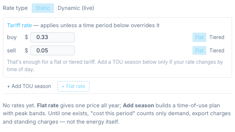

| Side | Enter | Means |
|---|---|---|
| buy | `0.33` | 33 c/kWh for every kWh imported (example). |
| sell | `0.05` | 5 c/kWh for every kWh exported (example). |

That is all a flat plan needs. You don't add a season. Enter prices as your bill shows them:
the bridge applies no tax to energy rates, so use GST-inclusive prices if you want
GST-inclusive costs.

!!! note
    Under the rates the editor still says *"No rates yet … Until one exists, 'cost this
    period' counts only demand, export charges and standing charges — not the energy
    itself."* With a tariff rate filled in, that message is out of date: the rate above
    **is** used (see [Energy Costs](#step-7-what-you-see) below for what is shown where).

### Step 5 — The daily supply charge

Open **Standing charges** → **+ Add charge**:

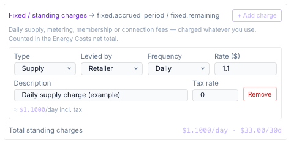

| Field | Example |
|---|---|
| Type | Supply |
| Levied by | Retailer |
| Frequency | Daily |
| Rate ($) | 1.10 (example) |
| Description | Daily supply charge |
| Tax rate | 0 (the example price already includes GST; enter 0.1 to add 10 %) |

Press **Save**. The service list now shows the AGL service:

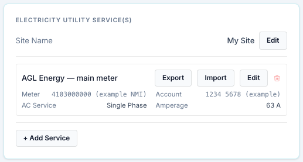

### Step 6 — Link the gateway to the service

In **Settings → Site & Gateways**, click **Edit** on your aGate and pick the service under
**Utility Service**, then **Save Changes**.

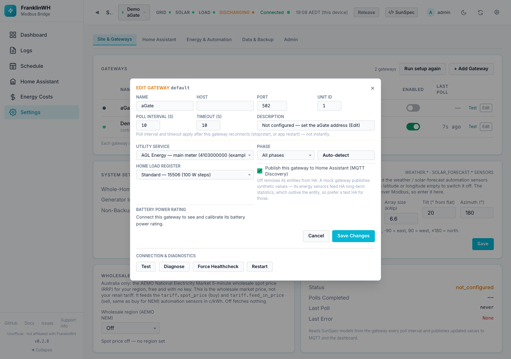

This records which meter the aGate sits behind. It is used by schedules that target a
*service* (they act on every gateway linked to it). As noted above, it does **not** choose
which tariff prices energy in 0.2.8. (In the screenshot the dialog was cancelled, so the
test bridge's gateways were not changed.)

### Step 7 — What you see

**Energy Costs** (turn the page on in
[Feature Modules](settings-admin.md#feature-modules) if it is hidden):

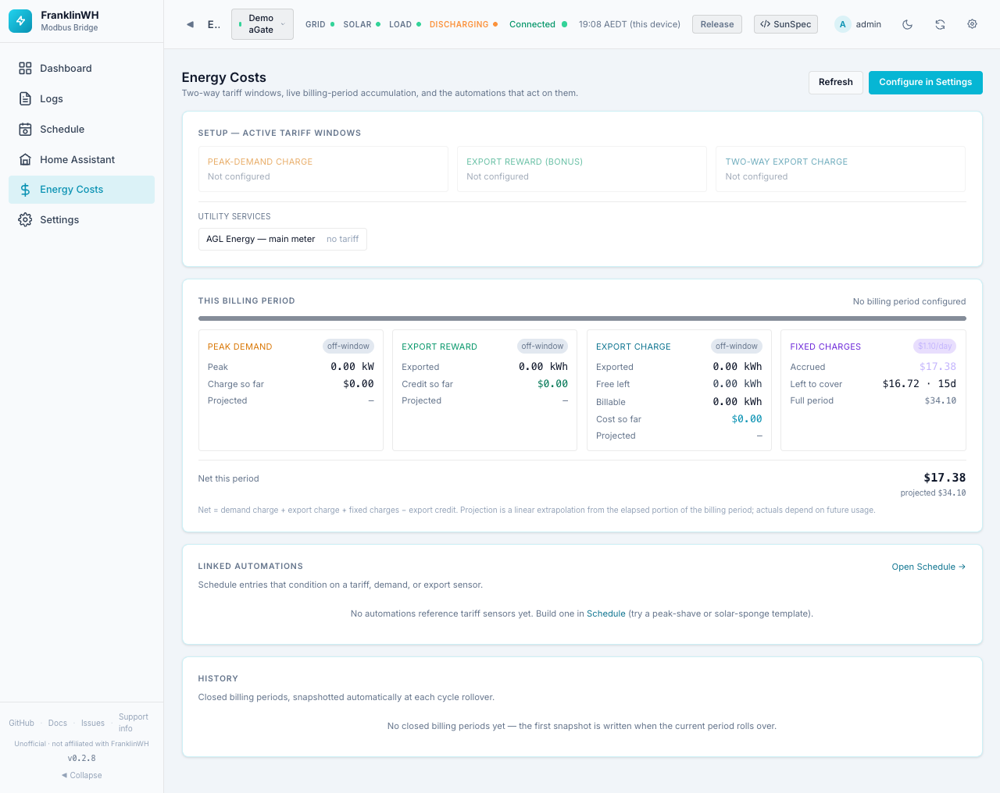

- **Fixed charges** shows the supply charge: $1.10/day, accrued so far this period, what
  is left, and the full-period total.
- **Net this period** includes the supply charge.
- The utility service shows **no tariff** and the import/feed-in cost does **not** appear
  in *Net this period*. The live page only adds demand, export-charge, fixed charges and
  the export bonus. The cost of the energy itself is tracked in the `energy.import_cost`
  and `energy.export_credit` sensors, and it **is** included in each closed period's
  **History** row (`gateway/demand.py` adds `energy_cost` and `energy_credit` to the
  period's `net_total`).

!!! tip
    Without the supply charge, a flat plan on its own shows **No tariff configured** on
    Energy Costs, even though its rates are in use.

**Sensors** — open **Schedule → + Add Entry**, add the sensors as entry conditions and press
**Test Verification** to see their live values:

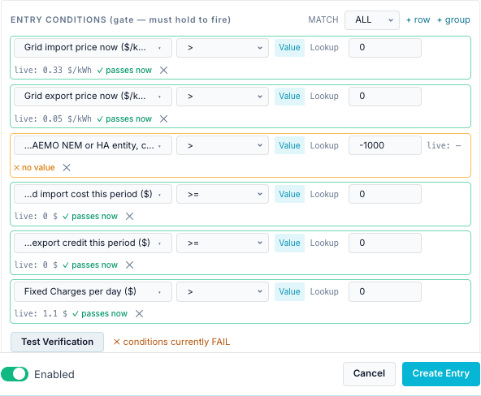

| Sensor | Value here | Meaning |
|---|---|---|
| `tariff.buy_rate` | 0.33 $/kWh | Import price now. Constant on a flat plan. |
| `tariff.sell_rate` | 0.05 $/kWh | Feed-in price now. |
| `tariff.spot_price` | no value | Wholesale price: none, because no NEM region is set. |
| `energy.import_cost` | $0 | Import cost so far this billing period. |
| `energy.export_credit` | $0 | Feed-in credit so far this billing period. |
| `fixed.daily_charge` | $1.10 | Standing charges per day. |

`energy.import_cost` and `energy.export_credit` are $0 here because the demo gateway is not
the primary gateway. On a real install they grow with your grid import and export meters.

---

## Example 2: a dynamic plan (Amber Electric on the NEM spot price)

Amber Electric passes the **wholesale** price through to you, so your price changes every
five minutes. The bridge can follow the AEMO National Electricity Market (NEM) wholesale
spot price for your region. This is **#89 part B** ("dynamic pricing").

| Part | Example value |
|---|---|
| Retailer | Amber Electric |
| Price source | AEMO NEM wholesale spot, region **NSW1** |
| Network daily supply | $1.10/day (**example**) |
| Amber membership | $25/month (**example**) |

**Needs:** internet access from the bridge to `visualisations.aemo.com.au` (public, no
key). Australia only.

### Step 1 — Wholesale spot price card (optional)

In **Settings → Site & Gateways → Wholesale spot price**, choose region **NSW1**. It saves
at once and shows the price now:

The price shown is AEMO's 5-minute regional reference price (RRP): **$/MWh ÷ 10 = c/kWh**
(here, $88.86/MWh = 8.89 c/kWh). It feeds `tariff.spot_price` and `tariff.feed_in_price`.

This card alone does **not** price your energy: it only provides the sensors. Step 2 is
what makes the plan dynamic. A dynamic plan fetches its own region even if this card is
left on *Off*.

### Step 2 — Make the plan dynamic

Edit the service: set **Service ID** to *Amber Electric — main meter* and **Retailer** to
*Amber Electric*. Then open **Energy rates** and set **Rate type** to **Dynamic (live)**:

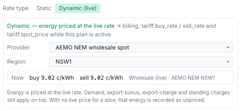

| Field | Choose |
|---|---|
| Provider | **AEMO NEM wholesale spot** |
| Region | **NSW1** (QLD1, SA1, TAS1 and VIC1 also exist) |

The box shows the live price now. Note that **buy and sell are the same number**: the
wholesale price, with nothing added.

Under **Standing charges**, add the fixed parts of the bill: the network supply charge
(daily) and Amber's membership (monthly, type *Membership*, levied by *Retailer*). Then
**Save**.

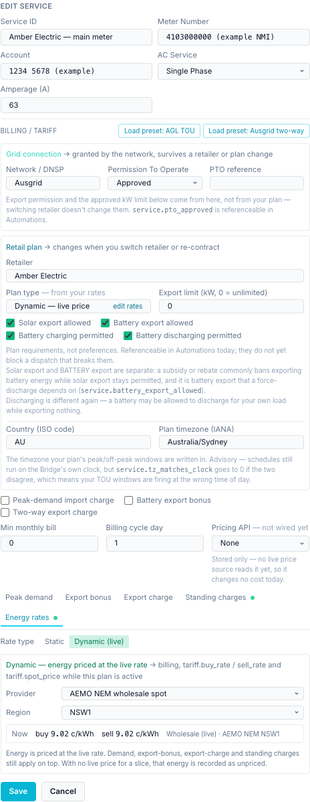

Your static rates from example 1 stay on file while Dynamic is on, and come back if you
switch to Static.

!!! note "Changing retailer mid-period"
    Editing the same service from AGL to Amber, as here, keeps the current billing period
    running. Costs accrued under AGL's prices and Amber's prices land in one period. The
    bridge has an API to close the period and start a new plan
    (`POST /api/services/{id}/switch-plan`), but no button for it in 0.2.8.

### Step 3 — What you see

**Energy Costs:**

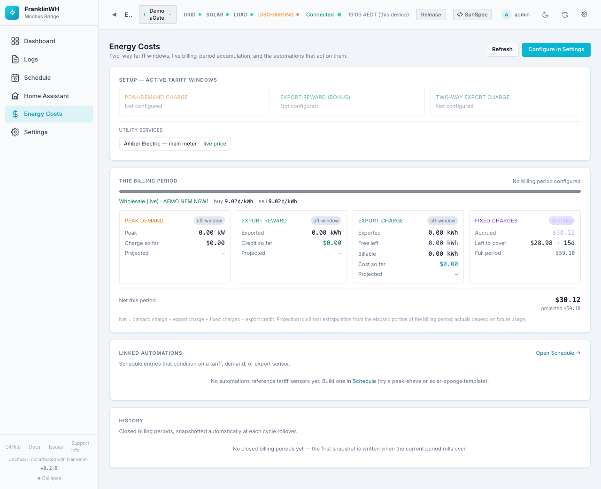

- The service is marked **live price**.
- A line under the period bar shows **Wholesale (live) · AEMO NEM NSW1** and the buy and
  sell price now.
- **Fixed charges** total the supply and membership charges ($1.10/day + $25/month ≈
  $1.91/day in the example).
- When no live price is available for a while (AEMO unreachable, or the cached price older
  than 10 minutes), the energy in that time is counted as **unpriced kWh** instead of being
  priced at an old rate. The page then says how many kWh were unpriced.

**Sensors:**

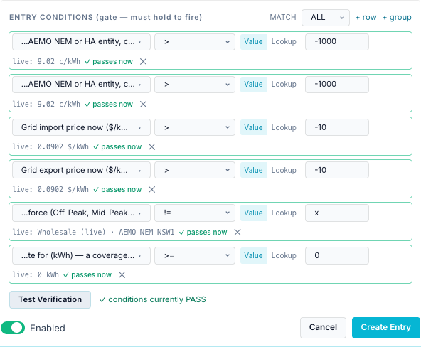

| Sensor | Value here | Meaning |
|---|---|---|
| `tariff.spot_price` | 9.76 c/kWh | The plan's live buy price (the NEM spot for NSW1). |
| `tariff.feed_in_price` | 9.76 c/kWh | The plan's live sell price. Same as buy for NEM. |
| `tariff.buy_rate` | 0.0976 $/kWh | The rate billing is charging now, in $/kWh. |
| `tariff.sell_rate` | 0.0976 $/kWh | The rate billing is crediting now. |
| `tariff.time_period` | Wholesale (live) · AEMO NEM NSW1 | What priced the energy, instead of Off-Peak / On-Peak. |
| `energy.unpriced_import_kwh` | 0 kWh | Import that had no live price. |

While a dynamic plan is active, `tariff.spot_price` and `tariff.feed_in_price` follow the
**plan's** source and override the Wholesale spot price card's region (`gateway/aemo_nem.py`,
`as_points`). The wholesale price can be **negative**; the sensors and the cost then go
negative too.

---

## Flat vs dynamic at a glance

| | Flat plan (AGL example) | Dynamic plan (Amber example) |
|---|---|---|
| Rate type | Static | Dynamic (live) |
| Where the price comes from | The numbers you typed | AEMO NEM 5-minute spot for your region (or a Home Assistant price entity) |
| Buy vs sell | Separate prices (33 c vs 5 c) | **Identical** for NEM: buy = sell = spot |
| Changes | Only when you edit it | Every 5 minutes |
| Plan type shown | Flat rate | Dynamic — live price |
| `tariff.buy_rate` / `sell_rate` | 0.33 / 0.05 $/kWh, fixed | Live spot in $/kWh |
| `tariff.spot_price` | No value unless the Wholesale card has a region | Live, in c/kWh |
| `tariff.time_period` | — (or the TOU period with seasons) | *Wholesale (live) · AEMO NEM NSW1* |
| Can go negative | No | Yes |
| Needs internet | No | Yes, to AEMO |
| When the price is missing | Never missing | Energy counted as **unpriced kWh** |
| Energy Costs badge | *no tariff* (unless other parts are on) | *live price* |
| Standing charges | Added under Standing charges | Same |

## What the bridge models, and what it doesn't

The dynamic plan prices energy at the **raw wholesale** price. Amber's real retail price is
**not** the wholesale price.

| Part of an Amber bill | Modelled? | How, or why not |
|---|---|---|
| Wholesale energy (spot price) | **Yes** | `gateway/aemo_nem.py` fetches AEMO's `ELEC_NEM_SUMMARY` every 240 s and converts RRP $/MWh to c/kWh (÷ 10). `gateway/dynamic_pricing.py` turns it into the plan's live rate, with **sell = buy = spot**. |
| Network (DNSP) usage charges, per kWh | **No** | Nothing adds a per-kWh amount on top of the live price. These are often the largest part of an Amber price, and vary by time of day. |
| Environmental / market charges, per kWh | **No** | Same: not added. |
| GST on energy | **No** | The live price is used as-is (`aemo_nem.py` divides RRP by 10; no tax). |
| Amber's own feed-in price | **No** | NEM gives one price; the bridge uses it for both buy and sell. Amber's feed-in differs from its buy price. |
| Network daily supply charge | **Yes**, if you add it | As a Standing charge (`gateway/fixed_charges.py`). |
| Amber membership fee | **Yes**, if you add it | As a Standing charge, type Membership. |
| Peak-demand or export charges | **Yes**, if configured | The Peak demand / Export charge tabs work with either rate type ("Demand, export-bonus, export-charge and standing charges still apply on top"). |
| Amber's 30-minute settlement | **Uncertain** | The bridge prices each sample at the latest 5-minute price; how closely this tracks Amber's 30-minute billing has not been checked. |
| A forecast of prices | **No** | Only the current price; no price forecast. |

So the **Energy Costs and `energy.import_cost` figures for a NEM dynamic plan will be lower
than your Amber bill**, by the network, market and GST components. They are useful for
deciding *when* power is cheap (the timing follows the spot price), not for reconciling the
bill.

!!! tip "For Amber's actual retail price"
    Choose **Provider: Home Assistant price entity** instead, and pick the Amber
    integration's *general price* (buy) and *feed-in price* sensors in Home Assistant. Those
    include Amber's network and other charges. This needs a
    [Home Assistant instance](settings-home-assistant.md#home-assistant-instances) and the
    entities exposed on the [Home Assistant page](home-assistant-page.md). A value in
    $/kWh is converted to c/kWh (`aemo_nem.ha_price_c_kwh`); with no feed-in entity, sell
    falls back to the buy price. This option could not be shown here: the test bridge has no
    Home Assistant.

For a static plan the rate comes from `gateway/rate_model.py` (`resolve`): the season for
this month, the block for this time of day, and that time period's buy/sell price, falling
back to the tariff-wide rate; an hour with no price at all is counted as unpriced.

## Where the prices go: Scheduler conditions

All of these are condition sensors in the [Scheduler](../scheduler/index.md). The full
list is in [Conditions → Every sensor in the picker](../scheduler/conditions.md#every-sensor-in-the-picker).

| Sensor | Group in the picker | Use it to |
|---|---|---|
| `tariff.buy_rate`, `tariff.sell_rate` | [Tariff](../scheduler/conditions.md#tariff) | Charge when import is cheap, discharge when feed-in pays well. Works for both plan types. |
| `tariff.spot_price`, `tariff.feed_in_price` | [Tariff](../scheduler/conditions.md#tariff) | React to the wholesale price, in c/kWh. See the [spot price example](../scheduler/examples.md#3-charge-from-the-grid-when-the-nem-spot-price-is-low). |
| `tariff.time_period`, `tariff.season`, `tariff.tier` | [Tariff](../scheduler/conditions.md#tariff) | Act in a TOU band (static plans with seasons). |
| `energy.import_cost`, `energy.export_credit`, `energy.unpriced_*_kwh` | [Energy](../scheduler/conditions.md#energy) | Running totals for the billing period. |
| `fixed.*` | [Fixed Charges](../scheduler/conditions.md#fixed-charges) | Standing charges per day, accrued, remaining. |
| `service.*` | [Utility Plan](../scheduler/conditions.md#utility-plan) | Check the plan allows battery export (`service.battery_export_allowed`) before a force discharge to grid; `service.tz_matches_clock`. |

Remember that the export and charging permissions are only enforced if your schedules test
them.

## Limits of these screenshots

- **Live NEM prices worked**: the test bridge had internet access, so the prices shown
  (8.89 c/kWh, 9.76 c/kWh) are real NSW1 spot prices from the day of capture.
- **Energy totals are zero**: the test bridge runs only the demo gateway, and the cost
  accrual follows the primary gateway, which was not set up. On a real install
  `energy.import_cost` and `energy.export_credit` grow with your meters.
- **No History rows**: closed billing periods only appear after a month boundary.
- **Gateway link not saved**: the Utility Service dialog was opened and cancelled, so the
  test bridge's gateways were not changed.
- **No Home Assistant price entity**: the test bridge has no Home Assistant.
