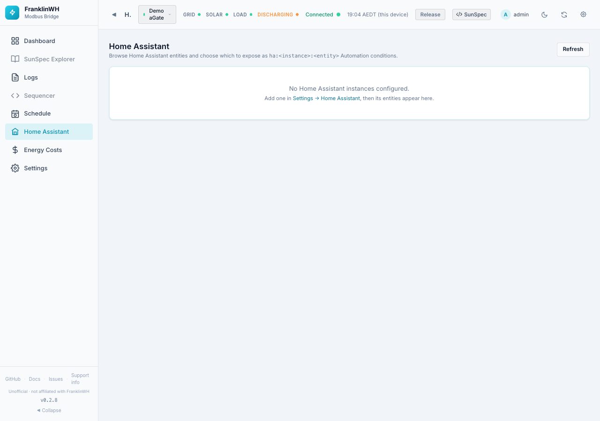
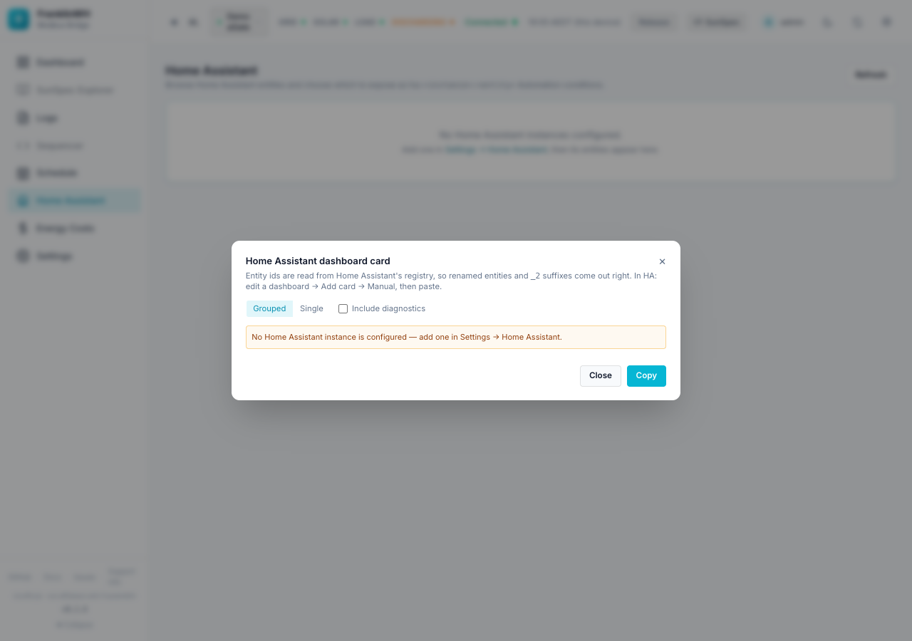

# Home Assistant page

The **Home Assistant** page (`?tab=ha_entities`) works in the opposite direction to MQTT.
MQTT sends the bridge's values **to** Home Assistant. This page reads entities **from**
Home Assistant, so your schedules can use them as conditions. It also builds a dashboard
card for Home Assistant.

| Direction | Where it is set up |
|---|---|
| Bridge → Home Assistant (MQTT entities) | [Settings → Home Assistant](settings-home-assistant.md) |
| Home Assistant → bridge (this page) | Add an instance in [Settings → Home Assistant → Home Assistant instances](settings-home-assistant.md#home-assistant-instances), then pick entities here |

!!! info "Needs a Home Assistant instance"
    Until an instance is added the page only says *No Home Assistant instances configured*,
    with a link to Settings. On the add-on, the Home Assistant it runs in is added
    automatically through the Supervisor.

In the feature list this page is called **HA Entities**. Switching that module off also
switches off the Home Assistant instance list in Settings and the "Use Home Assistant's
location" button, since they share the same API.

## This bridge's entities in Home Assistant

**Show** opens a table of every entity the bridge publishes over MQTT, with the entity
ID Home Assistant gave it. It's read from Home Assistant's own registry. Use it when an
entity seems to be missing in Home Assistant. It is usually one of these:

| Note | What it means | What to do |
|---|---|---|
| **Diagnostic** (Shown in HA) | Home Assistant lists it in the device page's **Diagnostic** section, not with the sensors. The [dashboard card](#dashboard-card) leaves it out unless **Include diagnostics** is ticked. Grid connection and inverter state are not diagnostic: they show with the sensors. | Open the device's Diagnostic section, or tick Include diagnostics. |
| A **Bridge dashboard** label | The bridge dashboard's label isn't Home Assistant's name. For example "DC Power" is **Battery Power**, and "Rated" is **Total Capacity**. | Search Home Assistant for the name in the HA entity column. |
| **Other id** | Home Assistant kept an entity ID from an earlier integration (for example `sensor.fhp_battery_power`), or you renamed it. It is still this bridge's entity: Home Assistant matches entities by unique ID, not by entity ID. | Optional: Home Assistant → **Settings → Entities** → the entity → settings → **Entity ID**. Automations that use the old ID need the new one. |
| **Not in HA** | The bridge publishes it, but Home Assistant's registry has no entry for it yet. | Check MQTT is connected, then Settings → Home Assistant → Republish. |
| **Disabled in HA** | Disabled in Home Assistant. | Enable it in Home Assistant. |

The bridge dashboard's grid status (Grid Following / Grid Forming) isn't published to
Home Assistant.

## Entities

Once an instance is connected the page shows:

- **Entities / Exposed / Instances** counts.
- A toolbar: **Search entities…**, an **instance** filter, a **domain** filter, and
  **Exposed only**.
- **Topics** presets that search for common names at once:
  *Solar / PV*, *Battery*, *Grid / Export*, *Price / Tariff*, *Automations*. Click again to
  clear; **clear** resets every filter.
- The table: #, Entity (id and friendly name), Domain, State (with unit), Instance, and the
  **Expose** switch.

Turn on **Expose** for an entity to make it available to schedules as a condition sensor
named `ha:<instance>:<entity_id>`. Exposing changes nothing in Home Assistant.

When you filter to the `automation` domain and some are enabled, an amber note warns that
an enabled Home Assistant automation and a bridge schedule controlling the **same** device
will fight. Decide on one owner per device.

Pages hold 25, **50**, 100 or 200 entities; use **Prev / Next**.

## Dashboard card

**Dashboard card** (top right, also on the MQTT broker card in Settings) builds YAML for a
Home Assistant dashboard card listing this bridge's entities.

| Option | Meaning |
|---|---|
| Grouped / Single | One card per group of entities, or one long card. |
| Include diagnostics | Adds the diagnostic entities. |
| Instance | Which Home Assistant to read (only with several). |

The entity IDs come from that Home Assistant's own registry, so renamed entities and
`_2` suffixes come out right. In Home Assistant: edit a dashboard → **Add card** →
**Manual**, and paste. **Copy** puts the YAML on the clipboard.

!!! note
    It needs a Home Assistant instance (above) **and** entities already published over MQTT.
    Without an instance the dialog shows *"No Home Assistant instance is configured — add
    one in Settings → Home Assistant"*, as in the screenshot.

For fixing, moving or removing the entities themselves, see
[Fixing, moving and removing entities](../home-assistant-entities.md).
