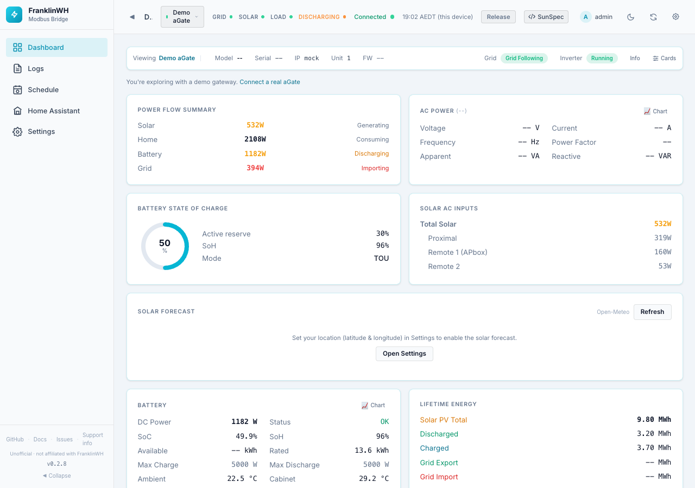
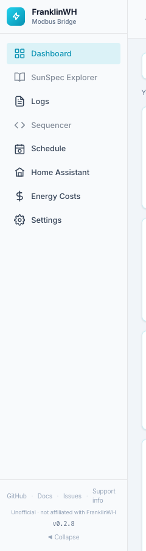
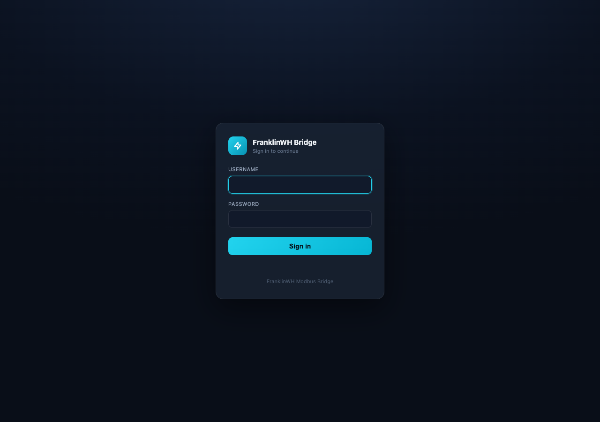
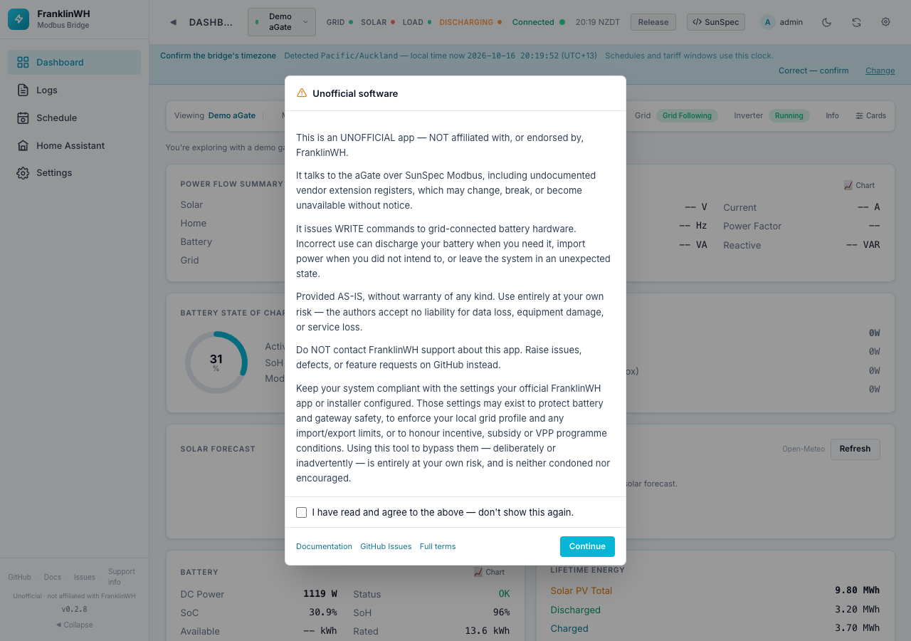
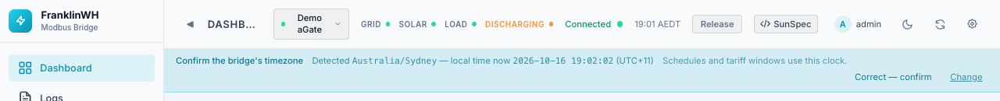
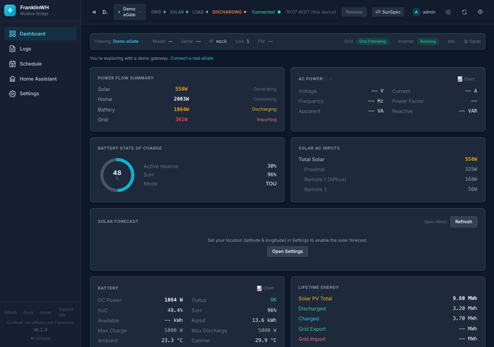

# Dashboards & Settings

This section describes every page of the bridge's web UI: what each card shows, what each
option does, its default, and what it depends on. The screenshots come from a test bridge
running the **demo gateway**, so some values read `--` where a real aGate would report one.

## The layout

The UI has three parts:

| Part | Where | What it is for |
|---|---|---|
| **Sidebar** | Left | Moves between pages. Click the logo or **◀ Collapse** to shrink it to icons. |
| **Top bar** | Top | Live status, the gateway selector, battery release, and display options. See [Top bar](top-bar.md). |
| **Page** | Centre | The page you picked in the sidebar. |

The address bar always shows the page you are on, so you can bookmark or share it:
`/?tab=dashboard`, `/?tab=settings&section=home-assistant`, and so on.

## Pages

| Sidebar entry | Address | On by default | Page |
|---|---|---|---|
| Dashboard | `?tab=dashboard` | Always (core) | [Dashboard](dashboard.md) |
| SunSpec Explorer | `?tab=explorer` | **No** (new installs) | [SunSpec Explorer](sunspec-explorer.md) |
| Logs | `?tab=logs` | Yes | [Logs](logs.md) |
| Sequencer | `?tab=sequencer` | **No** (new installs) | [Sequencer](sequencer.md) |
| Schedule | `?tab=schedule` | Yes | [Scheduler](../scheduler/index.md) |
| Home Assistant | `?tab=ha_entities` | Yes | [Home Assistant page](home-assistant-page.md) |
| Energy Costs | `?tab=energy_costs` | **No** (new installs) | [Energy Costs](energy-costs.md) |
| Settings | `?tab=settings` | Always (core) | Five sections, below |

<figure markdown>
{ width="200" }
</figure>

Pages marked **No** are switched off on a new install. Turn them on in
[Settings → Admin → Feature Modules](settings-admin.md#feature-modules). A switched-off
page disappears from the sidebar, and its address opens the Dashboard instead.

There is also a separate, phone-sized page for household members: the
[simple dashboard at `/user`](user-dashboard.md). People with the `user` or `viewer` role
always land there.

The battery controls live on the Dashboard, in the **Battery Control** and
**Operating Mode & Reserve** cards. See [Battery controls](controls.md).

### Settings sections

| Section | Address | Page |
|---|---|---|
| Site & Gateways | `?tab=settings&section=gateways` | [Site & Gateways](settings-site-gateways.md) |
| Home Assistant | `?tab=settings&section=home-assistant` | [Home Assistant settings](settings-home-assistant.md) |
| Energy & Automation | `?tab=settings&section=energy` | [Energy & Automation](settings-energy-automation.md) |
| Data & Backup | `?tab=settings&section=data` | [Data & Backup](settings-data-backup.md) |
| Admin | `?tab=settings&section=admin` | [Admin](settings-admin.md) |

## Who sees what

What you see depends on your role. Roles are set in
[Settings → Admin → Users](settings-admin.md#users).

| Role | Main UI (`/`) | Simple dashboard (`/user`) | Battery commands | Settings |
|---|---|---|---|---|
| `admin` | Yes, every page | Yes (via the user menu link) | Yes | Yes |
| `user` | No, sent to `/user` | Yes | Yes (charge/discharge) | No |
| `viewer` | No, sent to `/user` | Yes, read-only | No | No |
| `api` | No (REST API only) | No | Yes, via the API | No |

## First visit

Sign in with your username and password. If your last login ended (expired, revoked or
signed out elsewhere), the sign-in page says why.

Two things can appear the first time you open the UI.

### "Unofficial software" notice

A full-screen notice that the bridge is not made or supported by FranklinWH. It cannot be
closed by clicking outside it or pressing ++esc++. Tick **I have read and agree to the
above — don't show this again** and press **Continue**. Press **Continue** without ticking
and it comes back on the next page load. The links at the bottom open the documentation,
GitHub Issues and the full terms.

### Timezone confirmation

A blue banner asks you to confirm the bridge's timezone. Schedules and tariff windows run on
the bridge's own clock. That clock comes from the container or host, not from a setting in
this app. A container with no timezone set runs on UTC. If so, the banner says *"That looks
like a container default rather than a choice"*.

- **Correct — confirm** records the timezone, and the banner goes away for good.
- **Change** is meant to open Settings, but in 0.2.8 it does nothing. It would not help
  anyway: the timezone is set where the bridge runs (the host for the add-on, the Docker
  `TZ` variable), not in Settings. Fix it there, restart the bridge, then confirm.

## Connection problems

If the browser loses contact with the bridge, an amber bar appears under the top bar:
**Can't reach the bridge — showing data from …**. It retries every 10 seconds.
**More info** explains the likely cause (this device offline, a VPN dropped, or the bridge
stopped). **Retry now** tries straight away. Open forms keep what you typed.

If your login ends (expired, signed out elsewhere, or revoked by an admin), a **You have
been logged out** dialog says why, when, and by whom. The bridge and your schedules keep
running. Only the page has lost access. Log in again to continue.

## Themes

The moon or sun button in the top bar switches between dark and light. The choice is stored
in this browser only. The screenshots in this guide use the light theme.

