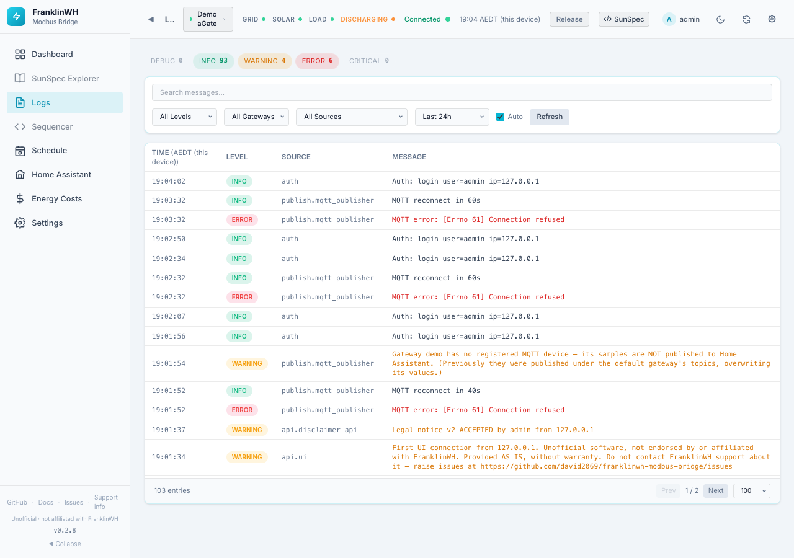
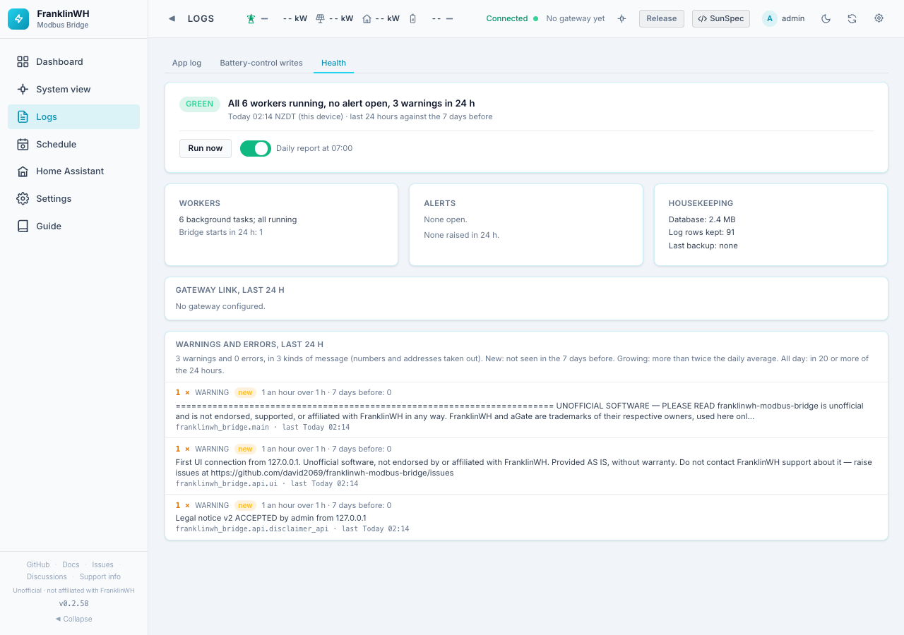

# Logs

The Logs page (`?tab=logs`) shows the bridge's own log, stored in its database. Use it to
see what the bridge did and why: commands sent, schedules that fired, connection problems.
It is on by default.

## Sub-tabs

The page has sub-tabs at the top. Each one has a link of its own:

| Sub-tab | Link | Shows |
|---|---|---|
| **App log** | `?tab=logs&section=app` | The bridge's log, described below. This is the default. |
| **Battery-control writes** | `?tab=logs&section=writes` | Every Modbus write the bridge sent, and the aGate's reply. Admins only. |
| **Health** | `?tab=logs&section=health` | The daily health report: [Health](#health). |

## Level chips

The chips at the top count entries per level in the current time span: **DEBUG**, **INFO**,
**WARNING**, **ERROR**, **CRITICAL**. A level with entries is tinted. Click a chip to show
only that level. Click it again to clear the filter.

## Filters

| Filter | Options | Default |
|---|---|---|
| Search messages… | Free text, searched as you type | empty |
| Level | All Levels, DEBUG, INFO, WARNING, ERROR, CRITICAL | All Levels |
| Gateway | All Gateways or one gateway (only with more than one gateway) | All Gateways |
| Source | The part of the bridge that wrote the entry (for example the poller, the MQTT publisher, the scheduler) | All Sources |
| Time span | Last 1h, 6h, 24h, 7 days, 30 days, All time, Custom… | Last 24h |
| Auto | Reloads every 5 seconds while the page is open | On |
| Refresh | Reloads now | — |
| Export text / Export JSON | Downloads the entries the filters select (admins only) | — |

**Custom…** shows From → To boxes in the bridge's timezone; press **Apply**.

On a phone, everything except Search folds behind a **Filters** button, which shows how
many filters are active.

## The table

| Column | Meaning |
|---|---|
| Time | When it was logged, in the bridge's timezone. Hover for the full date. |
| Level | DEBUG to CRITICAL. |
| Source | Short name of the logger. Hover for the full name. |
| Message | The log message. |

Below the table: the number of entries, **Prev / Next** pages, and the page size
(50, **100**, 200, 500).

## Export

**Export text** and **Export JSON** download the log for the current filters: search,
level, gateway, source and time span. The file includes every matching entry, oldest first,
up to 100,000 entries. Past that it keeps the newest. It isn't limited to the entries the
page has loaded.

Serial numbers and IP addresses are replaced with `<serial>` and `<ip>`. Nothing else is
changed: names and other details in messages stay as logged. The file's header
says which filters were used and how many lines were masked.

Only admins see these buttons.

!!! tip "Reporting a problem"
    Don't paste raw logs, or a log export, into a GitHub issue: the export masks only
    serials and IP addresses. Use
    [Settings → Admin → Support info](settings-admin.md#support-info), which removes
    serials, addresses, names and tokens first.

## Battery-control writes

Every SunSpec write the bridge sent to the aGate, newest first, up to the last 200.
It loads each time you open the sub-tab; **Refresh** reloads it.

| Column | Meaning |
|---|---|
| Time | When it was sent, in the bridge's timezone. |
| Gateway | Which aGate it went to: the gateway's name, with its aGate serial below. Hover for the gateway ID. A gateway since removed shows its ID. |
| Register | The register address, and its name when it is a model 704 point. |
| Raw values | The values written, as sent. |
| aGate reply | **OK**, or the error the aGate answered. |
| Sent by | Who asked for it, for example `schedule:<entry id>` or `user:<account>`. |

**Download CSV** and **Download JSON** save the audit trail, up to the last 100,000 writes.
Each row carries the gateway's ID (`gateway_id`), not its serial, so the files can be
shared without one.

## Health

Every day at 07:00 (the bridge's time) the bridge checks how it has been running and
writes a report (**Daily**): **green**, **amber** or **red**, with the reason first. It compares the
last 24 hours with the 7 days before. The report only reads; it never talks to the aGate
or changes the battery.

| Part | What it shows |
|---|---|
| Workers | The bridge's background tasks: any that crashed or stopped, and how many times the bridge started in the 24 hours. |
| Alerts | Alerts still active now, and those raised in the 24 hours with how many times. Open means a condition that is still active: one that has cleared, or a one-off event, is not counted as open here even if nobody acknowledged it (the Alerts bar keeps those until acknowledged). |
| Housekeeping | Database size, log rows kept, and the last backup. |
| Gateway link | Per gateway: Modbus requests, how many failed, reconnects, library retries and the longest run of failed polls. |
| Unusual changes yesterday | Yesterday's figures against the median of the 4 weeks before (see below). |
| Warnings and errors | Log warnings and errors grouped by message, with numbers and addresses taken out, so one message repeated every few minutes is one line. Marked **new** (not in the 7 days before), **growing** (more than twice its daily average) or **all day** (in 20 or more of the 24 hours). A password or token in a log line is shown as `<hidden>`. |

The colour:

| Colour | When |
|---|---|
| Red | A background task crashed or stopped, or a critical alert is open. |
| Amber | A warning alert is open; any error in the log; a warning that is new, growing or all day and seen 10 times or more; a gateway with 5% or more of its requests failing; or an unusual drop in state of health or efficiency. |
| Green | None of those. |

**Unusual changes.** From the daily snapshots below, the report compares yesterday with
the median of the 28 days before. A figure needs 7 of those days first; until then the
report says so.

| Figure | Unusual when |
|---|---|
| State of health | 1 point or more below the median. Turns the report amber. |
| Round-trip efficiency | Over the 7 days to the end of yesterday, 5 points or more below the median. Turns the report amber. |
| Battery charged and discharged, solar, grid import and export | Yesterday's total is twice the median or more, or half or less, and at least 2 kWh from it. |
| Warnings, errors, alerts raised, aGate alarms | Twice the median or more, and at least 20 warnings, 5 errors, 3 alerts or 3 alarms above it. Per gateway and for the bridge. |

Only the first two change the colour (and so reach the phones). The others are listed in
the report and in Home Assistant's notification, because weather and use move them a lot.

Pick an earlier report from the list at the top right. Reports are kept for 400 days.

**Where it is sent.** Each report replaces the last one in Home Assistant's notifications
("FranklinWH Modbus Bridge: health green"). Amber and red reports also go to the phones in
[Notifications](settings-home-assistant.md#notifications). Both follow the **Push
notifications** switch there. If the bridge was not running at 07:00, the report is made
when it starts.

**Admins** can press **Run now** to make a report at once (it sends nothing), and switch
the daily report off and on.

### Weekly battery report

Choose **Weekly battery** at the top of the Health sub-tab. Every Monday at 07:00 the
bridge reports on the week just ended (Monday to Sunday), for each gateway, from the
daily snapshots below. It only reads.

| Figure | How it is worked out |
|---|---|
| State of health | The aGate's SoH (SunSpec model 713) at the end of the week, a week, 4 weeks and a year before, and its trend per month once there are 4 weeks of readings. |
| Capacity | Rated (713 `WHRtg`) and available now (713 `WHAvail`). |
| Round-trip efficiency | Battery DC energy out ÷ in (model 714 lifetime counters), over the longest span in the week whose two ends are within 5 points of charge, so energy left in the battery hardly counts. No figure if there is no such span, or under 1 kWh went in. |
| Equivalent full cycles | Energy charged ÷ rated capacity, for the week and for the battery's life. |
| Charge cycles | Counted from the charge level history by rainflow (ASTM E1049-85): how many, how deep on average, and how many under 20, 20 to 50, 50 to 80, and 80 points and over. Half cycles count 0.5. |
| Energy | The week's battery in and out, solar, grid import and export, and inverter AC out and in, as the aGate's lifetime counters count them. |

The first weekly report needs two daily snapshots in the week; until then it says so.
It goes to Home Assistant's notifications as "FranklinWH Modbus Bridge: weekly battery
report", replacing the last one. It is not sent to phones; the daily report flags
unusual changes. Admins can switch it off, and **Run now** makes one for last week at once.

**Daily snapshot.** Just after midnight the bridge also keeps one row per gateway for the
day just ended: state of health, rated and available capacity, charge level, the aGate's
lifetime energy counters, and the day's alert, alarm, warning and error counts. These rows
are kept for good, so later reports can show trends over months. The API returns them at
`GET /api/health/snapshots`.
