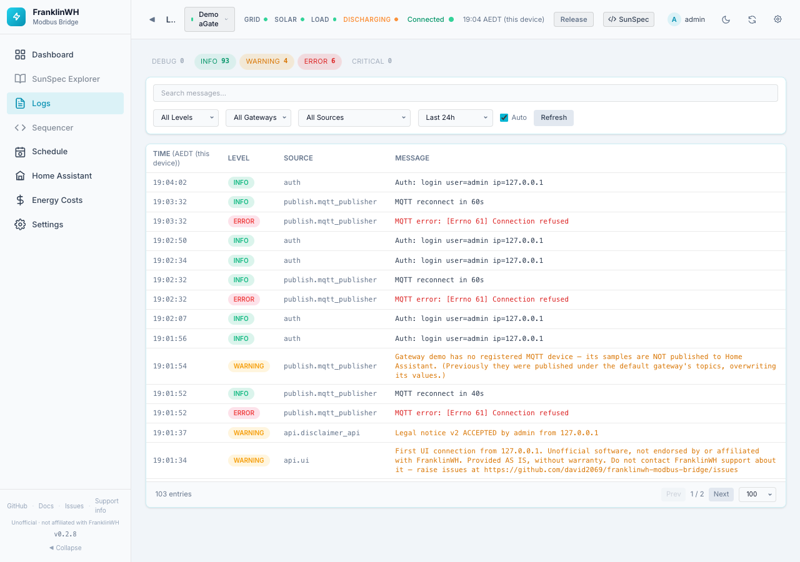

# Logs

The Logs page (`?tab=logs`) shows the bridge's own log, stored in its database. Use it to
see what the bridge did and why: commands sent, schedules that fired, connection problems.
It is on by default.

## Sub-tabs

Admins see two sub-tabs at the top of the page. Each one has a link of its own:

| Sub-tab | Link | Shows |
|---|---|---|
| **App log** | `?tab=logs&section=app` | The bridge's log, described below. This is the default. |
| **Battery-control writes** | `?tab=logs&section=writes` | Every Modbus write the bridge sent, and the aGate's reply. |

Other roles see only the app log, with no sub-tabs.

## Level chips

The chips at the top count entries per level in the current time span: **DEBUG**, **INFO**,
**WARNING**, **ERROR**, **CRITICAL**. A level with entries is tinted. Click a chip to show
only that level. Click it again to clear the filter.

## Filters

| Filter | Options | Default |
|---|---|---|
| Search messages… | Free text, searched as you type | empty |
| Level | All Levels, DEBUG, INFO, WARNING, ERROR, CRITICAL | All Levels |
| Gateway | All Gateways or one gateway (only with more than one gateway) | All Gateways |
| Source | The part of the bridge that wrote the entry (for example the poller, the MQTT publisher, the scheduler) | All Sources |
| Time span | Last 1h, 6h, 24h, 7 days, 30 days, All time, Custom… | Last 24h |
| Auto | Reloads every 5 seconds while the page is open | On |
| Refresh | Reloads now | — |
| Export text / Export JSON | Downloads the entries the filters select (admins only) | — |

**Custom…** shows From → To boxes in the bridge's timezone; press **Apply**.

On a phone, everything except Search folds behind a **Filters** button, which shows how
many filters are active.

## The table

| Column | Meaning |
|---|---|
| Time | When it was logged, in the bridge's timezone. Hover for the full date. |
| Level | DEBUG to CRITICAL. |
| Source | Short name of the logger. Hover for the full name. |
| Message | The log message. |

Below the table: the number of entries, **Prev / Next** pages, and the page size
(50, **100**, 200, 500).

## Export

**Export text** and **Export JSON** download the log for the current filters: search,
level, gateway, source and time span. The file includes every matching entry, oldest first,
up to 100,000 entries. Past that it keeps the newest. It isn't limited to the entries the
page has loaded.

Serial numbers and IP addresses are replaced with `<serial>` and `<ip>`. Nothing else is
changed: names and other details in messages stay as logged. The file's header
says which filters were used and how many lines were masked.

Only admins see these buttons.

!!! tip "Reporting a problem"
    Don't paste raw logs, or a log export, into a GitHub issue: the export masks only
    serials and IP addresses. Use
    [Settings → Admin → Support info](settings-admin.md#support-info), which removes
    serials, addresses, names and tokens first.

## Battery-control writes

Every SunSpec write the bridge sent to the aGate, newest first, up to the last 200.
It loads each time you open the sub-tab; **Refresh** reloads it.

| Column | Meaning |
|---|---|
| Time | When it was sent, in the bridge's timezone. |
| Gateway | Which aGate it went to: the gateway's name, with its aGate serial below. Hover for the gateway ID. A gateway since removed shows its ID. |
| Register | The register address, and its name when it is a model 704 point. |
| Raw values | The values written, as sent. |
| aGate reply | **OK**, or the error the aGate answered. |
| Sent by | Who asked for it, for example `schedule:<entry id>` or `user:<account>`. |

**Download CSV** and **Download JSON** save the audit trail, up to the last 100,000 writes.
Each row carries the gateway's ID (`gateway_id`), not its serial, so the files can be
shared without one.
