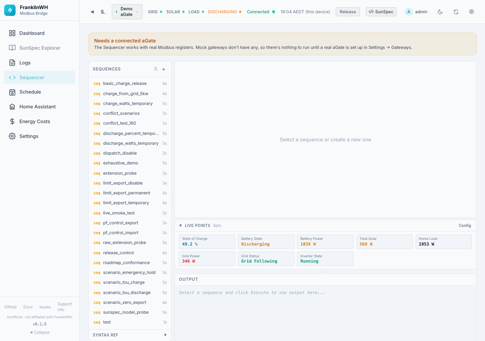
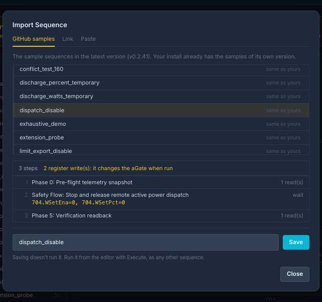

# Sequencer

The Sequencer (`?tab=sequencer`) stores and runs **sequences**: lists of raw Modbus register
writes, reads, waits and checks, written as JSON. It exists for testing and diagnosing the
aGate's control registers.

!!! danger "Expert tool"
    A sequence writes registers on a live, grid-connected battery. It bypasses the bridge's
    command handling, including the trusted battery rating that limits force commands. For
    normal charging and discharging use the [battery controls](controls.md) or the
    [Scheduler](../scheduler/index.md).

!!! info "Off by default, and needs a real aGate"
    The Sequencer is switched off on a new install
    ([Feature Modules](settings-admin.md#feature-modules)). With only a mock or demo gateway
    it shows **Needs a connected aGate**.

## Layout

**Sequences** (left): the saved sequences, with their step count.

- **+** creates a new sequence (give it a name).
- **Import** brings in a sequence from GitHub, a link or pasted text. See
  [Importing a sequence](#importing-a-sequence).
- **↻** resets the panel sizes.
- **Syntax Ref** shows the step keys:

| Key | Meaning |
|---|---|
| `step` | Step label |
| `writes` | `{"Model.Point": value}` registers to write |
| `reads` | `["Model.Point", …]` registers to read |
| `verify` | `true` to read back the writes and check them |
| `verify_timeout_ms` | How long to wait for the read-back to match |
| `wait_for` | `{"Model.Point": value}` condition to wait for |
| `sleep_ms` | Pause after the step |
| `abort_on_failure` | Stop the sequence if this step fails |
| `require_transition` | Require the value to change |
| `note` | A comment, ignored |

Points are written `ModelID.PointName`, for example `704.WSetPct`. On a site with several
batteries, Model 714 points take a port suffix: `714.DCW_1`, `714.DCW_2` (`714.DCW` is port 1).

**Editor** (right): click the highlighted text to edit. The bar under it says
*Valid JSON (N steps)* or shows the JSON error.

| Control | What it does |
|---|---|
| Rename / Delete | Renames or deletes the sequence. |
| Save | Saves your edits (enabled when there are changes). |
| Gateway | A real gateway (each listed once by name; starts on the default gateway), or *All Gateways*. Mock gateways are not listed. |
| Dry Run | Shows what would be written without writing. |
| Execute | Runs the sequence. Disabled while the JSON is invalid. |

A **Live Points** strip (same as on the [Dashboard](dashboard.md#live-points)) shows values
while you work, and **Output** shows each step's result. **Clear** empties the output.

## Importing a sequence

**Import** (next to **+**) opens a dialog with three sources:

| Source | What it does |
|---|---|
| GitHub samples | Lists the sample sequences of the bridge's latest version on GitHub. Each is marked **new**, **changed** or **same as yours**. Your install already has the samples of its own version, so this matters after a newer version is out. |
| Link | Fetches a sequence from an `https://` link (up to 256 KB). A GitHub page link (`github.com/…/blob/…`) is fetched as the raw file. |
| Paste | Checks sequence JSON you paste. |

Picking a sample, **Fetch** or **Check** shows a read-only preview: each step, its reads
and waits, and its register writes in amber. A sequence with no writes says
*Read-only: no writes*. A sequence that isn't a list of steps (or
`{"steps": […], "cleanup": […]}`) shows why, in the dialog.

Give it a name (letters, digits, `_` and `-`) and **Save**. If the name is taken the
dialog says so and offers **Replace**. The saved sequence opens in the editor.

!!! note "Importing never runs anything"
    It only saves the file. Running it is the same as any sequence: **Execute** in the
    editor. Read a sequence's writes before you run it, above all one from a link.

Importing needs the **control** permission, as running does. Each import is written to
the bridge log with its name, where it came from and who imported it.

A quick version, without saved sequences, is the **Modbus Sequencer** tab under the
Dashboard's [Power History](dashboard.md#modbus-sequencer-tab).
