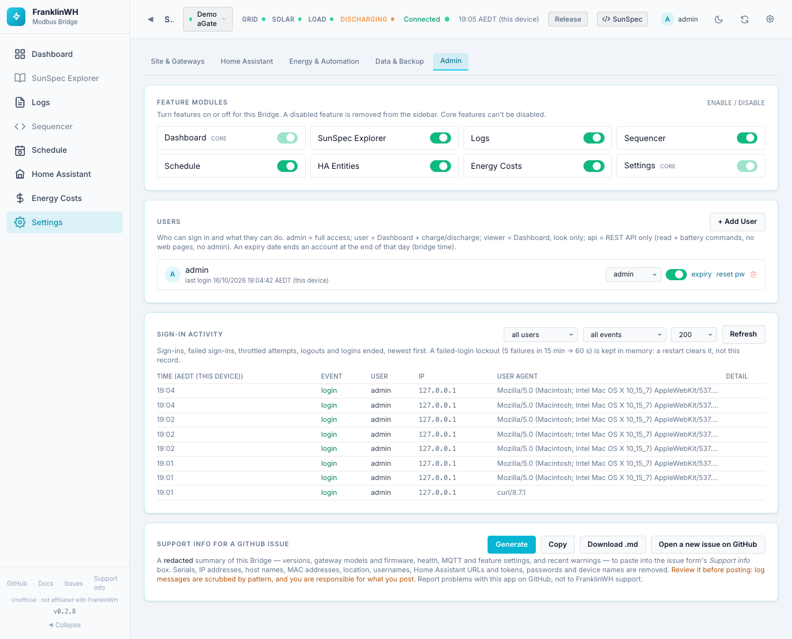
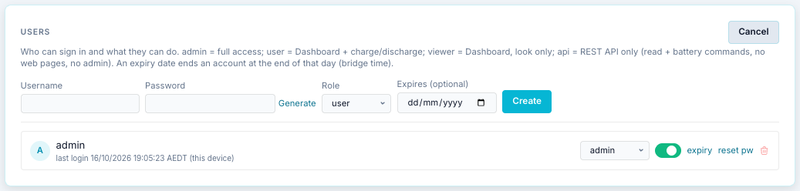
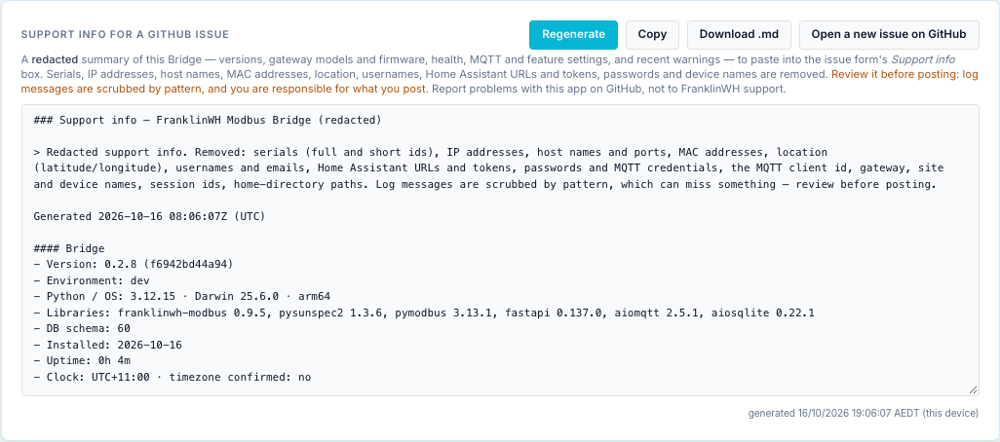

# Settings → Admin

`?tab=settings&section=admin` — features, user accounts, sign-in history and support
information. The Users, Sign-in activity and Support info cards are shown to admins only.

Cards on this page:

1. [Feature Modules](#feature-modules)
2. [Users](#users)
3. [Sign-in activity](#sign-in-activity)
4. [Support info](#support-info)

## Feature Modules

Turns whole features on or off for everyone. A disabled feature disappears from the
sidebar. For Schedule, HA Entities and Energy Costs the bridge's API also refuses that
feature's requests. **Core** features cannot be switched off. Changes apply at once.

| Module | Page | New install | Notes |
|---|---|---|---|
| Dashboard | [Dashboard](dashboard.md) | On (core) | |
| SunSpec Explorer | [SunSpec Explorer](sunspec-explorer.md) | **Off** | Expert tool: raw registers. |
| Logs | [Logs](logs.md) | On | |
| Sequencer | [Sequencer](sequencer.md) | **Off** | Expert tool: **writes** registers on a live battery. |
| Schedule | [Scheduler](../scheduler/index.md) | On | Off also hides Automation Constants and the schedule API. |
| HA Entities | [Home Assistant page](home-assistant-page.md) | On | Off also disables the Home Assistant instances card in Settings. |
| Energy Costs | [Energy Costs](energy-costs.md) | **Off** | |
| Settings | Settings | On (core) | |

Installs upgraded from before these defaults keep Explorer and Sequencer on.

!!! note
    Switching the **Sequencer** module off hides the Sequencer page, but not the
    **Modbus Sequencer** tab under the Dashboard's Power History.

## Bridge

**Restart bridge** restarts the whole bridge: every gateway, MQTT and the schedules. It
asks first and names anything running, like a [gateway restart](settings-site-gateways.md#admin-actions),
and it is recorded the same way.

It works on **Docker** only: the bridge shuts down cleanly and the container's restart
policy (`restart: unless-stopped` in `docker-compose.yml`) starts it again. Without a
restart policy it stays stopped.

| Install | Button |
|---|---|
| Docker | Available. |
| Home Assistant add-on | Disabled: restart the add-on from Home Assistant. |
| Development (`bridge run`) | Disabled: nothing would start it again. |

The API is `POST /api/bridge/restart` (admin), and `GET /api/lifecycle/check` returns
what a stop or restart would interrupt.

## Users

Who can sign in and what they can do.

| Role | Can do |
|---|---|
| `admin` | Everything. |
| `user` | The [simple dashboard](user-dashboard.md), including charge and discharge. |
| `viewer` | The simple dashboard, look only. |
| `api` | REST API only: read data and send battery commands. No web pages, no admin. Marked *REST only*. For integrations such as another bridge or a script. |

Each user row shows the name, last login, expiry (with a badge when it is close or past),
and:

| Control | What it does |
|---|---|
| Role dropdown | Changes the role at once. |
| Switch | Enables or disables the account. A disabled account cannot sign in. |
| **expiry** | Sets or clears an expiry date. The account ends at the end of that day, bridge time. |
| **reset pw** | Sets a new password for that user. |
| Bin | Deletes the user. |

**+ Add User**:

| Field | Default | Notes |
|---|---|---|
| Username | — | |
| Password | — | **Generate** fills in a long random password and shows it so you can copy it. |
| Role | `user` | admin, user, viewer, api. |
| Expires (optional) | none | For a guest or a temporary account. |

**Create** adds the user.

!!! tip "Locked out?"
    If you lose the admin password, see the admin recovery notes in the repository
    (`docs/admin-recovery.md`).

## Sign-in activity

Sign-ins, failed sign-ins, throttled attempts, logouts and ended logins, newest first.

- Filters: **all users** or one user; **all events** or one type (`login`, `login_failed`,
  `login_throttled`, `session_ended`, `session_adopted`, `password_changed`,
  `password_change_failed`, `break_glass_reset`); number of rows (50, **200**, 1000).
  **Refresh** reloads.
- Columns: Time (bridge timezone), Event, User, IP, User agent, Detail.

After **5 failed sign-ins in 15 minutes** an account is locked for **60 seconds**. The
lock is kept in memory, so a bridge restart clears it. This record is kept.

## Support info

Builds a **redacted** summary of this bridge for a GitHub issue: versions, gateway models
and firmware, health, MQTT and feature settings, and recent warnings. Nothing is sent
anywhere; it is shown for you to review.

| Button | What it does |
|---|---|
| **Generate** / **Regenerate** | Builds the summary and shows it. |
| **Copy** | Copies it to the clipboard. |
| **Download .md** | Saves it as a Markdown file. |
| **Save as Gist** | Copies it and opens GitHub's new Gist page. Paste it, name the file `support-info.md`, then choose **Create secret gist** (unlisted, but anyone with the link can read it) or **Create public gist**. The bridge sends nothing to GitHub itself. |
| **Open a new issue on GitHub** | Opens the bug report form. Paste the summary into its *Support info* box. |

Serials, IP addresses, host names, MAC addresses, location, usernames, Home Assistant URLs
and tokens, passwords and device names are removed.

!!! warning
    Log messages are scrubbed by pattern, which can miss something. Read the summary
    before you post it. You are responsible for what you post.

The sidebar's **Support info** link (admins only) jumps straight to this card. Report
problems with this app on GitHub, **not** to FranklinWH support.
