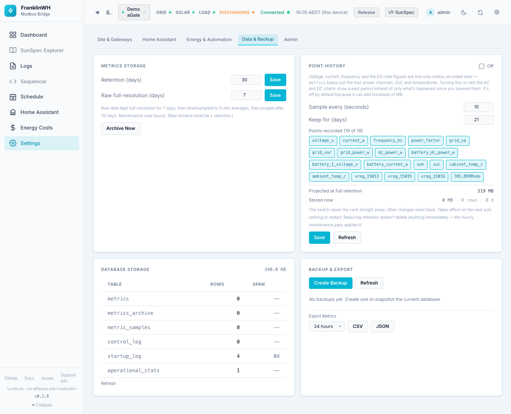

# Settings → Data & Backup

`?tab=settings&section=data` — how long history is kept, what extra history is recorded,
how big the database is, and backups.

Cards on this page:

1. [Metrics Storage](#metrics-storage)
2. [Point History](#point-history)
3. [Database Storage](#database-storage)
4. [Backup & Export](#backup-export)

## Metrics Storage

**Metrics** are the power samples behind [Power History](dashboard.md#power-history),
[Energy Flow](dashboard.md#energy-flow) and the solar "actual so far": battery, grid,
solar and home power, SoC and temperatures, recorded every poll.

| Field | Default | Range | Meaning |
|---|---|---|---|
| Retention (days) | 30 | 1–365 | After this, samples are deleted. |
| Raw full-resolution (days) | 7 | 1 to the retention | Samples are kept at full resolution this long, then averaged into 5-minute buckets. |

Each field has its own **Save**. The raw window must be no longer than the retention.
Maintenance (downsampling and deleting) runs every hour. **Archive Now** runs it straight
away.

!!! note
    Mock and demo gateways do not store metrics.

## Point History

Extra electrical readings, recorded for the **History** mode of the
[AC and DC charts](dashboard.md#ac-and-dc-metrics-charts). Without it, voltage, current,
frequency and the DC-side figures are live only.

| Field | Default | Range |
|---|---|---|
| Recording switch (top right) | **Off** | Off / Recording |
| Sample every (seconds) | 10 | 5–3600 |
| Keep for (days) | 21 | 1–365 |
| Points recorded | all 19 | Click a point to include or leave it out |

The 19 points: `voltage_v`, `current_a`, `frequency_hz`, `power_factor`, `grid_va`,
`grid_var`, `grid_power_w`, `dc_power_w`, `battery_dc_power_w`, `battery_1_voltage_v`,
`battery_current_a`, `soh`, `soc`, `cabinet_temp_c`, `ambient_temp_c`, three raw vendor
registers (`vreg_15013`, `vreg_15035`, `vreg_15016`) and `701.DERMode`. Per-phase values
are never recorded.

!!! warning "Disk space"
    Point History is off by default because it can add hundreds of MB. **Projected at full
    retention** shows the size your choices will reach before you save: about 319 MB for
    the defaults. **Stored now** shows its current size, rows and days. Keep this in mind on
    an add-on running from an SD card. Fewer points, a longer interval or fewer days all
    shrink it.

- The switch saves straight away. Other changes need **Save**; *Unsaved changes* reminds
  you.
- Changes take effect on the next poll. Nothing to restart.
- Lowering *Keep for* does not delete anything at once: the hourly maintenance does.
- **Refresh** reloads the card.

## Database Storage

The database size, and per table its row count and the days of data it spans
(for example `metrics`, `metrics_archive`, `metric_samples`, `control_log`,
`startup_log`). **Refresh** reloads it. Read-only.

## Backup & Export

**Create Backup** takes a snapshot of the whole database (settings, gateways, schedules,
users, history). **Refresh** reloads the list.

Each backup shows its file name, size, the bridge version that made it and how long ago,
with:

- **Download** — saves the backup file.
- **Restore** — replaces the current database with this backup, after a confirmation.
  A pre-restore snapshot is taken automatically. **Restart the bridge after a restore** so
  it reloads its state.

!!! warning
    A restore replaces **everything**, including users and passwords, with what was in the
    backup.

**Export Metrics** downloads power samples as **CSV** or **JSON** for 1 hour, 6 hours,
24 hours (default), 7 days or 30 days.

!!! bug "Downloads under Home Assistant ingress"
    In 0.2.8 the **Download**, **CSV** and **JSON** links use absolute paths (`/api/…`).
    When the bridge is opened through the Home Assistant sidebar (ingress) they may not
    reach the bridge. If a download fails there, open the bridge on its own port instead.
