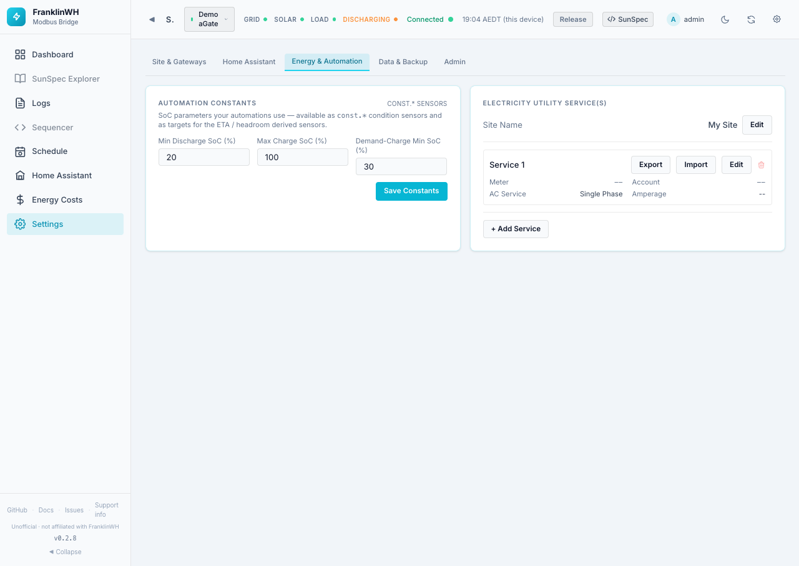
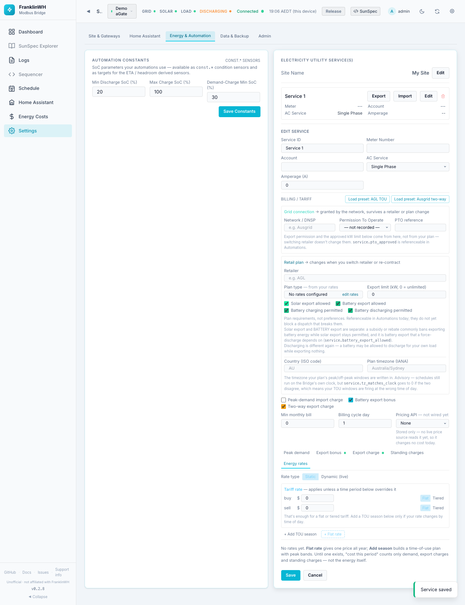
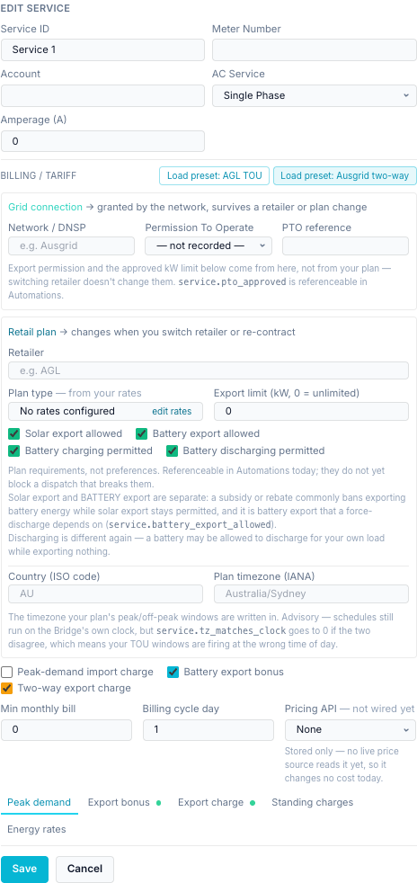
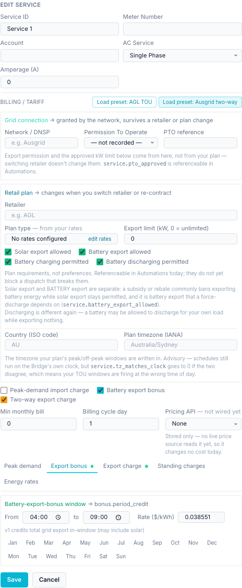
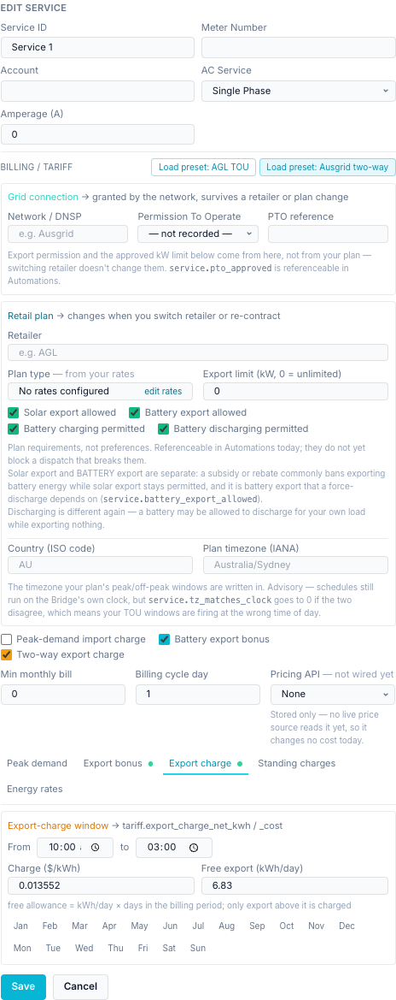
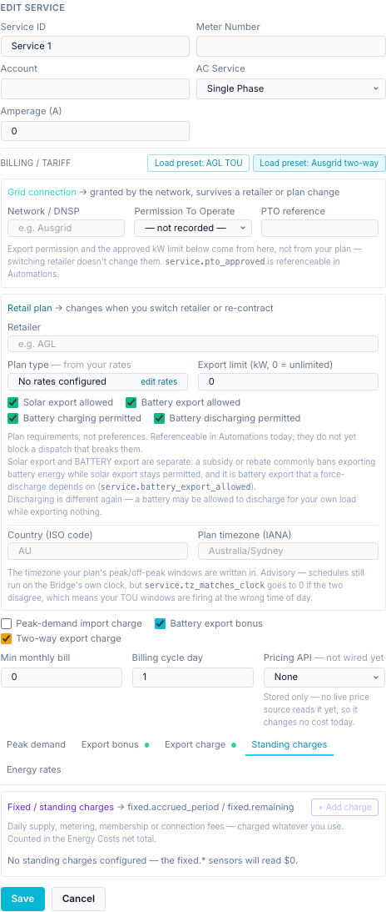
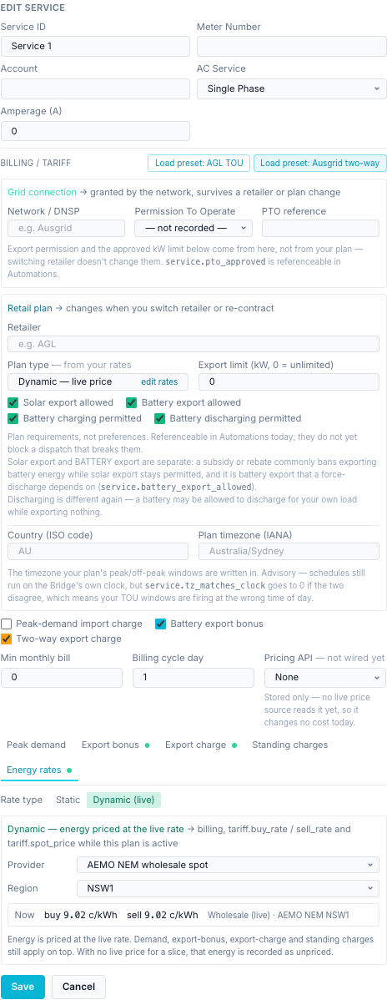

# Settings → Energy & Automation

`?tab=settings&section=energy` — values your schedules use, and the electricity
services and tariffs that price your energy.

Cards on this page:

1. [Automation Constants](#automation-constants)
2. [Electricity Utility Service(s)](#utility-services-and-tariffs)

## Automation Constants

SoC limits that your schedules can refer to. Shown only while the **Schedule** feature
module is on.

| Field | Default | Range | Sensor |
|---|---|---|---|
| Min Discharge SoC (%) | 20 | 0–100 | `const.min_discharge_soc` |
| Max Charge SoC (%) | 100 | 0–100 | `const.max_charge_soc` |
| Demand-Charge Min SoC (%) | 30 | 0–100 | `const.demand_charge_min_soc` |

Each value becomes a `const.*` sensor that a schedule condition can compare with, and a
target for the derived ETA and headroom sensors (for example, how long until the battery
reaches the max charge SoC at the current power). Changing a constant here changes every
schedule that uses it. **Save Constants** saves.

The constants do not limit the battery by themselves. They only take effect through the
schedules that use them. See the [Scheduler](../scheduler/index.md).

## Utility services and tariffs

!!! tip "Worked examples"
    For a step-by-step flat plan and a dynamic NEM plan, see
    [Guide: utility, meter and tariff setup](guide-utility-tariffs.md).

A **utility service** is your electricity connection: a meter, its grid-connection
permissions, and the retail plan and tariff that price it. A gateway is linked to a
service in its [Edit Gateway](settings-site-gateways.md#edit-gateway) dialog
(**Utility Service**), so a site with several aGates on one meter shares one tariff.

Services feed the [Energy Costs](energy-costs.md) page and the `service.*`, `tariff.*`,
`demand.*`, `bonus.*` and `fixed.*` sensors that schedules use.

### Site Name

The name of the whole site, default *My Site*. Shown at the top of the
[simple dashboard](user-dashboard.md). **Edit**, then **Save**.

### The service list

Each service shows Meter, Account, AC Service and Amperage, and four buttons:

| Button | What it does |
|---|---|
| **Export** | Downloads the tariff as a shareable JSON profile. Meter, account and network approval are left out. |
| **Import** | Loads a tariff profile into this service. You first see a review: the profile name, retailer and network, number of seasons, ignored fields and any rate problems. **Apply** replaces the service's tariff; meter, account and network approval are not touched. **Cancel** changes nothing. |
| **Edit** | Opens the service editor. |
| Bin | Deletes the service. |

**+ Add Service** creates one. The tariff part of the editor appears only after the
service has been saved once.

### Service editor

**The connection:**

| Field | Default | Notes |
|---|---|---|
| Service ID | — | The service's name (shown in lists). |
| Meter Number | empty | For example your NMI. |
| Account | empty | Your retailer account number. |
| AC Service | Single Phase | Single, Split or Three Phase. |
| Amperage (A) | 0 | The connection's rated current. |

**Load preset: AGL TOU** and **Load preset: Ausgrid two-way** fill in example values from
two Australian plans. They fill the form only: review, then **Save**.

- *Ausgrid two-way* (network tariff EA029): export reward 16:00–21:00 at 3.8551 c/kWh,
  export charge 10:00–15:00 at 1.3552 c/kWh above 6.83 kWh/day free.
- *AGL TOU*: an evening feed-in window at 28 c/kWh 17:00–21:00 and a daily supply charge.
  Its import rates are stored for reference only and are **not priced**.

**Grid connection** — granted by the network (DNSP) against your meter; survives a change
of retailer or plan:

| Field | Options | Sensor |
|---|---|---|
| Network / DNSP | Free text, for example *Ausgrid* | — |
| Permission To Operate | not recorded, Not applied for, Applied — pending, Approved | `service.pto_approved` |
| PTO reference | Free text | — |

**Retail plan** — changes when you switch retailer or re-contract:

| Field | Default | Notes / sensor |
|---|---|---|
| Retailer | empty | For example *AGL*. Used to group the Energy Costs history. |
| Plan type | — | **Read-only**, worked out from your rates: *No rates configured*, *Flat rate*, *Tiered*, *Time of use*, *Hybrid*, *Dynamic — live price*. **edit rates** jumps to Energy rates. |
| Export limit (kW) | 0 = unlimited | The approved export limit. Greyed out if export is not allowed. |
| Solar export allowed | On | May solar export to the grid. |
| Battery export allowed | On | May **battery** energy export to the grid. A force discharge to grid depends on this one. Rebates often ban battery export while allowing solar export. `service.battery_export_allowed` |
| Battery charging permitted | On | May the battery charge from the grid. |
| Battery discharging permitted | On | May the battery discharge at all, even only to the house. |
| Why is export restricted? | empty | Appears when either export box is off. A note for whoever comes next. |
| Country (ISO code) | empty | For example `AU`. |
| Plan timezone (IANA) | empty | The timezone the plan's peak windows are written in, for example `Australia/Sydney`. |

!!! warning "Permissions are recorded, not enforced"
    The export and charging boxes are plan requirements you can test in schedule
    conditions (`service.*` sensors). In 0.2.8 they do **not** block a dispatch that breaks
    them. Build the check into your schedules.

The plan timezone is advisory. Schedules still run on the bridge's clock, but
`service.tz_matches_clock` goes to 0 when the two disagree, which means your TOU windows
fire at the wrong time of day.

**Tariff parts and billing:**

| Field | Default | Notes |
|---|---|---|
| Peak-demand import charge | Off | Turns on the **Peak demand** tab. |
| Battery export bonus | Off | Turns on the **Export bonus** tab. |
| Two-way export charge | Off | Turns on the **Export charge** tab. |
| Min monthly bill | 0 | |
| Billing cycle day | 1 | Day of the month a billing period starts (1–31). Sets the period on Energy Costs. |
| Pricing API | None | *Not wired yet*: stored only, changes no cost today. |

Then five tabs. A dot on a tab means that part is switched on and configured.

#### Peak demand

Only when **Peak-demand import charge** is ticked. Feeds `demand.peak_kw` and
`demand.period_charge`.

| Field | Options |
|---|---|
| From / to | The demand window, for example 15:00 to 21:00. |
| Rate ($/kW/day) | The demand rate. |
| Interval | 15 min (×4), 30 min (×2), 60 min (×1): the averaging interval for demand. |
| Charge basis | *kW × rate × days*, or *kW × rate (flat)*. |
| Months, days | Click to choose. None selected = every month / every day. |

#### Export bonus

Only when **Battery export bonus** is ticked. A window (from / to, months, days) and a rate
in $/kWh. Feeds `bonus.period_credit`. Version 1 credits **all** grid export in the window,
which may include solar.

If your Energy rates already price export (a sell rate), the tab says the bonus is
*Superseded* and no longer credits the bill, so the same kWh is not paid twice. Put the
feed-in rate on the time period instead.

#### Export charge

Only when **Two-way export charge** is ticked. For networks that charge you for exporting
at midday. Feeds `tariff.export_charge_net_kwh` and `tariff.export_charge_cost`.

| Field | Meaning |
|---|---|
| From / to, months, days | The charge window. |
| Charge ($/kWh) | Price per kWh exported above the free allowance. |
| Free export (kWh/day) | The free allowance. Over a billing period it is this × the number of days. |

#### Standing charges

Daily supply, metering, membership or connection fees, charged whatever you use. They are
counted in the Energy Costs net and feed `fixed.accrued_period` and `fixed.remaining`.
With none, the `fixed.*` sensors read $0.

**+ Add charge**, then for each charge:

| Field | Options |
|---|---|
| Type | Supply, Metering, Membership, Connection, Other |
| Levied by | Utility / network, Retailer, Other |
| Frequency | Daily, Weekly, Monthly, Quarterly, Annual |
| Rate ($) | Amount per frequency period |
| Description | Free text |
| Tax rate | For example 0.1 for 10 % GST; 0 if the rate already includes tax |

Each charge shows its cost per day including tax, and the card totals per day and per
30 days.

#### Energy rates

What each kWh costs to buy and earns when sold. **Rate type** chooses:

**Static** — rates you enter:

1. **Tariff rate** — buy and sell, in $/kWh. Applies unless a time period below
   overrides it. **Flat** or **Tiered** per side. Tiered sets prices by kWh used at the
   meter this billing period: *up to N kWh* bands, then *and above*. This alone is enough
   for a flat or tiered plan.
2. Seasons, for time-of-use plans: **+ Add TOU season** (with time periods) or
   **+ Flat rate** (one price all year).
    - **Name** and **Months**. A month belongs to one season only; clicking one that
      belongs elsewhere moves it. A season with no months is the catch-all.
    - **Rates — buy & sell per time period**: Super Off-Peak, Off-Peak, Mid-Peak, On-Peak,
      each flat or tiered, each marked *active* or *not used*. **Copy rates → all
      seasons** copies them. A buy price of $0 is a free-import band.
    - **Time blocks → time period**: from / to times, the time period, and *All days*,
      *Weekdays* or *Weekend*. An end at or before the start wraps past midnight, so
      `00:00` as an end means end of day (the FranklinWH cloud writes `24:00`; both work).
3. **Reset all time periods** overwrites every period in every season with the tariff
   rate.

The editor checks the plan as you go and lists anything it can't price (*This plan won't
price everything: …*), or says *Every hour of every month is priced*. Uncovered hours use
the tariff rate, or are recorded as unpriced if there is none.

**Dynamic (live)** — the price follows a live source:

| Field | Options |
|---|---|
| Provider | *AEMO NEM wholesale spot* or *Home Assistant price entity* |
| Region | NSW1, QLD1, SA1, TAS1, VIC1 (NEM only) |
| Buy price / Feed-in | Home Assistant entities (HA only). Feed-in defaults to *Same as buy price*. |

The box shows the live buy and sell price now, in c/kWh. With no live price, energy in that
time is recorded as **unpriced**, not priced at an old rate. While Dynamic is on, it drives
billing and the `tariff.buy_rate`, `tariff.sell_rate` and `tariff.spot_price` sensors. Your
static rates stay on file.

**Depends on:** internet access to AEMO, or a [Home Assistant instance](settings-home-assistant.md#home-assistant-instances)
with the price entity exposed on the [Home Assistant page](home-assistant-page.md).

**Save** saves the service; **Cancel** discards your edits.
