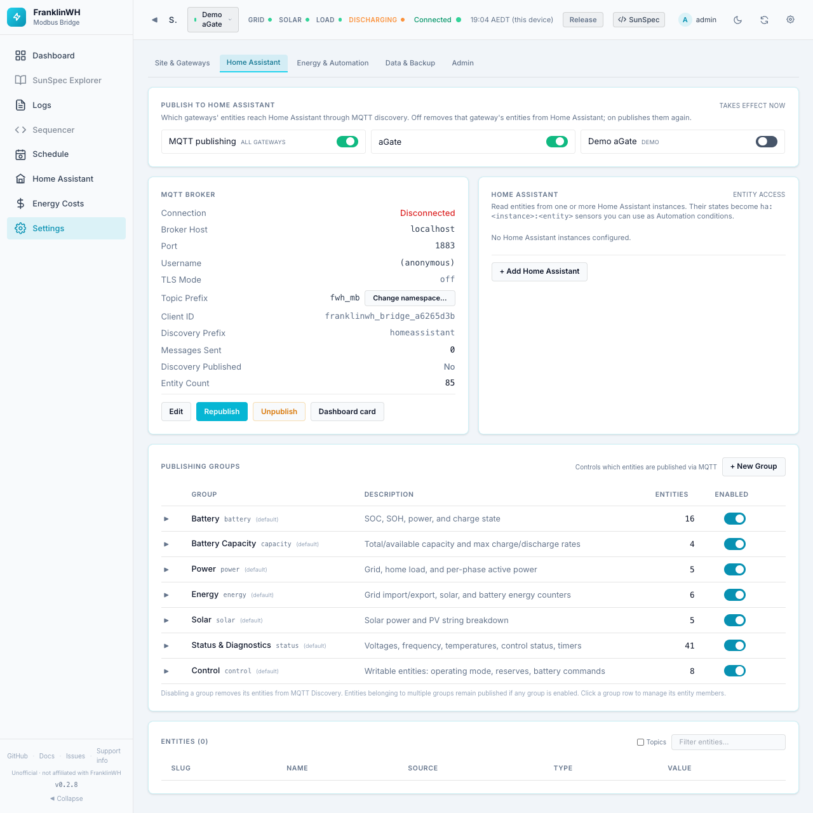
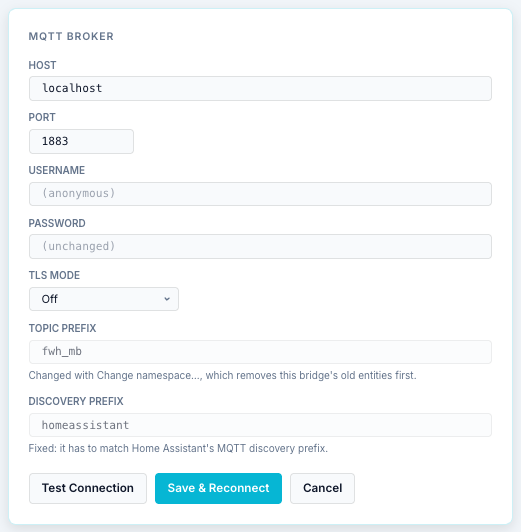
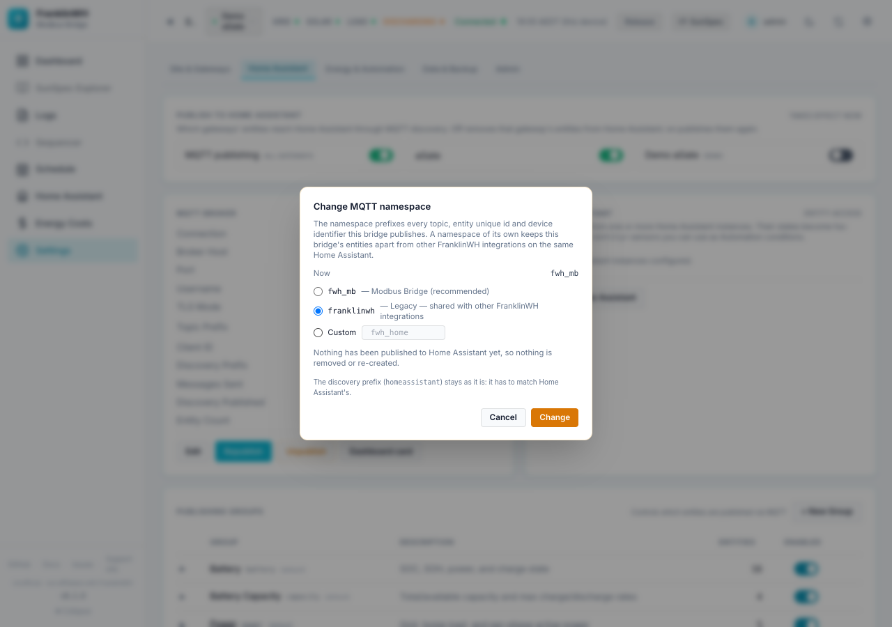
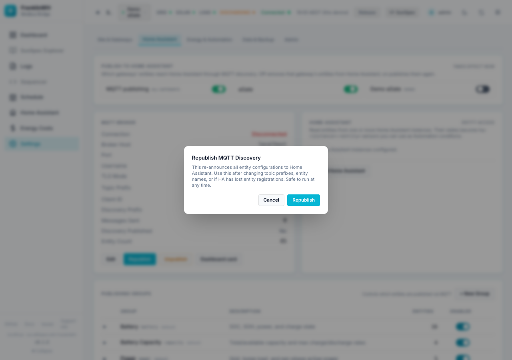
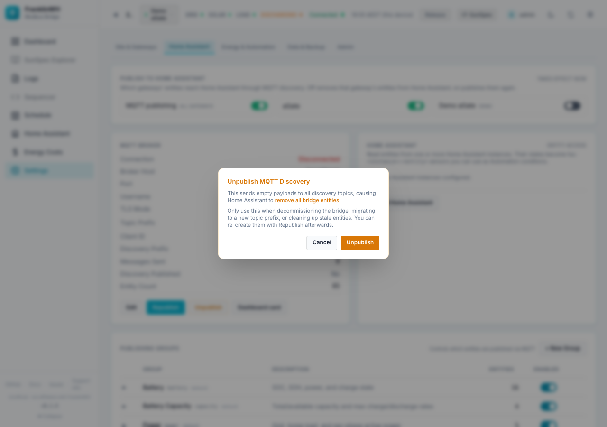
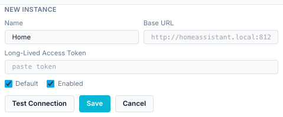
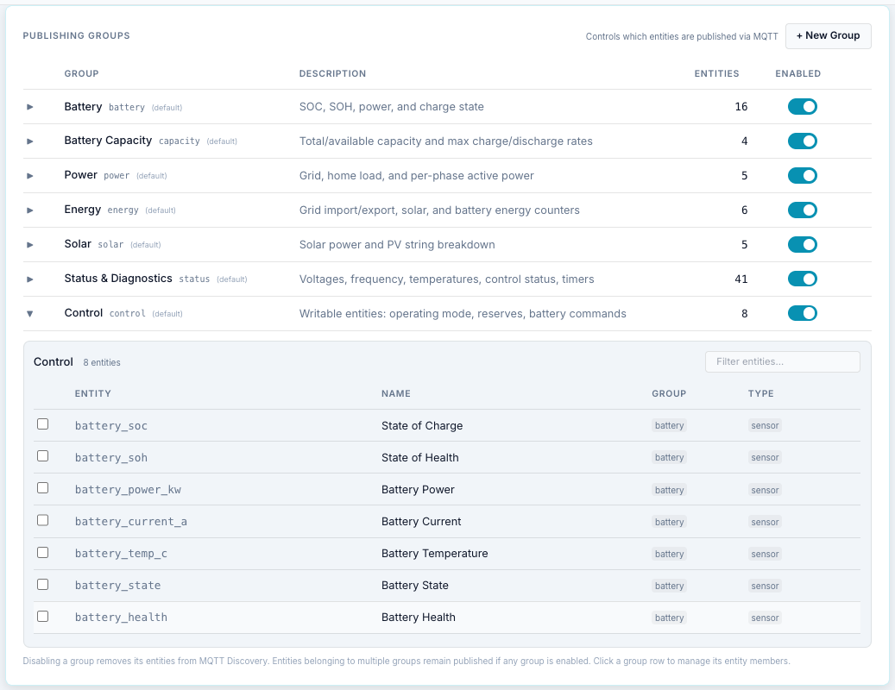

# Settings → Home Assistant

`?tab=settings&section=home-assistant` — how the bridge publishes entities to Home
Assistant over MQTT, and which Home Assistant instances it reads from.

Cards on this page:

1. [Publish to Home Assistant](#publish-to-home-assistant)
2. [MQTT Broker](#mqtt-broker)
3. [Home Assistant instances](#home-assistant-instances)
4. [Publishing Groups](#publishing-groups)
5. [Entities](#entities)

How the bridge's entities are named, moved and cleaned up is covered in
[Fixing, moving and removing entities](../home-assistant-entities.md).

## Publish to Home Assistant

Switches that decide which gateways' entities reach Home Assistant through MQTT discovery.
They **take effect at once**.

| Switch | Default | On | Off |
|---|---|---|---|
| **MQTT publishing** (all gateways) | On | The bridge connects to the broker and publishes. | Nothing is published for any gateway. Entities already in Home Assistant show **unavailable**; they are not removed. Use [Unpublish](#republish-and-unpublish) to remove them. |
| One switch per gateway (*demo* and *disabled* badges where they apply) | On for real gateways; off for the demo created by the setup wizard | That gateway's device and entities are published. | **Its entities are removed from Home Assistant.** Switch it on again to re-create them. |

With **MQTT publishing** off, the card says so: the per-gateway switches have no effect
until it is on again.

The per-gateway switch is the same setting as **Publish this gateway to Home Assistant**
in the [Edit Gateway](settings-site-gateways.md#edit-gateway) dialog.

## MQTT Broker

The connection to the MQTT broker that Home Assistant listens to.

**Depends on:** an MQTT broker. On the Home Assistant add-on, install the
**Mosquitto broker** app. The bridge then configures itself from Home Assistant's MQTT
service (the card says *Configured automatically from Home Assistant's MQTT service*). If no
broker is installed yet, it says *Waiting for a broker* with a link to install one; the
bridge connects as soon as it is running. With Docker, enter the broker's details here.

| Field | Meaning |
|---|---|
| Connection | *Connected*, *Disconnected*, or *Disabled* (MQTT publishing off). |
| Broker Host, Port | Where the broker is. Default `localhost`, `1883`. |
| Username | Or *(anonymous)*. |
| TLS Mode | *off*, *tls*, or *tls_insecure* (TLS without checking the certificate). |
| Topic Prefix | The bridge's **namespace**, default `fwh_mb`. Changed with **Change namespace…**. |
| Client ID | The bridge's MQTT client ID. |
| Discovery Prefix | `homeassistant`. Fixed; it must match Home Assistant's. |
| Messages Sent | Since the bridge started. |
| Discovery Published | *Yes*, *No*, or *Unpublished — Republish to restore*. |
| Entity Count | Entities the bridge publishes. |

Buttons: **Edit**, **Republish**, **Unpublish**, **Dashboard card**.

### Editing the broker

| Field | Notes |
|---|---|
| Host | Broker hostname or IP. |
| Port | 1–65535. |
| Username | Empty = anonymous. |
| Password | Leave empty to keep the stored one. |
| TLS Mode | Off, TLS, TLS (insecure). |
| Topic Prefix | Read-only here. Use **Change namespace…**. |
| Discovery Prefix | Read-only. |

A field set by an environment variable is read-only, with the variable's name under it:
change it where the bridge runs, then restart.

**Test Connection** tries the settings without saving. **Save & Reconnect** saves and
reconnects. **Cancel** discards.

### Change namespace

The namespace prefixes every topic, entity unique ID and device identifier the bridge
publishes. A namespace of its own keeps this bridge's entities apart from other FranklinWH
integrations on the same Home Assistant.

| Choice | Meaning |
|---|---|
| `fwh_mb` | Modbus Bridge (recommended, the default for new installs). |
| `franklinwh` | Legacy: shared with other FranklinWH integrations. |
| Custom | `fwh_` plus 2–8 lowercase letters or digits, for example `fwh_home`. `fwh_ai`, `fwh_lb` and `fwhai` are reserved for other producers. |

If entities have already been published, the dialog explains what happens:

- Home Assistant creates **new entities and a new device** under the new namespace.
- Dashboards, automations and scripts using the old entity IDs need updating.
- Whether Home Assistant carries the old entities' history over is **not established** —
  assume it doesn't.
- Only entities **this bridge** published are removed from the old namespace. Another
  integration's entities there are left alone.

The button reads **Change and re-create entities** (or **Change** if nothing has been
published). Afterwards the dialog reports how many old entities were removed and how many
belonged to others. The discovery prefix does not change.

### Republish and Unpublish

**Republish** re-announces every entity configuration to Home Assistant. Use it if Home
Assistant has lost entities, or after renaming. Safe at any time.

**Unpublish** sends empty discovery messages, so Home Assistant **removes all of the
bridge's entities**. Use it only when decommissioning the bridge or cleaning up stale
entities. The entities **stay removed until you press Republish**.

### Dashboard card

Opens the [Home Assistant page](home-assistant-page.md#dashboard-card) with the dashboard
card YAML dialog. It needs a Home Assistant instance (below).

## Home Assistant instances

The Home Assistant installations the bridge **reads from**. Their entity states become
`ha:<instance>:<entity>` sensors that schedules can use as conditions, after you expose
them on the [Home Assistant page](home-assistant-page.md). An instance is also used by
**Use Home Assistant's location**, the dashboard card YAML, and HA price entities.

Each instance shows: name, badges (*default*, *disabled*, *auto*), URL, token (*set*,
*none* or *Supervisor*), status (*connected · live* over WebSocket, *connected · poll*, or
*offline* with the last error) and its entity count.

On the add-on, the Home Assistant it runs in is added automatically (*auto*) through the
Supervisor. It has no URL or token and cannot be deleted.

**+ Add Home Assistant** (or **Edit** on an instance):

| Field | Notes |
|---|---|
| Name | For example *Home*. Used in sensor names. |
| Base URL | For example `http://homeassistant.local:8123`. Not shown for an *auto* instance. |
| Long-Lived Access Token | Create one in Home Assistant under your profile → Security. Leave empty to keep the stored one. |
| Default | The instance used when none is named. |
| Enabled | Off stops reading it. |

**Test Connection**, **Save**, **Cancel**. The bin icon deletes an instance.

!!! note
    This card uses the same API as the **HA Entities** feature module. If you switch that
    module off in [Feature Modules](settings-admin.md#feature-modules), the instance list
    cannot load.

## Publishing Groups

Groups decide **which entities** are published over MQTT. Every entity belongs to one or
more groups.

The built-in groups (marked *(default)*):

| Group | Slug | Entities | Contents |
|---|---|---|---|
| Battery | `battery` | 16 | SoC, SoH, power, charge state |
| Battery Capacity | `capacity` | 4 | Total/available capacity, max charge/discharge rates |
| Power | `power` | 5 | Grid, home load, per-phase active power |
| Energy | `energy` | 6 | Grid import/export, solar, battery energy counters |
| Solar | `solar` | 5 | Solar power and PV inputs |
| Status & Diagnostics | `status` | 41 | Voltages, frequency, temperatures, control status, timers |
| Control | `control` | 8 | Writable entities: operating mode, reserves, battery commands |

(Counts as in 0.2.8.)

- The **Enabled** switch turns a group on or off. **Disabling a group removes its entities
  from Home Assistant.** An entity in several groups stays published while any of its
  groups is enabled.
- Click a group row to list its members. Tick or untick entities to add or remove them;
  **Filter entities…** searches.
- **+ New Group**: Slug (lowercase, 2–63 characters, letters, digits and underscores),
  Display Name and Description. Custom groups can be deleted with **✕**; the built-in ones
  cannot.

!!! tip
    Switching off the **Control** group removes the writable entities (mode, reserves,
    battery commands) from Home Assistant, so nobody can command the battery from there.

## Entities

The full list of entities the bridge publishes, with live values: Slug, Name, Source (the
SunSpec point or register), Type (sensor, number, select …) and Value.

- **Filter entities…** searches.
- **Topics** adds the MQTT state topic of each entity.
- With more than one publishing gateway, a dropdown picks which gateway's list to show.
