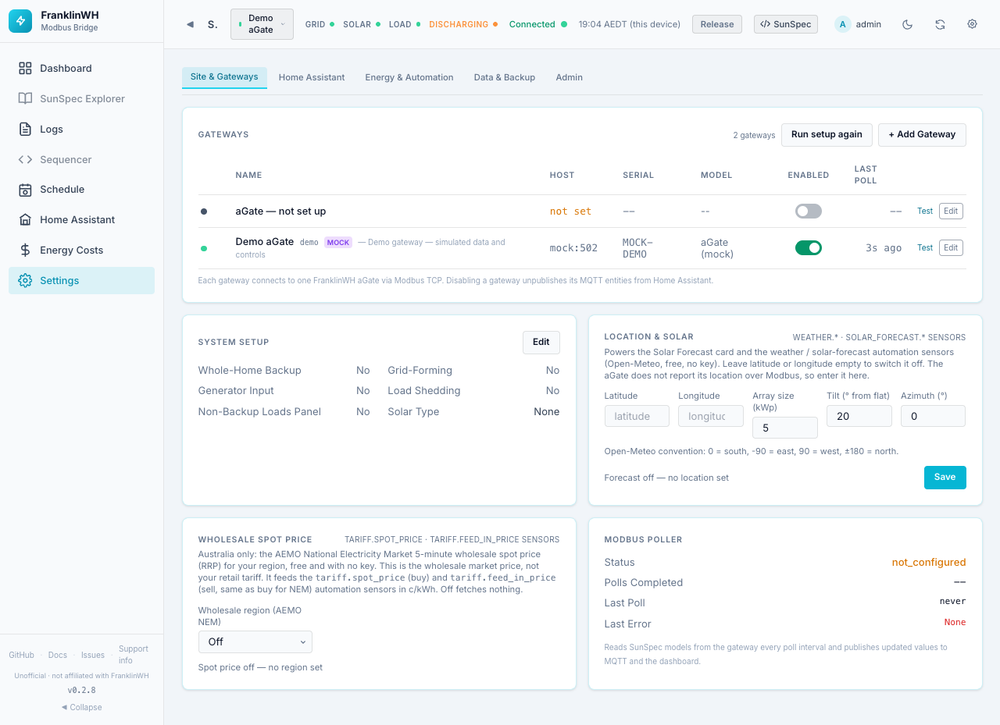
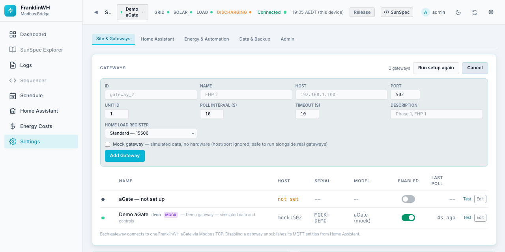
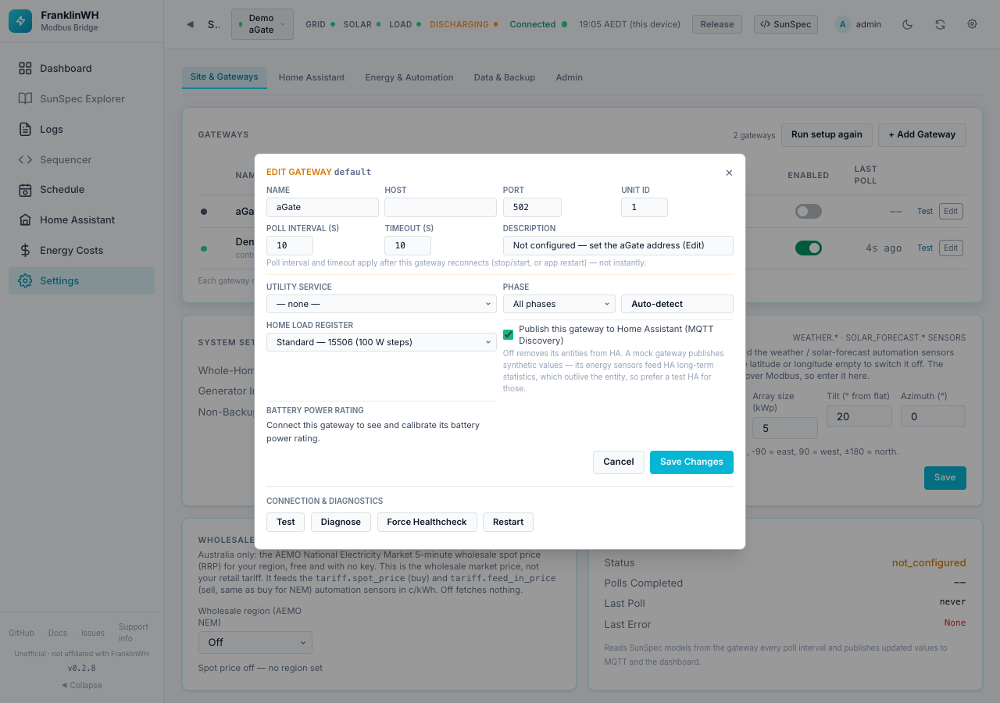
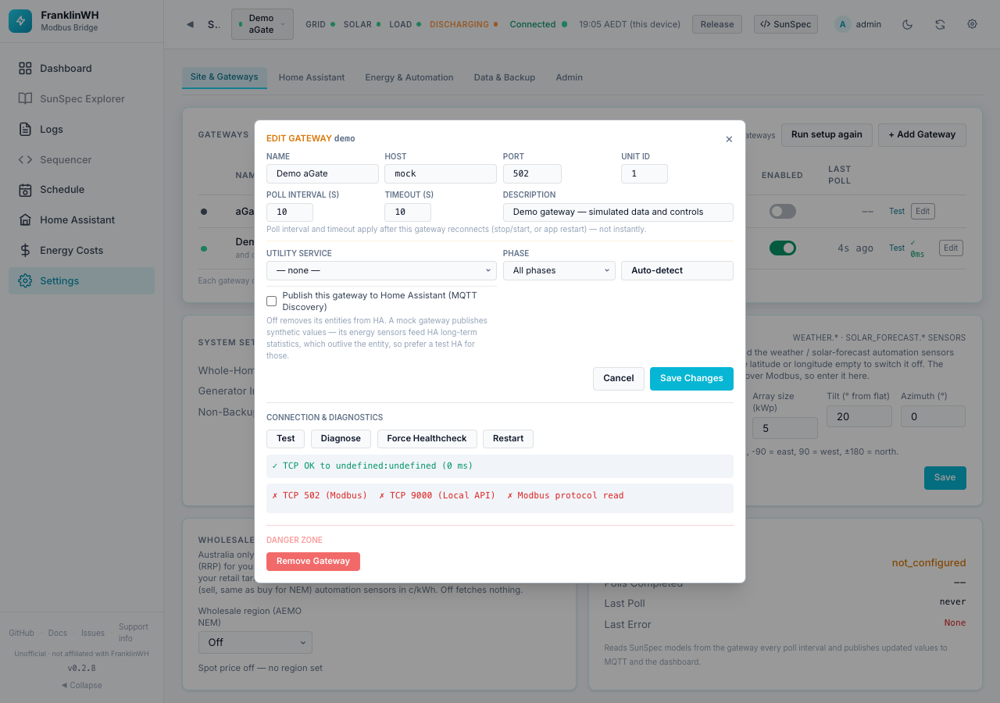
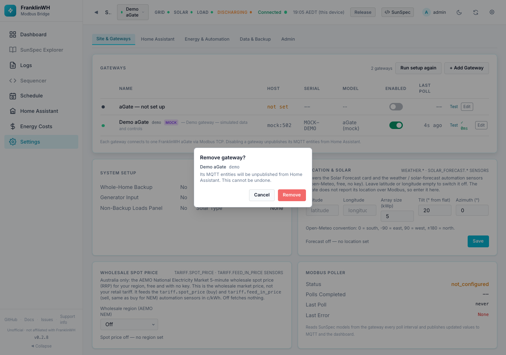
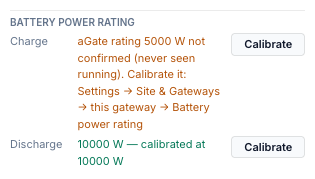
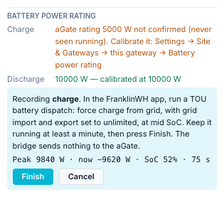
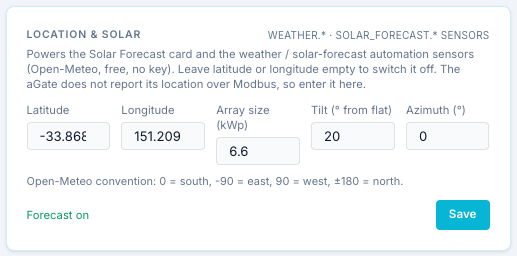
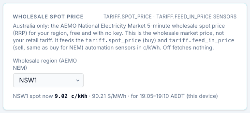
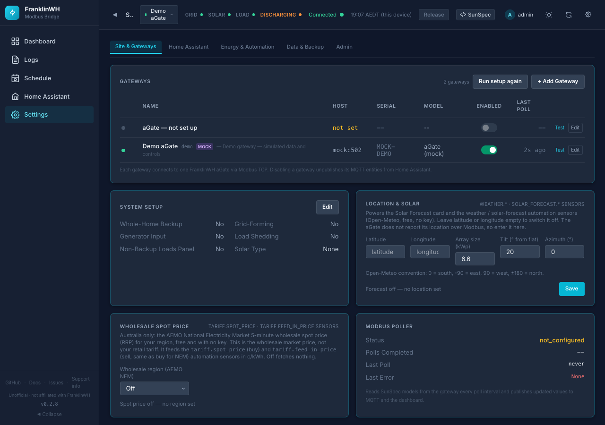

# Settings → Site & Gateways

`?tab=settings&section=gateways` — the aGates the bridge talks to, how your system is
built, where it is, and the wholesale price feed.

Cards on this page:

1. [Gateways](#gateways)
2. [System Setup](#system-setup)
3. [Location & Solar](#location-solar)
4. [Wholesale spot price](#wholesale-spot-price)
5. [Modbus Poller](#modbus-poller)

## Gateways

Each gateway is one FranklinWH aGate reached over Modbus TCP, or a **mock** (simulated)
gateway. The first one, ID `default`, is the **primary** gateway. It always exists and
cannot be removed. On a new install its address is empty until you run the setup wizard
or edit it.

At the top of the card: the number of gateways, **Run setup again** (reopens the setup
wizard, admins only) and **+ Add Gateway**.

### Gateway table

| Column | Meaning |
|---|---|
| Dot | Health: green = connected, amber = TCP only (port open, Modbus not answering), red = unreachable, grey = stopped, disabled or not set up. Hover for the word. |
| Name | The name, the ID (except for `default`), a *mock* badge, and the description. An unconfigured primary shows **aGate — not set up**. |
| Host | `host:port`, or *not set*. |
| Serial, Model | Reported by the aGate. |
| Enabled | A switch that **starts or stops polling**. Disabled for a gateway with no address. |
| Last Poll | How long ago the last poll was. |
| Test | Opens a TCP connection to the gateway and shows ✓ and the latency, or ✗ and the error. |
| Edit | Opens the [Edit Gateway](#edit-gateway) dialog. |

!!! note "The Enabled switch stops polling, nothing more"
    Switching a gateway off with this switch **stops** it and keeps it stopped across
    restarts. It stays configured. It does **not** remove its entities from Home Assistant:
    they go *unavailable*. To remove a gateway's entities, switch off
    **Publish this gateway to Home Assistant** in its Edit dialog, or the gateway's switch
    in [Settings → Home Assistant](settings-home-assistant.md#publish-to-home-assistant).

    The note under the table, *"Disabling a gateway unpublishes its MQTT entities"*, refers
    to a gateway being disabled through the API (`enabled: false`), and is true only for
    gateways other than `default`.

### Add Gateway

| Field | Default | Notes |
|---|---|---|
| ID | — (required) | Permanent. Used in MQTT topics and HA identifiers, for example `gateway_2`. |
| Name | — (required) | Display name. |
| Host | — (required for a real aGate) | IP address or hostname of the aGate. |
| Port | 502 | Modbus TCP port, 1–65535. |
| Unit ID | 1 | Modbus unit ID, 1–247. |
| Poll Interval (s) | 10 | How often the bridge reads the aGate, 1–300 s. |
| Timeout (s) | 10 | Modbus connect/read timeout, 1–60 s. Raise it on a flaky link. |
| Description | empty | Free text. |
| Home Load Register | Standard — 15506 | See [Home Load Register](#edit-gateway). Hidden for a mock. |
| Mock gateway | Off | Simulated data, no hardware. Host and port are ignored. Safe to run beside real gateways. |

**Add Gateway** (or **Add Mock Gateway**) saves it and starts polling at once.

Two real gateways cannot point at the same aGate (same host, port and unit ID): the bridge
refuses, because one aGate can only hold one Modbus session.

!!! warning "Adding a second gateway to Home Assistant"
    A new gateway is published to Home Assistant by default, as its own device. A mock
    gateway publishes synthetic values. Its energy sensors feed Home Assistant's long-term
    statistics, which outlive the entity. Use a test Home Assistant for mocks, or switch
    their publishing off.

### Edit Gateway

| Field | Default | What it does |
|---|---|---|
| Name | — | Display name. |
| Host | — | The aGate's address. Setting the address of an unconfigured gateway **starts it** straight away. |
| Port | 502 | Modbus TCP port. |
| Unit ID | 1 | Modbus unit ID. |
| Poll Interval (s) | 10 | 1–300 s. |
| Timeout (s) | 10 | 1–60 s. |
| Description | — | Free text. |
| **Utility Service** | — none — | Links the gateway to a [utility service](settings-energy-automation.md#utility-services-and-tariffs) (meter and tariff). Schedules that act on a *service* act on its gateways. |
| **Phase** | All phases | Which phase(s) the gateway is on: All, L1, L2, L3, L1+L2, L1+L2+L3. Used to group gateways in the Site view. **Auto-detect** reads it from Model 701 and says whether it matches your choice. |
| **Phase View** | Both | Only for split- or three-phase aGates: publish *aggregate + per-phase*, *aggregate only* or *per-phase* values. |
| **Home Load Register** | Standard — 15506 | Which register gives home load. *Standard 15506* is documented, in 100 W steps. *High resolution 16000* is about 1 W, but undocumented and verified on one site only. The bridge checks it against 15506 every poll and uses 15506 while they disagree. Changing it changes the published Home figures, so it is logged. Hidden for a mock. |
| **Publish this gateway to Home Assistant** | On | Whether this gateway gets its own device and entities in Home Assistant. **Off removes its entities from Home Assistant** (rather than leaving them unavailable). The same switch is in [Settings → Home Assistant](settings-home-assistant.md#publish-to-home-assistant). |
| **Battery power rating** | — | See [below](#battery-power-rating). Hidden for a mock. |

**Save Changes** saves. Poll interval and timeout take effect when the gateway reconnects
(stop/start, Restart, or a bridge restart), not instantly. Everything else applies at once.

#### Connection & Diagnostics

| Button | What it does |
|---|---|
| **Test** | A TCP connection test, with latency. |
| **Diagnose** | Three checks: TCP 502 (Modbus), TCP 9000 (the aGate's local API) and a Modbus protocol read, each ✓ or ✗ with latency and a verdict. Read-only. |
| **Force Healthcheck** | Re-checks health now instead of waiting for the next poll, and shows the result. |
| **Restart** | Drops the Modbus connection and reconnects from scratch, without restarting the bridge. Use it for a stuck session. |

!!! note
    On a mock gateway, Test and Diagnose have nothing real to test, so their results are
    not meaningful (the screenshot shows ✗ marks for the demo).

#### Danger Zone

**Remove Gateway** (not offered for `default`) asks for confirmation:

!!! warning "Switch Publish off before removing a gateway"
    The dialog says the gateway's MQTT entities will be unpublished. In 0.2.8 removing a
    gateway does **not** yet remove its entities from Home Assistant straight away (#151):
    they stay until the next time the bridge syncs its MQTT devices (for example after a
    restart). To remove them cleanly, first switch off **Publish this gateway to Home
    Assistant**, Save, then remove the gateway.

### Battery power rating

Force charge and force discharge are sized against this rating: the aGate's SunSpec
nameplate (Model 702) as reported, or the figure you calibrated. They are refused only when
there is no rating or it has been contradicted. See
[Battery controls](controls.md#power-is-in-watts-sized-against-the-battery-rating).

The section shows one line per direction:

| Line text | Trusted? | Meaning |
|---|---|---|
| *N W — calibrated at N W* | Yes | You calibrated it. |
| *N W — aGate rating N W, seen at M W* | Yes | The aGate's Model 702 rating, confirmed: the battery has run at 80–115 % of it. |
| *N W — aGate nameplate rating (SunSpec M702) N W* | Yes | The aGate's Model 702 nameplate, as reported. |
| *battery … seen at M W, above the aGate's rating of N W* | No | Contradicted: the battery ran more than 15 % (plus 300 W) above the rating. |
| *battery … power rating unknown* | No | The aGate reports no rating. |
| *Connect this gateway to see and calibrate its battery power rating* | — | The gateway is not connected. |

A rating stops being used if the battery is later seen well above it, or if a command
overshoots it. Force commands in that direction are then blocked until you calibrate.

#### Calibrating

Calibration records the battery's real full-rate power while **you** run a dispatch from
the official FranklinWH app. The bridge sends nothing to the aGate.

1. Make sure no force command is running from the bridge (release it first; the bridge
   refuses to start a calibration during one).
2. Bring the battery to a middle SoC, so it can run at full power in the direction you
   test.
3. Press **Calibrate** next to *charge* or *discharge*. The panel shows instructions and
   live figures:

    

4. In the FranklinWH app, run a **TOU battery dispatch**: *force charge from grid* for the
   charge direction, or *force discharge to grid* for discharge. Set grid import and export
   to **unlimited**.
5. Let it run for **at least a minute** at full power. Watch **Peak** and **now** (W),
   **SoC** and the seconds elapsed.
6. Press **Finish**. The peak becomes the calibrated rating for that direction, and the
   section says *Calibrated*. Press **Cancel** to abandon it.
7. Stop the dispatch in the FranklinWH app, and repeat for the other direction.

A calibration needs at least 60 seconds and a peak of at least 500 W, or Finish is refused.

!!! note "About the screenshots"
    A mock gateway is always trusted and has no calibration section, so the rating and
    calibration panels above were rendered with example values on the demo gateway.

## System Setup

Facts about how your installation is built. Mostly informational: they label the UI and
describe the site.

**Edit** turns the read-only list into switches; **Save** or **Cancel**.

| Field | Default | Meaning |
|---|---|---|
| Full / Whole-Home Backup | No | The whole home is on backup. |
| Grid-Forming (Island-capable) | No | The aGate can island (run off-grid). |
| Generator Input | No | A generator is connected. |
| Load Shedding | No | Load shedding is installed. |
| Non-Backup Loads Panel | No | There is a separate non-backup panel. |
| Solar Type | None | None, AC-Coupled or DC-Coupled. |
| Solar kWp | 0 | Array size; shown when Solar Type is not None. |
| Battery Label | empty | A name for the battery, for example *Franklin WHB13*. Used as the title of the Battery and Battery SoC cards. |

## Location & Solar

!!! tip "Worked example"
    [Guide: site location, weather and solar forecast](guide-location-weather.md).

Powers the [Solar Forecast card](dashboard.md#solar-forecast) and the `weather.*` and
`solar_forecast.*` sensors that schedules can use. Data comes from Open-Meteo (free, no
key), so the bridge needs internet access. The aGate does not report its location over
Modbus, so enter it here.

| Field | Default | Range | Notes |
|---|---|---|---|
| Latitude | empty | −90 to 90 | Leave latitude **or** longitude empty to switch the forecast off. |
| Longitude | empty | −180 to 180 | |
| Array size (kWp) | 5 | 0.1–1000 | Your solar array's peak power. |
| Tilt (° from flat) | 20 | 0–90 | 0 = flat. |
| Azimuth (°) | 0 | −180 to 180 | Open-Meteo convention: **0 = south**, −90 = east, 90 = west, ±180 = north. In the southern hemisphere a north-facing array is **180**. |

The status line says **Forecast on** or **Forecast off — no location set**.

- **Use Home Assistant's location** (shown when a Home Assistant instance is set up) fills
  in latitude and longitude from Home Assistant's home location.
- **Save** saves the card. Only admins can edit it.

## Wholesale spot price

**Australia only.** The AEMO National Electricity Market 5-minute wholesale spot price
(RRP) for your region, free and with no key. This is the wholesale market price, not your
retail tariff.

| Field | Default | What it does |
|---|---|---|
| Wholesale region (AEMO NEM) | Off | NSW1, QLD1, SA1, TAS1 or VIC1. Saved as soon as you choose. *Off* fetches nothing. |
| Buy price from HA entity (optional) | None | Shown when Home Assistant has numeric entities exposed. A Home Assistant price sensor (for example from your retailer) used for the buy price instead of NEM. |
| Feed-in price from HA entity (optional) | None | The same for the sell (feed-in) price. |

It feeds the `tariff.spot_price` (buy) and `tariff.feed_in_price` (sell) sensors in c/kWh.
For NEM, sell equals buy. An HA entity, when set, wins over NEM for its side. A value in
$/kWh is converted to c/kWh; anything else is read as c/kWh.

The status line shows the region's price now in c/kWh and $/MWh, and the 5-minute interval
it covers. *stale* means the last fetch failed and the last good price is shown.

**Depends on:** internet access to AEMO. For HA price entities: a
[Home Assistant instance](settings-home-assistant.md#home-assistant-instances) and the
entity exposed on the [Home Assistant page](home-assistant-page.md).

A plan can also use this live price for its energy rates: see **Dynamic (live)** in the
[tariff editor](settings-energy-automation.md#energy-rates).

## Modbus Poller

Read-only status of the poller: **Status**, **Polls Completed**, **Last Poll** and
**Last Error**. The poller reads the SunSpec models every poll interval and publishes the
values to MQTT and the dashboard.

!!! note
    This card reports the **primary** (`default`) gateway only. With the primary not set
    up it says *not_configured*, even while another gateway polls. Each gateway's own
    state is in the gateway table.

## Dark theme

