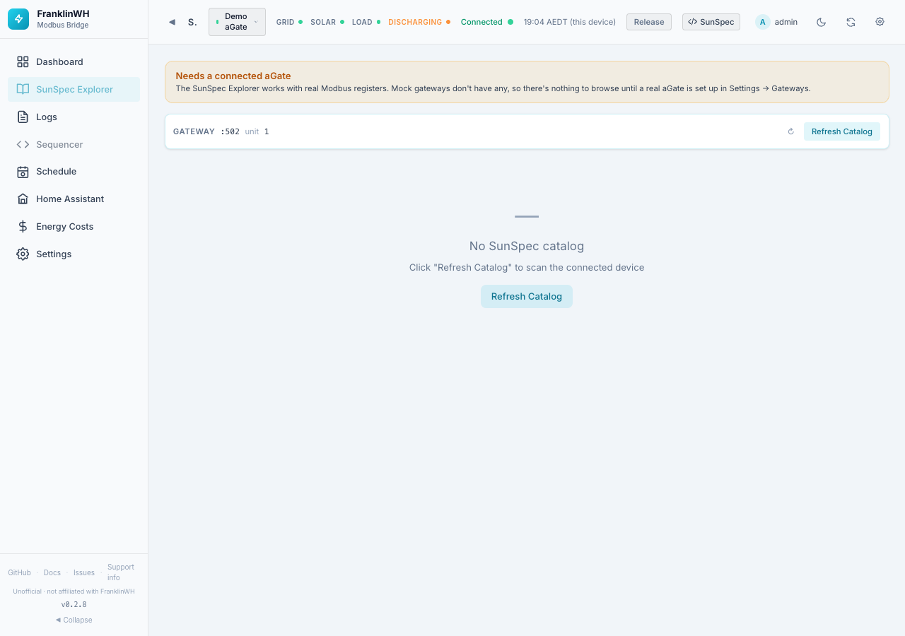

# SunSpec Explorer

The SunSpec Explorer (`?tab=explorer`) lists every SunSpec model and register the aGate
exposes, with live values. It is a tool for checking a value, reporting a bug, or
learning the aGate's registers. It only reads, apart from PICS marks that it stores in the
bridge's database.

!!! info "Off by default, and needs a real aGate"
    - On a new install the Explorer is switched off. Turn it on in
      [Settings → Admin → Feature Modules](settings-admin.md#feature-modules).
    - It needs a connected, real aGate. With only a mock or demo gateway it shows
      **Needs a connected aGate**, because a mock has no Modbus registers.

## Layout

**Connection bar** (top): the gateway's host, port and unit ID, how many models and points
were found, and:

- **↻** resets the panel sizes.
- **Refresh Catalog** scans the aGate again for its SunSpec models. Use it after a firmware
  update. If no catalog exists yet the page offers this button in the middle.

**Model tree** (left):

- **Filter models/points…** searches model names and point names.
- **Hide unpolled models (no live values)** hides models the bridge does not poll.
- Each model shows its ID, name and number of points. Click one to open it.

**Points detail** (right), for the chosen model:

| Control | What it does |
|---|---|
| **Addr: Base-0 / Base-1 / 4xxxx** | **Base-0** (the default) is the Modbus address you actually send: the aGate serves its SunSpec map starting at address 0, and FranklinWH's official SunSpec PICS lists addresses the same way. **Base-1** is the Modbus *register number*: the same register counted from 1. **4xxxx** is the legacy Modbus (Modicon) holding-register reference: 40001 = register 1 = PDU address 0. The leading 4 means *holding register* and is not part of the address; a tool that sends 40001 as the address gets exception 2 (illegal data address) from the aGate. These are Modbus terms; SunSpec only fixes where its map starts (the aGate's starts at PDU address 0). |
| **Access** | All, R (read-only) or RW (writable). |
| **PICS** | Filters by compliance mark (see below). |
| **↻** | Reads the model from the aGate now. |

If the model is not polled, a notice says **Not actively polled — no live values** with a
**⚡ Read Now** button.

Points table columns: Point, Label, Value (hover a coded value to see what each code
means), Type, Unit, Addr, Access, PICS.

### PICS marks

PICS is a compliance checklist. Click the PICS badge on a row to cycle it through:

| Mark | Meaning |
|---|---|
| U | Unimplemented (default when there is no value) |
| S | Supported (default when the point has a live value) |
| T | Tested |
| F | Failed |
| X | Not applicable |

Your marks are saved in the bridge's database, per model and point.

## Exporting models

**Export…**, at the top of the page next to **Refresh Catalog**, opens a window to export the
SunSpec map with its current values, for a GitHub issue, a Gist, or someone writing another
integration.

| Option | Choices |
|---|---|
| Models | **This model** (the one open on the right, when one is), **All models** (the default), **Displayed models** (the ones the list on the left shows after its filter and *Hide unpolled models*), or **Choose models** (click model numbers to add or remove them). |
| Format | **JSON** (with the gateway's model and firmware) or **CSV** (one row per point). |
| Addresses | Every point carries its **base-0** PDU address, its **base-1** register number and its **4xxxx** holding-register reference (`address_base0` / `address_base1` / `holding_register_4x`; three CSV columns), and the JSON has an `addressing` note explaining them. Extension registers carry only their listed address. |
| **Include FranklinWH extensions** | On by default. Adds the FranklinWH extension registers (15000–15039, 15500+, 16000+) as their own section: in JSON a `franklinwh_extensions` block whose `note` says they are **not SunSpec** (undocumented by FranklinWH, named by this bridge, some unconfirmed); in CSV, rows with Model `ext`. The file name gains `_ext`. |
| **Redact serial number** | On by default. Replaces the serial number with `<serial>`: in model 1's `SN` and anywhere else it appears, including its last 8 characters. Turn it off only if you want to share the serial. |

The preview shows exactly what you will get. The gateway's IP address and name are never
included. Then:

- **Copy** copies it.
- **Download** saves it, named for example `sunspec_all_redacted.json`.
- **Save as Gist** copies it and opens GitHub's new Gist page. Paste it, give the file the
  name shown under the preview, then choose:
    - **Create secret gist**: unlisted, so only people with the link can find it. It is not
      private: anyone with the link can read it.
    - **Create public gist**: listed on your profile and searchable.

  The bridge sends nothing to GitHub itself, and needs no GitHub account or token.

The same export is available from the REST API: `GET /api/models/export` (see the
[API reference](../../dev/api-reference.md)).

!!! warning
    Read the preview before you share it. You are responsible for what you post.

## FranklinWH Extension Registers

The bottom panel lists the FranklinWH vendor registers (15000+, 15500+, 16000+) that are
outside the SunSpec models. Click its header to show or hide it.

- **Search registers…** filters by name or description.
- **All / Identified / Unknown** shows every register, only the ones with a name (from
  FranklinWH documentation, or from site notes marked *unconfirmed*), or only the unnamed
  ones (`Reg15xxx`, description *Unknown*).
- **Hide zeros** hides registers that read 0.
- **JSON / CSV** download the list as filtered here. **Export…** at the top can also include them with the models (*Include FranklinWH extensions*).

Columns: Addr, Register, Description, Value, Hex, Type, Acc (access), Unit.

!!! warning
    Extension registers are undocumented by FranklinWH and can change with firmware.

Panel sizes are draggable, and the layout is remembered in this browser.

## Modbus reader

**Modbus reader** (admins only, at the bottom of the page) runs the franklinwh-modbus
reader against the gateway, the same tool as the library's `modbus_sunspec2_reader.py`.
It only reads.

| Option | What it does |
|---|---|
| **Raw** | A raw register read, `start:count` (base-0 PDU addresses, up to 125 registers). Buttons fill in the known blocks: `15000:40`, `15500:14`, `16000:3`. Leave empty for no raw read. |
| **Models** | Scan only these SunSpec models, e.g. `1,701-704`. |
| **Point** | Read one point, e.g. `714.DCW`. |
| **Detail** | How much the model scan prints: minimal, basic, values, detailed, full. |
| **Non-zero only** | For a raw read, show only registers that aren't 0. |
| **Match** | Look for SunSpec points whose value equals each raw register's value, to help work out what an unknown register is. It scans the models first, so it takes longer. |

The output is the reader's own text; **Copy** copies it. A register the aGate doesn't
answer shows the Modbus error rather than a blank.

While the reader runs, the bridge hands it the aGate's Modbus connection (the aGate takes
one client at a time), so polling pauses for those few seconds. It doesn't run on a demo
gateway.
