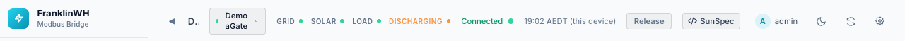
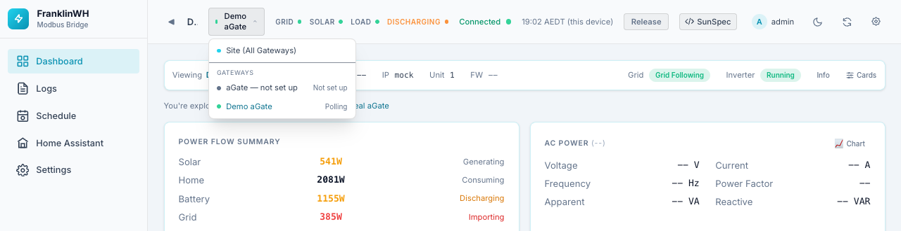
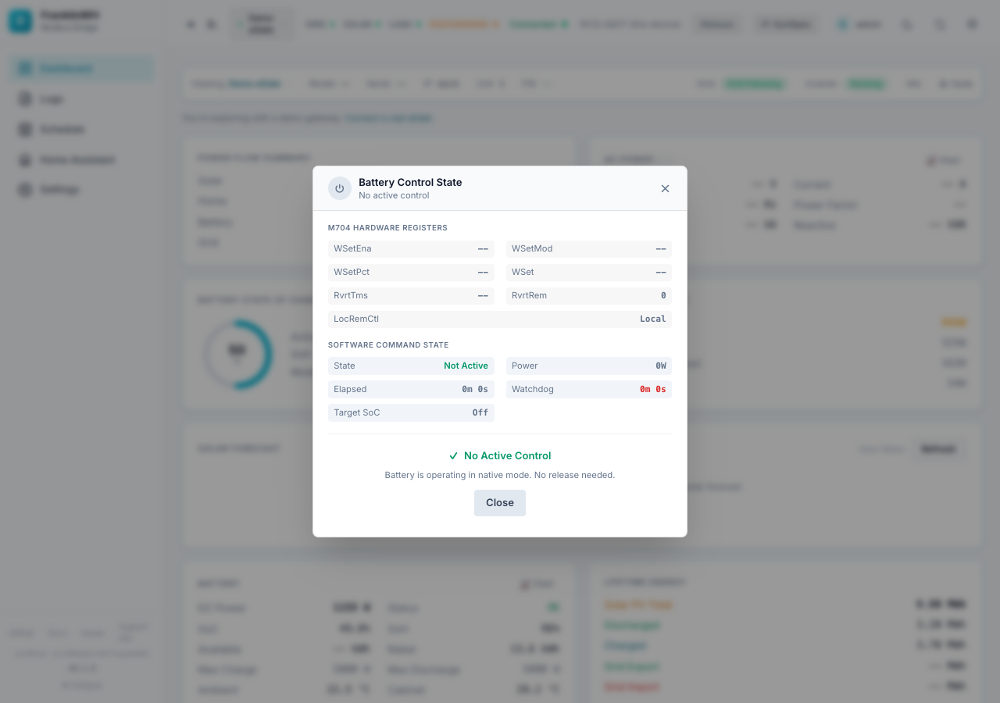
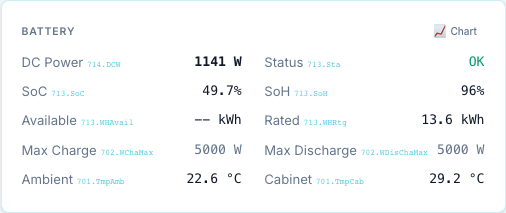
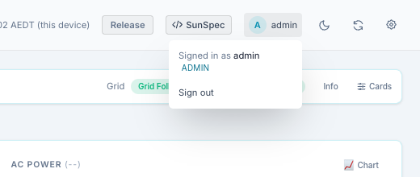
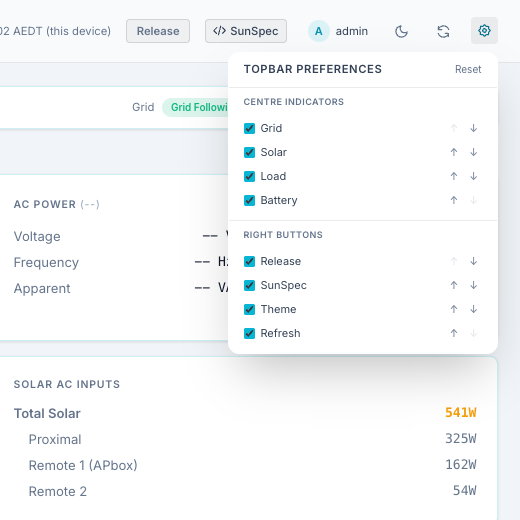

# Top bar

The top bar is on every page of the main UI.

From left to right:

| Item | What it shows or does |
|---|---|
| **◀ / ▶** | Collapses or expands the sidebar. |
| **Page title** | The page you are on. |
| **Gateway selector** | Which gateway the page shows. Only appears when there is more than one gateway. |
| **Status dots** | Grid, Solar, Load and Battery, live. |
| **Connected / Disconnected** | Whether the browser's last data request to the bridge succeeded. |
| **Quality badge** | Only appears when the data is `stale` or bad. Hidden while it is fine. |
| **Clock** | Time of the last poll, in the **bridge's** timezone. |
| **Release** | Opens the battery control state and the Force Release button. |
| **SunSpec** | Shows or hides the SunSpec source of each value. |
| **User menu** | Your name and role, and **Sign out**. |
| **Theme** | Switches dark / light. |
| **Refresh** | Fetches live data now, without waiting for the next 10-second refresh. |
| **⚙ (gear)** | Top bar preferences: which items show, and in what order. |

## Gateway selector

Shown only when the bridge has two or more gateways.

- **Site (All Gateways)** combines every gateway's data where that makes sense
  (for example, Power History is labelled *Combined*).
- Under **Gateways**, each gateway shows its name and a status: *Polling*, *Connected*,
  *Offline*, *Not set up* or *Stopped*. A gateway with no address yet is shown as
  **aGate — not set up**.

Until you pick one, the UI shows a gateway that is actually producing data. So with an
unconfigured aGate and the demo gateway, it opens on the demo. Once you pick, it stays on
your choice for the rest of the session.

The selection changes the Dashboard cards, Power History, Events and the Energy Flow card.
It does **not** change the [simple dashboard](user-dashboard.md).

## Status dots

| Dot | Green / lit when | Tooltip |
|---|---|---|
| **Grid** | The aGate reports the grid as connected | "Grid: connected / not connected". A red Grid dot means the aGate is **islanded** (off-grid). |
| **Solar** | Solar power is above 0 W | "generating / not generating" |
| **Load** | Home load is above 0 W | "consuming / none" |
| **Battery** | The label is the battery's own state: *Charging*, *Discharging* or *Standby* | — |

When you have sent a force command (from the Dashboard, the simple dashboard or a
schedule), an orange **Forced** badge appears next to the battery state. This is
different from the battery's normal charging and discharging.

On a narrow window the labels drop and only the dots remain. Each dot keeps its tooltip.

The time shows the bridge's timezone, for example `20:18 NZDT`. If your device is in a
different timezone, a second labelled line gives your local time too.

## Release

The **Release** button gets a red dot when a battery command is active. Click it to see the
control state, read straight from the aGate and from the bridge.

**M704 Hardware Registers** (the aGate's own control registers):

| Field | Meaning |
|---|---|
| `WSetEna` | Power setpoint enabled (1) or not (0). |
| `WSetMod` | Setpoint mode. |
| `WSetPct` | Setpoint as a percentage of the aGate's rating (hover for the raw register). |
| `WSet` | Setpoint in watts. |
| `RvrtTms` | Hardware revert timer: how long the setpoint lasts before the aGate drops it. |
| `RvrtRem` | Time left on the hardware revert timer. |
| `LocRemCtl` | Local or remote control. |

**Software Command State** (what the bridge has commanded):

| Field | Meaning |
|---|---|
| State | *Not Active*, *Force Charge*, *Force Discharge* or *Force Standby*. |
| Power | Commanded power in watts. |
| Elapsed | How long the command has run. |
| Watchdog | Time left before the bridge stops the command. *No limit* means it runs until released or until the target SoC. |
| Target SoC | The SoC that ends the command, or *Off*. |

If there is active control, **Force Release** zeroes `WSetPct` and `WSet`, disables
`WSetEna`, clears the revert timer and stops any dispatch. The aGate returns to its own
(native) mode. If nothing is active, the dialog says **No Active Control** and offers only
**Close**.

!!! warning
    Force Release stops a dispatch that a schedule started too. The schedule may start it
    again at its next evaluation if its conditions still hold.

## SunSpec button

Turns on small grey labels next to values, showing where each one comes from: a SunSpec
`model.point` (for example `713.SoC`) or a FranklinWH extension register (`ext.15508`).
Useful when you compare the UI with the [SunSpec Explorer](sunspec-explorer.md) or report a
wrong value. The setting is stored in this browser.

## User menu

Shows who is signed in and their role. **Sign out** ends this login.

## Top bar preferences

The gear opens **Topbar Preferences**:

- **Centre Indicators**: Grid, Solar, Load, Battery.
- **Right Buttons**: Release, SunSpec, Theme, Refresh.

Untick an item to hide it. Use **↑ / ↓** to change the order. **Reset** restores the
defaults (everything shown, in the order above). These preferences are stored in this
browser only.
