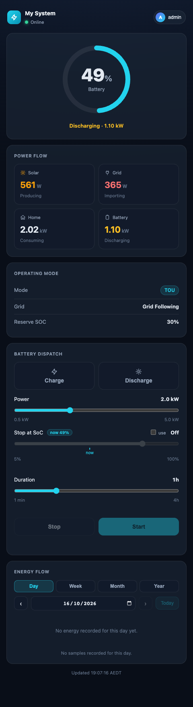

# Simple dashboard (/user)

`/user` is a single, phone-sized page for the people who live with the battery. It shows
the essentials and, for the `user` role, lets them start a charge or discharge.

- Accounts with the **`user`** or **`viewer`** role always land here. They cannot open the
  main UI.
- **Admins** can open it to see what household members see. Its user menu has an
  **Admin view** link back to the main UI.
- It always uses the **dark** theme.
- It refreshes on its own and needs no setup.

<figure markdown>
{ width="380" }
</figure>

## Cards

| Card | Shows |
|---|---|
| **Top bar** | The site name (from Energy & Automation → Site Name), *Online* / *Offline*, and the user menu (**Sign out**). |
| **Battery ring** | SoC, and whether the battery is charging or discharging and at what power. |
| **Power Flow** | Solar, Grid, Home and Battery in kW, each with its state (*Producing*, *Importing*, *Exporting*, *Consuming*, *Charging*, *Discharging*, *Idle*). Below 25 W counts as idle. |
| **Operating Mode** | The aGate's mode, the grid state, and the reserve SoC of the active mode. |
| **Battery Dispatch** | Only for roles that may send commands (`user`, `admin`). See below. |
| **Energy Flow** | The same Sankey diagram as the Dashboard, with Day / Week / Month / Year and a date picker. |
| **Today** | Solar produced, grid imported and exported, battery charged and discharged, for the chosen day. |
| **Lifetime** | The aGate's lifetime counters for the same five figures. |

The footer gives the update time in the bridge's timezone.

## Battery Dispatch

1. Pick **Charge** or **Discharge** (click again to unselect).
2. Set **Power**: 0.5 kW up to the gateway's trusted battery rating.
3. Optionally tick **use** next to **Stop at SoC** and set a target (5–100 %). The current
   SoC is marked on the slider. If the battery is already past the target in that
   direction, a warning says the target won't stop it.
4. Set **Duration**: 1 minute to 4 hours. With a target set, duration is the backstop:
   whichever comes first ends the dispatch.
5. Press **Start**. **Stop** releases it and hands control back to the aGate.

!!! info "Needs a trusted battery rating"
    **Start** stays disabled until the gateway's battery power rating is trusted. The card
    then says *"Battery power not calibrated yet — ask the bridge admin to calibrate it"*.
    The admin does this in
    [Settings → Site & Gateways → Battery power rating](settings-site-gateways.md#battery-power-rating).

!!! warning "Primary gateway only"
    Battery Dispatch always commands the primary gateway (ID `default`). On a bridge where
    the primary aGate is not set up (for example, demo only), the page can show readings
    from another gateway while its controls have nothing to command.

A `viewer` sees everything except Battery Dispatch.
